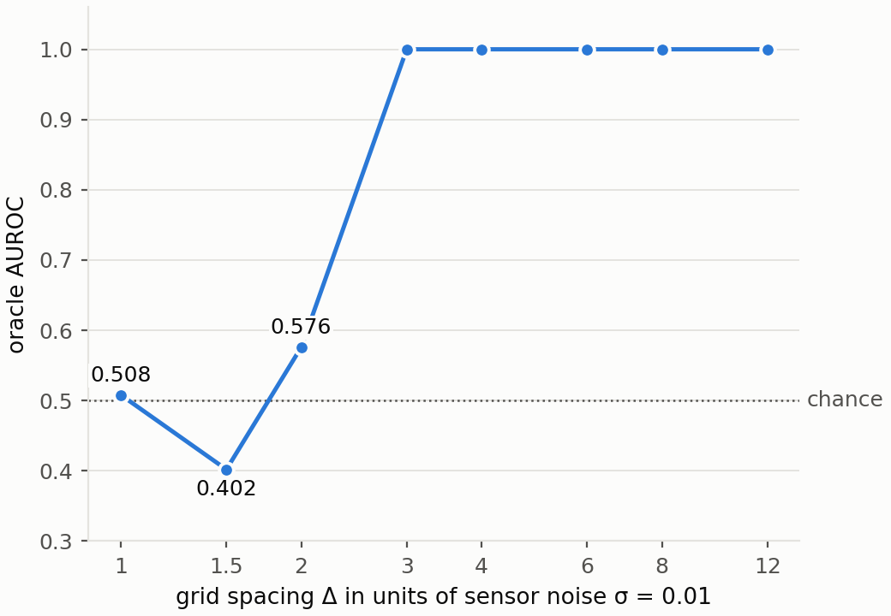
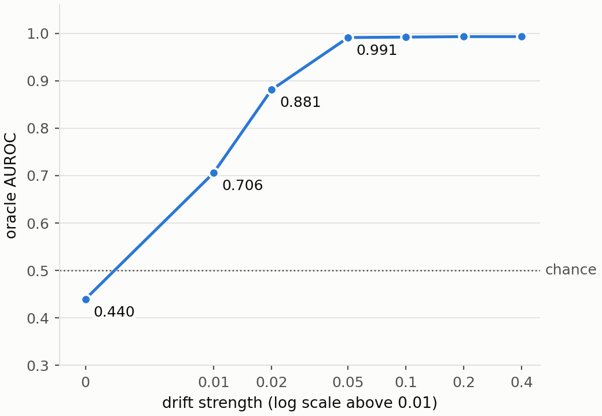
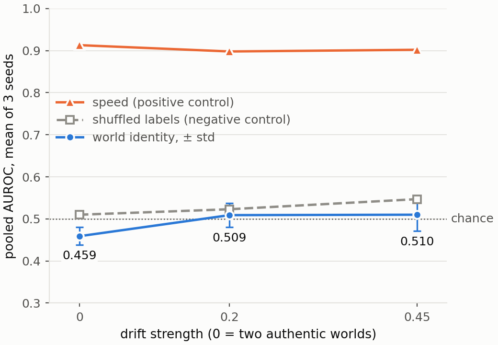
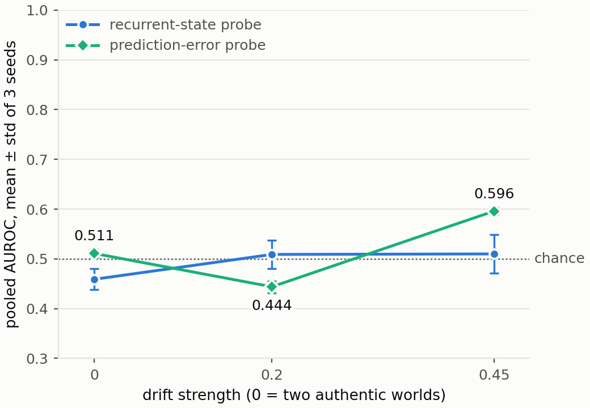
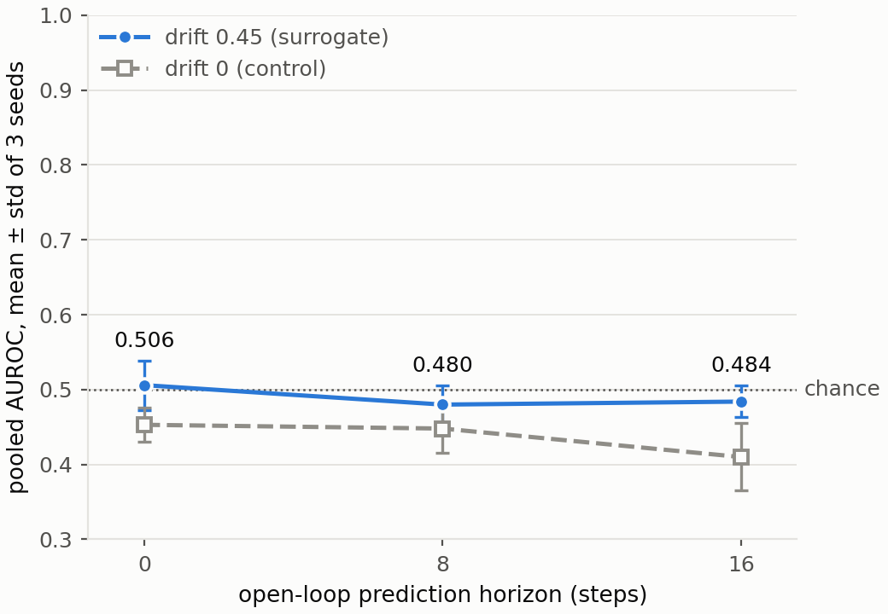

# ITASORL: Findings to Date

*Empirical results from the first build-and-test cycle. This document records what
was run and what was found; the research plan lives in `ITASORL.md` and the world
in `ITASORL_world_spec.md`.*

*Section numbers are stable identifiers: frozen pre-registration documents cite
them, so result sections are appended, never renumbered. (The one exception: the
reproducibility appendix, cited nowhere frozen, moved from 8 to 12 to restore
reading order; there is deliberately no section 8.)*

---

> **Revision 2026-10 (read first).** Every survival-trained result below was produced by
> a trainer whose GAE bootstrap read the critic value before an episode's final
> transition. The trainer is corrected (`docs/CORRECTIONS.md`), the historical numbers
> stay as recorded and are labeled by implementation in `docs/RESULTS_MANIFEST.md`, and
> the corrected confirmation runs, with readouts on their agents, are in section 17 (summary
> in 17.12). Claim wording is narrowed
> throughout to what each estimator measured: below-bar results "did not meet the
> registered encoding criterion"; behavior and sensory controls name their basis and
> model; the common garden shows that prefix condition "remains decodable after
> restoring authentic dynamics", not internal memory; the texture knockout shows that
> the original direction does not transfer; Experiment C has a flat contrast under both of
> its readouts and an uninformative registered verdict (13.F). Gates under both fold
> partitions: `docs/GATE_TABLE.md`.
> Margin intervals: `docs/CONTRAST_INTERVALS.md`. What each arm experienced:
> `docs/METHODS_ARMS.md`.

## TL;DR

A from-scratch agent, never paid to look, lives in a world that is either the real
program or a copy with one substrate flaw. Whether its recurrent state separates the two
is read out afterward with a probe, and nothing in training names the condition.

**Status of the numbers.** The two primary comparisons were rerun with the corrected
trainer (banner above; section 17), and the corrected numbers lead this summary. Every
other survival-trained number is historical, labeled as such, and kept as recorded.
*(Note 2026-10-11: the second capacity and the two further fingerprint instances have since been
rerun with the corrected trainer (section 20). The hidden 7 rerun is off-design, because its
gate 0 fails on the untrained floor; the hidden 8 seed 2 rerun is uninformative, on one
speed-control pool and the L0 gate; the hidden 10 seed 1 rerun reads 0.626 [0.598, 0.654],
under the bar, with both margins passing. The historical rows keep their labels.)*
*(Note 2026-10-16: the L1 organism run has also been rerun on the corrected trainer (22.1). It
reads 0.551 [0.531, 0.570], 0 of 10 seeds at 0.65, against 0.552 for the historical run on the
same partition, so the L1 negative below does not depend on the trainer defect. The matched-world
confirmation, `B1` and `B2`, ran on the corrected trainer and is UNINFORMATIVE, because the
untrained arm reads 0.614 (section 21).)*

**Hand-authored flaws (L1, L2) did not meet the encoding criterion** (H_B2, registered for L2
and applied to L1 after its run; `docs/CORRECTIONS.md`, 2026-10-16). A
detector that knows the true rules finds the L2 drifting coefficient almost perfectly from
nearly noiseless inputs (AUROC ≈ 0.99 in Experiment A's diagnostic configuration), yet the
prediction-only agent's state stays near chance across readout channels (sections 3, 4;
its world model received each action one step late, so that arm was a weaker predictor than
designed, `docs/CORRECTIONS.md` 2026-10-16; retrained with correct action timing it reads 0.544
at drift 0.45 against 0.517 for the one-step-late timing on the same machine, both inside the
recorded row's interval, so the negative stands with correct timing, note of 2026-10-19 in
section 3),
and the survival-coupled variant reaches 0.610 against the 0.65 bar (section 7.1; the B-v2 arc
in section 9 reads 0.523). Given the
L3 gate's input noise, the same detector reads the L2 flaws at 0.62 to 0.65 on one noise draw,
and at 0.60 and 0.50 averaged over eight (section 15),
so L2 was the weaker flaw. The detectability-matched contrast is L1: at an in-band
observation-quantization grid (Δ = 0.023, detector 0.873) the survival agent's pooled
target on the corrected trainer is **0.551 [0.531, 0.570]**, with 0 of 10 seeds at 0.65 (22.1);
on the historical trainer, as first recorded, the pooled target is 0.533, with 0 of 10 seeds at
0.65 (section 14.7).
*(Note 2026-10-19: the same state readout registers the seam at the supra-band grid Δ = 0.06,
where the detector reads 1.000: there the untrained arm reads 0.672 [0.640, 0.704], so the L1
negative is a negative at the in-band grid and not an insensitivity of the readout to this class
of seam. Survival minus untrained at Δ = 0.06 is -0.029 [-0.062, +0.005], so what registers the
seam there is the readout on an untrained trunk, not a survival-specific encoding (22.1, note of
2026-10-19).)*
*(Note 2026-10-16: for L1 the criterion is H_B2, frozen on 2026-06-28 for the L2 run and
applied unchanged to the historical L1 run after it ran. No L1 rule was registered before that
run, and its code was first committed together with its result. `docs/CORRECTIONS.md`,
2026-10-16.)*

**A learned-law flaw (L3) met its decodability clauses at 0.733 under one training protocol
(corrected, section 17); the registered rule as a whole is not met, because the L0 gate is
open on the registered world pair (0.559).**
Survival training with the next-observation auxiliary, 300 updates, ten seeds, against a
gate-calibrated fingerprint (privileged detector 0.928 at detector-side noise σ = 0.02): the
survival state decodes the world at **0.733** (t-based 90% CI [0.669, 0.797]), against 0.589 for
the predictor arm and 0.523 untrained, with paired margins of +0.144 and +0.210 whose intervals
clear 0.05. The lead over the predictor is a difference between training regimes: fed the survival
agent's own streams, a prediction-trained trunk reads 0.721, and a decoder of the observation and
action stream alone reads 0.724 (17.6, 17.8). The L0 gate is open on the registered world-sample
pair (0.559), the largest of nine draws on record. Across eight independent pairs the absolute
deviation from chance averages 0.037, and a TOST over the eight signed pair means (0.493 on
average, sd 0.049) accepts equivalence to chance (p = 0.022) (signed pair means; folded about 0.5
the same eight draws give p = 0.129, not equivalent). That TOST is a diagnostic added with the
artifact and not named in the frozen spec, so it is a reading, not a pass. The gate accepts on two
pairs individually. On a second seed set (`B1`, seeds 10 to 19, corrected trainer) the drift-0
survival agents read 0.561 [0.527, 0.595] on the same registered pair (TOST p 0.717), so the open
gate repeats there (section 21). On the agents of the historical hidden-8 run at drift 0.45, all
eight independent draws clear the bar (0.728 to 0.860; the registered draw's 0.774 ranks 5 of 9),
SECURE under a rule frozen before the run. The registered verdict is therefore NOT MET, because
the L0 gate is open; the decodability clauses are met. Without the auxiliary the survival state
reads **0.613** [0.552, 0.675], not met; the decoder adds **+0.120** [+0.065, +0.174]. The
registered auxiliary rule asks `C1` to meet its primary rule, so it is NOT MET as registered; the
lead holds on the decodability clauses (added 2026-10-10, 17.4). The correction itself moved the
two drift-0.45 readings by +0.003 and +0.012.

What the corrected agents show about that result:

- **The trajectories carry it, and a prediction-trained trunk keeps it.** Fed the survival
  agent's own observation streams, a trunk trained only to predict reads the world at 0.721,
  and one trained on exactly the survival agent's experience at 0.738, against 0.733 for the
  survival trunk; both sit within about 0.01 of it. Under one scripted policy every arm reads
  0.55 to 0.58 (17.6). The survival-over-predictor margin is a difference between training regimes, not of
  objective at matched input; "survival-specific" is withdrawn.
- **Budget.** Decodability rises with training. Without the decoder the arm reaches 0.685
  at 450 updates; at that budget the decoder arm reads 0.821, and the return interval is too
  wide to show the two arms forage equally (17.10).
- **Controls.** After the per-timestep behavior control 0.723 remains; the nonlinear control
  over observations, actions, and behavior, which fits best in the fixed-penalty battery,
  leaves 0.620, under the bar.
  A decoder of the observation and action stream reads 0.724, and summary features of the
  observation trace alone read 0.715 (17.8).
- **Memory.** Under identical input the prefix condition fades within a few steps; with the
  recurrent state zeroed, the physical footprint of the prefix still reads 0.662 (17.7).
- **Learnedness.** A hand-authored, temporally coherent drag of the same one-step size as
  the Gaussian comparator is read through the original direction (0.721) and by a fresh
  probe (0.754, against an untrained floor of 0.612 that sits outside the gate-0 tolerance,
  margins +0.109 and +0.142); white jitter is read by no arm (17.9). *(Note 2026-10-16: autocorrelated
  jitter does not reach the bar either, at matched one-step size, at matched stationary offset, or at a
  matched 24-step deviation, where coherence did not raise the margin (22.3; with the gaps matched
  exactly the contrast misses the 0.05 equivalence band by 0.001). What the
  drag shares with the learned law is that its deviation depends on the agent's own velocity; no
  mechanism is claimed.)*

The historical record of the same arc (pre-correction trainer, kept as recorded): survival
**0.752** [0.698, 0.807] on GPU and 0.730 on CPU; 0.726 after the behavior control (10.4),
0.731 after the sensory control (10.4.2); 0.601 without the auxiliary (10.8) and 0.717
without it at 450 updates with a failed skill match (10.8.1); a second capacity keeps the
residual (0.722) but not the predictor margin (10.5); an independently trained fingerprint
keeps the margin under the bar (0.639; 10.9). L0 reads 0.517 under the original fold
partition and 0.539 under the explicit one (section 16; `docs/GATE_TABLE.md`).

The follow-ups, read narrowly:

- **Graded seam.** Blending the learned law back toward the authentic one lowers decoding
  step by step to chance (0.506 at the authentic end; section 14). Decoding depends on the
  size of the dynamics difference, which 17.9 shows need not be learned.
- **Transfer.** The direction reads a capacity variant of the same recipe (0.773; same data
  and seed, 10.6) and a random-Fourier-features law fit on the same data (0.684, t-based
  lower bound 0.654; 10.7). The reverse direction misses the bar (0.638). On the corrected
  agents it also reads the hand-authored drag (17.9).
- **Common garden.** Tail-only states still separate the prefix condition (0.666 forward,
  0.684 reverse; 10.6.1). Prefix condition remains decodable after restoring authentic
  dynamics, and on the corrected agents mostly through the physical footprint (17.7).
- **Matched worlds.** A confirmation frozen before it ran (`B1` survival, `B2` pellets with
  death off; seeds 10 to 19, corrected trainer) reads 0.800 and 0.843 on matched world pairs,
  and both runs are UNINFORMATIVE: the untrained arm reads 0.614, outside the 0.1 floor. A
  sensory-echo control frozen after those raw outcomes leaves 0.761 and 0.780, with the untrained
  arm at 0.596 [0.577, 0.615] (section 21). The original pellet run's 0.796 was recorded with a
  leakage gate on the homeostatic reward, so its full-rule validity was not established (18.7).
- **Experiment C.** The contrast is flat and the registered verdict is uninformative
  (13.F). Selection over 30 generations did not raise world decodability under the pooled
  population readout (contrast -0.002 [-0.013, +0.009]; 13.D) or under the per-individual
  readout (final treatment means 0.534 to 0.539, no individual at 0.65; 13.F). The speed
  positive control (gate 5) fails, and the preregistration interprets no contrast unless every
  gate passes, so the verdict is uninformative, not a null. Exploitability (gate 1) is a weak
  positive under the frozen wording and falls short only of a 0.005 margin that an
  unratified draft amendment sets (13.F, second note of 2026-10-10). The pooled readout
  reads 0.609 where independent known-decodable individuals average 0.649 (regrouped by world
  seed on 2026-10-19 it reads 0.617), so it is attenuated rather than blind (17.11).

---

## 1. What was tested

The design rests on three invariants: **tabula rasa** (no imported semantics),
**readout-not-reward** (world identity is probed, never trained or rewarded), and
**substrate-grounded** (the only tells are artifacts of the computational
substrate). Detection is measured against a **surrogate ladder**:

| Rung | Nature of the artifact | Status |
|------|------------------------|--------|
| L0 | Identical re-implementation (control, must be at chance) | tested |
| L1 | Observation discretization (a lattice / quantization tell) | tested (survival did not meet the encoding criterion registered for L2 (H_B2), applied unchanged, at in-band Δ=0.023: 0.551 [0.531, 0.570] on the corrected trainer, 0 of 10 seeds at 0.65 (section 22.1); 0.533 as first recorded on the historical trainer (section 14.7)) |
| L2 | Rollout drift (a slowly drifting dynamics coefficient) | tested |
| L3 | Learned world-model surrogate (a generative fingerprint) | tested. Corrected trainer (section 17): `C1` **0.733** [0.669, 0.797] met the decodability clauses, and the L0 authentic-versus-authentic gate is **open** on the registered world pair (0.559, TOST p 0.939), while across eight independent pairs a test on the signed pair means accepts equivalence to chance (TOST over pairs p 0.022; folded about 0.5 the same eight draws give p = 0.129, not equivalent), with the gate accepting on two of the eight draws individually (17.5); the behavior and sensory control that fits best in the fixed-penalty battery leaves **0.620**, under the bar (17.8 and its 2026-10-16 note); at matched input a prediction-trained trunk reads the same streams within about 0.01 of the survival trunk (17.6); the common-garden tail is carried mostly by the prefix's physical footprint, and retention under identical input is not shown (17.7). Historical trainer, as recorded: (positive at the registered 300-update budget with the next-observation auxiliary, n=10; reward/survivorship-controlled; 0.726 remains after the four-channel behavior control; held-out probe: capacity-variant transfer positive (0.773; same recipe and data, see the 10.6 scope note); cross-recipe probe carries the generalization claim (different surrogate family, 0.684, rule passes); the re-scored common-garden control passes the frozen rule on both directions (forward 0.666, reverse 0.684), so prefix condition remains decodable after restoring authentic dynamics (section 10.6.1); section 10) |
| L4 | Adversarially-hardened surrogate | not started |

Three experiments were planned. This cycle completed Experiment A for L1 and L2
(and later the L3 oracle gate, section 10.1), the first full arc of Experiment B,
the survival-coupled B-v2/B-v3 arc (sections 9 and 7.1), and the L3 arc (section 10).
Experiment C (emergence under selection) has run its first pilot; the recorded
null was **invalidated by two since-fixed measurement bugs** (see the correction
in section 13.C). The re-run on fixed code (section 13.D) and a rerun with the
per-individual readout and the full gate battery (section 13.F) both show a flat
contrast: selection did not raise world-condition decodability under either readout.
The speed positive control fails, and the preregistration interprets no contrast unless
every gate passes, so the registered verdict is **uninformative**, not a null (section 13.F).
Exploitability is a weak positive under the frozen wording and fails only against the
margin of an unratified draft amendment.

The world is **"A Patch of Earth" v0**, a 2.5D, deterministic, dissipative,
Earth-*like* (authored, not data-driven) environment with a ~146-dimensional
observation (vision raycasts + interoception; smell masked in the first config).
As implemented in v0 there are no weather or PDE fields (the weather seed stream is
drawn but unused and `_update_fields` is a no-op), the arena is a closed unit square
whose walls clip position and zero the outward velocity component (not a torus), and
drag is a constant 1.5 in world P. Dissipation damps velocity; it does not by itself
rule out sensitive dependence on initial conditions. Methods note 10 lists the
implemented world.

---

## 2. Experiment A: the detectability ceiling (agent-free)

*(All section-2 numbers are committed in `artifacts/expA/summary.json`,
promoted from the recorded `fullruns/06302026` e2e bundle by
`scripts/promote_ab_summaries.py`.)*

*(Figure provenance, noted 2026-10-10. Until 2026-10-10 the four figures in sections 2 and 3
(`figures/expA_ceiling.png`, `figures/expA_L2_ceiling.png`, `figures/expB_incidental.png`,
`figures/expB_channels.png`) were the images committed on 2026-06-28, drawn on the owner's
local stack. The later local quick-mode run `fullruns/07042026` (commit `888eb3e`, RTX 4050
laptop GPU) reproduces them byte for byte. The numbers in the text and tables of both
sections come from the promoted run `fullruns/06302026` (commit `4c16be6`, Tesla T4). The
plotted and quoted values differ at every point that is not saturated, and the largest gap
is 0.055, at the L1 calibration point delta 0.015 (0.457 plotted, 0.402 recorded). Quick
mode shortens only the B-v2 step, so the gap comes from the different run and stack. The
figures are now redrawn from the committed artifacts by `scripts/plot_record_figures.py`, so
they plot the numbers quoted here; `docs/figures/README.md` and `docs/CORRECTIONS.md`,
2026-10-10.)*

**Method.** An external discriminator on full trajectory logs, run *before* any
agent exists, to (a) measure how detectable each rung is and (b) prove the signal
is not riding on a confound. Trajectories are generated in **matched pairs** (a
shared prefix is snapshotted, then continued once authentically and once through
the surrogate from byte-identical state), so authentic and surrogate differ only
by the artifact. The **unit of inference is the pair**, never the timestep
(grouped cross-validation). A **leakage-audit battery** trains the same
classifier on nuisance channels (reward, episode length, metadata); these *must*
stay at chance, or the result is contaminated. (Scope note: in this matched-pair
design several nuisance channels are bit-identical across the two classes *by
construction* - all three at L1/L0, and length/metadata at L2 - so their clean
0.500s are design guarantees, not empirical findings; the one live empirical
leakage test at L2 is the reward channel, and the injected-contamination check
below is what demonstrates the battery can actually fire.)

### 2.1 L1: observation discretization

The detector uses the per-dimension residual against the candidate grid; with a
realistic sensor-noise floor (σ = 0.01) the tell is meaningful rather than a
trivial exact-grid giveaway.

- **Control (L0, identical):** oracle AUROC **0.523** (chance); leakage all 0.500 → **PASS**.
- **L1 (grid Δ = 0.06):** oracle AUROC **1.000**; leakage all 0.500 → **PASS**. The signal is entirely in the substrate observation; nothing leaks.
- **Contamination test:** injecting a +0.02 reward offset into the surrogate drives the reward-leakage baseline to **0.982** → gate **FAILS**, as it should. The audit has teeth.
- **Difficulty calibration:** detection is saturated while the grid is coarser than ≈ 3σ and collapses to chance by ≈ 2σ, exactly the expectation that a grid finer than the noise is invisible.

### 2.2 L2: rollout drift

L2 alters the *dynamics* (the drag coefficient follows a slow AR(1) random walk),
so detection is invariant-based: the oracle re-applies the exact authentic
one-step motion law to the (noisy) logged velocity and measures the residual. A
tamed config (high uniform drag, gravity off, straight-line motion, central
start) isolates the drift signal; measurement noise (σ = 2×10⁻⁴) provides the
floor.

- **Control (drift = 0, identical dynamics):** oracle AUROC **0.440** (chance); leakage all 0.500 → **PASS**.
- **L2 (drift_sigma = 0.30):** oracle AUROC **0.993**; leakage ≈ 0.5 → **PASS**.
- **Contamination test:** reward-leakage rises to **1.000** → gate **FAILS** correctly.
- **Difficulty calibration:** 0.00 → 0.44, 0.01 → 0.71, 0.02 → 0.88, 0.05 → 0.99, plateau ≈ 0.99. Drift is detectable from ≈ 0.02 and saturates by ≈ 0.05.

**Methodological note.** For dynamics-altering rungs like L2, reward can be a
*legitimate downstream* consequence of the artifact (different dynamics → different
foraging), so reward is not a clean nuisance channel in general. In the tamed
no-foraging config used here it stayed at chance, but for a foraging agent the
leakage audit must be read with this in mind.

---

## 3. Experiment B: incidental detection (the headline)

*(Section-3 numbers are committed in `artifacts/expB/summary.json`,
promoted from the recorded `fullruns/06302026` e2e bundle plus the 2026-07-13
k-step rerun log by `scripts/promote_ab_summaries.py` - with one exception: the
3.4 engagement figures, see the 2026-07-18 correction note there. The two figures of this
section were drawn from a different run until 2026-10-10; see the figure provenance note at
the head of section 2.)*

*(Note 2026-10-16, after the critical review: the world model of 3.1 to 3.4 received each
action one step late. `experiment_b.collect_episodes` records each observation after the step
that produced it, and `RecurrentWorldModel` scores its prediction from the pair (O[t], A[t])
against O[t+1], which A[t+1] produces, so every next observation is predicted without the
action that causes it. `forward_rollout`, the open-loop path of 3.3 and 3.4, pairs them the same
way. The prediction-only arm was therefore a weaker predictor than designed. The
prediction-error channel of 3.2 and the open-loop horizons of 3.3 are the most exposed; the
state probe of 3.1 still saw the full observation and action history. The effect on any number
here was not measured at the time (it is measured in the 2026-10-19 note below), and every
number and verdict stays as recorded. `docs/CORRECTIONS.md`, 2026-10-16.)*

*(Note 2026-10-19: Experiment B was retrained on this machine under both alignments, three seeds
each, with no actor-critic and no saved agent (`docs/specs/2026-10-17-closing-readouts-design.md`,
section "C1. Experiment B, the L2 prediction-only arm with correct action timing"; commit
`75ce098`; JSON only, `artifacts/expB_legacy_local_2026-10-18/` and
`artifacts/expB_aligned_2026-10-18/`). Integrity passed: every script wrote its JSON, the stored
figures were untouched, and the local one-step-late (legacy) drift-0.45 state target,
0.517 ± 0.056, lies inside the recorded row's 90% interval [0.429, 0.591] around 0.510 ± 0.039. The spec
printed that interval's lower end as 0.430; its own formula gives 0.42948, a rounding slip that
moves no label. Label: RESTORE. With correct timing the prediction-only state reads 0.544 ± 0.037
at drift 0.45, inside the same interval, so the negative stands with correct timing. Legacy then
aligned, beside the recorded values: prediction-error AUROC 0.596 ± 0.004 and 0.599 ± 0.007
(recorded 0.596 ± 0.007); open-loop horizons 0, 8 and 16 read 0.506 / 0.465 / 0.476 and
0.496 / 0.460 / 0.449 (recorded 0.48 to 0.51); random-forest probe 0.486 ± 0.034 and
0.459 ± 0.015 (recorded 0.482 ± 0.031). Aligned minus legacy on the state target, paired over three seeds,
is +0.027 [-0.074, +0.129]. Both alignments were retrained here, so the contrast is between two
local runs; aligned against the stored rows is not used. Values are means ± population SD over
three seeds, as in the tables below, which stay as recorded.)*

**The apparatus.** A compact recurrent world model (RSSM-lite: encoder → GRU →
next-observation decoder) trained **only** to predict its own sensory stream. It
is never told which world it inhabits and never rewarded for world identity. Its
recurrent state `h_t` is the object we probe. A full Dreamer-style agent would add
a survival-trained actor-critic; this self-supervised world model is the natural
first rung and isolates the probe pipeline, which accepts the actor-critic
unchanged.

Each run uses three probes, with the **episode** as the unit of inference:

- **target**: decode world identity from `h_t` (the H4 claim);
- **shuffled**: decode a randomized world label (negative control);
- **speed**: decode above/below-median speed (positive control: states *are* probeable).

The artifact is L2 drift (not L1), deliberately: a probe reading identity from a
dynamics artifact cannot be dismissed as "it is just detecting that the inputs are
quantized."

### 3.1 Recurrent-state probe (one-step world model)

| drift_sigma | target | shuffled | speed (+ctrl) |
|-------------|--------|----------|---------------|
| 0.00 (control) | 0.459 ± 0.021 | 0.510 ± 0.113 | 0.913 ± 0.023 |
| 0.20 | 0.509 ± 0.028 | 0.523 ± 0.069 | 0.898 ± 0.021 |
| 0.45 | 0.510 ± 0.039 | 0.547 ± 0.058 | 0.902 ± 0.008 |

*(Three cells corrected 2026-10-10 to the committed artifact and the run log they were
promoted from: the drift-0 target had read 0.460, and the shuffled column 0.522 at 0.20 and
0.548 ± 0.059 at 0.45. The means come from `artifacts/expB/summary.json`; the shuffled
standard deviations, which the artifact does not store, come from
`fullruns/06302026/steps/expB_full.log`. `docs/CORRECTIONS.md`, 2026-10-10.)*

The target sits at chance even at strong drift, while the positive control reads
speed at ≈ 0.90 and the drift = 0 control is clean. The apparatus works; the agent
simply did not encode world identity.

### 3.2 Prediction-error (surprise) channel

A world model trained on **authentic episodes only** should be measurably
surprised when the dynamics drift. We probe authentic-vs-surrogate from the
agent's per-episode prediction error.

| drift_sigma | surprise-probe AUROC |
|-------------|----------------------|
| 0.00 (control) | 0.511 ± 0.008 |
| 0.20 | 0.444 ± 0.012 |
| 0.45 | 0.596 ± 0.007 |

A faint, *reliable* signal at the strongest drift (0.596, tight error bars), but
nowhere near the oracle's 0.99.

### 3.3 Longer-horizon (open-loop k-step) objective

To test whether the null is caused by the *locality* of one-step prediction, the
world model was retrained to imagine forward open-loop: after a context window it
must predict future observations from its recurrent state on actions alone (no new
observations). If locality were the cause, the target should lift as the horizon
grows.

| open-loop horizon | target (drift 0.45) | target (control) |
|-------------------|---------------------|-------------------|
| 0 (pure next-step) | 0.506 ± 0.033 | 0.453 ± 0.023 |
| 8 | 0.480 ± 0.026 | 0.448 ± 0.032 |
| 16 | 0.484 ± 0.021 | 0.410 ± 0.045 |

No liftoff. The target stays at chance across all horizons; the control stays
flat (the horizon-16 control dips slightly below chance, within its error bar
at n = 3 seeds).

*Correction (2026-07-13).* An earlier version of this table quoted numbers from
the original pre-refactor run (0.516/0.523/0.490 drift; 0.465/0.444/0.468
control). When the open-loop rollout API was later reimplemented (the original
script depended on an API that had been committed but not implemented) all
figures were regenerated, but this table was not, so the published figure and
table came from different runs. Both now come from a single recorded rerun of
`scripts/run_expB_kstep.py` on the current code (log:
`fullruns/kstep_rerun_20260713.log`); the rerun is deterministic (a repeat
reproduces it exactly). The qualitative conclusion is unchanged in every
version: no liftoff at any horizon.

### 3.4 The null is robust (engagement and probe checks)

Two checks confirm the negative result is not an artifact of a weak objective or a
weak probe.

**The open-loop objective genuinely engaged.** The absolute-observation rollout
model (horizon 16) reaches an open-loop prediction MSE of **0.52**, well below both
a mean-predictor baseline (0.89) and a persistence baseline (1.35); it really does
predict the imagined future, yet its recurrent state still does not encode world
identity. (A delta-prediction variant, which predicts the observation *change*
where the drag drift most directly lives, only marginally beat its own baseline,
1.07×, and also showed nothing; it is the less informative of the two, precisely
because it under-engaged.)

> **CORRECTION NOTE (2026-07-18, methodology audit).** The specific figures in
> the paragraph above (0.52 / 0.89 / 1.35 / 1.07×) predate the promotion
> pipeline and cannot be tied to a recorded run: the committed artifact stores
> `open_loop_mse: 0.657` for the promoted `fullruns/06302026` bundle and no
> baseline values at all, because `results_io.py`'s gap-step parser captures
> only the MSE line and drops the printed baselines. The qualitative
> adjudication - the objective engaged (`open_loop_engaged: true`, committed and
> gate-checked) - stands; the specific magnitudes above should be treated as
> unverified until the gap step is re-promoted with a parser that captures the
> baselines. Two scope caveats recorded at the same time: the engagement MSE is
> computed on the model's own training episodes (an "objective engaged during
> training" check, not held-out prediction skill), and this correction changes
> no verdict.

**A nonlinear probe finds nothing either.** Replacing the linear probe with a
random forest on the same recurrent states leaves the target at chance
(**0.460 ± 0.009** control and **0.482 ± 0.031** drift 0.45), while the positive
control (speed) stays high at ≈ 0.87 to 0.89. World identity is encoded neither
linearly nor nonlinearly, even though speed plainly is.

*(Corrected 2026-10-10: the control mean had read 0.459, the linear probe's drift-0 value
from 3.1. The random-forest value is 0.460 ± 0.009 in `artifacts/expB/summary.json`
(`expB_nonlinear`) and in the run log. The speed standard deviations in the 3.1 table, like
its shuffled ones, come only from `fullruns/06302026/steps/expB_full.log`; the artifact
stores none. `docs/CORRECTIONS.md`, 2026-10-10.)*

The null therefore holds across objective horizon, objective engagement, and probe
nonlinearity.

---

## 4. The headline finding

**Detectability ≫ incidental encoding.** Across three independent readout channels
(the recurrent state of a one-step world model, the agent's prediction error, and
the recurrent state of a deep open-loop world model), a from-scratch agent's
representation of an L2 drift artifact is at or near chance (0.49 to 0.60), while a
privileged external oracle detects the same artifact class at ≈ 0.99. (Scope note:
the oracle number comes from Experiment A's tamed diagnostic configuration - its
hard-coded physics constants cannot run on the Experiment-B world - so the contrast
is oracle-in-diagnostic-config vs agent-in-foraging-config; no in-config L2 oracle
ceiling was measured, unlike L3's in-config gate. The qualitative gap is not in
doubt, but the two numbers are not a same-world comparison.) **Resolved 2026-09-27 (section 15):** measured on P, the L2 oracle reads 1.000 at the tamed configuration's detector noise and 0.646 (ar1) / 0.618 (regime) at the L3 gate's sigma = 0.02 on the first noise draw (0.604 / 0.503 averaged over eight, 2026-10-16 note in section 15), below L3's 0.928 on the same sweep; the cross-rung ordering in this section's headline is withdrawn in favour of the matched comparisons named there.

Three things explain the gap:

1. **The oracle is privileged.** It applies the *exact* authentic motion law to
   the world's internal transitions and measures the deviation directly. The agent
   does observe velocity (interoception carries it exactly, and every vision ray
   carries a radial velocity), but nothing in its objective asks it to check that
   velocity against a law; it learns whatever dynamics its objective needs.
   *(Corrected 2026-10-06: this item said the agent sees raycasts, not velocity.)*
2. **The objective is local / under-constraining.** One-step prediction never
   requires representing whether drag is slowly drifting; the next observation is
   predictable either way. The drift's signature lives in long-horizon coherence,
   which self-supervised prediction does not force into the representation. And,
   empirically, even a *verified-engaged* open-loop objective did not change this
   (§3.4).
   *(Note 2026-10-16: this explanation is confounded. Both the one-step and the open-loop
   objective paired each observation with an action one step late (note at the head of
   section 3), so neither objective was the one designed, and the open-loop check does not
   isolate locality. `docs/CORRECTIONS.md`, 2026-10-16.)*
   *(Note 2026-10-19: retrained with each observation paired with the action that produced it,
   the objectives are the designed ones, and the result is the same: the state reads 0.544 at
   drift 0.45 and the open-loop horizons 0, 8 and 16 read 0.496 / 0.460 / 0.449, with no liftoff
   (note of 2026-10-19 at the head of section 3).)*
3. **Readout-not-reward, as a hypothesis.** The tested objectives did not require
   the distinction, and the state did not meet the registered encoding criterion.
   That is consistent with the principle that what no objective requires the agent
   does not represent; it is one configuration, not a demonstration of the principle.

---

## 5. Validity and caveats

**The apparatus is sound.** The positive control reads speed at ≈ 0.90, and the
drift = 0 control is always at chance, so the null is not an artifact of broken
machinery: two independent sets of authentic episodes are correctly
indistinguishable.

**Caveats, stated plainly:**

- These are modest-scale runs (≈ 110 episodes/class, a few seeds, ≤ 20 epochs,
  hidden = 96). The *magnitudes* could shift with more data, capacity, or
  training, though the qualitative gap is large.
- Two caveats from the first pass have since been **checked and closed** (§3.4):
  the open-loop objective was verified to engage (it beats mean and persistence
  baselines), and a nonlinear probe also finds world identity at chance while
  still reading the positive control. The null is robust to objective horizon,
  objective engagement, and probe nonlinearity.

A null from small runs does not prove incidental detection is impossible; it shows
it does not happen *for free* under natural self-supervised objectives, and that
inducing it (if possible) requires something more deliberate.

---

## 6. Status against the hypotheses

- **H1 (detectability).** Supported at the substrate level: L1, L2, and L3 are all
  detectable by a privileged discriminator, with calibrated difficulty and a
  validated leakage gate (Experiment A; the L3 oracle gate in section 10.1). Section 15 (2026-09-27) scores the rungs on one detector handicap: at the L3 gate's noise the L2 artifacts at the organism's drift read below the band (0.646, 0.618 on the first noise draw; 0.604, 0.503 averaged over eight) while L3 reads 0.928 (0.893 over eight); the section-2 L2 ceiling was measured at a hundredfold smaller handicap.
- **H4 (legibility / incidental encoding).** Conditionally supported. Not supported
  at L2 under any lever pulled (sections 3, 9): a hand-tuned dynamics artifact did
  not meet the registered encoding criterion even under survival pressure at scale.
  Supported at L3 (section 10), with the historical trainer; superseded by 17.4, 17.6, 17.7 and 17.8 for the corrected record: a learned-dynamics
  fingerprint is decodable from the state of survival-trained agents that also carry
  the next-observation auxiliary, at the registered 300-update budget, above the
  predictor and untrained arms, and the signal that remains after controlling for the
  named behavior channels   clears the registered bar. Corrected-trainer results: section 17, where `C1` reads 0.733
  on the decodability clauses with the L0 gate open (17.4), the best-fitting control of the
  fixed-penalty battery leaves 0.620 under the bar (17.8), and at matched evaluation input a
  prediction-trained trunk reads the survival agent's own streams within about 0.01 of the
  survival trunk, so the margin is a difference between training regimes and not of objective
  (17.6). The condition that flips
  the result is a coherent, state-dependent dynamics difference (17.9), not probe power,
  capacity, or objective horizon; why trunks keep more of it from the survival policy's
  streams than from scripted ones is not measured (17.6; sentence revised 2026-10-10).
  *(Note 2026-10-16: 22.3 does not show coherence to be the property read. What the
  hand-authored drag and the learned law share is a deviation that depends on the agent's own
  velocity, a lead and not a measured contrast, and no mechanism is claimed.)*
  A held-out probe (section 10.6)
  qualifies the *nature* of the encoding: it transfers to a capacity variant of
  the training fingerprint (same recipe, seed, and training data - robustness
  within one recipe, see the 10.6 scope note), and a common-garden
  control, re-scored with the fixed estimator, passes the frozen rule on both
  directions (survival tail 0.666 forward, 0.684 reverse), so prefix condition
  remains decodable after authentic dynamics are restored (see section 10.6.1; that
  control does not separate internal memory from the prefix's physical footprint). The generalization evidence is the
  cross-recipe probe (section 10.7): the same direction reads a
  gate-calibrated random-Fourier-features law (0.684, rule passes; interval lower
  bound 0.654), fit on the same authentic data as `G`. Two 2026-09-27 boundary checks
  (10.8, 10.9) narrow the conditional support: the positive requires the
  next-observation auxiliary alongside survival (0.601 without it), and an
  independently trained fingerprint reproduces the dissociation between training
  regimes at 0.639, below the bar. Both are historical-trainer readings; the corrected
  auxiliary comparison is 17.4 (`C2` 0.613, `C1` minus `C2` +0.120) and the objective
  reading is withdrawn in 17.6.
- **H2 (substrate-grounding via ablations).** Supported for the L3 rung at hidden=8 in
  the narrow sense stated at the end of this item (sections 14 and 14.5). Section 14 (A1) shows a graded neutralization
  of the one substrate seam (the learned velocity law, blended
  `(1-alpha)*authentic + alpha*G`) collapses the survival world-signal
  monotonically to the chance floor as the seam is removed: pooled target 0.752,
  0.723, 0.683, 0.618, 0.538, 0.506 across alpha 1.00, 0.75, 0.50, 0.25, 0.10,
  0.00 (Spearman rho 1.0), with alpha=0 equivalent to chance (mean 0.506; TOST p = 0.005,
  and the bootstrap ROPE check agrees). At hidden 7 the untrained floor also rises with the
  seam (section 14, note of 2026-10-10). Section 14.5 (A2) adds the structure-knockout +
  dose-response probe:
  a matched-band unstructured Gaussian-jitter surrogate is read at chance by the
  survival arm (0.539 vs untrained 0.542), while the same-recipe capacity ladder
  co-decays with oracle detectability (h16 0.701, h32 0.622, h64 0.541). Together
  these show that decoding depends on the dynamics difference (A1) and that the
  original L3 direction does not transfer to matched-band white noise (A2). They do
  not establish that decoding loads on the learned *texture*: no fresh probe was fit
  on the Gaussian comparator and no agents were trained under it (scope:
  `docs/specs/2026-10-06-texture-comparator-design.md`). Superseded by 17.9, which ran the
  two missing questions on the corrected agents: a hand-authored, temporally coherent drag
  at matched one-step size IS read through the same direction (transfer 0.721, fresh
  0.754) while white jitter is not, so what the tested classes separate on is temporal
  coherence, not learnedness. *(Note 2026-10-16: 22.3 does not support coherence as the property
  read. At a matched 24-step deviation coherence did not raise the margin; the drag and
  the learned law share a deviation that depends on the agent's own velocity, and no mechanism is
  claimed.)* The survival-specificity reading is withdrawn
  (17.6). The same
  H2 battery on the L1 discretization rung (section 14.7) finds that survival does
  **not meet the encoding criterion registered for L2 (H_B2)**, applied unchanged at the
  matched in-band grid (0.533), so L1 does not reproduce the L3 positive. H2 at L1 is
  therefore negative at the 0.65 bar registered for L2 and applied to L1 after its run: the
  survival mean sits above chance and below
  0.65 (14.7), which is not the at-chance reading a strengthened negative needs (revised
  2026-10-10; it had called the result a strengthened negative).
- **H3 (emergence under selection).** Not answered: the contrast is flat and the
  registered verdict is **uninformative** (section 13.F). The first pilot's
  recorded null was **invalidated** (section 13.C): the run executed on pre-fix
  code carrying two since-fixed measurement defects (the fitness/panel legs ran
  on the default world rather than world P, and the common-garden AUROC estimator
  split matched pairs across CV folds, biasing detection AUROCs toward 0). The
  re-run on fixed code with the identical pre-registered configuration (section
  13.D) found a flat contrast: the treatment-minus-control emergence contrast is
  -0.002 (90% t-CI [-0.013, +0.009], spanning 0), mean final treatment AUROC 0.509
  (below the 0.65 floor), so emergence_claim is False on all three pre-registered
  sub-conditions. Selection had grip (fitness moved in both arms) but the pooled
  population readout did not rise, and a rerun with the per-individual readout found
  no individual at the bar (section 13.F). That rerun's full gate battery fails gate 5
  (the speed positive control), and section 7 of `docs/PREREGISTRATION_C.md` interprets no
  contrast unless every gate passes, so neither readout yields a verdict on H3 at 3 lineages
  and 30 generations. Gate 1 (exploitability) is a weak positive under the frozen section-7
  wording and fails only against the 0.005 margin of the unratified section-14 draft (13.F,
  second note of 2026-10-10). The null label of
  section 13.D described the pooled estimand before those gates were run.

---

## 7. Levers: tested and open

Separated so a closed lever is not mistaken for an open one. The
detectability-vs-encoding gap has survived every lever pulled so far.

### 7.1 Closed levers (tested; the negative held or strengthened)

1. **Survival reward coupled to the dynamics (§9).** This was the strongest lever,
   and it has now been pulled. Coupling the readout to survival (Experiment B-v2) did
   **not** lift incidental encoding above the pre-registered 0.65 threshold: the
   survival agent reaches only **0.523** at drift 0.45 in the authoritative full-scale
   replication. The genuinely *instrumentally-necessary* (Dreamer-style) refinement, an
   identifiable per-episode drag the agent must cope with to survive (pre-registered in
   `docs/PREREGISTRATION_Bv3.md`), lifts the probe to **0.610** at n = 10 (90 % CI
   [0.585, 0.634]) but still misses 0.65. Adjudication note: 0.610 with the CI
   excluding 0.5 and significant margins over both same-trunk baselines (≈ +0.097
   over predictor, +0.110 over untrained - roughly 2x the 0.05 SESOI) falls in the
   runner's pre-committed **intermediate zone** ("neither at chance nor above the
   bar"), not the frozen matrix's strengthened-negative cell, which is reserved for
   survival ≈ predictor ≈ untrained ≈ 0.5. The below-bar half of the negative
   stands; "no survival-specific trace at all" does not. A pre-registered
   supervised control (n = 10) that trains the recurrent trunk directly on the
   drift reads a pooled **0.596** (90 % CI [0.577, 0.616]; the t-based interval
   [0.573, 0.619] also excludes 0.65), while its matched-pair detectability
   channel reaches **~0.70**. Because that run's supervision itself only partially
   succeeded (0.702 matched-pair, not ≈ 1.0; single unswept coefficient; point
   value 0.622 in the earlier n = 3 run), it is a **lower-bound positive-control
   reference for the pooled readout, not a demonstrated architectural ceiling** -
   it shows the pooled readout CAN express ≈ 0.6 under direct supervision, and it
   brackets the survival agent's 0.610, but it cannot establish a supremum.
   (Note 2026-10-10: the "~0.70" matched-pair reading was scored by the pre-fix
   matched-pair estimator, which split twins across folds and biased AUROC toward zero
   (PREREGISTRATION_L3, 2026-07-22 entry). In the same run its drift-zero floors read 0.137
   in all three arms (`fullruns/07092026/artifacts/expB2_results.json`), so 0.702 is not a
   level on the pooled scale and supports no comparison with it. The B-v3 matched-pair
   leakage audit below was scored the same way: at `820849f` it called the probe with one
   group per episode.)
   (Note 2026-10-19: the 0.596 is an attained estimate with an interval, not a numerical
   bound. The manuscript revision of 2026-10-19 calls it a reference for what the pooled
   readout can express under direct supervision; read "lower-bound positive-control
   reference" above in that sense. The value and verdict are unchanged.)
   (Per-seed pooled targets for both n = 10 runs are committed
   in `artifacts/expB2/bv3_n10_summary.json` and
   `artifacts/expB2/sysid_ceiling_n10_summary.json`.) The B-v3 gate values,
   promoted 2026-09-26 to `artifacts/expB2/bv3_n10_gates.json`: engagement
   passes in 20/20 cells, the L0 control reads 0.517 (TOST p = 0.010), the
   speed positive control is at least 0.784 in every cell, and the matched-pair
   leakage audit is clean in 59/60 cells (drift 0.45, seed 6, survival arm:
   reward-sum AUROC 0.393, deviation 0.107 against the 0.1 margin). That one
   marginal miss sits on the demoted matched-pair channel; the pooled leakage
   audit (PR #39) postdates this run and was not part of its battery. The
   pooled verdict is unchanged. The probe harness accepted the
   actor-critic unchanged. (The
   pooled probe is read as Experiment-B-comparable, not confound-clean - it drops early
   deaths per world, a survivorship asymmetry the matched-pair channel is designed to
   avoid; the volatility readouts are secondary/exploratory, not part of the 0.65
   decision.)
   (Note 2026-10-19: the B-v3 registration's identifiability premise
   (`docs/PREREGISTRATION_Bv3.md` section 1, "a single trajectory does not identify a stable
   'world'") concerns the drag value, which under `ar1` wanders within an episode. The
   generative condition, authentic or surrogate, is fixed per episode, and the privileged
   residual oracle, which scores one row per branch, classifies the `ar1` condition at drift
   0.45 from single trajectories at 1.000 at detector noise 0.001 and below (section 15). What
   the wander lacks is a constant drag value; under `regime` the drag value is constant within
   an episode. The L2 reading is below the criterion, and equivalence to chance was not shown.
   The registration text stays as frozen; `docs/PREREGISTRATION_Bv3.md` section 12,
   2026-10-19.)
2. **A stronger multi-step objective.** The open-loop, longer-horizon objective was
   confirmed to engage the world model yet still did not induce encoding (§3.4).
3. **Probe class and sampling power.** A nonlinear probe finds nothing (§3.4) and the
   readout has been scaled to n = 10 seeds without clearing the bar, so neither the
   probe family nor sampling power is the bottleneck.

### 7.2 Open directions (status as of the L3 arc)

1. **L3, a generative fingerprint: TESTED, POSITIVE (section 10).** This was the lever
   that changed the result. A surrogate whose tell comes from a separately *learned*
   predictive world-model reverses the L2 nulls: the survival agent incidentally
   encodes world identity at 0.752, and 0.726 remains after the four-channel behavior
   control (0.723 once absolute position and heading join the basis, section 10.4.1).
   The second in-band capacity is now tested (section 10.5): the
   behavior-controlled signal replicates (0.722), but the survival-vs-predictor
   dissociation does not, making that verdict conditional on the
   subtler hidden = 8 artifact. The objective reading is withdrawn outright in 17.6: at
   matched evaluation input a prediction-trained trunk reads the survival agent's streams as
   well as the survival trunk does, so the margin is a difference between training regimes. The held-out fingerprint probe (section 10.6) is
   now run and reported below.
2. **Held-out / common-garden probe: TESTED, POSITIVE (section 10.6).** Two channels
   on one hidden = 8 run. Transfer is POSITIVE: the world-identity direction fit
   against the trained fingerprint still reads a held-out capacity variant of it
   (survival 0.773 vs untrained 0.569; pre-registered rule passes) - same recipe
   and training data, so robustness within one recipe (10.6 scope note); the
   across-recipe generalization is item 3. Common garden is also a PASS after
   re-scoring: with the felt dynamics made identical for the tail, tail-only state
   still recovers the prefix world above the frozen bar on both directions
   (survival 0.666 forward, 0.684 reverse; both clauses pass; section 10.6.1).
   Prefix condition therefore remains modestly decodable after the dynamics are
   equalized, decaying along the tail. Because each tail keeps its prefix's physical
   state as well as its hidden state, this does not separate internal memory from
   the footprint the prefix left in the world. That controlled test has since been RUN on the
   corrected agents (17.7, spec
   `docs/specs/2026-10-06-controlled-persistence-design.md`): retention under identical input
   is not shown (replay 0.561), and with memory zeroed the tail still reads 0.662, so the
   common-garden signal is mostly the prefix's physical footprint. *(The original
   common-garden read as NEGATIVE, survival 0.557 below the bar, was scored with
   the since-fixed biased estimator of section 13.C; the re-score of the saved tail
   dumps overturned it, see section 10.6.1. The transfer channel was unaffected.)*
3. **Cross-recipe transfer probe: TESTED, POSITIVE (section 10.7).** Readout-only
   against the saved hidden = 8 agents. The direction fit against the trained MLP
   fingerprint reads a gate-calibrated random-Fourier-features ridge law the agent
   never lived with (survival 0.684 vs untrained 0.548; pre-registered rule passes,
   machine-checked). Historical trainer; the arm comparison is a difference between training
   regimes, not of objective (17.6). The secondary constant-drag family
   proved uncalibratable (empty gate-0 window) and was dropped per the pre-stated
   rule. The direction thus reads a second surrogate family fit on the same training
   data: transfer across two function classes, not across independent data.
4. **Remaining objective variants.** Weighting the dynamics-relevant observation
   dimensions and increasing capacity, though the capacity-ceiling result above makes a
   pooled-probe breakthrough from these unlikely at L2.

---

## 9. Experiment B-v2: does survival pressure induce incidental encoding?

Experiment B's null was conjectured to follow from *readout, not reward*: what the
objective does not require, the agent does not represent. B-v2 tests the strongest
lever from §7.1: it makes the agent **act to stay alive in a world whose dynamics
drift**, so coping with the drifting drag (and thus modelling it) becomes
instrumentally useful. No explicit world label is in the observation or the
reward, and only the probe sees the label. The observation does carry the
consequences of the dynamics, which is what any detector reads. Pre-registered before the run
(`docs/PREREGISTRATION.md`). Three agents share the identical recurrent trunk and the
identical readout, differing only in objective: `untrained` (mechanical floor),
`predictor` (Experiment B's next-step prediction on this trunk), and `survival`
(recurrent A2C + GAE, potential-based food shaping, harsh metabolism so a non-forager
starves in ≈ 50 steps).

**Primary readout, pooled (Experiment B frame).** A world-identity
direction across independent authentic (drift 0) vs surrogate (drift d) episodes;
≈ 0.50 means no incidental encoding. Mean ± std over 3 seeds, 300 A2C updates.

*Initial confirmatory run* (pre-rigor-hardening codebase; archived in
`artifacts/expB2/expB2_results_confirmatory_n3.json`):

| agent | drift = 0.0 (control) | drift = 0.45 (test) |
|-------|----------------------|---------------------|
| untrained | 0.460 ± 0.036 | 0.444 ± 0.027 |
| predictor | 0.493 ± 0.079 | 0.485 ± 0.053 |
| **survival** | 0.514 ± 0.052 | **0.595 ± 0.014** |

*Independent end-to-end replication* (`fullruns/06302026`, commit `4c16be6`, Tesla T4,
237 min wall time; canonical artifact `artifacts/expB2/expB2_results.json`):

| agent | drift = 0.0 (control) | drift = 0.45 (test) |
|-------|----------------------|---------------------|
| untrained | 0.468 ± 0.057 | 0.476 ± 0.041 |
| predictor | 0.537 ± 0.070 | 0.510 ± 0.027 |
| **survival** | 0.520 ± 0.040 | **0.523 ± 0.045** |

Per-seed survival @ drift 0.45 in the replication: **0.586, 0.495, 0.488** (90 % CI
[0.490, 0.556]). The replication confirms the negative verdict but **does not reproduce**
the initial run's tight 0.595 mean; cross-seed variance is much wider and the pooled
target sits closer to chance.

(The initial confirmatory numbers are from the corrected run; see the GAE-bug deviation in
`docs/PREREGISTRATION.md` §12. The first run was trained with a buggy advantage estimator
that affected only the survival arm; the conclusion is unchanged in both runs.)

Gates (replication run, all pre-registered): **engagement** passed in 100 % of seeds;
**positive control** (speed probe) ≈ 0.84-0.96; **leakage audit** clean in every cell;
**manipulation check** passed (drift-trained policies lose return under eval@0.45;
artifact survival-relevant); **L0 equivalence** for the survival agent: point estimate
0.520, TOST inconclusive at n = 3 (p = 0.20), ROPE leg inconclusive (share of bootstrap means inside the ROPE 0.85).

*(Note 2026-10-10: the pool-level speed readings in `artifacts/expB2/expB2_results.json` run
from 0.790 (untrained, drift 0) to 0.968 and the arm means from 0.820 to 0.961, so "≈
0.84-0.96" understated the low end; every pool clears the registered 0.75, and the gate
passes as recorded. The ± values in both tables of this section are population standard
deviations over the three seeds (ddof 0); the sample standard deviation is about 22% larger,
for example 0.069 rather than 0.057 for the replication's drift-0 untrained cell.)*

**Result: the negative holds - with the L0 equivalence gate INCONCLUSIVE, not
passed.** The pre-registered battery requires all gates to pass before the survival
target is interpreted; the L0 TOST is structurally near-unpassable at the
registered n = 3 (a margin-0.05 TOST at the observed seed-sd passes only ~26% of
the time even when the true mean is exactly 0.5), so this verdict is recorded as
"negative with the L0 equivalence gate inconclusive (underpowered at the
registered n)" rather than full gate passage. (The L3 arc's n = 10 L0 TOST does
pass, closing the analogous gate there.) Effect size is smaller and noisier than
the initial run.

- The `predictor` agent reproduces Experiment B's null *on this trunk* (≈ 0.51 at
  drift 0.45, |dev| ≈ 0.01 in the replication), an internal validation that the
  apparatus and the trunk carry no spurious signal.
- The `survival` agent sits **at chance** at drift 0 (0.520 in the replication) and
  reaches **0.523 ± 0.045 at drift 0.45**, a small drift-specific lift (per-seed
  range 0.488-0.586) that is **well below the pre-registered SESOI of 0.65** (an
  oracle reads the same artifact at ≈ 0.99). Drag-ceiling probes read ≈ 0.75 while
  identity-target probes read ≈ 0.52: the state tracks *dynamics*, while the
  identity target does not meet the encoding criterion.
- **Verdict (pre-registered decision matrix): the strong hypothesis is not
  supported.** *Detectability ≫ incidental encoding* survives the move to survival
  pressure and an independent 4-hour full-scale replication. Treat the initial 0.595
  figure as one lab estimate, not a settled effect size; the replication is the
  authoritative full-scale result at the registered config (300 updates, 3 seeds).

**Caveats.** n = 3 seeds (TOST/ROPE underpowered); initial vs replication differ in
code version (rigor-hardening PR #8 added manipulation check, drag ceiling, CIs) and
hardware (L4 lab vs T4 Colab); a single architecture, world family, and L2 only; 300
A2C updates (the forager is engaged but not expert); and the *reactive-vs-representational*
ambiguity is unresolved. The secondary matched-pair readout is reported in
`expB2_results.json` but is demoted: with bit-identical L0 branches its
cross-validated AUROC is a biased estimate of chance, so it indexes *detectability*,
not encoding across independent episodes.

---

## 10. Experiment B, L3: the learned-dynamics fingerprint (positive)

L2's artifact is hand-tuned (an authored drift coefficient). L3's artifact is a
**generative fingerprint**: the surrogate's dynamics come from a separately learned
predictive model, so its tell is the systematic error signature of a learned
approximation, the artifact class the simulation argument actually cares about.
Pre-registered before the confirmatory run in `PREREGISTRATION_L3.md`; every
deviation is logged in its section 12. All headline numbers below are committed in
`artifacts/expB2/behavior_audit_l3_h8_traces.json` and reproduce deterministically.

### 10.1 The surrogate and its gate

`G_motion` is a small MLP velocity law `(vel, action) -> vel_next` trained on a
fixed budget of authentic rollouts of the same world `P` the organism inhabits
(`itasorl/surrogate_l3.py`). The surrogate world runs `G`'s predicted state through
the REAL sensor model, so no observation channel is synthetic and the sole tell is
`G`'s dynamics error. (Whether every surrogate state is reachable under the
authentic law is not established, so "on the authentic manifold" is not claimed.) Capacity is the single difficulty knob: the
pre-registered gate requires an Experiment-A-style residual oracle to detect
authentic-vs-surrogate at AUROC in [0.85, 0.95] (fingerprint exists, but not
L2-trivially).

**Frozen gate 0 (world `P`): hidden = 8, detector-side noise σ = 0.02 (not sensor
noise), privileged detector score 0.928, untrained mechanical floor 0.483 (chance).** (Disclosure: σ is a *detector-side*
handicap inside the oracle's residual computation, not a world property - the
world's observation model is noiseless, and a noiseless privileged detector reads
this fingerprint at ≈ 1.0. The [0.85, 0.95] band is therefore a calibration of
oracle-under-handicap, chosen to leave headroom; "subtle" means subtle *to the
handicapped oracle*, and σ was tuned post-registration with its values frozen in
the PREREGISTRATION_L3 §12 deviation log.)

*(Note 2026-10-11: the band [0.85, 0.95] is a registered selection rule applied to the point
estimate, the grouped 5-fold oracle AUROC over 60 matched pairs; no interval entered any gate-0
call. On the pair bootstrap of 19.1 the 95% intervals of the ten calibrated instances on record
are 0.06 to 0.15 wide, and none lies wholly inside the band. This fingerprint reads 0.928, pair
95% [0.859, 0.964]. Every recorded gate-0 oracle value reproduces exactly from the committed CPU
exports, the CUDA-calibrated ones included (19.1).)*

Two honesty notes from the audit trail (full detail: `PREREGISTRATION_L3.md`
sec. 12). First, an earlier observation-channel construction was retired because it
was trivially detectable at every capacity; the dynamics-level construction above
replaced it before any organism run. Second, the first n = 3 organism run was
**retracted**: `G` had been trained on default world parameters rather than `P`, so
the "fingerprint" was partly a wrong-world artifact (untrained floor 0.706). The
bug was fixed with a regression test, gate 0 recalibrated on `P`, and the corrected
run showed a chance-level floor, which is what makes the survival-specific result
below interpretable.

### 10.1.1 What the surrogate and the detector are, measured (2026-10-06, revision step 10)

**The surrogate as implemented.** `G` is a feed-forward 4 -> h -> h -> 2 ReLU MLP on
(velocity, acceleration), trained full batch with Adam (lr 1e-3) for a **fixed 300 epochs**
on 250 x 40 authentic scripted-policy transitions, with no held-out set and **no early
stopping**. PREREGISTRATION_L3 section 9 described a recurrent predictor trained to early
stopping; that is not what ran (dated amendment in its section 12). In world P drag is the
constant 1.5, so the authentic law vel' = 0.925 vel + 0.05 a is linear with constant
coefficients and withholding drag from `G` withholds a constant. A least-squares linear fit
on `G`'s own training transitions recovers the law to float rounding (RMS 6e-9 on those
transitions and on episodes at disjoint seeds alike), so a linear surrogate would carry no
fingerprint: **the fingerprint is the approximation error of this particular finite-trained
network.** Introducing early stopping now would make a
different fingerprint and would need its own gate 0.

**Errors on held-out authentic transitions** (`artifacts/surrogate_diagnostics.json`, block
`disjoint_heldout`, rescored 2026-10-10; 60 x 40 scripted-policy transitions at seeds 100000
to 100059, disjoint from every training range; the train column is each `G`'s own 250
training episodes; RMS velocity error):

| surrogate | one-step, train | one-step, held out | open-loop rollout gap at 1 / 5 / 10 / 24 steps | lag-1 autocorrelation of the deviation, held out | agent-accessible detector |
|---|---|---|---|---|---|
| `G` hidden 8, seed 0 (headline) | 0.0361 | 0.0354 | 0.038 / 0.060 / 0.079 / 0.076 | 0.83 | 0.991 |
| `G` hidden 7, seed 0 | 0.0574 | 0.0558 | 0.032 / 0.076 / 0.114 / 0.128 | 0.94 | 0.992 |
| `G` hidden 10, seed 1 | 0.0263 | 0.0258 | 0.021 / 0.049 / 0.083 / 0.108 | 0.87 | 0.991 |
| `G` hidden 8, seed 2 | 0.0356 | 0.0342 | 0.014 / 0.061 / 0.112 / 0.127 | 0.93 | 0.991 |
| Gaussian jitter, sigma_v 0.01 | 0.0141 | 0.0143 | 0.013 / 0.026 / 0.033 / 0.036 | 0.01 | 0.991 |
| quadratic drag, eps 6.0 (hand-authored) | 0.0143 | 0.0148 | 0.000 / 0.030 / 0.085 / 0.045 | 0.95 | 0.967 |

**The seed-77 calibration sample (as recorded 2026-10-06; relabeled 2026-10-10).** Until
2026-10-10 the table below was labeled "held-out authentic transitions at seeds disjoint from
training". It was not held out. Episode i of a sample is seeded by the sample's base seed plus
i, so its 60 episodes at base seed 77 are episodes 77 to 136 of every `G`'s own training data
(250 episodes from seed 0, 1 or 2), and its train column used seed 0 for every `G`, which is
the training data of the two seed-0 instances only. For a learned `G` the middle column is
therefore in-sample. The untrained comparators have no training data to overlap. The sample
stays in the record as the calibration sample: the quadratic drag's eps 6.0 was matched on it
(17.9), and the detector column does not depend on it. The rescored table above moves no
reading; the headline `G` errs by 0.0354 per step held out against 0.0349 here
(`docs/CORRECTIONS.md`, 2026-10-10).

| surrogate | one-step, seed-0 sample | one-step, seed-77 calibration sample (in-sample for `G`) | open-loop rollout gap at 1 / 5 / 10 / 24 steps | lag-1 autocorrelation of the deviation | agent-accessible detector |
|---|---|---|---|---|---|
| `G` hidden 8, seed 0 (headline) | 0.0361 | 0.0349 | 0.038 / 0.057 / 0.079 / 0.072 | 0.84 | 0.991 |
| `G` hidden 7, seed 0 | 0.0574 | 0.0559 | 0.031 / 0.066 / 0.121 / 0.127 | 0.94 | 0.992 |
| `G` hidden 10, seed 1 | 0.0263 | 0.0264 | 0.019 / 0.051 / 0.086 / 0.100 | 0.88 | 0.991 |
| `G` hidden 8, seed 2 | 0.0357 | 0.0340 | 0.014 / 0.063 / 0.094 / 0.123 | 0.93 | 0.991 |
| Gaussian jitter, sigma_v 0.01 | 0.0141 | 0.0143 | 0.013 / 0.026 / 0.033 / 0.036 | 0.00 | 0.991 |
| quadratic drag, eps 6.0 (hand-authored) | 0.0143 | 0.0141 | 0.000 / 0.041 / 0.083 / 0.042 | 0.94 | 0.967 |

One-step error and rollout divergence are different quantities: the rollout gap compounds
the one-step error along a trajectory and, because drag damps velocity, it saturates rather
than growing without bound. The learned fingerprints' deviations are temporally coherent
(lag-1 autocorrelation 0.83 to 0.94 held out, 0.84 to 0.94 on the calibration sample); the
Gaussian comparator's are white.

**The detector.** The gate-0 oracle is a **privileged detector**: it reads the world's
internal transitions and adds a **detector-side** measurement noise of sigma = 0.02 before
scoring; the world's observations carry no such noise. Its score (0.928 for the headline
fingerprint) is a privileged detector score at that handicap, not a universal ceiling, and
not a statement about what the agent could detect. The **agent-accessible detector** in the
last column sees only what the agent sees: it checks the velocity law from consecutive raw
observations (interoception carries velocity and the applied acceleration), fits the law on
authentic training-fold episodes, adds no noise, and is scored with the standard grouped-CV
probe on 110 + 110 scripted-policy episodes of 24 steps. It reads **0.991** for every learned
fingerprint and for the Gaussian comparator. Every tested surrogate is therefore close to
perfectly detectable from the agent's own inputs; "subtle" describes the handicapped
privileged detector only. The question the organism results answer is whether an agent whose
objectives never ask for that check comes to represent the difference anyway.

### 10.2 Headline result (n = 10 seeds, drift 0.45)

Three agents share the identical recurrent trunk and identical readout, differing
only in objective (as in section 9). Pooled world-identity target, mean over 10
seeds with seed-level percentile-bootstrap 90% CI (the t-based decision interval
follows below; methods note 5):

| agent | pooled target | 90% CI | seeds ≥ 0.65 |
|-------|--------------|--------|---------------|
| untrained | 0.488 | [0.461, 0.514] | 0/10 |
| predictor | 0.573 | [0.546, 0.599] | 0/10 |
| **survival** | **0.752** | [0.704, 0.797] | **8/10** |

The honest t-based 90% CI for the survival mean is **[0.698, 0.807]**, which
**excludes the pre-registered 0.65 bar** (per-seed: 0.853, 0.636, 0.841, 0.823,
0.830, 0.573, 0.705, 0.782, 0.759, 0.723). Survival beats both baselines by far
more than the 0.05 SESOI; the L0 authentic-vs-authentic control is 0.517 (TOST and
ROPE both accept equivalence to chance). *(Narrowed by 10.8: the decodability
belongs to survival-trained agents carrying the next-observation auxiliary at the
registered budget, not to the survival objective alone; the earlier wording
"encoded by the survival objective, uniquely" is withdrawn.)*

### 10.3 Controls that pass

- **Reward leakage (the live channel for dynamics rungs, cf. section 2.2):** world
  identity is not decodable from summed reward: AUROC mean 0.541, range
  [0.517, 0.559], clean in 10/10 seeds.
- **Survivorship:** 0 early deaths in every pool (110/110 episodes, authentic and
  surrogate, all seeds), so the pooled probe's drop-early-deaths rule introduces no
  asymmetry in this regime.
- **Nonlinear-probe floor:** a random-forest probe on the untrained agent reads
  0.517 (shuffled baseline 0.506; L0 untrained 0.483), so the survival-vs-untrained
  dissociation is not a linear-probe artifact.
  *(Note 2026-10-11: no committed code produced the 0.517, 0.506 and 0.483. The committed
  random forest of `itasorl/behavior_audit.py` fits behavior features, not states. Re-scored on
  the same dumps with the Experiment B forest of `scripts/run_expB_nonlinear.py` on the legacy
  partition, the untrained arm at drift 0.45 reads 0.514 with random_state 0 and 0.518 with
  random_state set to the seed; the closest values are 0.514 and 0.518, and neither is 0.517.
  On the explicit partition the untrained forest reads 0.557 [0.545, 0.569], an interval that
  excludes 0.5, so the near-chance nonlinear reading holds on the published partition only.
  19.3; `docs/CORRECTIONS.md`, 2026-10-11.)*
  *(Note 2026-10-11, second: on the corrected agents of the `C1` rerun, R210 (20.4) reads the
  untrained arm's states at drift 0.45 with a random forest at 0.559 [0.540, 0.578], against a
  shuffled control of 0.503 and the linear probe's 0.523 (forest minus linear +0.037 [+0.012,
  +0.062]). The near-chance nonlinear floor does not hold on the corrected agents either. Under
  the forest the survival arm leads the untrained arm by +0.171 [+0.104, +0.238].)*
- **Shuffled negative control:** at chance for every arm.

### 10.4 Behavior mediation: how much of the signal is just "acting differently"?

The agent moves and forages differently in the two worlds, so behavior itself
decodes the world: per-episode behavior means (speed/energy/food/drag) read 0.689
(linear) / 0.705 (nonlinear), and the full per-timestep behavior trace reads
**0.803**, better than the state probe itself. The question is whether the state
signal is behavior in disguise.

Two controls, both fit in-fold (no leakage), committed as reproducible code
(`itasorl/behavior_audit.py`, `scripts/audit_behavior_mediation.py`):

- **Per-episode-mean residualization** leaves 0.676 (linear basis) / 0.659
  (quadratic). Synthetic ground-truth tests show this control OVER-removes
  (episode-mean regression absorbs state signal correlated with behavior averages),
  so these are deflated estimates.
- **Per-timestep residualization** (behavior traces φ = [b_t, b_(t-1), cummean(b)]
  regressed out of h_t timestep-by-timestep) is the surgical control:
  **survival 0.726 (t-based 90% CI [0.679, 0.772]; seed-level bootstrap
  [0.685, 0.765]; 9/10 seeds ≥ 0.65; quadratic variant 0.721 [0.678, 0.760])**.
  Both intervals exclude the bar.

Honesty checks on real data: the untrained agent's per-timestep-controlled state
reads 0.498 (exact chance) even though untrained *behavior* alone decodes 0.645, so
the control neither manufactures nor spares signal; the predictor stays at 0.574,
preserving the survival-only dissociation. Under the per-timestep control, behavior
mediates only ≈ 0.03 of the 0.752 headline. Caveat: the residualization basis is
linear/quadratic in a short behavior window; a full-history or nonlinear control
could in principle remove more.

> **COVARIATE-GAP NOTE (2026-07-18, methodology audit).** The behavior channels
> residualized out are speed/energy/food-distance/drag only; absolute position
> and heading are not in the dump and are not controlled. Because the two
> worlds' velocity laws differ, identical policies trace diverging position
> paths, so a state component that encodes *position* would survive this
> control and read as signal beyond behavior. The 0.726/0.722 controlled
> numbers should be cited with this scope limit until the audit is re-run with
> position and heading added to the trace basis (the dump and covariate code
> now support them for future runs; existing dumps do not contain position, so
> the re-run requires regenerating pools). **RESOLVED 2026-07-19 (see 10.4.1):
> position and heading were added to the control basis at n = 10; resid_trace
> 0.726 -> 0.723, the gap closes in the headline's favor.**

### 10.4.1 Position/heading covariate resolution (2026-07-19)

The covariate-gap note above flagged that the per-timestep behavior control
residualized speed/energy/food/drag only; absolute position and heading were
absent from the dump, so a state component encoding *position* (which diverges
across worlds under the differing velocity laws) could survive the control and
read as signal beyond behavior. To close it, the L3 hidden = 8 pools were
regenerated at n = 10 with the extended dump (`scripts/run_expB2.py --drift-mode
l3 --l3-hidden 8 --dump-states`, which now records pos_x/pos_y/heading trace
channels), and the audit re-run with the seven-channel basis
(`scripts/audit_behavior_mediation.py`; `BEHAVIOR_CHANNELS` now includes
pos_x/pos_y/heading, folded into both the per-episode-mean and the per-timestep
controls). Reporting is unchanged: 90% seed-bootstrap CI, bar 0.65, committed as
`artifacts/expB2/behavior_audit_l3_covar_n10.json`.

**Determinism first.** The uncontrolled `target` probe (which never touches the
behavior traces) reproduced the published aggregate exactly: 0.752 [0.704, 0.797]
(8/10), and every per-seed drift-0.45 survival target matched the four-channel
run to three decimals. The regeneration is bit-faithful; only the control basis
changed.

**The control got strictly stronger and the signal held.** Adding position and
heading lifts the behavior ceiling as expected -- `behavior_trace_only` rises from
0.803 [0.763, 0.840] to **0.832 [0.798, 0.862]** -- because position genuinely
does decode the world. Yet the position/heading-controlled state signal barely
moves: `resid_trace` goes 0.726 [0.685, 0.765] (9/10) to **0.723 [0.682, 0.760]
(8/10)**, a change of -0.003; the t-based 90% CI [0.676, 0.769] still excludes the
0.65 bar. The quadratic variant, which absorbs more of the richer basis, softens
to 0.700 [0.663, 0.735] (7/10) but stays above the bar at the mean.

**Controls clean.** The untrained agent's position/heading-controlled state reads
0.512 (chance) and the predictor 0.565, preserving the survival-only
dissociation; the drift-0.00 survival floor sits at 0.521, near chance.

**Corrected reading.** The covariate gap is CLOSED in the headline's favor.
Strengthening the control by exactly the flagged mediator -- absolute position and
heading -- raised the behavior ceiling (+0.028) but left the residual world-signal
at 0.723, above the 0.65 bar with a t-CI that excludes it. Had a position code
been masquerading as world-identity, adding those channels to the control would
have collapsed `resid_trace`; instead the ceiling rose while the residual held,
which is consistent with a component those seven channels do not explain rather
than position in disguise. The 10.4 reading (about 0.73 remains after the behavior
control) stands with
position and heading now inside the control basis (revised figure resid_trace
0.723). This resolves the covariate-gap note above.

### 10.4.2 Sensory-echo control (2026-09-26)

Methods note 7 (section 11) left one scope limit on the behavior-mediation
control: its basis is seven behavior scalars, not the ~146-dim observation, so
controlling for behavior did not control for sensory echo. A state that
passively mirrors world-dependent inputs would survive the behavior control.
This probe tests it directly. Spec, which the log records as fixed before launch but which
was first committed together with its result, about an hour after the run ended (dated note
of 2026-10-10 in `docs/PREREGISTRATION_L3.md` section 12):
`docs/specs/2026-09-26-l3-sensory-echo-control-design.md` (readout-only against
the saved hidden = 8 agents; runner `scripts/audit_sensory_echo.py`; committed
artifact `artifacts/expB2/sensory_echo_l3_h8.json`).

**Design.** The pools are regenerated with the same seed bases as the headline
readout, now also recording the normalized observation the trunk received at
every step. The PRIMARY control `resid_obs` regresses the instantaneous input
basis `[x_t, x_{t-1}]` (292 columns) out of every `h_t`, in-fold, and probes
the residual. The integrated basis with `cummean(x)` added is reported as
`resid_obs_int` (secondary): a pre-run amendment logged in the spec showed on
synthetic ground truth that a cumulative-mean column absorbs any persistent
tag, genuine or echoed, once the inputs separate the worlds. `resid_obs_beh`
joins the instantaneous observation basis with the full seven-channel behavior
basis (the strongest control the project has; reported, not adjudicated).

**Integrity gate (determinism check #8).** All 60 regenerated pools bit-match
the saved dumps at both drifts; the drift-0.45 survival target reproduces
**0.752** and the seven-channel behavior control reproduces **0.723** (10.4.1).

**Result (drift 0.45, n = 10, t-based 90% CI; seed bootstrap in the artifact).**

| readout | survival | predictor | untrained |
|---|---|---|---|
| target | 0.752 [0.698, 0.807] (8/10) | 0.573 | 0.488 |
| obs_trace_only (ceiling) | 0.709 [0.650, 0.769] | 0.559 | 0.543 |
| resid_trace (behavior control) | 0.723 [0.676, 0.769] (8/10) | 0.565 | 0.512 |
| **resid_obs (sensory control, PRIMARY)** | **0.731 [0.690, 0.772] (8/10)** | 0.542 | 0.534 |
| resid_obs_int (integrated, secondary) | 0.758 [0.716, 0.800] (9/10) | 0.576 | 0.562 |
| resid_obs_beh (sensory + behavior) | 0.670 [0.638, 0.702] (7/10) | 0.527 | 0.517 |

The frozen rule PASSES on both clauses: 0.731 >= 0.65 and 0.731 > 0.534 + 0.05,
with the t-CI lower bound (0.690) above the untrained mean. Every drift-0.00
floor sits near chance under every control (survival 0.504, untrained 0.472
for `resid_obs`), so the control manufactures nothing.

**Reading.** The observation stream alone decodes the world at only 0.709,
below the state probe (0.752): the surrogate's fingerprint is not loudly
present in any single input. Removing what a linear echo of the current and
previous input could account for leaves the survival world-signal essentially
intact (0.731), while the untrained and predictor arms stay near chance under
the identical control. The integrated variant reads higher still (0.758),
which is what the amendment's ground truth predicts when the inputs separate
the worlds only weakly per step. Under the joint sensory-plus-behavior control
the signal is attenuated to 0.670 with a t-CI lower bound (0.638) just under
the bar; that is the most conservative number the project has, and it is
reported as such. Methods note 7 is closed for the linear, current-plus-previous
input basis: the signal that remains after the behavior control is not a linear
echo of the current and previous input. Longer histories, the action channels, and
held-out regression quality are measured in revision step 8.

**Scope.** One capacity (hidden = 8) at the time of the first run, one lag. The
joint-control attenuation is the upper bound on what linear input-plus-behavior
mirroring could explain; the nonlinear addendum below bounds the nonlinear case.
The second capacity is covered by the hidden = 7 addendum that follows.

**Hidden = 7 (2026-09-29; readout-only on the saved hidden = 7 agents, owner's
GPU, legacy fold split so the integrity gate reads the published 0.737;
committed artifact `artifacts/expB2/sensory_echo_l3_h7.json`).** The same
runner and rule at the second in-band capacity, where the behavior control had
been least clean (10.5). Integrity gate: all 60 regenerated pools bit-match the
saved dumps and the drift-0.45 survival target reproduces **0.737**.

| readout | survival | predictor | untrained |
|---|---|---|---|
| target | 0.737 [0.682, 0.791] (8/10) | 0.714 | 0.586 |
| obs_trace_only (ceiling) | 0.697 [0.645, 0.750] | 0.675 | 0.643 |
| resid_trace (seven-channel behavior control) | 0.739 [0.691, 0.786] (8/10) | 0.702 | 0.584 |
| **resid_obs (sensory control, PRIMARY)** | **0.684 [0.627, 0.741] (7/10)** | 0.589 | 0.549 |
| resid_obs_int (integrated, secondary) | 0.695 [0.659, 0.732] (7/10) | 0.600 | 0.570 |
| resid_obs_beh (sensory + behavior) | 0.671 [0.618, 0.725] (7/10) | 0.554 | 0.533 |

The frozen rule PASSES on both clauses: 0.684 >= 0.65 and 0.684 > 0.549 + 0.05,
with the t-CI lower bound (0.627) above the untrained mean but below the bar,
stated as such. Drift-0.00 floors sit at chance under the control (survival
0.504, untrained 0.472). Two readings. The sensory control costs more at
hidden = 7 than at hidden = 8 (0.737 to 0.684, against 0.752 to 0.731): this
fingerprint is louder in the inputs (obs_trace_only 0.697 with the untrained
arm already at 0.643), so more of the state's world-signal is accounted for by
a linear echo of the current input, and what remains still clears the bar.
And the predictor arm, which at hidden = 7 matches survival on the raw target
(0.714 against 0.737, the 10.5 non-dissociation), falls to 0.589 under the
sensory control while survival holds 0.684: the survival-versus-predictor
dissociation that the raw probe does not show at this capacity appears once
the input echo is removed (+0.095), a reading reported here, not adjudicated,
since no rule was frozen for it. The seven-channel behavior control on these
regenerated pools reads 0.739; the published 0.722 (10.5) used the original
four-channel dump.

**Nonlinear joint control (2026-09-28; spec
`docs/specs/2026-09-27-local-strengthening-probes-design.md`, probe B).** The
same regenerated pools (integrity gate: 30/30 drift-0.45 cells bit-match, 0.752
reproduced) with the in-fold regressor replaced by a one-hidden-layer MLP (64
ReLU units, L2 penalty 1e-3, Adam, 300 iterations), computed on the owner's GPU
machine with the legacy GroupKFold split of that stack (methods note 8).
Committed artifact `artifacts/expB2/sensory_echo_l3_h8_mlp.json`. Drift 0.45,
n = 10, t-based 90% CI:

| readout | survival | predictor | untrained |
|---|---|---|---|
| resid_obs_mlp (observation basis, MLP) | 0.653 [0.633, 0.674] (6/10) | 0.530 | 0.497 |
| **resid_obs_beh_mlp (observation + behavior, MLP)** | **0.654 [0.621, 0.687] (6/10)** | 0.542 | 0.509 |

The frozen rule PASSES at the mean (0.654 >= 0.65 and 0.654 > 0.509 + 0.05),
with the t-CI lower bound (0.621) below the bar, so the honest statement is
that the world-signal survives a nonlinear input-plus-behavior control at the
bar, not comfortably above it. The linear joint control read 0.670; the MLP
removes a further 0.016. Both baseline arms sit at chance under the identical
control. Methods note 7's "linear only" limit is closed in the headline's
favor: a nonlinear mirror of the current input and the behavior trace leaves
roughly two thirds of the above-chance signal (0.154 of 0.252 AUROC units).
Process note: the first local attempt died at cell 8 on an out-of-memory error;
the runner gained a `--resume` path and the remaining cells were computed
without recomputing the first seven.

### 10.5 Second in-band capacity (replication across artifact type)

The preregistration requires the organism test at a second in-band capacity, since
the oracle band fixes difficulty but not artifact *type*. The trail (full detail
and adjudications in `PREREGISTRATION_L3.md` sec. 12, entries 2026-07-13/14):

- **hidden = 4 was uninformative, not negative.** The first candidate capacity had
  been frozen from a pre-bugfix calibration on the wrong world and was never
  re-validated on `P`; its n = 10 run failed the gates (untrained floor 0.891,
  reward-leak clean in 0/10 seeds, engagement in 30% of seeds) and was adjudicated
  UNINFORMATIVE per the pre-registered decision matrix.
- **Gate 0 became a committed per-capacity check** (`scripts/run_expA_l3.py`)
  validating both the oracle band and the organism-side untrained floor on world
  `P`, with a hidden = 8 regression check (oracle 0.928, floor 0.482, both exact
  reproductions). The frozen fallback rule selected **hidden = 7** (oracle 0.922,
  mechanical leakage clean, floor 0.566; hidden = 5 out of band at 0.972,
  hidden = 6 floor 0.647, hidden = 4 floor 0.896).
- **The hidden = 7 n = 10 run passed every gate:** engagement 10/10 seeds, L0
  control 0.517, speed positive control 0.959, reward-leak 0.567 clean in 10/10
  seeds, 0 early deaths (110/110 per pool), pooled untrained floor 0.586 (inside
  the frozen tolerance, though violated per-seed in 2 of 10 seeds).

*(Note 2026-10-11: the hidden-4 statements above now have a committed source,
`artifacts/expB2/failed_gates_l3_h4_traces.json` (19.4): untrained floor 0.891, pooled reward
leak clean in 0/10 survival seeds, engagement 3/10 at drift 0.45, trunk 96 read from the dumped
states. The gate-0 oracle values in this trail are point estimates under the registered band
rule: hidden 7 reads 0.922 with a pair 95% interval of [0.841, 0.958], and hidden 4 on world
`P` reads 0.932 [0.862, 0.964] (19.1).)*

*(Notes 2026-10-10.)* The hidden-8 regression check is a tolerance check, not an exact one:
`scripts/run_expA_l3.py` passes it when the oracle is within 0.05 of 0.928 and the floor
within 0.1 of 0.483. The oracle reads 0.9278. The floor 0.482 is the mean of the three floor
seeds (0.4831, 0.4140, 0.5487; `fullruns/l3_gate0_recal/calibration.json`), while the 0.483
frozen at gate 0 on 2026-07-10 matches the seed-0 floor alone. "Both exact reproductions" is
withdrawn. In the hidden-7 gate line, the reward-leak (0.567, clean in 10/10) and speed
(0.959) figures are the survival arm's at drift 0.45. Counted over every arm, as the comparator-trained runs are scored (`scripts/promote_texture_trained.py`) and
as the registered leakage gate names no arm (PREREGISTRATION_L3 section 7 gate 4), one pool
of the 60 lies outside the 0.1 tolerance: predictor, drift 0.45, seed 8, at 0.616
(`artifacts/expB2/heldout_l3_h7_reverse_summary.json`, whose pools equal the trace run's).
The speed control's per-pool minimum is 0.784 (untrained, drift 0, seed 0;
`fullruns/l3_h7_traces`), which passes. PREREGISTRATION_L3, 2026-10-10 entry.

Result (pooled world-identity target at drift 0.45, mean over 10 seeds with
seed-level percentile-bootstrap 90% CI):

| agent | pooled target | 90% CI | seeds ≥ 0.65 |
|-------|--------------|--------|---------------|
| untrained | 0.586 | [0.550, 0.623] | 2/10 |
| predictor | 0.714 | [0.687, 0.740] | 8/10 |
| **survival** | **0.737** | [0.688, 0.780] | **8/10** |

**What replicates: the survival signal that remains after the behavior control.** Under the
same frozen per-timestep control, survival resid_trace reads **0.722** (t-based
90% CI [0.672, 0.773]; seed-level bootstrap [0.678, 0.763]; 8/10 seeds ≥ 0.65;
quadratic variant 0.704) - an almost exact replication of hidden = 8's 0.726
(`artifacts/expB2/behavior_audit_l3_h7_traces.json`).

**What was not demonstrated: the survival-vs-predictor dissociation.** The
predictor reads 0.714, so survival's lead is +0.023, under the pre-registered
+0.05 requirement. (Adjudication note: the paired per-seed survival-minus-predictor
difference has a t-based 90% CI of [-0.026, +0.071], which includes both 0 and the
+0.05 SESOI - the rule-miss is a "not demonstrated", not an established absence;
the CI does exclude a hidden-8-sized +0.18 effect, which is the evidence-backed
shrinkage statement.)
predictor resid_trace is 0.691 (vs 0.574 at hidden = 8) and untrained resid_trace
0.579 (vs 0.498, exact chance, at hidden = 8). The hidden = 7 artifact is
qualitatively coarser: mechanically leakier and far more behaviorally salient (the
behavior trace alone decodes the world at 0.762-0.796 in ALL arms, including
untrained, vs 0.645 for the untrained arm at hidden = 8), so at this capacity
every trained agent picks the fingerprint up.

**Reading, per the pre-registered two-capacity clause:** the cross-capacity claim
that survives both runs is a reward-clean, survivorship-clean world-signal of
≈ 0.72 remaining after the seven-channel behavior control in the survival agent's state at both
frozen capacities. The survival-*specific* "encoding induced" verdict is
conditional on the subtler hidden = 8 artifact.

*(Note 2026-10-11: corrected-trainer rerun `H7-corrected` (20.2). Gate 0 measured on the run's
own CPU fit of the hidden 7 fingerprint fails on the untrained floor (oracle 0.918 in band,
floor 0.601), so the rerun is off-design under section 8 and adjudicates nothing.
Descriptively: survival 0.703 [0.650, 0.756], predictor 0.703, untrained 0.593, survival
`resid_trace` 0.717 [0.678, 0.757]. The historical hidden 7 gate 0 fails the same way under
the explicit partition (floor 0.615; section 16). The rows above keep their historical
label.)*

### 10.6 Held-out fingerprint (common-garden) probe

> **RE-SCORE RESOLVED (2026-07-19).** The common-garden channel numbers in this
> section (cg_tail 0.557, late-tail 0.492; reverse-run 0.598/0.489) were computed
> with the pre-fix pair-splitting `cg_probe` estimator invalidated in section
> 13.C (bias toward AUROC 0 whenever the surviving pair count is not a multiple of
> 5). The committed artifacts carried the signature: drift-0.00 cg floors of
> 0.001-0.27 instead of ~0.5, and cg pair counts of 96-110 (non-multiples of 5 in
> most cells). The saved `_cg.npz` tail dumps have now been re-scored with the
> fixed estimator (`scripts/reanalyze_cg_states.py`) and re-adjudicated against
> the unchanged frozen 2026-07-14/15 rule. The corrected numbers OVERTURN the
> "reactive, not persistent" reading recorded below: both directions PASS the
> frozen rule (forward survival cg_tail 0.666, reverse 0.684). See the resolution
> in section 10.6.1. The NEGATIVE body text that follows is retained as the
> historical (invalidated) record; the current verdict is 10.6.1. The TRANSFER
> channel (0.773 forward / 0.638 reverse / 0.684 cross-recipe) was never affected:
> it uses the frozen-fit train/test estimator with no CV grouping. The
> matched-pair mp_target numbers are EXPECTED to be fold-safe (pair counts
> 60/25 co-locate twins under the sklearn version in use, and that path drops
> no pairs), but twin co-location under singleton groups is an
> argsort-tie-breaking accident that varies across sklearn versions - so the mp
> numbers should be confirmed (not assumed) alongside the cg re-score.
> **MP CONFIRMATION RESOLVED (2026-07-22): the fold-safety expectation was
> WRONG.** GroupKFold under the sklearn in use (1.5.2) splits twins at both
> pair counts (33/60 and 24/25), and the committed drift-0.00 mp floors carry
> the section-13.C bias signature (0.134-0.137 instead of ~0.5). The mp
> rollouts are deterministic from the saved agent bundles, so both held-out
> bundles were re-scored from regenerated rollouts
> (`scripts/reanalyze_mp_readout.py`): every one of the 120 cells reproduced
> its stored pre-fix value bit-for-bit under the old singleton-group scoring
> (determinism gate), and under the fixed pair-grouped estimator every
> drift-0.00 floor returns to 0.500 exactly. Corrected drift-0.45 means
> (old -> fixed): forward run survival 0.883 -> 0.893, predictor
> 0.615 -> 0.706, untrained 0.501 -> 0.612; reverse run survival
> 0.814 -> 0.855, predictor 0.796 -> 0.838, untrained 0.622 -> 0.689. The bias
> DEFLATED the recorded values, so no number was overstated. The mp channel is
> secondary/demoted (a detectability index, sections 9 and 11) and no
> pre-registered decision rides on it: this corrects the record, not a
> verdict. Committed artifacts:
> `artifacts/expB2/heldout_l3_h8_mp_rescore.json` and
> `heldout_l3_h7_reverse_mp_rescore.json` (via
> `scripts/promote_mp_rescore.py`).

Done (n = 10, frozen spec 2026-07-14; per-seed summary committed as
`artifacts/expB2/heldout_l3_h8_summary.json`, extracted from the
`fullruns/l3_h8_heldout` bundle by `scripts/promote_heldout_artifact.py`, with
the run's config fingerprint and git commit embedded). The headline is
conditional on the single frozen fingerprint instance `G_0` and on the dynamics
felt at readout time; two evaluation channels on one hidden = 8 training run test
both. Both are readout-only: no change to training, the surrogate family, or the
pre-registered headline probe. The standard pools in the same run reproduced the
published survival headline exactly (0.752, seed-level bootstrap 90% CI
[0.704, 0.797]; L0 control
0.517, equivalent to chance; reward-leak 0.541, clean; 0 deaths / 110 per pool),
a third independent determinism check.

**Channel 1, unseen-fingerprint transfer: POSITIVE.** The world-identity direction
is fit against the trained hidden = 8 fingerprint, then frozen and scored on a
fresh authentic pool versus the held-out hidden = 7 fingerprint the agent never
lived with. Survival `transfer_target` = **0.773** (t-based 90% CI
[0.722, 0.824], 9/10
seeds ≥ 0.65), predictor 0.633 (3/10), untrained mechanical floor 0.569 (0/10).
The pre-registered rule (survival ≥ 0.65 AND > untrained + 0.05) PASSES on both
clauses, so the signal generalizes beyond the one artifact instance it was trained
against. Scope, stated honestly: hidden = 7 is the same surrogate recipe at a
different capacity, not a different surrogate family; cross-recipe transfer was out
of scope for this run (spec 2026-07-14) and is closed by section 10.7.

> **SCOPE NOTE (2026-07-18, methodology audit).** The held-out hidden = 7 map is
> trained on the bit-identical authentic transition set as the hidden = 8
> training map (same n_eps = 250, steps = 40, seed = 0), differing only in
> width. A residual-field comparison on fresh authentic transitions measures
> ~36% shared fingerprint variance between the two maps (Pearson r ≈ +0.60),
> versus ~4% (r ≈ +0.20) between hidden = 8 and the cross-recipe `G_rff` of
> section 10.7. Channel 1 therefore certifies robustness across *capacity
> variants of one recipe fit on one dataset* - a weaker claim than transfer to
> an independent fingerprint. The recipe-level generalization claim is carried
> by section 10.7, whose two maps are near-orthogonal in fingerprint space.
> This note changes no number and no rule outcome; it narrows the wording.

*(Note 2026-10-11: the residual-field comparison is now committed
(`artifacts/agent_free/residual_field_correlation.json`, 19.2). Hidden 8 against hidden 7
reads r = +0.607 [+0.573, +0.639] and hidden 8 against `G_rff` +0.174; both match the quoted
values. The attribution to the bit-identical training set is not supported: `G_rff` is fit on
exactly the same episodes and shares 3% of variance with hidden 8, while MLP maps at other G
seeds correlate +0.43 and +0.52 with it. The recipe the MLP maps share explains their overlap
better than the shared dataset does. The note's conclusion stands. `docs/CORRECTIONS.md`,
2026-10-11.)*

**Channel 2, common garden: NEGATIVE (informative).** Two groups run a 20-step
prefix in different worlds (authentic vs the hidden = 8 surrogate), then continue
under identical authentic dynamics for a 24-step tail; the probe reads tail-only
state and must recover the prefix world. Survival `cg_tail_target` = **0.557**
(t-based 90% CI [0.492, 0.622], 1/10 seeds ≥ 0.65), predictor 0.409, untrained
0.377. The
pre-registered rule (survival ≥ 0.65) FAILS. The late-tail decay confirms it: on
the last 8 tail steps the survival probe falls to `cg_latetail_target` = 0.492,
chance. Once the felt dynamics are made identical, tail-only state does not
reliably carry where the episode came from.

**Reading.** The L3 world-signal generalizes across fingerprint instances (it is
not an overfit to `G_0`), but under a common-garden control it reads as reactive
tracking of the currently-felt dynamics, not a persistent stored world-identity
representation. This resolves the long-standing reactive-vs-representational
ambiguity (§7.2, §9 caveats), and it resolves toward reactive: the emergent
"world-discriminative state" is a byproduct of coping with the live dynamics, not
an internal world-identity tag the state retains after the dynamics equalize.

**Reverse direction (staged follow-up, frozen 2026-07-14, run 2026-07-15):
NEGATIVE (informative).** The freeze's staged reverse run trains at hidden = 7 and
holds out the *subtler* hidden = 8 fingerprint (`fullruns/l3_h7_heldout`, n = 10;
per-seed summary committed as
`artifacts/expB2/heldout_l3_h7_reverse_summary.json`). The run is valid per its
freeze: the standard-probe half reproduces the hidden = 7 table exactly (survival
pooled 0.737, boot 90% CI [0.688, 0.780]; L0 0.517, equivalent to chance;
reward-leak 0.567, clean; 0 deaths). Transfer: survival `transfer_target` =
**0.638** (t-based 90% CI [0.600, 0.676], 4/10 seeds ≥ 0.65) vs untrained floor
0.525 and predictor 0.603. The pre-registered rule (≥ 0.65 AND > untrained + 0.05)
FAILS on the absolute bar (the floor-margin clause alone passes, +0.063). Common
garden: survival `cg_tail_target` = 0.598 (4/10), decaying to 0.489 late-tail;
FAILS again, a second independent data point for the reactive reading. Per the
freeze's interpretation limit, no survival-specificity claim is made at
hidden = 7. **Combined reading: forward transfer is demonstrated; reverse transfer
was not demonstrated.** Fit on the subtle fingerprint, the world-identity
direction reads coarser unseen artifacts (0.773 same recipe, 0.684 cross recipe);
fit on the coarse fingerprint, the frozen rule fails on the absolute bar (0.638 -
though that point's own t-CI [0.600, 0.676] straddles 0.65, so "reverse transfer
is absent" is not established either; no equivalence bound was run). The solid
asymmetry statement is the paired forward-minus-reverse contrast (≈ +0.14, the
two marginal CIs non-overlapping), noting the two legs also differ in test-artifact
mechanical floor (0.569 vs 0.525) and agent population, so the asymmetry is
between the two frozen setups as wholes. The honest generality claim: the survival
world-signal demonstrably generalizes *from subtle training artifacts*;
bidirectionality is unresolved, not refuted.

### 10.6.1 Common-garden re-score resolution (2026-07-19)

The section 13.C estimator fix was applied to the saved common-garden tail dumps
by re-scoring both held-out bundles (`scripts/reanalyze_cg_states.py`), promoting
the decision-relevant aggregate to committed artifacts
(`artifacts/expB2/heldout_l3_h8_cg_rescore.json` forward,
`heldout_l3_h7_reverse_cg_rescore.json` reverse, via
`scripts/promote_cg_rescore.py`), and re-adjudicating with the unchanged frozen
2026-07-14/15 rule (survival tail AUROC >= 0.65 AND > untrained + 0.05).

**Sanity first.** Every drift-0.00 L0 floor returns to 0.500 exactly under the
fixed estimator (survival, predictor, and untrained, both runs), the signature
that the pair-splitting bias is gone. The biased artifacts had read these floors
as low as 0.001.

**Forward run (hidden = 8 trained, hidden = 7 held out; decision-relevant).**
Survival `cg_tail` = **0.666** (per-seed range 0.527-0.773, n_pairs 107-110),
untrained floor 0.570, predictor 0.588. Both frozen clauses PASS: 0.666 >= 0.65,
and 0.666 > 0.570 + 0.05 = 0.620. The late tail still decays (last-8-step survival
`cg_latetail` = 0.586, below the bar), so the retained component is real but
modest and fading, not a strong persistent tag.

**Reverse run (hidden = 7 trained, hidden = 8 held out; supporting).** Survival
`cg_tail` = **0.684** (per-seed range 0.579-0.763), untrained floor 0.573,
predictor 0.597. Both clauses PASS again: 0.684 >= 0.65 and 0.684 > 0.573 + 0.05 =
0.623. Late-tail 0.577, the same modest-and-fading pattern. The two directions now
agree.

**Corrected reading.** Under the fixed estimator the common-garden control does
NOT read reactive. Once the felt dynamics are made identical, tail-only state
still recovers the prefix world above the frozen bar on both directions, so prefix
condition remains decodable after restoring authentic dynamics. The component is modest (survival tail
just over the 0.65 bar, 0.666 forward and 0.684 reverse) and decays across the
tail (late-tail 0.586/0.577, below the bar), so the honest statement is "remains
decodable, weakly, and fades". This supersedes the "resolves toward reactive"
conclusion in the body above. It does not resolve the reactive-vs-representational
ambiguity (§7.2, §9 caveats): each tail keeps its prefix's physical state as well as
its hidden state, so memory and the external footprint are confounded. The
controlled test (spec `docs/specs/2026-10-06-controlled-persistence-design.md`) has since
been RUN on the corrected agents: see **section 17.7**, which finds retention under identical
input not shown (replay 0.561) and the tail still at 0.662 with memory zeroed, so this
common-garden signal is carried mostly by the prefix's physical footprint.

### 10.7 Cross-recipe transfer probe

Done (`fullruns/l3_crossrecipe`, n = 10, spec frozen 2026-07-15 before any run;
committed artifact `artifacts/l3_crossrecipe/summary.json`). Section 10.6's
transfer channel left one named escape hatch: hidden = 7 is the *same recipe* at a
different capacity, so "generalizes" could still mean "reads the MLP family's
texture." This probe is readout-only against the SAVED hidden = 8 agents (no
retraining): the pooled probe is refit on the regenerated standard pools, frozen,
and scored on fresh pools against a held-out family with a genuinely different
function class and fit procedure.

**Gate-0 calibration.** The primary family `G_rff` (random-Fourier-features ridge
velocity law: smooth global cosine basis, convex closed-form fit, versus the
trained MLP's piecewise-linear units and Adam path) required the pre-registered
bisection fallback: the round-1 D sweep stepped over the band (0.975 at D = 64,
0.624 at D = 128), and bisection froze **D = 80** in-band (oracle 0.887, leakage
pass, untrained floor 0.538). The secondary family `G_cd` (mis-set constant drag,
owned in the spec as degenerate L2-regime) has an **empty calibration window**:
at the eps where its oracle reaches the band (0.854 at eps = 3.2, 0.907 at
eps = 6.4) the untrained mechanical floor exceeds 0.6 (0.859, 0.913). A
drag-coefficient bias big enough to detect is felt so grossly that any recurrent
state separates the worlds; the family was DROPPED per the pre-stated rule. This
is itself informative: in world P, coefficient-bias artifacts cannot be made
subtle-but-detectable, which independently motivates the learned-texture
construction of the L3 rung.

*(Note 2026-10-11: the frozen D = 80 oracle, 0.8875 on the legacy partition, reproduces exactly.
Its pair 95% interval is [0.824, 0.945], 0.102 of its pair-bootstrap draws fall below 0.85,
and it reads 0.897 on the explicit partition. The in-band call is the registered rule applied
to the point (19.1).)*

**Integrity gate (fourth determinism check).** All 60 saved agents regenerated
their standard pools bit-identically against the saved dumps, and the drift-0.45
pooled survival mean reproduced the published **0.752** exactly.

**Channel (primary, `G_rff` D = 80): POSITIVE.** Survival `transfer_rff_target`
= **0.684** (boot 90% CI [0.657, 0.710]; t-based 90% CI [0.654, 0.715], lower
bound above the bar; 7/10 seeds ≥ 0.65, per-seed minimum 0.584), predictor 0.574
[0.554, 0.593] (0/10), untrained mechanical floor 0.548 [0.538, 0.557] (0/10).
The frozen rule (survival ≥ 0.65 AND > untrained + 0.05 = 0.598) PASSES on both
clauses, machine-checked in the runner aggregate (`rff_rule_pass` true, margin
+0.034).

**Reading.** The world-identity direction generalizes across surrogate *recipes*,
not only instances: it reads a cosine-basis ridge fingerprint it was never fit
against, survival-specifically (the predictor and untrained arms clear no bar),
attenuated relative to same-recipe transfer (0.773 -> 0.684) as expected for a
farther family. The common-garden verdict of section 10.6 is a separate question:
this channel extends the *generality* of the world-signal; it says nothing new
about persistence. *(2026-07-19 note: the common-garden verdict was re-scored and
now reads as prefix condition remaining decodable after restoring authentic dynamics, see section 10.6.1; and per the 10.6
scope note, this cross-recipe channel, not same-recipe transfer, carries the
generalization claim. Scope: `G_rff` is fit on the same training data as
`G_motion` by design - the recipes differ in function class and fit, not data.)*

---

### 10.8 Architecture baseline: the positive needs the world-model auxiliary (2026-09-27)

Methods note 6 and the design document both named the missing external-validity
check: every result rides on one trunk, and the survival arm carries a
next-observation decoder as an auxiliary loss (`wm_coef = 1.0`). If the L3
positive depends on that auxiliary, "the survival objective, uniquely" overclaims.
Spec frozen before the run:
`docs/specs/2026-09-26-l3-architecture-baseline-design.md`. Runner flag
`scripts/run_expB2.py --no-world-model` (survival and untrained arms built with
`world_model=False`; the predictor arm is the decoder objective and is unchanged).
Committed artifacts: raw `artifacts/reviewer_gaps_runs/l3_h8_nowm/`, summary
`artifacts/expB2/arch_baseline_l3_h8_nowm.json`.

**Execution.** The run executed in a CPU cloud sandbox (4 vCPU, 3 workers, torch
2.14+cpu, 4 h 06 min) because the local GPU machine was memory-starved; the
published hidden = 8 run it is compared against was GPU-generated. That is the one
nuisance factor the comparison against 0.752 does not control; the device control
below closes it with a same-device comparison.

**Gates (all pass).** Engagement 20/20 cells; L0 control 0.514 (TOST p = 0.006,
ROPE share = 0.9997, both accept); speed positive control at least 0.835 in every
cell; pooled reward-leak clean in every cell; untrained floor at drift 0.45
0.529 (within tolerance); 0 early deaths in every pool.

*(2026-10-10: 0.835 is the lowest arm mean; the lowest pool reads 0.787. See the note "the speed positive control, read in every pool" at the end of 10.9.)*

**Result (drift 0.45, n = 10, t-based 90% CI; seed bootstrap in the artifact).**

| agent (no auxiliary unless noted) | pooled target | t 90% CI | seeds >= 0.65 |
|---|---|---|---|
| untrained | 0.529 | [0.510, 0.549] | 0/10 |
| predictor (unchanged objective) | 0.589 | [0.567, 0.610] | 0/10 |
| **survival, no auxiliary** | **0.601** | **[0.549, 0.654]** | 1/10 |
| survival with auxiliary (published, GPU, 10.2) | 0.752 | [0.698, 0.807] | 8/10 |

Per-seed survival: 0.603, 0.619, 0.599, 0.617, 0.488, 0.488, 0.810, 0.619,
0.626, 0.545. Behavior audit (`resid_trace`, seven-channel basis): survival
**0.646** [0.593, 0.698] (6/10), predictor 0.592, untrained 0.548; the behavior
trace alone decodes the world at 0.771.

**Adjudication (frozen rule).** Survival 0.601 < 0.65, so the run lands in the
spec's **auxiliary-conditional** cell: the L3 positive does not survive removal
of the world-model auxiliary. The survival lead over the predictor is +0.013
(under the 0.05 margin) and over the untrained floor +0.072. By the
PREREGISTRATION_L3 section 8 matrix this is the intermediate zone (above the
floor, below the bar), not a strengthened negative.

**Reading.** At the registered 300-update budget and protocol, neither objective
alone produced the positive. Prediction alone
reads 0.573 (10.2); survival alone reads 0.601; survival with the next-observation
auxiliary reads 0.752. At this budget the decodability belongs to the two
objectives trained together on one trunk. One account is that the auxiliary makes
the state carry predictive information about the sensory stream and survival
pressure shapes it into a world-identity direction; this run does not test that
mechanism. The published wording "encoded by the survival objective, uniquely" is
narrowed accordingly: decodable from survival-trained agents carrying the
next-observation auxiliary at the 300-update budget, and from neither objective alone
at that budget and protocol. The no-auxiliary arm trained to 450 updates reads above
the bar with a failed skill match (10.8.1), so the statement is bounded by budget.

**Device control (pre-registered addendum, 2026-09-27; landed 2026-09-28): the
verdict stands.** The published decoder-carrying protocol was rerun unchanged in the
same CPU cloud environment (`scripts/reviewer_gaps/run_cloud_device_control.sh`,
launched 2026-09-27 22:33 UTC, results self-committed 02:44 UTC in `f746469`). The
frozen rule: if that run clears 0.65 with its t-CI excluding the bar and leads the
no-auxiliary 0.601 by more than 0.05, the auxiliary-conditional verdict stands; if it
falls below 0.65, the verdict is withdrawn to "not established". An earlier launch
(17:06 UTC) committed no results. Committed artifacts: raw
`artifacts/reviewer_gaps_runs/l3_h8_wm_cpu/`, summary
`artifacts/expB2/device_control_l3_h8_wm_cpu.json` (the rule is evaluated in its
`device_control` block).

Gates all pass: engagement 20/20 cells; L0 control 0.529 (TOST p = 0.039, ROPE
P = 0.983, both accept); speed positive control at least 0.830; pooled reward-leak
clean in every cell; untrained floor at drift 0.45 0.523; 0 early deaths.

*(2026-10-10: 0.830 is the lowest arm mean; the lowest pool reads 0.772. See the note "the speed positive control, read in every pool" at the end of 10.9.)*

| agent (same CPU sandbox) | pooled target | t 90% CI | seeds >= 0.65 |
|---|---|---|---|
| untrained | 0.523 | [0.491, 0.554] | 0/10 |
| predictor | 0.589 | [0.567, 0.610] | 0/10 |
| **survival with auxiliary (device control)** | **0.730** | **[0.668, 0.791]** | 8/10 |
| survival, no auxiliary (above) | 0.601 | [0.549, 0.654] | 1/10 |

Per-seed survival: 0.666, 0.790, 0.700, 0.733, 0.617, 0.537, 0.885, 0.721, 0.850,
0.798. Behavior audit: survival `resid_trace` **0.710** [0.656, 0.764] (7/10),
predictor 0.592, untrained 0.543; the behavior trace alone decodes the world at 0.817.

**Adjudication (frozen addendum rule).** 0.730 clears the bar with its t-CI lower
bound (0.668) above it, and leads the no-auxiliary 0.601 by +0.128; paired by seed
the lead is +0.128 [+0.089, +0.168]. Rule cell: **device is not the cause.** The
auxiliary-conditional verdict above stands, now as a same-device comparison.

Three further readings. The predictor arm is bit-identical per seed to the
no-auxiliary run's predictor arm, produced in a separate session, and the drift-0
survival arm matches 10.9's drift-0 arm per seed (the fingerprint is not active at
drift 0): the CPU pipeline is deterministic. The device shift on the identical
protocol is small: 0.730 on CPU against 0.752 on GPU, and 0.710 against 0.723 for
the behavior-controlled signal on the seven-channel basis (10.4.1). And the
decoder-carrying agents also survive somewhat better on the same device
(train@0.45 eval@0.45 return -0.355 against -0.474 without the auxiliary), so the
design does not separate the auxiliary's direct effect on the state from an
indirect effect through a stronger policy.

### 10.8.1 Skill-matched model-free baseline: no skill-mediation verdict (2026-09-30)

10.8 closes on the one confound its design does not separate: the decoder-carrying
agents also forage better, so the auxiliary's direct effect on the state is not
distinguished from an indirect effect through a stronger policy. This run is the
pre-registered check for that confound. Spec
`docs/specs/2026-09-29-l3-skill-matched-baseline-design.md`, frozen 2026-09-29, with an
amendment at 2026-09-30 03:17 UTC that makes the match clause asymmetric and was written
while `fullruns/l3_h8_nowm_skill_u450/cells` was still empty. Committed artifacts: raw
`artifacts/reviewer_gaps_runs/l3_h8_nowm_skill_u450/`, summary
`artifacts/expB2/skill_matched_l3_h8_nowm_u450.json` (the rule is evaluated in its
`skill_match` block).

**Design.** Train the no-auxiliary survival arm on a longer budget until its foraging
return matches the decoder-carrying agents', then probe it unchanged. The reference is
the published GPU decoder-carrying mean eval@0.45 return, -0.219; the match window is
that value plus or minus 0.05; the budget ladder is the frozen ascending order 450, 600,
900 survival updates against the published 300. Stage 1 calibrates the budget on three
seeds, stage 2 runs the selected budget at n = 10, and the n = 10 return is what the
rule reads.

**Execution.** Owner's GPU machine (RTX 4050 Laptop, torch 2.7.0+cu126, `--device cuda`,
`--resume`, `ITASORL_FOLDS=explicit`), stage 1 from 2026-09-29 20:24 UTC and stage 2
finishing 20/20 cells at 2026-09-30 23:56 UTC. Runner
`scripts/run_expB2.py --no-world-model --survival-updates 450`.

**Stage 1, and why the clause needed a reading.** Budget 450 returned **+0.0067** on
three seeds (sd 0.310, se 0.179), which is 0.2257 above the reference and 1.26
calibration standard errors away from it. The stage-1 rule glosses "within 0.05" as "at
least -0.269", one-sided, and the runner implemented that gloss, so 450 was selected on
the first rung and the ladder never ascended. The stage-2 clause repeats "within 0.05 of
-0.219" without the gloss, so the one-sided and two-sided readings, identical everywhere
else, disagree exactly here. The amendment resolves that in writing, before any stage-2
cell existed, and records that the selection is correct as written while the arm is not
at the decoder agents' skill.

**Gates.** Engagement 20/20 cells; speed positive control at least 0.837 in every cell;
pooled reward-leak clean in every cell; untrained floor at drift 0.45 0.513 (within
tolerance); 0 early deaths in every pool. **The L0 control does not accept**: 0.539 with
TOST p = 0.285 and a share of 0.736 of bootstrap means inside the ROPE. This is the same open drift-zero clause
recorded for every GPU run scored on the stack-independent partition (section 16
addendum, 10.9), it is recorded as open here on the same terms, and no verdict below
rests on it. Two cross-checks on the pipeline: the drift-zero untrained and predictor
arms are bit-identical per seed to the hidden-8 new-seed GPU run's, and the drift-zero
survival arm differs as it must, 0.5390 against 0.5393, since this arm's objective and
budget differ.

**Result (drift 0.45, n = 10, t-based 90% CI; seed bootstrap in the artifact).**

| agent (no auxiliary, survival budget 450) | pooled target | t 90% CI | seeds >= 0.65 |
|---|---|---|---|
| untrained | 0.513 | [0.490, 0.536] | 0/10 |
| predictor (unchanged objective) | 0.588 | [0.562, 0.615] | 0/10 |
| **survival, no auxiliary, budget 450** | **0.717** | **[0.679, 0.755]** | 8/10 |
| survival, no auxiliary, budget 300 (10.8, CPU) | 0.601 | [0.549, 0.654] | 1/10 |
| survival with auxiliary (published, GPU, 10.2) | 0.752 | [0.698, 0.807] | 8/10 |

Per-seed survival: 0.764, 0.618, 0.755, 0.791, 0.730, 0.621, 0.800, 0.686, 0.733,
0.672. Behavior audit (`resid_trace`, seven-channel basis): survival **0.724**
[0.690, 0.757] (9/10), predictor 0.590, untrained 0.539; the behavior trace alone
decodes the world at 0.838.

**Adjudication (frozen rule, amended 2026-09-30).** R, the stage-2 survival arm's mean
eval@0.45 return over the ten seeds, is **-0.1559** (sd 0.304, se 0.096). The match
window is [-0.269, -0.169], so R sits **0.0131 above** it. The primary probe reads 0.717
with its t-based 90% interval excluding the bar, so it reads at or above the bar. That is
row 4 of the frozen table: **no skill-mediation verdict.** The positive is reported as
confounded by excess skill, because encoding cannot be credited to matched skill that was
in fact exceeded. The 10.8 **auxiliary-conditional** verdict therefore stands unchanged.
It does not narrow to a skill effect, and it is not strengthened to decoder-direct.
Adjudicating the confound would need a budget between 300 and 450.

**The readout, recorded without adjudication.** A model-free survival agent at 450
updates, carrying no next-observation decoder, encodes world identity at 0.717 against an
untrained floor of 0.513 and a predictor arm of 0.588, with the behavior-controlled
residual at 0.724. This is the first above-bar L3 reading from an arm with no decoder, and
it is precisely why the overshoot matters: had the arm landed in the window, this readout
would have narrowed 10.8 from "the auxiliary is needed" to "the survival skill the
auxiliary buys is needed". The data cannot carry that narrowing, because the arm that
produced the readout is better at foraging than the agents it was meant to match.

**Three limitations, two of them recorded in the spec before the run and none fixed
retroactively.** (1) The budget ladder ascends only, so an overshoot cannot be corrected
inside this design; a follow-up would bisect between 300, whose n = 10 return was -0.474,
and 450. (2) The plus-or-minus 0.05 window is tight against the noise in the quantity it
gates: the overshoot is 0.0131 against a stage-2 standard error of 0.096, about 0.14 of
one standard error, and the reference's own spread (sd 0.144 at n = 10) gives a standard
error near 0.046. The arm did not meaningfully exceed the target; it landed on it, and the
window is narrower than the noise. (3) Stage 1's three seeds are the first three of stage
2's ten, so stage 1 is not an independent pre-test of the budget. The rule reads the
n = 10 return, which is what is quoted and adjudicated above.

*(2026-10-10: the gates paragraph above quotes the speed control at 0.837, the lowest arm mean; the lowest pool reads 0.790. See the note "the speed positive control, read in every pool" at the end of 10.9.)*

### 10.9 Second fingerprint instance: a training-regime dissociation, below the bar (2026-09-27, historical trainer; objective reading withdrawn per 17.6)

Methods note 4: `G` was a single frozen instance trained at seed 0. The held-out
probes (10.6, 10.7) show the world-identity DIRECTION transfers to other
fingerprints, but no agent had been trained against a second instance. Spec
frozen before any run:
`docs/specs/2026-09-26-l3-second-fingerprint-instance-design.md`; flags
`scripts/run_expA_l3.py --g-seed` and `scripts/run_expB2.py --l3-seed`.
Committed artifacts: raw `artifacts/reviewer_gaps_runs/l3_gate0_seed1/` and
`l3_h10_gseed1/`, summary `artifacts/expB2/second_instance_l3_h10_gseed1.json`.
Executed in the same CPU cloud sandbox as 10.8 (gate 0 in 8 min, organism run
3 h 59 min).

**Gate 0 at G seed 1 (frozen fallback order 8, 7, 9, 10; selection appended to
PREREGISTRATION_L3 section 12 by the chain before launch).**

| hidden | oracle AUROC | in band | untrained floor | gate 0 |
|---|---|---|---|---|
| 8 | 0.928 | yes | 0.664 (dirty) | fail |
| 7 | 0.957 | no | 0.640 (dirty) | fail |
| 9 | 0.982 | no | 0.487 | fail |
| **10** | **0.893** | yes | **0.484** | **PASS** |

Two things about this table are themselves findings. The clean untrained floor at
hidden = 8 is a property of the seed-0 instance, not of the capacity: the seed-1
hidden-8 map is oracle-identical (0.928) but mechanically leaky (floor 0.664).
And oracle detectability is not monotone in capacity at this seed (hidden 9 reads
0.982). The selected instance is subtler to the oracle than the published one
(0.893 against 0.928).

*(Note 2026-10-11: the four oracle values in this table and the seed-2 value below reproduce
exactly (19.1), and the band is applied to the point. The hidden 7 exclusion is a near call:
0.957 has a pair 95% interval of [0.890, 0.978] and 0.354 of its pair-bootstrap draws above
0.95, against 0.901 for hidden 9. The selected hidden 10 reads 0.893 [0.817, 0.941], with 0.148
of its draws below 0.85, and the seed-2 hidden 8 map reads 0.939 [0.871, 0.971].)*

**Gates (all pass).** Engagement 20/20; L0 control 0.529 (TOST p = 0.039, ROPE
P = 0.983, both accept); speed at least 0.830; pooled reward-leak clean in every
cell; untrained floor 0.514; 0 early deaths. (The secondary matched-pair leakage
channel is clean in 7/10 untrained cells at drift 0.45; no rule reads it.)

*(2026-10-10: 0.830 is the lowest arm mean; the lowest pool reads 0.753. See the note "the speed positive control, read in every pool" at the end of 10.9.)*

**Result (drift 0.45, n = 10, t-based 90% CI).**

| agent | pooled target | t 90% CI | seeds >= 0.65 |
|---|---|---|---|
| untrained | 0.514 | [0.485, 0.542] | 0/10 |
| predictor | 0.534 | [0.508, 0.560] | 0/10 |
| **survival** | **0.639** | **[0.610, 0.669]** | 5/10 |

Per-seed survival: 0.652, 0.556, 0.600, 0.657, 0.581, 0.626, 0.726, 0.679,
0.676, 0.638. Behavior audit: survival `resid_trace` **0.658** [0.625, 0.691]
(5/10), predictor 0.565, untrained 0.539; behavior trace alone 0.702.

**Adjudication (frozen rule).** Replication is NOT claimed: the pooled target
0.639 misses the 0.65 bar and its t-CI straddles it, and the behavior-controlled
0.658 has a t-CI that also straddles the bar. The two margin clauses PASS with
room: survival leads the predictor by +0.105 and the untrained floor by +0.126,
and the t-CI [0.610, 0.669] excludes both baseline means. Zone: intermediate.

**Reading.** On a fingerprint the agent never met at design time (different
authentic rollouts, different initialization, different capacity), the
survival-specific world-identity encoding reproduces in direction and in
specificity, at a magnitude below the pre-registered bar. Read together with
10.5, three instances are now on record: hidden 8 / seed 0 (magnitude above the
bar, survival-specific), hidden 7 / seed 0 (magnitude above the bar, not
survival-specific), hidden 10 / seed 1 (survival-specific, magnitude below the
bar). The claim that survives all three is a survival-specific world-identity
signal well above both baselines; the claim that clears the absolute bar is
instance-conditional. The instance is subtler to the oracle, and the run is
CPU-executed, so the magnitude gap to 0.752 has two candidate sources the design
did not separate.

*Device-control note (2026-09-28).* On the published seed-0, hidden-8 protocol, CPU
execution reads 0.730 against 0.752 on GPU (10.8). If the device shift is similar on
this instance, the device accounts for about 0.02 of the 0.113 gap, and most of it
sits with the instance, whose seed and capacity changed together.

*GPU re-measure (2026-09-29).* The device question above is now answered directly.
The same hidden 10, G seed 1 protocol was re-run on the owner's GPU machine (RTX
4050, torch 2.7.0+cu126; gate 0 re-run on CUDA first: oracle 0.893 in band, floor
0.521, pass; n = 10; explicit fold split, the same partition the cloud run used).
Drift 0.45: survival **0.612** [0.582, 0.642] (3/10 seeds), predictor 0.529,
untrained 0.521; `resid_trace` **0.638** [0.612, 0.663] (4/10), predictor 0.566,
untrained 0.538. Per-seed survival: 0.555, 0.650, 0.571, 0.588, 0.541, 0.603, 0.640,
0.704, 0.664, 0.602. Frozen rule: NOT MET on either clause; the two margin clauses
pass (+0.083 over predictor, +0.091 over untrained). Paired by seed against the cloud
run, GPU minus CPU survival is **-0.027** [-0.060, +0.005] and predictor -0.005: the
device shift is small, includes zero, and runs the other way from the 0.02 the note
above allowed for. The gap therefore sits with the instance, whose seed and
capacity changed together. Comparator, corrected 2026-09-30: this run is scored on the
explicit split, so its like-for-like headline is the explicit 0.774, not the legacy-scored
0.752, and the gap is **0.162** rather than 0.140 (methods note 8; section 16). The
hidden-8 new-seed run
(`docs/specs/2026-09-28-l3-hidden8-second-seed-design.md`) separates them. Gates:
engagement 20/20, speed >= 0.833, pooled leak clean 20/20, floor 0.521, 0 deaths.
One gate is open: the L0 control reads 0.539 (95% percentile bootstrap interval [0.516, 0.562]) and is not shown
equivalent to chance by TOST (p = 0.207) or ROPE (P = 0.816) at n = 10, the first
L3 organism run on record with that gate open. The verdict does not depend on it (the
run misses the bar on the fingerprint-active drift regardless) and it is reported as
a caveat on this run's apparatus, not on the instance. Execution note: the run
started with one worker, paged at under 1 GB of free RAM, and was resumed after one
cell with two parallel CUDA workers (`--workers` is outside the config fingerprint,
so `--resume` reused the finished cell). Committed:
`artifacts/reviewer_gaps_runs/l3_gate0_seed1_gpu/`, `l3_h10_gseed1_gpu/`,
`artifacts/expB2/second_instance_l3_h10_gseed1_gpu.json`.

*(2026-10-10: 0.833 is the lowest arm mean. One pool reads 0.748, under the 0.75 bar, so the speed positive control is not met on this run. See the note at the end of this section.)*

*Hidden-8 new-seed run (2026-09-29).* The run the two notes above pointed to:
capacity held at the published 8, only the G seed changed. Spec frozen before
launch (`docs/specs/2026-09-28-l3-hidden8-second-seed-design.md`). Gate 0 at G
seed 2, the first of the frozen order 2, 3, 4: oracle 0.939 (in band), mechanical
leakage clean, untrained floor 0.540, PASS, so seeds 3 and 4 were never tried.
Executed on the owner's GPU machine (RTX 4050, torch 2.7.0+cu126, explicit folds,
three parallel CUDA workers with `--resume`), n = 10. Drift 0.45:

| agent | pooled target | t 90% CI | seeds >= 0.65 | `resid_trace` |
|---|---|---|---|---|
| untrained | 0.550 | [0.511, 0.589] | 1/10 | 0.563 |
| predictor | 0.627 | [0.609, 0.646] | 3/10 | 0.606 |
| **survival** | **0.676** | **[0.636, 0.717]** | 6/10 | **0.660** [0.631, 0.689] (5/10) |

Per-seed survival: 0.636, 0.600, 0.755, 0.676, 0.713, 0.607, 0.744, 0.742,
0.567, 0.725. Behavior trace alone reads 0.745 for survival, 0.719 for the
predictor, 0.683 untrained (the trace channel carries most of the readable
signal in every arm, as in 10.4).

**Adjudication (frozen rule).** Replication at hidden 8 is NOT claimed: both
means clear 0.65 but both t-CI lower bounds (0.636, 0.631) sit below it. The
margin over the untrained floor passes (+0.126, paired 90% CI [+0.074, +0.179]).
The margin over the predictor misses by one thousandth: survival leads by
+0.0491 against the frozen 0.05, with a paired 90% CI of [-0.003, +0.101] that
includes zero. Read strictly, the table row is "margins fail", not
"survival-specific but under the bar": the hidden 7 pattern of 10.5 recurs on a
new instance, at the boundary. The `resid_trace` leads (+0.054 over the
predictor, +0.098 over untrained) would pass on their own but the rule reads the
pooled target. Gates: engagement 20/20, speed at least 0.814, pooled leak clean
in every cell, untrained floor 0.550, 0 early deaths; the L0 control reads 0.539
(TOST p = 0.207), the open clause described in section 16, and these are the
same ten drift-0 cells as the hidden 10 GPU run.

*(2026-10-10: 0.814 is the lowest arm mean; the lowest pool reads 0.758. See the note at the end of this section.)*

**Reading.** Two independently trained hidden-8 fingerprints (seed 0: 0.774
explicit, seed 2: 0.676) both give a survival readout well above the untrained
floor and above the 0.65 bar in the mean, so the encoding is not confined to the
published instance. What does not replicate is the full-strength rule: the
size is instance-dependent (paired against the explicit seed-0 run, -0.097
[-0.140, -0.055]), and on this instance the predictor baseline is higher (0.627
against 0.588 explicit at seed 0, 0.529 on the hidden 10 instance), which is
what closes the predictor margin. The device comparison the spec planned
(against the CPU device control, 0.730) is confounded here because this run is
GPU: paired difference -0.053 [-0.124, +0.018], not adjudicated. With the hidden
10 instance (0.612 GPU, 0.639 CPU) and this one, both extra instances land below
the seed-0 headline on the pooled target and the survival-over-predictor lead
ranges from +0.049 to +0.105; the wording that "the headline is one
fingerprint's full-strength result" stands, and "survival-specific" is now
qualified by two instances, one clear and one at the margin. Committed:
`artifacts/reviewer_gaps_runs/l3_gate0_seed2_gpu/`, `l3_h8_gseed2_gpu/`,
`artifacts/expB2/second_seed_l3_h8_gseed2_gpu.json`.

*Note (2026-10-10): the speed positive control, read in every pool.* The gate lines of 10.8,
10.8.1 and this section give the speed positive control as "at least" a value that
`scripts/promote_reviewer_gaps_runs.py` computed as the lowest arm mean. The registered gate 3
asks for at least 0.75 in every pool, and the B-v3 gate promotion, the comparator-trained runs
and `scripts/build_corrected_verdicts.py` read it that way. Each of these artifacts now records
the lowest pool (`gates.speed_min`, located by `speed_min_at`), with the earlier figure kept
under `gates_refreshed` and `speed_min_of_arm_means`:

| run | quoted in | lowest arm mean | lowest pool | where | pools under 0.75 |
|---|---|---|---|---|---|
| `L3-H8-NOWM-CPU` | 10.8 | 0.835 | 0.787 | untrained, drift 0, seed index 0 | 0 of 60 |
| `L3-H8-WM-CPU` | 10.8 | 0.830 | 0.772 | untrained, drift 0, seed index 0 | 0 of 60 |
| `L3-H8-NOWM-U450` | 10.8.1 | 0.837 | 0.790 | untrained, drift 0, seed index 0 | 0 of 60 |
| `L3-H10-GS1-CPU` | 10.9 | 0.830 | 0.753 | untrained, drift 0.45, seed index 6 | 0 of 60 |
| `L3-H10-GS1-GPU` | 10.9 | 0.833 | 0.748 | untrained, drift 0.45, seed index 6 | 1 of 60 |
| `L3-H8-GS2-GPU` | 10.9 | 0.814 | 0.758 | untrained, drift 0.45, seed index 6 | 0 of 60 |
| `C1` | 17.2 (already the pool value) | 0.830 | 0.772 | untrained, drift 0, seed index 0 | 0 of 60 |
| `C2` | not quoted | 0.835 | 0.787 | untrained, drift 0, seed index 0 | 0 of 60 |

Every run but one still passes. On the hidden-10 GPU re-measure the untrained arm at drift
0.45, seed index 6, reads 0.748, so the positive control is not met on that run. By the rule
applied to the white-jitter run (14.5.1), which needs every gate to pass before a verdict is
reached, that run's readings above are descriptive; its frozen rule was not met in any case,
and the 0.75 threshold is not relaxed. The corrected verdicts already used the per-pool values
(`artifacts/corrected_verdicts.json`). The gate table (`docs/GATE_TABLE.md`) shows the same
values; PREREGISTRATION_L3 carries a dated entry and `docs/CORRECTIONS.md` the correction.

*(Note 2026-10-11: corrected-trainer reruns of both instances, `H10GS1-corrected` and
`H8GS2-corrected` (20.2). Hidden 10 at G seed 1 passes gate 0 on its own fit and reads 0.626
[0.598, 0.654], 3 of 10 seeds at the bar, with `resid_trace` 0.637 [0.610, 0.664]. Replication
is not claimed, both margins pass, and the L0 gate is open because the run's drift-0 cells are
`C1`'s. Hidden 8 at G seed 2 is uninformative (one untrained pool at 0.725 under the speed
control's 0.75, and the L0 gate); descriptively it reads 0.659 [0.619, 0.699], +0.031 over the
predictor. A margin over the predictor is a difference between training regimes. The rows above
keep their historical labels.)*

## 11. Methods notes and limitations

Stated once, plainly, with pointers into the code.

1. **The pooled probe conditions on survival.** `collect_pool` drops episodes that
   end early, so a surrogate that kills more would yield a survivorship-selected
   pool (`itasorl/experiment_b2.py`, `collect_pool`). This is a substantive
   assumption, empirically bounded here: at the L3 headline config there were 0
   early deaths in 110/110 episodes per pool across all seeds and both worlds
   (10.3), and per-world death counts are reported for every run. The matched-pair
   channel is built to avoid the asymmetry entirely.
2. **The engagement gate margin is frozen from the pilot.** `ENGAGE_MARGIN = 0.15`
   (and `LIFE_TOL = 2.0`) were fixed during the B-v2 de-risk and carried forward
   unchanged (`itasorl/experiment_b2.py`); no sensitivity sweep has been run. A
   materially different margin could flip engagement-gate adjudications near the
   boundary, though every headline run passed with room.
   *(Tuning provenance, added 2026-10-19: the trainer settings of note 10 (Adam lr 3e-4, gamma
   0.99, lambda 0.95, entropy 0.01, value 0.5, decoder 1.0, shaping 1.0) were tuned on a
   drift-0.45 de-risk of the L2 survival run (B-v2) and frozen with its pre-registration at
   `51e086e` on 2026-06-28 (`docs/PREREGISTRATION.md` section 9, "tuned on a `drift=0.45`
   de-risk and are frozen for the confirmatory run"), which names no selection criterion beyond
   that. The engagement margin was set on the same de-risk data after the GAE fix (`679fee6`), as
   a true-return margin that separated the engaged forager (+0.43) from a non-learner (+0.04), and
   frozen at `5c3aca1` before the confirmatory rerun (`docs/PREREGISTRATION.md`, 2026-06-28
   deviation entry; `git log 51e086e^..5c3aca1`). The B-v3 and L3 pre-registrations freeze the
   same trainer values (`docs/PREREGISTRATION_Bv3.md`, `docs/PREREGISTRATION_L3.md` section 9),
   and the L1 runs use them unchanged.)*
   *(Timing, added 2026-10-19: the 0.65 bar and the 0.05 margins first appear in `51e086e`
   (`git grep 0.65 51e086e^` is empty), after the drift-0.45 de-risk and before the first
   confirmatory run `07ef113`. The engagement margin first appears in `5c3aca1`, after
   `07ef113` had been read and before the rerun `83e9297`. It was calibrated on a de-risk run
   under the fixed trainer (the `5c3aca1` message: "The fixed-GAE de-risk showed"), with the
   non-learner reference (+0.04) named "the v2 pilot" in the code comment of that commit.
   Where the tuning-provenance note above says "the same de-risk data", read "a de-risk rerun
   under the fixed trainer", which is not the pre-registration de-risk.
   "Frozen from the pilot" in this note's heading means set on de-risk data after the first
   confirmatory result was read. The manuscript's section 4.3 tabulates this with the later
   registrations; `docs/CORRECTIONS.md`, 2026-10-19.)* **Swept 2026-09-28 on the
   committed cells** (`scripts/audit_engagement_margin.py`; the B-v3 n = 10 gate
   values in `artifacts/expB2/bv3_n10_gates.json` and the three cloud runs of 10.8
   and 10.9 in `artifacts/expB2/engagement_margin_cloud_runs.json`, 80 cells): every
   cell passes at margins 0.05, 0.10, and 0.15. From 0.20 to 0.30 one cell fails,
   the no-auxiliary run at drift 0.45, whose trained return clears the better
   baseline by 0.182. The published GPU L3 cells are not committed, so the 2026-09-28
   sweep did not read them; the 2026-10-10 extension at the end of this note does.
   **Extended 2026-10-09 to the corrected cells**
   (`scripts/audit_engagement_margin.py` on `artifacts/corrected_runs/*/cells`, 40 cells,
   `artifacts/engagement_margin_corrected.json`): `C1` passes 10 of 10 at every margin from
   0.05 to 0.30 at both drifts, smallest gap over the better baseline **0.390** at drift
   0.45; `C2` passes 10 of 10 up to 0.20, **9 of 10** at 0.25 and **8 of 10** at
   0.30, smallest gap **0.230**. The registered matrix routes an engagement failure to
   uninformative, so a margin of 0.25 or more would change `C2`'s gate status; under either
   reading `C2` does not reach the bar, and `C1`'s engagement gate is unaffected at any swept
   margin. **Extended 2026-10-10 to the GPU-published cells, with inputs recorded** (written up
   here 2026-10-19; `scripts/audit_engagement_margin.py --with-inputs`,
   `artifacts/engagement_margin_gpu_runs.json`, manifest `ENGAGE-MARGIN-GPU`): the gitignored
   cells of `fullruns/l3_n10`, `l3_h8_traces`, `l3_h7_traces`, `l3_h4_traces`, `l3_h8_heldout` and
   `l3_h7_heldout`, the committed cells of the three GPU reviewer-gap runs, and
   `artifacts/expL1/organism_summary.json`, 200 cells. Every run passes 10 of 10 at every margin
   from 0.05 to 0.30 at both drifts, with two exceptions: the two hidden-7 runs pass 9 of 10 at
   0.30 at drift 0.45 (smallest gap 0.286), and the hidden-4 run (19.4, already FAILED GATES,
   UNINFORMATIVE) passes at drift 0.45 in 9 of 10 seeds at 0.05, 5 of 10 at 0.10, 3 of 10 at 0.15
   and 0 of 10 from 0.20 on (smallest gap 0.030). Smallest gap over the better baseline per run,
   over both drifts: `l3_n10`, `l3_h8_traces` and `l3_h8_heldout` 0.417; `l3_h7_traces` and
   `l3_h7_heldout` 0.286; `l3_h4_traces` 0.030; the seed-2 hidden-8 run 0.346; the hidden-10 run
   0.655; the 450-update no-auxiliary run 0.497 (at drift 0); the L1 organism run 0.520 (at drift
   0.023). Each entry carries its cells' engagement inputs, so every margin recomputes from the
   committed file.
3. **One primary readout; everything else is a control or exploratory.** The
   pre-registered decision uses only the pooled LEVEL `target` against the 0.65 bar
   and the 0.05 SESOI. The volatility readouts (`target_var`, `target_full`),
   selectivity, speed/energy/food ceilings, drag tracking, and leakage channels are
   gates, controls, or exploratory layers; no multiple-comparison correction is
   applied, and none is needed for the primary decision because it is a single
   pre-specified test. The same holds for the behavior-mediation family (10.4):
   `resid_trace` is the single confirmatory mediation readout per the 2026-07-12
   spec; the `resid_epmean*`, `behavior_only*`, and quadratic variants are
   supporting or diagnostic layers, reported uncorrected.
4. **The L3 fingerprint is a single frozen instance.** `G` is trained once at a
   fixed seed by design (`scripts/run_expB2.py`, `setup_l3_surrogate`): the
   experiment tests encoding of one reproducible artifact, not artifact-general
   detection. Generality across fingerprint instances is exactly what the held-out
   probe (10.6) tests, and stability across artifact type is what the second
   capacity (10.5) tests. **Updated 2026-09-27 (10.9):** an agent population
   trained against an independently trained instance (seed 1, hidden 10)
   reproduces the survival-specific dissociation at 0.639, below the bar; the
   absolute level is instance-conditional.
   *(Note 2026-10-11: both instances and the second capacity now also have corrected-trainer
   reruns (section 20). Hidden 7 is off-design on its own fingerprint, hidden 8 at G seed 2 is
   uninformative, and hidden 10 at G seed 1 does not meet its replication rule; in all three
   the survival arm leads the untrained arm by about 0.11.)*
5. **CI methodology at the decision boundary.** The percentile bootstrap of a seed
   mean under-covers near the bar at n ≤ 10, so "clears / misses 0.65"
   adjudications use the t-based interval, with both reported
   (`itasorl/stats.py`; history in `PREREGISTRATION_L3.md` sec. 10 and 12).
6. **Scope.** All results are conditional on one architecture (RSSM-lite trunk,
   GRU core, hidden = 96), one world family ("A Patch of Earth" v0), the frozen
   difficulty band (oracle AUROC in [0.85, 0.95]), and the specific objectives
   tested. They are existence and non-existence proofs within that scope, not
   universal claims. **Updated 2026-09-27 (10.8):** the one architecture
   baseline run (the same trunk without the next-observation auxiliary) reads
   0.601, so the L3 positive is conditional on survival and prediction being
   trained together; no other core or width has been tested.
7. **The behavior-mediation control covers behavior, not the full sensory
   stream.** The residualization basis is the four per-timestep behavior scalars
   (speed/energy/food/drag) with lag and cumulative-mean expansions
   (`itasorl/behavior_audit.py`), not the ~146-dim observation.
   Controlling for behavior is therefore not controlling for sensory echo:
   state that passively mirrors world-dependent inputs (e.g. the vision rays)
   would survive the control. That reading is bounded by the untrained and
   predictor arms, which pass through the identical control - cleanly at
   hidden = 8 (untrained 0.498, predictor 0.574) but not at hidden = 7 (0.579 and
   0.691), which is part of why the survival-specific claim is stated as
   artifact-conditional (10.5). **Closed 2026-09-26 at hidden = 8 (10.4.2):** a
   direct sensory control that regresses the instantaneous observation basis
   out of `h_t` leaves the survival signal at 0.731 (rule passes); the joint
   sensory-plus-behavior control leaves 0.670. **A nonlinear (MLP) joint control leaves 0.654 [0.621, 0.687],
   rule passing at the mean (2026-09-28, 10.4.2 addendum).** All of those are historical-trainer
   readings. On the corrected agents the battery is wider and each control reports how well its
   basis fits the state (**17.8**): the control that fits best in that fixed-penalty battery,
   a 64-unit MLP on observations, sensory traces, actions and the behavior trace, explains 89%
   of held-out state variance and leaves **0.620**, under the bar, and a decoder of the
   observation and action stream reads 0.724.
   The phrase "behavior-independent" is retired for that reason.
8. **Cross-validation folds depended on the software stack (found 2026-09-28;
   re-scored 2026-09-29).** Every grouped probe splits episodes with a 5-fold
   GroupKFold, and scikit-learn before its stable sort ordered equal-sized groups
   with numpy's unstable sort, so fold membership depended on the numpy build and
   the CPU. `itasorl/folds.py` now builds a balanced partition in plain numpy on
   every stack (`explicit`, the default; `ITASORL_FOLDS=legacy` routes through the
   installed GroupKFold). The re-score frozen in
   `docs/specs/2026-09-28-explicit-cv-folds.md` ran on the owner's stack (Python
   3.13.2, numpy 1.26.4, scikit-learn 1.5.2), the one that produced the published
   GPU numbers; artifacts under `artifacts/fold_rescore/`. Integrity: the legacy
   column reproduces every published value it was asked to (0.752 and 0.726 at
   hidden 8; 0.737 and 0.722 at hidden 7; common garden 0.666 forward and 0.684
   reverse; every stored matched-pair value; gate 0 oracle 0.928 and floor 0.482 at
   hidden 8, 0.922 and 0.566 at hidden 7). One correction to the spec: on this stack
   the legacy partition of a 110 + 110 pool is (22,22), (22,22), (22,22), (21,23),
   (23,21), not the split the spec had inferred from fold means; the measurement
   supersedes the inference and the reproduction is exact either way. Explicit-split
   values beside the record (drift 0.45; survival arm unless stated; t-based 90% CI):

   | readout | legacy (published) | explicit | shift |
   |---|---|---|---|
   | hidden 8 pooled target | 0.752 [0.698, 0.807] | 0.774 [0.727, 0.821] | +0.021 |
   | hidden 8 `resid_trace` | 0.726 [0.679, 0.772] | 0.750 [0.706, 0.795] | +0.025 |
   | hidden 8 predictor / untrained | 0.573 / 0.488 | 0.588 / 0.513 | +0.015 / +0.025 |
   | hidden 7 pooled target | 0.737 [0.682, 0.791] | 0.740 [0.688, 0.791] | +0.003 |
   | hidden 7 `resid_trace` | 0.722 [0.672, 0.773] | 0.725 [0.680, 0.770] | +0.003 |
   | hidden 7 predictor / untrained | 0.714 / 0.586 | 0.703 / 0.600 | -0.011 / +0.014 |
   | common-garden tail, forward / reverse | 0.666 / 0.684 | 0.677 / 0.677 | +0.011 / -0.007 |
   | matched pair hidden 8 / 7 (demoted channel) | 0.893 / 0.855 | 0.903 / 0.848 | +0.010 / -0.007 |
   | gate 0 hidden 8: oracle, floor | 0.928, 0.482 | 0.929, 0.508 | |
   | gate 0 hidden 7: oracle, floor | 0.922, 0.566 | 0.918, **0.615** | floor +0.049 |

   At hidden 8 every arm moves up by about 0.02 (the legacy split had put slightly
   harder folds on this pool), more than the 0.004 a simulation had suggested for a
   mean but in the same direction for all three arms, so no margin moves. No
   verdict on the two organism runs, the common garden, or the transfer channels
   changes: hidden 8 clears the bar with room on both readouts, hidden 7 clears the
   bar and its survival-minus-predictor lead stays under the 0.05 margin (+0.037),
   and both common-garden directions pass both clauses. Two pre-registered gate
   clauses flip, both reported in section 16: the hidden 7 gate-0 untrained floor,
   and the L0 equivalence test on every historical run scored on the owner's
   workstation stack, which covers the GPU-trained L3 runs and the CPU-trained L1
   organism run, while the runs scored on the cloud CPU stack pass it (the L0
   control reads 0.539 with TOST p = 0.207 under explicit, 0.517 with p = 0.010
   under legacy; the first entry of this note missed it). The stack is named as
   provenance, not as the cause: the explicit partition is the same on every
   stack, and which runs pass follows the agent set scored (wording corrected
   2026-10-10; it had said "every GPU-scored L3 and L1 organism run"). Not
   re-scored: the B-v3 dumps are not on the owner's machine, and the joint
   sensory-plus-behavior controls come from `audit_sensory_echo.py`, which
   regenerates pools rather than reading dumps, so their lower bounds (0.638
   linear, 0.621 nonlinear) stand as legacy-split numbers. The hidden 4, L1, and
   L3 n = 10 dump sets were also re-scored; no reading is affected except the
   L0 equivalence gate of section 16. The explicit
   hidden 8 and 7 survival means (0.774, 0.740) are now the `explicit` entries of
   `REFERENCE_SURVIVAL_TARGET`, so the regeneration integrity gates work on any
   stack.

   *(Note 2026-10-19: the L1 gate-0 oracle was rerun agent-free under both partitions
   (`docs/specs/2026-10-17-closing-readouts-design.md`, section "G47. The L1 gate-0 oracle under
   both fold partitions"; commit `75ce098`; `artifacts/fold_rescore/gate0_l1_legacy.json` and
   `artifacts/fold_rescore/gate0_l1_explicit.json`). REPRODUCED: gate 0 L1 (delta 0.023): oracle
   0.873 legacy / 0.871 explicit. The legacy value, 0.872875, equals
   `artifacts/expA/l1_calib.json` bit for bit; the explicit partition gives 0.871125 at the same
   sensor noise, 0.01. Both lie inside the [0.85, 0.95] band.)*

   **Comparator convention (fixed 2026-09-30).** The published numbers stay as the
   record and stay primary on the legacy split: that is what was pre-registered, and
   this stack reproduces it exactly. Every run from 2026-09 on is scored on the
   explicit split (the three cloud runs and the 2026-09-29 GPU runs already are). When
   a run is compared against the headline, both sides must come from the same
   partition, so an explicit-scored run is read against 0.774 and not against 0.752.
   Mixing the scales flatters the newer run by about the size of the shift, roughly
   0.02; section 10.9's GPU paragraph was corrected on exactly that point.
9. **Interval labels, estimators, and what the intervals condition on (2026-10-06,
   revision step 13).**
   - *ROPE.* The ROPE leg resamples the per-seed values and checks whether the
     percentile bootstrap interval of their mean lies inside [0.45, 0.55]. It is not
     a Bayesian analysis: there is no prior and no posterior. Its interval is a
     **percentile bootstrap interval**, not a highest-density interval, and the number
     reported beside it is the **share of bootstrap means inside the ROPE**, not a
     posterior probability. Dated log entries in the preregistrations write these as
     "HDI", "ROPE P", or "P(in ROPE)"; read them this way. TOST is the formal
     equivalence test.
   - *Per-cell AUROC intervals.* A cell's `target` is the mean of the five fold
     AUROCs; the `target_lo` / `target_hi` beside it bootstrap the pooled out-of-fold
     AUROC, a different quantity. Both condition on the fitted probes (no refit).
     `itasorl.stats.fold_mean_auroc_ci` gives the interval aligned with the fold-mean
     estimator. Before 2026-10-06 the paired readouts (common garden, matched pairs)
     resampled rows for their per-cell interval, treating the two members of a pair as
     independent; they now resample pairs (`cluster_auroc_ci`). No decision rule uses
     a per-cell interval.
   - *Across-seed intervals.* Every t-based interval over agent seeds conditions on
     the run's single trained surrogate and on its fixed evaluation worlds, which all
     seeds share (`docs/RESULTS_MANIFEST.md`; the world-sample spread is measured in
     `artifacts/l0_audit/`). They describe agent-seed variation, not variation over
     surrogates or worlds.
   - *Margins.* The 0.05 margins are claims about differences, so
     `docs/CONTRAST_INTERVALS.md` gives each survival-minus-baseline difference paired
     by seed with its t-based 90% CI.
   - *Rule met is not evidence shown.* A registered threshold applied to a mean is a
     prospective decision rule; whether the data clearly exceed the threshold is a
     separate question, answered by the interval. The nonlinear joint control reads
     0.654 [0.621, 0.687] (10.4.2): it meets the mean rule and its interval straddles
     0.65. The cross-recipe transfer reads 0.684 with a lower bound of 0.654 (10.7).
     The hidden 8 new-seed instance reads 0.676 [0.636, 0.717] (10.9). Each is
     reported as "meets the registered rule; the interval does not exclude the
     threshold", never as clear evidence above it.
   - *Analysis tiers (revision 2026-10).* **Primary:** the pooled target of the
     corrected decoder-carrying survival arm against the 0.65 bar and both baselines,
     and the decoder-on minus decoder-off contrast on one device
     (`docs/specs/2026-10-06-corrected-trainer-confirmation-design.md`). **Secondary:**
     the registered gates, the behavior and sensory controls, the L0 world-sample
     audit, and the policy-controlled readouts. **Exploratory:** the budget curve, the
     persistence test, the texture comparators, the transfer channels, the H2
     batteries, the evolutionary readout, and every historical result produced with
     the pre-correction trainer. Exploratory results are reported uncorrected and
     carry no claim on their own.
10. **The world, the trainer, and the arms as implemented (2026-10-06, revision step
    14).** Descriptions elsewhere in this document and in the plans are corrected to
    the code:
    - *World.* v0 has no weather and no PDE fields: the weather seed stream is drawn
      and never used, and `_update_fields` does nothing. The arena is a closed unit
      square, not a torus: a wall clips the position to the boundary and sets the
      outward velocity component to zero (`patch_of_earth.py`, `_integrate_motion`).
      In world P drag is the constant 1.5 everywhere, so the authentic velocity law is
      linear in (velocity, acceleration). The dynamics are dissipative (drag damps
      velocity); dissipation does not by itself exclude sensitive dependence on
      initial conditions, and none was measured.
    - *Metabolism.* Rates are per unit simulated time and the step is dt = 0.05. In the
      B-v2 worlds the basal energy drain is 0.4 per unit time, 0.02 per step, against a
      starting energy of 1.0, so a creature that does not eat starves in 50 steps from
      the basal drain alone and sooner once movement costs (0.05 per unit acceleration
      per unit time) are added.
    - *Observation.* No explicit world label is supplied. Interoception carries the
      velocity and the applied acceleration exactly, and each of the 24 vision rays
      carries a radial velocity alongside distance and color, so vision is a motion
      sensor as well as an appearance sensor (this bears on 14.6). The surrogate's
      observations come from the real sensor model; reachability of every surrogate
      state under the authentic law is not established.
    - *Trainer.* Survival arms: Adam lr 3e-4, entropy 0.01, value 0.5, decoder 1.0,
      gamma 0.99, lambda 0.95, one update per 16-episode batch. Predictor arms: Adam lr
      **1e-3** on scripted-policy data. Potential-based shaping uses coefficient
      **1.0** in every run (`scripts/run_expB2.py`; the function default 0.5 was never
      used), potential minus the distance to the nearest available pellet, set to 0 at
      a terminal step. The policy-invariance argument for that shaping assumes a zero
      potential at true terminals and correct bootstrapping at truncation; with the
      historical pre-transition bootstrap (`docs/CORRECTIONS.md`) the second condition
      did not hold, so for the historical runs the shaping is a training aid without
      the invariance guarantee.
    - *Who experienced what.* Each cell trains in one condition and is evaluated in
      two; the arms differ in objective, training policy, and data at once. The full
      table is `docs/METHODS_ARMS.md`.
11. **The probe penalty (2026-10-19).** Every probe value on record uses a fixed penalty,
    C = 1. `docs/specs/2026-10-17-closing-readouts-design.md`, section "G01. Probe-penalty
    sensitivity" (commit `75ce098`; `artifacts/probe_sensitivity/`), refits the registered
    pooled probe at C in {0.001, 0.01, 0.1, 1, 10} and with C chosen in fold, on six dump sets:
    the historical hidden-8 held-out run, the historical and the corrected L1 held-out runs,
    `B1`, `B2`, and `C1`, whose dumps are cross-stack regenerated, max abs target delta = 0.00165
    (section 12, note of 2026-10-19). Integrity passed in every set: at C = 1 the script
    reproduces the recorded target (60 cells each, worst difference 0.0). Label:
    PENALTY-SENSITIVE for every set. At the strongest drift or at drift 0 the survival target
    leaves 0.02 of its C = 1 value somewhere on the grid, and in every set the extreme is at
    C = 0.001, the strongest penalty, below the C = 1 value. Strongest-drift survival range across
    C: hidden 8 0.698 to 0.779, historical L1 0.498 to 0.555, corrected L1 0.514 to 0.551, `B1`
    0.689 to 0.760, `B2` 0.755 to 0.837, `C1` 0.669 to 0.735. The drift-0 survival reading of
    `C1`, the open L0 gate of 17.5, runs 0.507 to 0.559 across C (C = 0.001: 0.507, C = 1: 0.559,
    C = 10: 0.552), and C chosen in fold gives 0.519 [0.498, 0.540]. Described, not labeled: at
    C = 0.1 and C = 10 every survival target stays within 0.02 of its C = 1 value (largest
    -0.020, `B1` at drift 0.45, C = 10), so the sensitivity comes from the two strongest
    penalties. The predictor and untrained rows, with the same within-0.02 test, are in the
    artifact; `B1` and `B2` share those arms, as do the two L1 runs. No gate is read at any C
    other than 1, and no verdict changes.
12. **The within-episode decoding curve (2026-10-19, post hoc).**
    `docs/specs/2026-10-17-closing-readouts-design.md`, section "G04. The within-episode decoding
    curve" (commit `75ce098`; `artifacts/step_resolved/`), reads the registered linear probe on
    h_t alone at steps 1, 2, 4, 8, 12, 16 and 24 of the episode, every arm, on the six dump sets
    of note 11. A curve on the historical dumps was looked at in a scratch read before the spec
    was written, so the readout is post hoc. Integrity passed in every set: the registered pooled
    target reproduces (60 cells, worst difference 0.0), and the step-24 column equals the
    recorded final-state reading to the bit in all 60 cells. Labels on the seed-paired step-24
    minus step-1 target at the strongest drift: survival BUILDS WITHIN THE EPISODE in hidden 8
    (+0.313 [+0.271, +0.354]), `B1` (+0.305 [+0.253, +0.357]), `B2` (+0.393 [+0.351, +0.435]) and
    `C1` (+0.272 [+0.204, +0.339]), and is UNRESOLVED in the historical and corrected L1 runs
    (+0.029 [-0.004, +0.062] and +0.031 [-0.005, +0.067]). The predictor arm BUILDS WITHIN THE
    EPISODE at drift 0.45 in every L3 set and is UNRESOLVED at L1; the untrained arm is
    UNRESOLVED in hidden 8 and `C1` (+0.048 [+0.003, +0.092] and +0.058 [+0.017, +0.099]) and
    FLAT in the L1 and the balanced sets. The survival mean first reaches 0.65 at step 16 in every
    L3 set; no other arm and no L1 set reaches it. The step-1 targets sit at 0.43 to 0.51. The
    curve does not by itself separate coherence from integrated deviation, the lead 22.3 leaves
    open.

---

## 12. Reproducibility

All experiments are deterministic given their seeds. Dependencies: `numpy`,
`scikit-learn`, `matplotlib`, and (for Experiment B) `torch`.

| Experiment | Script | Key config |
|------------|--------|------------|
| A, L1 | `scripts/run_expA.py` | default world, fixed policy, sensor σ = 0.01, 100 pairs, Δ headline 0.06 |
| A, L2 | `scripts/run_expA_l2.py` | tamed config (k=4, gravity 0), 120 pairs, meas σ = 2×10⁻⁴, drift headline 0.30 |
| B, recurrent-state | `scripts/run_expB_full.py` | k_land=1.5, gravity 0.4, ≈110 ep/class, 3 seeds, drift sweep + control |
| B, surprise | `scripts/run_expB_surprise.py` | authentic-only model, surprise probe |
| B, k-step | `scripts/run_expB_kstep.py` | open-loop horizons 0/8/16 |
| B, engagement + delta | `scripts/run_expB_gap.py` | open-loop MSE vs baselines; delta-rollout objective |
| B, nonlinear probe | `scripts/run_expB_nonlinear.py` | random-forest probe on the recurrent states |
| B-v2, survival-coupled | `scripts/run_expB2.py` | A2C+GAE agent, harsh metabolism, drift [0,0.45], 3 seeds, 300 updates (`--quick` for a fast pass) |
| B-v2, compare runs | `scripts/compare_expB2_artifacts.py` | Side-by-side survival @ drift 0.45 vs canonical / lab JSON (no GPU) |
| L3, organism run | `scripts/run_expB2.py --drift-mode l3 --l3-hidden 8 --seeds 0 1 2 3 4 5 6 7 8 9` | learned-fingerprint surrogate, frozen gate 0, `--dump-states` for the audit. Add `--gae-bootstrap pre_transition` to reproduce a historical run bit for bit; the default is the corrected successor-state bootstrap (`docs/CORRECTIONS.md`) |
| L3, behavior audit | `scripts/audit_behavior_mediation.py <states-dir> --json <out>` | per-episode and per-timestep behavior controls on dumped states |

Core modules live under `itasorl/` (`world.py`, `patch_of_earth.py`, `agent.py`,
`experiment_a.py` / `experiment_b.py` / `experiment_b2.py`, `surrogate_l3.py`,
`behavior_audit.py`, `stats.py`). See `README.md` for the full manifest and run
commands. Published result JSONs and their promotion history live in
`artifacts/expB2/` (plus `artifacts/expA/` and `artifacts/expB/` for the
L1/L2-arc summaries). The `fullruns/` bundles referenced throughout this
document are local-only archives (gitignored); every published number is
promoted from them into the committed `artifacts/` JSONs, and
`scripts/audit_stats_recheck.py` re-verifies the doc-to-artifact
correspondence.

One entry point drives the whole reproduction: `scripts/reproduce.py tables` rebuilds the
manifest, the gate table, the contrast intervals and the verdicts from the committed per-seed
artifacts and then runs that audit, with no training; `scripts/reproduce.py retrain RUN` prints
the exact commands for any run; and `scripts/reproduce.py supplement` builds the anonymized
archive. `docs/REPRODUCE.md` is the walkthrough, and `docs/RESULTS_MANIFEST.md` records which
trainer, fold partition, commit and device produced each artifact.

**Wall times of the GPU organism runs (recorded 2026-10-10).** No artifact records the wall
time of these runs; the figures below come from local, gitignored files. Each run is ten
seeds at two drifts with three arms on the owner's RTX 4050 laptop GPU.

| run | measured span | source |
|---|---|---|
| `L3-H8-N10` (`fullruns/l3_h8_traces`, with state dumps) | 7.42 h, first to last cell file (2026-07-12 20:39 to 2026-07-13 04:05 local) | cell file times; the run log has no timestamps |
| `L3-H8-HELDOUT` (`fullruns/l3_h8_heldout`) | 6.55 h, first to last cell file (2026-07-14 11:14 to 17:47 local) | cell file times; the run log has no timestamps |
| `L3-H10-GS1-GPU` (`fullruns/l3_h10_gseed1_gpu`) | 5.74 h, launch to exit (2026-09-28 21:14 to 2026-09-29 02:58 UTC), including a first attempt that stopped after one cell at 0.81 h and a resume on two workers that ran 4.92 h | `fullruns/second_instance_gpu_chain.log` |
| `L3-H8-GS2-GPU` (`fullruns/l3_h8_gseed2_gpu`) | 6.53 h, launch to exit on three workers (2026-09-29 13:45 to 20:17 UTC) | `fullruns/gpu_queue_chain.log` |

A span from the first to the last cell file leaves out the time to the first cell, so the two
July runs took longer than their spans.

**Corrected-trainer compute (recorded 2026-10-10).** The policy-controls artifact
(`artifacts/policy_controls/corrected_l3_h8_wm.json`) times each survival retrain on one CPU
worker of the revision container: 9.6 to 11.2 minutes per seed (`retrain_seconds`, 575 to
671 s). The whole cell, which adds the logged-batch predictor and the twelve readouts of 17.6,
took 11.5 to 13.3 minutes (`seconds`, 693 to 801 s). The 11.5 to 13.3 range is a cell time,
not a retrain time.

*(Note 2026-10-19: the `C1` state dumps were regenerated from the saved agents on the
workstation stack (`docs/specs/2026-10-17-closing-readouts-design.md`, section "G57. Regenerating
the C1 state dumps on this machine"; commit `75ce098`; report
`artifacts/repro_check_c1_regen/c1_regen_local_stack.json`; the 60 dumps stay local and do not
ship). Label: WITHIN TOLERANCE. All 60 regenerated targets lie within 0.002 of the recorded ones,
22 of 60 are equal to the bit, and the largest difference is 0.00165, so bit equality of the
regenerated pools holds on the recording stack only and elsewhere the check is the 0.002
tolerance. Readouts that use these dumps (methods notes 11 and 12) carry the label
"cross-stack regenerated, max abs target delta = 0.00165".)*

---

## 13. Experiment C: emergence of a world-detector under selection (milestone-3 pilot)

> **CORRECTION (2026-07-18).** The pilot recorded in the opening body of this
> section (everything from here down to 13.C) ran on pre-fix code with two
> measurement defects that sit directly on the pre-registered estimand; its
> quantitative result (the null) is **invalidated**. See section 13.C for the
> defect analysis. The re-run on fixed code has since landed and is reported in
> **section 13.D**; it is a **validated null** that reaches the same H3
> conclusion. The original opening-body record is preserved unedited per the
> append-only convention. The committed artifact
> `artifacts/expC/emergence_pilot_summary.json` now holds the **re-run** numbers
> (section 13.D); the invalidated original numbers survive only as prose in the
> opening body above 13.C.
>
> *(2026-10-10: under the full gate battery of section 13.F the registered verdict is
> uninformative, not a null; see the note at the end of 13.F.)*

*(The committed section-13 numbers live in
`artifacts/expC/emergence_pilot_summary.json`, promoted from the gitignored
`fullruns/expC_milestone3/emergence_pilot.json` by
`scripts/promote_expC_summary.py` and re-verified by
`scripts/audit_stats_recheck.py`. As of the 13.D re-run the artifact holds the
fixed-code numbers. Pre-registration: `docs/PREREGISTRATION_C.md`.)*

**The question.** The L3 arc, as read at the time (section 10.6, since re-scored in
10.6.1), found a *reactive* world-signal: the survival-trained agent tracks the felt
dynamics. Experiment C asks the next question
directly: if lineages are placed under Darwinian selection in a world where
knowing the world's identity *pays*, does selection build a persistent, heritable
world-detector that was not there at generation 0?

**Design (two-arm paired-lineage).** Both arms share one gen-0 population and
evolve under threshold-triggered reproduction (`itasorl/neuroevolution.py`),
scored by lifetime foraging return over a mixed authentic-plus-surrogate lifetime
(`itasorl/experiment_c.py`, `mixed_world_fitness`). The arms differ only in the
food layout:

- **Treatment.** Frozen sparse-and-far `SURVIVAL_FOOD`: pellets sit beyond reach,
  so the agent must coast, the velocity law matters, and correctly reading which
  world it is in has instrumental fitness value.
- **Control (the claim).** A dense-and-near, world-invariant layout
  (`food_override = {n_pellets: 80, reach: 0.25}`): food underfoot means no
  coasting, so the velocity law is never exercised and detecting the world buys
  approximately zero fitness. World identity is held out of the reward and the
  observation in both arms; only its *instrumental value* differs, so a
  treatment-over-control emergence is attributable to selection for detection, not
  to leakage.

Detection is measured every generation by a fixed common-garden panel
(`common_garden_panel`): world-identity AUROC off the pooled recurrent-tail
states, with survival reported as a **separate** series (the keystone control that
avoids a "detects better vs. lived longer to log more data" confound) and an L0
authentic-vs-authentic floor.

**Estimand (pre-registered, sec. 6/10).** Per lineage seed,
`Delta = AUROC(final) - AUROC(gen0)`; the reported effect is the
treatment-minus-control contrast of those deltas. `emergence_claim` fires only
when ALL three conditions hold: the t-based contrast CI excludes 0, the mean
contrast reaches the SESOI (0.05), and the treatment's mean final AUROC clears the
0.65 floor. Seeds are the replication unit, so both intervals are across-seed.

**Configuration.** N = 48, G = 30, 3 lineage seeds (0, 1, 2), sigma = 0.03,
q = 0.5, n_eps = 2, max_steps = 80, embed = 8, hidden = 8; frozen L3 surrogate
`G_motion` (hidden = 8, seed = 0) in world P(k_land = 1.5, k_water = 1.5,
gravity = 0.4); common-garden panel 110 pairs, prefix 20, tail 24. Wall time
25,194 s (~7 h, memory-throttled). Seed-0 treatment evolution is bit-reproducible.

**Result: pre-registered NULL.** The emergence claim does not fire; none of the
three conditions is met.

| Quantity | Value |
|----------|-------|
| Mean contrast (treatment - control) | **+0.020** |
| Contrast t-based 90% CI | **[-0.052, +0.092]** (spans 0) |
| Contrast bootstrap 90% CI | [-0.007, +0.048] |
| Per-seed contrast | -0.028, +0.033, +0.055 |
| Mean final treatment AUROC | **0.568** (floor 0.65) |
| Per-seed final treatment AUROC | 0.530, 0.570, 0.604 |
| `ci_excludes_zero` / `meets_sesoi` / `meets_auroc_floor` | False / False / False |

**Mechanism: selection had grip, but did not route it through detection.** This is
not an underpowered null in which nothing moved. Fitness rose in every arm-run
(fitness delta treatment +0.61, +1.36, +0.95; control +2.79, +3.60, +3.63; both
gate-2 fitness-move checks pass), and selection cut authentic-world mortality
hard: the authentic-world death rate fell from ~0.58 at gen 0 to 0.15-0.38 by the
final treatment generation (0.281, 0.375, 0.146) while the surrogate-world death
rate stayed near 0 throughout. Selection was effective; it simply improved
survival behavior rather than world-identity detection, which barely moved off its
gen-0 chance level (per-seed gen-0 AUROC 0.505, 0.499, 0.496). This is consistent
with the gate-1 diagnosis that the detection payoff is locally flat near the
behavioral optimum, so a world-detector is not the cheapest fitness gain available.

**A pre-registration deviation, documented.** The pilot fixes each arm's
reproduction threshold at the median (q = 0.5) of *its own* gen-0 fitness, rather
than a shared absolute threshold. This matched-intensity choice is not in the
frozen prereg; the run proved it necessary, because the two arms occupy disjoint
fitness regimes (per-arm thresholds treatment -2.01 / -0.10 / -0.59 versus control
+0.29 / +5.75 / +6.04). A shared threshold would have applied grossly unequal
selection pressure and confounded the contrast. This deviation must be confirmed
before any confirmatory-scale run; it is moot for the decision below because the
pilot is not being scaled.

**Decision: record the negative; do not scale this design.** The pre-registered
bars are point estimates (SESOI mean >= 0.05, floor AUROC >= 0.65). The observed
+0.020 and 0.568 miss both, and adding seeds only shrinks the CI around those
points; it cannot move them, so scaling would only power up a scientifically
trivial effect. Fitness had converged by roughly generation 5-10 in most arm-runs,
so more generations are unlikely to help either. The path forward is a design that
*steepens* the detection payoff (while keeping world identity out of reward and
observation, so only its instrumental value rises), which is a separate
pre-registration cycle, not a rerun of this one.

**Caveats.** The common-garden panel was scored at gen 0 and the final generation
only, not every generation, so "fitness plateaued, therefore detection plateaued"
is an inference from the endpoints, not a measured per-generation detection
trajectory. Three seeds give df = 2, so the t-CI is wide by design; the null here
is read from the point estimates missing the bars, not from CI width alone. All
results are conditional on the pilot design, world P, and the frozen L3 surrogate.

**Follow-on de-risk: can layout geometry steepen the payoff? No.** The decision
above routes the next step to "a design that steepens the detection payoff." Before
paying for that redesign, a cheap check asks whether the steepening is reachable
just by retuning the food-and-reach geometry inside the existing scripted-oracle
paradigm. `scripts/run_expC_gate1_sweep.py`
(`itasorl.experiment_c_gate1.steepness_sweep`) grids the gate-1
value-of-world-identity gap, measured by the scripted momentum-to-target oracle
against the same frozen L3 map, over a pre-specified reach-by-horizon lattice, with
the from-rest control floor held at exactly zero. No cell in the family produced a
gap materially larger than the flat pilot value: the largest raw gaps were only a
small multiple of a near-zero baseline, and once normalized for reach distance (raw
gap inflates mechanically with how far the target sits) none was steeper than the
pilot cell. The lattice is flat across the whole family, so layout geometry is not
the lever. The sweep is bit-reproducible; its full grid lives in the gitignored
`fullruns/expC_gate1_sweep/steepness.json`.

**Note (2026-10-17): the normalized-steepness sentence above misread the sweep.** The committed
grid, artifacts/expC/gate1_steepness_sweep.json (bias-guarded rerun of 2026-07-20, seeds
7100-7105, disjoint from the certification seeds 7000-7009), ranks the cells two ways. By raw gap
the best cell is reach 0.50 / horizon 60 at 0.00445, 1.9 times the 0.0023 pilot baseline. By
reach-normalized gap the best cell is reach 0.15 / horizon 80 at 0.0241, against 0.0132 for the
pilot cell (reach 0.25 / horizon 30), so one cell is steeper than the pilot cell by that measure.
No cell reaches the 0.005 gate-1 margin, which is the reading the go/no-go in PREREGISTRATION_C.md
section 14 item 4 rests on, and the routing to controller expressiveness stands on that margin,
not on the normalized ranking. The 2026-07-17 sweep on seeds 7000-7005 that this paragraph was
written from was not promoted and its output file was overwritten by the rerun at the same path;
PREREGISTRATION_C.md section 14 item 4 records that it, too, singled out the reach 0.15 / horizon
80 cell. The committed artifact is the only grid on record.

**What this implies for the redesign.** The bottleneck is controller expressiveness,
not layout. A constant-thrust single-pellet reach can only express a thin slice of
the drag coupling, whereas a recurrent forager reaches a much larger
authentic-versus-surrogate payoff gap than any scripted cell in this sweep. Two
readings remain open, and the sweep discriminates against only one of them:

1. The instrumental incentive to detect exists for a capable controller but is not
   expressible by the scripted oracle, so a redesign should steepen the payoff
   through a richer task and controller rather than through food geometry.
2. A persistent, heritable detector is simply not needed. Because the world is
   continuously re-observable, the reactive detection the gen-0 population already
   has (the reactive reading as recorded at the time in sections 6 and 10; note
   2026-10-16: the common-garden part of that reading was re-scored in 10.6.1, where the
   frozen rule passes, and re-read on the corrected agents in 17.7) captures the
   available fitness, and selection has no gradient toward storing world identity.
   On this reading the pilot null is the scientific result, not a design artifact to
   engineer away.

The sweep rules out the cheapest rescue, retuning the layout, but does not decide
between (1) and (2): a large scripted gap would have been sufficient evidence of an
untapped incentive, yet its absence is only a lower bound, because the scripted
controller under-expresses what a recurrent forager can use. Distinguishing (1) from
(2) is the open question a section 8 redesign must pre-register before any further
run.

### 13.C Correction: the pilot's quantitative result is invalidated (2026-07-18)

A systematic code audit (PR #63, fix commit `1633bca`) found two defects that
were live in the code the pilot ran on (`git_commit 9758202`, recorded in
`artifacts/expC/emergence_pilot_summary.json`); both sit directly on the
pre-registered estimand, so the section-13 emergence numbers are not valid
measurements.

**Defect 1 - wrong world (config).** `scripts/run_expC_milestone3.py` omitted
`params=P` from both the fitness seam (`mixed_world_fitness`) and the detection
panel (`common_garden_panel`), so every authentic leg ran on the DEFAULT world
(k_land 0.20, k_water 0.60, gravity 1.0) while the frozen L3 surrogate was
trained on world P (1.5 / 1.5 / 0.4) as pre-registered. The authentic-versus-
surrogate contrast therefore included the entire P-versus-default parameter gap
rather than isolating the velocity law, and the artifact's `"world": "P(...)"`
field is false provenance. The pilot's own mortality asymmetry is the visible
symptom: authentic-leg gen-0 death rate ~0.58 versus surrogate-leg ~0.01 -
two legs that should differ only in the velocity law were different worlds.

**Defect 2 - biased AUROC estimator.** `cg_probe` assigned each episode its own
CV group, so GroupKFold split the two members of a matched pair across folds
whenever the surviving pair count was not a multiple of 5. Split twins let the
probe read the train twin's label off the near-identical test twin, biasing
AUROC toward 0 (bit-identical L0 pairs score 0.000 instead of 0.500; verified
empirically in the fix's regression tests). With 110 requested pairs and the
~0.58 authentic death rate above, surviving pair counts were essentially never
multiples of 5, so the gen-0/final detection AUROCs, the L0 floors, and the
contrast built from them were all computed with the biased estimator.

**What survives.** The mechanism-level observations that used unaffected series
remain informative but are now read on the wrong world: fitness rose in every
arm (gate-2 checks), mortality fell under selection, and seed-0 evolution was
bit-reproducible. The follow-on payoff-steepness sweep (end of section 13) is
NOT invalidated - it passes `params=P` throughout and uses the scripted-oracle
payoff, which never touches the affected probe - but its framing inherits the
pilot null as premise, so its "controller expressiveness" routing is
provisional until the re-run lands.

**Disposition.** H3 returns to OPEN. The pre-registered pilot is being re-run
on fixed code (`main` at or after `1633bca`) with the identical configuration
(N=48, G=30, seeds 0-2, sigma=0.03, q=0.5, panel 110/20/24, frozen L3 h=8).
The re-run's summary will be promoted through the same
`promote_expC_summary.py` + `audit_stats_recheck.py` gate and recorded as a new
subsection; the numbers above stay as the historical record of the invalid run.
This correction was recorded BEFORE the re-run's outcome was known.

### 13.D Re-run on fixed code: a validated null (2026-07-18)

The pre-registered pilot was re-run on fixed code with the identical
configuration. The run executed on `git_commit a0cb850` (recorded in the
artifact's `git_commit_at_run`, at or after the `1633bca` fix) and its summary
was promoted at `7e587a2`. Wall time was 9.6 hours across the three seeds. This
is the valid H3 measurement; the opening-body numbers (above 13.C) are
superseded and survive only as the historical record of the invalidated run.

**The wrong-world symptom is gone.** On fixed code the authentic and surrogate
legs are the same world apart from the velocity law, and nothing dies in either:
gen-0 death rate is 0.000 on both the authentic and the surrogate leg for every
seed (compare the invalidated run's ~0.58-versus-0.01 asymmetry, section 13.C).
The `"world": "P(...)"` provenance is now truthful.

**The emergence contrast is a null.** Per-seed treatment-minus-control contrast
is +0.002, -0.009, +0.002 (seeds 0, 1, 2); the mean contrast is -0.002 with a
90% t-CI of [-0.013, +0.009] and a bootstrap 90% CI of [-0.006, +0.002], both
spanning 0. Mean final treatment AUROC is 0.509, below the 0.65 detection floor;
per-seed final treatment AUROCs are 0.508, 0.510, 0.509, all sitting at chance.
All three pre-registered sub-conditions fail: the contrast CI includes 0
(`ci_excludes_zero` False), the mean contrast is below the 0.05 SESOI
(`meets_sesoi` False), and the mean final AUROC is below the floor
(`meets_auroc_floor` False), so `emergence_claim` is **False**.

**Selection had grip; it did not route through detection.** The mechanism reads
that survived the correction hold on the fixed world: the fitness delta is
positive in every arm-run of every seed (gate-2 passes on both arms), and seed-0
treatment evolution is bit-reproducible. Selection moved the population, but the
pooled population readout of the final-generation foragers is no higher than at
generation 0. That readout fits one probe across individuals, so it cannot see
world information that individuals encode along different directions; section 13.E
gives the per-individual estimator and its scope.

**H3 disposition: negative under the pooled population readout.** Darwinian selection
over 30 generations in this world did not raise world decodability as that readout
measures it (scope: section 13.E). The payoff-steepness
sweep's "controller expressiveness" framing (in the opening body above 13.C) is
no longer provisional-on-the-re-run: the re-run confirms the null it took as
premise.

---

### 13.E What the evolutionary readout measures (2026-10-06, revision step 12)

The 13.D null was measured with a pooled population readout: tail states from the
sampled individuals are pooled and ONE probe is fit across them. If each individual
encodes the prefix world along its own direction, that probe can read chance while
every individual is decodable, so the null does not show that no individual carries a
detector. The result is therefore restricted to that estimator and that budget (three
lineage seeds, 30 generations, 48 policies of an 8-unit trunk): **under the pooled
population readout, selection did not raise world-condition decodability.** "No
heritable detector" is not claimed.

The per-individual estimator now exists (`itasorl.experiment_c.individual_probe_panel`:
a held-out AUROC per individual with pair groups, summarized within a population, with
lineages as the replication unit across populations, `lineage_summary`), and
`scripts/validate_population_readout.py` checks both estimators on populations whose
answer is known (independently trained survival agents, and untrained agents as a
null). The evolution itself was not rerun for this entry (about 9.6 hours for three
lineages); it was rerun with the per-individual readout on 2026-10-07, see 13.F.

Whether detection would pay is measurable from the B-v2 cross-evaluation cells
(`experiment_c.value_of_world_information`): with the authentic-trained and the
surrogate-trained policy of each seed, the matched assignment (each policy in its own
world) minus the better single policy is **-0.043** return (t-based 90% CI
[-0.084, -0.001], n = 10, historical CPU device-control cells; -0.090 without the
auxiliary). With those policies, knowing the world buys no return. This is a lower
bound on what an ideal world-conditional policy could gain, measured in the B-v2
setting rather than Experiment C's, and it is consistent with selection having no
gradient toward a detector.

*Note (2026-10-10): what -0.043 measures.* The quantity above is the matched assignment
(each policy in the world it was raised in) minus the better single policy. It shows whether
rearing in a world gives a policy an advantage there, and it is negative whenever one policy
returns more in both worlds. It is not the value of knowing the world, and it is not a lower
bound on that value. An agent that knew the world would run the better of the two policies in
each world; that best-of-two value, half the sum of the two per-world maxima minus the better
single policy, cannot be negative. On these historical CPU cells it is +0.013 (zero in 8 of 10
seeds). The policies are 96-unit gradient-trained survival agents in the B-v2 setting, not the
8-unit evolved policies of Experiment C, so neither figure measures what detection would pay
there. The docstring of `itasorl.experiment_c.value_of_world_information` called the quantity a
lower bound and is corrected; the function's output is unchanged. 17.11 gives the same
comparison on the corrected cells.

### 13.F The evolution rerun with the per-individual readout: UNINFORMATIVE (2026-10-07)

The milestone-3 evolution was rerun with the per-individual estimator of 13.E and the
full section-7 gate battery of `docs/PREREGISTRATION_C.md`. It was launched on
2026-10-06 20:46 local under the standing NO LAUNCH disposition and without the dated
amendment the revision ground rules require; the amendment was appended to the
preregistration after the fact and records that deviation. Runner
`scripts/run_expC_milestone3.py`, N=48, G=30, seeds 0, 1, 2, CPU, with per-seed
checkpointing and `--resume` (PRs #117 and #118). Code commit `06ecc10` (tree identical
to main at `329dfb7`). Wall time 81183 s (22.6 hours; one seed about 7.5 hours), exit
0, determinism bit-reproducible. Output
`fullruns/expC_milestone3/emergence_pilot_per_individual.json` (gitignored, not
promoted). The console was not captured by the launcher; the log file beside the
output is a summary reconstructed from the JSON.

**Same evolution as 13.D.** Fitness series and per-arm thresholds are bit-identical to
the `a0cb850` run recorded in `artifacts/expC/emergence_pilot_summary.json`. Pooled
panel AUROCs differ from it by up to 0.006 (seed 0 generation 0: 0.4932 then, 0.4992
now) because the fold partition moved from GroupKFold to `itasorl.folds` (`0406e97`)
and the gate-4 and gate-5 panels were added; the pooled estimand reproduces 13.D:
per-seed treatment-minus-control contrast +0.0021, -0.0097, +0.0012 (mean -0.0021),
t-based 90% interval [-0.0132, +0.0090], bootstrap [-0.0061, +0.0018], mean final
treatment AUROC 0.510, `emergence_claim` False.

**Gate battery and routing.** Gate 1 (exploitability) fails: treatment gap 0.00228, 90%
CI [0.00109, 0.00377], control gap exactly 0, against the 0.005 margin, as the
2026-07-20 bias-guarded sweep said it would at this geometry. Gate 2 (fitness moves)
passes in both arms. Gate 3 (L0 shuffle, TOST, n = 21 panels) passes at mean 0.500.
Gate 4 (reward leakage) passes with worst deviation 0.026. Gate 5 (speed control)
fails: minimum 0.527 against the 0.75 bar, with the final treatment panels at 0.576,
0.631 and 0.612. The runner routes the result **UNINFORMATIVE: contrast not
interpretable** (section 8 of the preregistration).

**Per-individual readout.** Every individual is scored (48 of 48 per population).
Means at generation 0 are 0.526, 0.521 and 0.527 (seeds 0, 1, 2); in the final
treatment populations 0.534, 0.539 and 0.536; in the final control populations
0.540, 0.530 and 0.522. The best single individual in any population reads 0.649; the
share at or above the 0.65 bar is 0.0 everywhere. The pooled probe on the same tails
reads 0.499 to 0.511. Per 17.11, a population whose members each carried a 0.65
signal would read about 0.61 under the pooled probe; these populations read 0.51, and
the individuals average 0.535. The per-individual result therefore does not change
13.E: under either estimator, selection did not raise world-condition decodability at
this budget.

**Reconciling 13.D with the gate battery.** The `a0cb850` run checked gate 2, the
determinism rerun and the authentic/surrogate death symmetry; gates 1, 3, 4 and 5 were
not computed by that runner. Gate 1 had been certified separately in 2026-07 as a weak
positive under the qualitative section-7 reading and as sub-margin under the 0.005
margin, which is what this run prints. So "validated null" in 13.D stands as a
description of the pooled estimand on fixed code, and the full battery adds that the
contrast is not interpretable at this geometry: the registered payoff for knowing the
world is too small, and the panel's speed control is below bar. This is the
section-14 disposition restated by the run itself. Re-opening Experiment C still
requires the section-8 richer-controller redesign.

**Note (2026-10-10): one verdict wording on every surface.** The paragraph above keeps
"validated null" as a description of the pooled estimand. The registered rule does not:
section 7 of `docs/PREREGISTRATION_C.md` interprets no contrast unless every gate passes,
section 8 allows "Strengthened negative" only when every gate passes, and gate 5, the speed
positive control, fails here (second note below). Under the registered rule Experiment C has a
flat contrast under both readouts and an uninformative verdict, which bears on H3 in neither
direction. The summary surfaces of this document (the revision banner, the TL;DR, sections 1
and 6, and 17.12) and `docs/PAPER_OUTLINE.md` now say so. The 13.D heading and the paragraph
above stay as written.

**Second note (2026-10-10): the run record checked against the code and the run file.** This
note corrects statements in 13.D and 13.F without editing them. Each
point was checked against `fullruns/expC_milestone3/emergence_pilot_per_individual.json`, the
promoted summaries under `artifacts/expC/`, and the runner at `06ecc10`.

- *Which gate decides the routing.* Section 7 of `docs/PREREGISTRATION_C.md`, frozen at
  `0887200`, gives gate 1 no numeric margin; it asks that the payoff be exploitable only
  through world identity. The 0.005 margin first appears in section 14, which the 2026-07-20
  disposition left unratified. Against the frozen wording the treatment gap of 0.00228, whose
  90% interval [0.00109, 0.00377] lies above zero while the control gap is 0, is the weak
  positive the 2026-07 certification recorded; it is below the draft margin, which is all the
  runner's `passes_gate1 = False` means. The registered routing rests on gate 5: section 7
  interprets no contrast unless every gate passes, and the speed control reads 0.527 to 0.631
  across the 21 panels, under the 0.75 bar in every one. Section 8's table has no row for a
  gate-5 failure, and its strengthened-negative row needs every gate to pass, so the verdict
  stays uninformative. "Gate 1 (exploitability) fails" in the gate-battery paragraph of 13.F
  reads gate 1 against that draft margin.
- *Gate 3 cannot fail.* The L0 sub-panel runs both members of every pair on the authentic
  law from the same seeds under a deterministic policy, so the two tails are identical and all
  21 panels read exactly 0.500; the TOST p of about 1e-203 reflects zero variance. It checks
  the estimator, not the apparatus, and "L0 shuffle ... passes" in 13.F overstates it.
- *What moved the pooled AUROCs.* The panel's detection probe runs before the gate-4 and
  gate-5 computations, which draw no random numbers, so the shift of up to 0.006 from 13.D
  comes from the fold partition alone, not from the added panels.
- *Which run each number comes from.* The estimand in 13.D (per-seed contrast +0.002,
  -0.009, +0.002; final treatment 0.508, 0.510, 0.509) is the `a0cb850` run, scored with the
  legacy GroupKFold partition; its runner computed none of gates 1, 3, 4 and 5. The gate
  battery and the per-individual readout belong to the `06ecc10` run, scored with the
  explicit partition, whose pooled estimand is +0.002, -0.010, +0.001 (mean -0.002, t-based
  [-0.013, +0.009]) with final treatment 0.510 (0.509, 0.510, 0.511). The two evolutions are
  bit-identical.
- *Promotion.* The `06ecc10` summary is promoted as
  `artifacts/expC/emergence_pilot_per_individual_summary.json` (recorded promotion commit
  `177605f`, on `main` since `7e97cf4`), so "not promoted" in 13.F is out of date.
- *Per-individual contrast and scope.* Neither the runner nor 13.F reports one. From the
  promoted summary, the treatment gain minus the control gain in per-individual means is
  -0.006, +0.009 and +0.015 (seeds 0, 1, 2), mean +0.006, t-based 90% interval [-0.012,
  +0.024]. It is descriptive, since the run is uninformative. The per-individual readout was
  scored at generation 0 and at each arm's final generation only, not on the generation-10
  and generation-20 panels. The individuals of the final treatment populations average 0.537
  (mean of the three population means), not the 0.535 printed in 13.F.
- *Selection intensity.* Each arm's reproduction threshold is fixed at its generation-0
  median, and fitness rises fast. At least 90% of a population qualifies from generation 3,
  7 and 4 (seeds 0, 1, 2; the same in both arms), and over generations 5 to 29 the mean
  qualifying share is 0.988, 0.922 and 0.951 in treatment and 0.962, 0.973 and 0.968 in
  control. After the first few generations each generation removes only the lowest few
  individuals. Seed-0 treatment fitness peaked at generation 15 (-0.863) and ended at -1.122.
  "Selection had grip" in 13.D rests on endpoint fitness deltas.
  *(Note 2026-10-11: these numbers now have a committed source,
  `artifacts/expC/selection_intensity.json` (19.5). It also shows that seed-1 treatment falls
  back under 90% in five later generations and that the main milestone run's fitness series
  and thresholds are identical to the rerun's.)*
- *Fitness is scored on fixed layouts.* Each lifetime is 2 authentic and 2 surrogate episodes
  of 80 steps on the same two layouts (seed base 320000 plus 10000 per lineage), identical for
  every individual, generation and arm, under a deterministic policy. Section 4 of the
  preregistration specifies a world drawn per episode by a keyed stream. This is recorded as
  deviation 4 of the seven on record for Experiment C (PREREGISTRATION_C, the two 2026-10-10
  entries).
- *The separate survival series.* It runs 2 episodes per agent on two fixed layouts for 44
  steps and records no death in any of the 21 panels. The common-garden panel on the same
  populations keeps 4936, 4963 and 4938 of 5280 pairs at generation 0 (6.0% to 6.5% dropped,
  symmetrically by construction) and drops 2.4% to 4.0% at the final generation. "Nothing
  dies in either" in 13.D describes the survival series only.
- *Determinism.* The check reruns seed 0's treatment arm and compares fitness series rounded
  to 8 decimals; it re-derives no panel AUROC. "Bit-reproducible" in 13.D and 13.F means
  reproducible to 8 decimals, the wording section 14 item 9 of the preregistration asks for.
- *The per-arm threshold.* Its stated justification, disjoint fitness regimes, was measured on
  the invalidated pilot's wrong world (13.C). The fixed-world runs keep each arm's threshold
  and its generation-0 mean fitness: thresholds -1.844, -0.053 and -0.575 in treatment and
  0.054, 6.045 and 6.147 in control; means -1.470, -0.540 and -0.935 against 2.033, 2.621 and
  2.633. The overlap of the two distributions was never measured, so the section-14 item 2(a)
  contingency could not be evaluated.

**Third note (2026-10-10): what else the run record does not show.** Checked against the
runner and `itasorl/` at `06ecc10` and the two promoted summaries. The code now carries the
first two points as comments (`itasorl/experiment_b2.py` `cg_probe`,
`scripts/run_expC_milestone3.py`); no behavior changed.

- *The pooled probe's folds.* The panel pools every individual's 110 pairs, drawn on the same
  110 world seeds for each individual, and the probe groups its cross-validation folds by
  pooled row. Pairs on the same world seed from two related individuals can then fall in
  different folds, which can lift the pooled AUROC as the population grows more related. The
  tails were not saved, so the size of this effect cannot be checked without a rerun, and the
  contrast cancels it only as far as relatedness is equal across arms.
- *Which population gate 2 describes.* `evolve` scores fitness before each reproduction, so the
  last value of the fitness series belongs to generation 29. The panel scores the population
  the 30th reproduction produced, whose fitness is never evaluated. `fit_delta` and gate 2
  describe a different population from the one in the estimand.
- *The trunk width.* The evolved policies have an 8-unit GRU behind an 8-unit embedding
  (`embed` and `hidden` 8 in both summaries' configurations), against the registered 96-unit
  trunk of the survival agents of 13.E and 17.11 (the two comparator-trained runs of 14.5.1
  also had 8 units, and no claim rests on them). The pooled speed control reads 0.527 to 0.631
  here, which fits a narrow trunk, and the 17.11 validation behind the 0.61 estimate used
  96-unit agents (17.11, note of the same date).
- *What was registered.* The 8-unit trunk and the lifetime of 2 authentic plus 2 surrogate
  episodes appear only in the unratified section 14 (item 6). The second 2026-10-10 entry in
  `docs/PREREGISTRATION_C.md` lists these, which the frozen sections leave open, and three
  departures from frozen text, numbered deviations 5 to 7 there: no energy cost of
  reproduction (section 4), the panel cadence (section 5), and the unreported generational
  curve and untrained floor (section 10).

## 14. H2 substrate-grounding: the graded-seam ablation (A1)

**Status: supported for the L3 rung at hidden=8 in the narrow sense of section 6
(decoding falls with the dynamics difference); the mechanism reading is superseded by
17.9.** Design spec:
`docs/specs/2026-07-21-h2-substrate-grounding-ablation-design.md`. Committed
artifact: `artifacts/expH2/summary.json`. Every number below is recomputed from
the per-seed cells by `scripts/audit_stats_recheck.py`.

H2 asks whether the incidentally-encoded world-signal is *driven by the
computational substrate artifact* and not by a task confound. The "not a task
confound" half was already established for the hidden=8 headline by the controls
in sections 10.4 and 10.4.1 (the signal survives residualizing behavior, absolute
position, and heading), section 10 (the pooled reward-leak audit is clean, and
per-world death counts are zero so there is no survivorship asymmetry), and the
mechanical-channel checks (length and metadata sit at chance). What those controls
do not supply is the *positive necessity* half: remove the substrate artifact
itself and show the signal dies. A1 supplies exactly that.

**Design (readout-only, no training).** The one substrate seam is the per-step
velocity law: authentic `(1 - drag*dt)*vel + a*dt` versus the learned `G` that
imitates it (`itasorl/surrogate_l3.py`; in world P drag is the exact constant 1.5
so the authentic law is exactly linear and `G`'s systematic error is the whole
fingerprint). A1 attaches a graded blend
`g_alpha = (1 - alpha)*authentic + alpha*G` in place of `G`
(`GradedGMotion`), so alpha dials the seam from full (1.0) to absent (0.0), and
runs the standard pooled world-identity readout at each alpha on the saved
hidden=8 agents (`fullruns/l3_h8_heldout`, 10 seeds, drift 0.45). At alpha=1 the
blend is bit-identical to `G`; at alpha=0 it is bit-identical to the authentic
law. Runner: `scripts/run_expH2_ablation.py`.

**Integrity gate (determinism check #5).** At alpha=1 the regenerated pools
bit-match the saved dumps and the drift-0.45 survival mean reproduces the
published headline exactly, 0.752; the untrained arm at alpha=1 reads 0.488, also
matching the published floor. The pipeline is faithful before any ablation is
interpreted. (The gate did its job in practice: a first run on CPU failed the
bit-match at the first cell, because the saved bundle is GPU-generated; the
CUDA re-run reproduces it.)

**The signal collapses with the seam, monotonically, to the chance floor.**

| alpha (seam) | survival target | untrained floor |
|---|---|---|
| 1.00 | 0.752 | 0.488 |
| 0.75 | 0.723 | 0.491 |
| 0.50 | 0.683 | 0.483 |
| 0.25 | 0.618 | 0.470 |
| 0.10 | 0.538 | 0.460 |
| 0.00 | 0.506 | 0.463 |

The survival collapse is strictly monotone (Spearman rho of the per-alpha means
against alpha is 1.0). At alpha=0, with the seam fully removed, the survival
signal is equivalent to chance: mean 0.506, 95% percentile bootstrap interval [0.481, 0.530],
entirely inside the ROPE [0.45, 0.55] (accept equivalence), 0/10 seeds above the
0.65 bar. So decoding depends on the dynamics difference: the world-identity signal is *necessary on* the
substrate seam: dial the seam out and it dose-responsively vanishes.

**The collapse is specific to the learned signal.** The untrained agent's floor
stays flat near chance (0.46 to 0.49) at every alpha and clears the 0.65 bar in
0/10 seeds at every alpha. The graded world by itself does not manufacture a
decodable signal in a generic recurrent agent; only the trained survival agent's
state rides the seam. Had the graded world simply made the two pools separable,
the untrained floor would have risen with alpha too. It does not.

**Verdict.** Combined with the banked task-confound controls, A1 is the "detection
loads on the structural artifact" evidence H2 requires: the survival world-signal
is dose-controlled by, and collapses to chance without, the substrate velocity-law
seam, specifically for the trained agent. H2 is confirmed for the L3 rung at
hidden=8, conditional on that artifact.

**Hidden=7 second-capacity replication.** The same A1 graded-seam sweep was rerun on
the saved hidden=7 agents (`fullruns/l3_h7_heldout`, 10 seeds, drift 0.45). The
integrity gate reproduces the hidden=7 published survival mean **0.737** exactly.
The collapse is again strictly monotonic (Spearman rho 1.0): alpha=1.00 **0.737**,
0.75 **0.725**, 0.50 **0.704**, 0.25 **0.650**, 0.10 **0.554**, 0.00 **0.472**.
The L0 anchor at alpha=0 is near chance (mean 0.472, 95% percentile bootstrap interval [0.445, 0.501],
ROPE share 0.947). The graded-seam necessity result is robust across the two in-band
capacities.

*Note (2026-10-10): the hidden-7 untrained floor is not flat.* In the same run
(`artifacts/expH2/summary_h7.json`, promoted from the local run bundle
`fullruns/l3_h7_ablation/`; the audit recomputes the numbers of this note from it) the
untrained arm rises with the seam: 0.474, 0.482, 0.530, 0.574, 0.578 and 0.586 from
alpha 0 to alpha 1 (Spearman rho 1.0; alpha 1 minus alpha 0, paired by seed, +0.112 [+0.067,
+0.157], 9 of 10 seeds up), and the predictor arm rises from 0.500 to 0.714. At hidden 7 the
graded world does make the pools separable to an untrained trunk, which fits the coarser and
mechanically leakier hidden-7 artifact of 10.5. The specificity paragraph above, which rests
on a flat untrained floor, holds at hidden 8 only (0.46 to 0.49). The survival-minus-untrained
margin, paired by seed, falls with the seam at both capacities: at hidden 7 from +0.151
[+0.099, +0.202] at alpha 1 to -0.001 [-0.026, +0.023] at alpha 0, and at hidden 8 from
+0.265 [+0.209, +0.320] to +0.044 [+0.018, +0.070], where the untrained arm sits below 0.5
(0.463). The alpha-0 equivalence statements above rest on the bootstrap ROPE check. The TOST
against 0.5 at the 0.05 margin accepts at hidden 8 (p = 0.005) and does not accept at
hidden 7 (p = 0.086).

**Scope and deferred follow-ons.** This is a necessity-plus-specificity result on
the L3 rung at hidden=8 and hidden=7; it does not speak to L1/L2 (different
substrate primitives) or to H3 (flat contrast, registered verdict uninformative, section 13.F). The reactive
reading of the common-garden control (section 10.6.1: prefix condition remains
modestly decodable after restoring authentic dynamics)
is unchanged; A1 neutralizes the felt dynamics divergence, so a collapse is fully
consistent with it. A2 observation-channel localization is now resolved in
section 14.6. A3 (same H2 battery on the L1 discretization rung) is now
resolved in section 14.7: organism encoding is negative at the matched in-band
grid, so L1 does not reproduce the L3 positive.

## 14.5 H2 texture-knockout: structure + dose-response ablations

**Status: the original direction does not transfer, at hidden=8 and hidden=7; the
broader texture claim is not established (narrowed 2026-10-06).** Design spec:
`docs/specs/2026-07-22-h2-substrate-grounding-ablations-design.md`. Local artifacts:
`fullruns/l3_h2_ablations/{gate0_gn.json,gate0_ladder.json,aggregate.json,cells.json}`
(hidden=8) and `fullruns/l3_h7_h2_ablations/aggregate.json` (hidden=7). Committed
artifacts (promoted 2026-09-26 by `scripts/promote_h2_batteries.py`, verified by
`scripts/audit_stats_recheck.py`): `artifacts/expH2/texture_knockout_h8.json` and
`artifacts/expH2/texture_knockout_h7.json` (per-seed transfers, gate-0 rows,
integrity receipts).

This probe adjudicates the surviving skeptic story after A1: the survival world-signal
collapses with the seam, but does it read the *texture* of the learned
approximation or any equally-detectable dynamics perturbation? It uses two
readout-only channels against the saved agents.

**Channel 1, structure knockout (PRIMARY).** A frozen world-identity direction,
fit on the trained fingerprint, is scored on a gate-calibrated unstructured
Gaussian-jitter surrogate (`G_gn`: authentic velocity law plus iid `N(0, sigma_v^2 I2)`
noise). The noise is white, isotropic, and independent of `(vel, a)`; the only tell
is the jitter's magnitude. Gate 0 at `sigma_v=0.01` yields oracle AUROC **0.865**
(in-band), mechanical leakage pass, untrained floor **0.448** (within tolerance).
This is matched-band detectability with zero learned structure.

*(Note 2026-10-11: 0.865 is the point estimate on the legacy partition and reproduces exactly.
It is the weakest in-band call on record: its pooled out-of-fold AUROC is 0.843, its pair 95%
interval [0.766, 0.913], 0.533 of its draws below 0.85, and it reads 0.889 under the explicit
split. "Matched-band" holds for the point under the registered rule, with less margin than any
learned map has (19.1).)*

*Hidden=8 result:* survival `transfer_gn_target` = **0.539** (n=10, mean),
untrained floor **0.542**, predictor **0.556**. The frozen positive rule fails both
clauses; the structured-texture direction does NOT read the matched-magnitude
unstructured perturbation. The original direction does not transfer to the
comparator at hidden=8.

*Hidden=7 result:* survival `transfer_gn_target` = **0.510**, untrained floor
**0.520**, predictor **0.539**. The positive rule also fails both clauses; the
non-transfer holds at the second capacity as well. Historical trainer; superseded by 17.9,
which fit the missing fresh probe on both comparators.

**Channel 2, dose-response titration (SECONDARY).** Same frozen direction scored
on same-recipe GMotion at hidden {16, 32, 64}; these capacities are intentionally
sub-band (oracles 0.788, 0.656, 0.603) with clean floors and leakage. The survival
reading co-decays monotonically with oracle detectability at hidden=8: **h16 0.701**
(8/10 >= 0.65) → **h32 0.622** (3/10) → **h64 0.541** (0/10). At hidden=7 the
reading is also below the bar: h16 0.574 (1/10), h32 0.516, h64 0.513. The
primary channel already supports H2, so the promotion rule is not evaluated.

**Integrity gate (determinism check #6 at hidden=8, #7 at hidden=7).** All 60
reloaded agents per capacity regenerated the standard pools bit-identically, and
the drift-0.45 survival means reproduced the published **0.752** (hidden=8) and
**0.737** (hidden=7) exactly.

**Verdict (narrowed 2026-10-06).** The texture knockout answers one question: the
original L3 direction does not transfer to a matched-band Gaussian-jitter comparator,
at either in-band capacity. It does not show that the Gaussian condition cannot be
encoded (no fresh probe was fit on it) or that agents trained under it would not
encode it (none were trained), so it does not establish that the signal is driven by
the learned structure of the surrogate. The three questions and the wording each
licenses are in `docs/specs/2026-10-06-texture-comparator-design.md`. The dissociation between training regimes
remains conditional on the subtler hidden=8 artifact (section 10.5), and the reading that
credited the survival objective is withdrawn in 17.6. For what the comparators do show once a
fresh probe is fit on them, see **17.9**.

*(Note 2026-10-19: the quadratic-drag comparator of 17.9 was run at eps 6.0, a setting its
gate-0 sweep never read. Read agent-free at that setting
(`docs/specs/2026-10-17-closing-readouts-design.md`, section "H31. The drag comparator's oracle at
the setting used"; commit `75ce098`; `artifacts/agent_free/qd_eps6_oracle.json`), the gate-0
oracle reads 0.671, between 0.656 at eps 4 and 0.697 at eps 8, which the same run reproduces bit
for bit. Label: (b) OUTSIDE the [0.85, 0.95] band. The gate-0 floor at eps 6, over three floor
seeds, is 0.610, a different quantity from the `C1` untrained arm's 0.612 on the drag pools. The
reading is descriptive and enters no gate: the drag's gate 0 stays failed, and eps 6.0 was not
calibrated through gate 0.)*

### 14.5.1 Comparator-trained run on the white jitter: UNINFORMATIVE (2026-10-09)

The 2026-10-08 texture entry recorded that no `gn`-trained run had been executed and that the
learned-texture rule remained unmet. This is that run, frozen beforehand in
`docs/specs/2026-10-09-gn-comparator-trained-design.md` and announced in
`docs/PREREGISTRATION_L3.md` section 12. Unlike the diagnostics of 17.5.1 and 17.5.2 it is
**confirmatory**: section 6's rule and section 7's gates apply verbatim to agents raised inside
an in-band unstructured perturbation. `G_gn` at `sigma_v = 0.01` had passed gate 0 on world `P`
before the spec was written (oracle 0.8653 in band, mechanical leakage clean, untrained floor
0.4479 within tolerance), which is what separates it from the quadratic drag of 14.5 whose gate 0
failed. Ten seeds, drifts 0 and 0.45, 300 updates, three arms, corrected successor-value trainer,
CPU (`artifacts/texture/T_gn_l3_h8_wm.json`).

**The configuration was not the registered one, found 2026-10-09 after the run.** The agent
trunk was **8 units wide, not the registered 96**. The run was launched with `--hidden 8`, which
sets the agent's GRU width, conflated with `--l3-hidden 8`, which sets the surrogate's and is the
correct gate-0 value; the same conflation is in the Colab notebook's extras cell, now fixed.
Verified from the saved weights: `cell.weight_hh` is `(24, 8)` on all three arms, against
`(288, 96)` for every other run in the project. This is a second and more fundamental reason the
run is uninformative, independent of the gate below: whatever it measured, it was not the
registered protocol with the surrogate family switched, and a trunk a twelfth of the registered
width is not the trunk any other result in this paper is about. It is also the likely cause of
the gate failure, since the positive control is low in **every arm at both drifts**, including
the drift-0 cells where no surrogate is installed at all, which a property of the jitter could
not produce.

**The gate that does not pass.** The registered positive control (section 7, gate 3: speed probe
at least 0.75) is short in **9 of the 60** arm-by-cell pools of
this run. The worst reads **0.6862**, short by 0.0638, against an
all-pool mean of 0.8179. The shortfall is concentrated in the untrained arm (3 of 10
cells at drift 0 and 5 of 10 at drift 0.45), with one survival cell at drift 0.45
(0.74545); on the survival arm alone 19 of 20 pass, with a mean of
0.8436. The untrained arm is the baseline the registered margins are measured
against, so this run does not establish that its own comparator is probeable at all, which is
exactly what a positive control exists to catch. The margin is not relaxed after the fact. Section 8's two verdicts both
require every gate to pass, so neither is reached; and the matrix routes only a gate-0 or
engagement failure to *uninformative*, so it names no cell for this outcome, the same structural
gap recorded for the L0 failure in 17.2. **The run is therefore uninformative, it is not counted
as a negative, and no claim anywhere rests on it.**

Every other gate passes: engagement in 20 of 20 cells; the drift-zero L0 control accepts
equivalence to chance on the survival arm (mean 0.5228,
TOST p = 0.0202), which is the clause the corrected headline run does not pass;
reward leakage at most 0.089 from chance against the 0.1
tolerance; zero deaths in every pool; untrained floor 0.552.

**The descriptive outcome**, recorded because the preregistration log and the manuscript quote
it, and for no other purpose. At drift 0.45, pooled target with t-based 90% intervals over ten
seeds: untrained 0.552 [0.529, 0.575], predictor
0.511 [0.484, 0.539], survival **0.522**
[0.502, 0.542], with 0 of 10 seeds at or
above the 0.65 bar. The seed-paired survival-minus-untrained contrast is
-0.030 [-0.051, -0.008], so the survival arm reads below the
untrained arm rather than above it. Had the positive control passed, this configuration would
have routed to *strengthened negative*. It did not, and the project does not read a verdict off a
run whose gates are open.

**What this does not license.** It is not evidence that agents raised in an unstructured
perturbation fail to encode it, and the sufficiency claim gains nothing from it. With the trunk
at a twelfth of the registered width the descriptive numbers are not comparable to any other
cell in this paper, and they should not be read as a reading of the jitter at all. The limitation
that no comparator-trained run supports that claim stands. A usable trained case would require a
new run under a specification written before it, not a reinterpretation of this one.

**Correction (2026-10-10): the error was in the frozen spec, and the `qd`-trained run had it
too.** Two statements above are corrected here and left as written. First, the run "was
launched with `--hidden 8`" reads as if the launch introduced the error. The frozen spec's own
command block (`docs/specs/2026-10-09-gn-comparator-trained-design.md`, committed in `d341091`
before the run and rebased with the same text as `caa2ce0`, the parent of the run commit
`60eb355`) already reads `--l3-hidden 8 --hidden 8`, and the launch copied it. The
conflation began in the 2026-10-06 texture comparator spec, which describes the
comparator-trained protocol as a "hidden 8 trunk". Second, "`(288, 96)` for every other run in
the project" is wrong. The `qd`-trained run set aside in 17.9 (`fullruns/T_qd_l3_h8_wm/`) has
`cell.weight_hh` `(24, 8)` on all 60 saved agents, and its recorded config fingerprint
`23a620e51d4e26fd` is reproduced by its flags with `--hidden 8` and not with 96 (which gives
`f947a5bce5be281b`). The saved agent sets checked from their weights on 2026-10-10 that do have
the registered trunk, `(288, 96)`, are `l1_heldout`, `l3_h7_heldout`, `l3_h8_heldout`,
`l3_h8_gseed2_gpu`, `l3_h10_gseed1_gpu`, `l3_h8_nowm` (six files) and `l3_h8_nowm_skill_u450`.
Runs whose agents were not kept, the corrected `C1` and `C2` among them, cannot be checked this
way. Both comparator-trained runs were therefore 8-unit runs. The `qd` run's speed positive
control is also short, in **8 of 60** pools, worst 0.7018 (untrained, drift 0, seed 2), and its
three short untrained drift-0 pools equal this run's to every digit (0.7449, 0.7062, 0.7018).
No surrogate is installed at drift 0, and the untrained agents of the two runs share their seeds
and the 8-unit trunk, so equal values there point at the trunk width and not at either
perturbation. No verdict changes: this run was already uninformative, the `qd` run was already
excluded, and no claim rests on either. Dated entries: `docs/PREREGISTRATION_L3.md` section 12
and `docs/CORRECTIONS.md`, 2026-10-10.

*(Note 2026-10-11: the `qd`-trained run is now promoted, labeled off-design, as
`artifacts/texture/T_qd_l3_h8_wm.json` (19.4), where its 8-unit trunk is read from all 60 saved
agents and its 8 short pools are listed one by one. On the `G_gn` gate 0 quoted above (0.8653),
see the note at 14.5 and 19.1.)*

*(Note 2026-10-11, second: the `C1` and `C2` reruns keep their agents (18.1, 20.1). Their config
hashes equal `C1`'s and `C2`'s, which `tests/test_expb2_trunk_guard.py` derives from the 96-unit
recipe; the width has not been read from their weights.)*

## 14.6 A2 observation-channel localization

**Status: COMPLETE for the L3 rung at hidden=8 and hidden=7.** Design and runner:
`scripts/run_l3_obs_localization.py`. Local artifacts:
`fullruns/l3_h8_obs_localization/aggregate.json` and
`fullruns/l3_h7_obs_localization/aggregate.json`. Committed artifacts (promoted
2026-09-26 by `scripts/promote_h2_batteries.py`, verified by
`scripts/audit_stats_recheck.py`): `artifacts/expH2/obs_localization_h8.json` and
`artifacts/expH2/obs_localization_h7.json` (per-seed, per-mask targets and the
zeroed-dimension counts).

This probe asks *which* observation channels carry the world-identity signal in
the survival agent's recurrent state. The agent is frozen; the only change is a
channel-wise zero mask applied to the raw observation before its running norm. New
pools are collected under the learned fingerprint at drift 0.45, and a fresh
pooled_readout is run on each masked condition.

**Hidden=8.**

| Mask | Zeroed dims | survival mean | predictor mean | untrained mean |
|---|---|---|---|---|
| none | 0 / 146 | **0.752** (8/10 >= 0.65) | 0.573 | 0.488 |
| vision | 120 / 146 | **0.686** (7/10) | 0.598 | 0.567 |
| intero | 14 / 146 | **0.756** (8/10) | 0.562 | 0.506 |
| all | 146 / 146 | **0.500** (0/10) | 0.500 | 0.500 |

**Hidden=7.**

| Mask | Zeroed dims | survival mean | predictor mean | untrained mean |
|---|---|---|---|---|
| none | 0 / 146 | **0.737** (8/10) | 0.714 | 0.586 |
| vision | 120 / 146 | **0.764** (9/10) | 0.674 | 0.724 |
| intero | 14 / 146 | **0.742** (8/10) | 0.639 | 0.646 |
| all | 146 / 146 | **0.500** (0/10) | 0.500 | 0.500 |

**Reading.** Masking the entire observation collapses the signal to chance (0.500)
in both capacities, which is a sanity check that the readout is not decoding from
unmasked behavior correlates. At **hidden=8**, masking **interoception** (velocity,
heading, energy, etc.) leaves the signal essentially unchanged, while masking
**vision** causes a modest but clear drop from 0.752 to 0.686 (the no-mask
baseline is the headline 0.752 to full precision; an earlier draft rounded the
4-dp aggregate 0.7525 up). This suggests the
world-identity signal is carried by the visual stream and/or the behavior it
shapes, not by explicit interoceptive velocity feedback.

At **hidden=7**, the pattern is different: neither vision nor interoception masking
collapses the survival signal (0.737 -> 0.764 with vision masked, 0.737 -> 0.742
with intero masked). The signal is robust to single-channel lesion and only falls to
chance when all observations are masked. The coarser hidden=7 surrogate produces
dynamics artifacts that propagate into both visual and interoceptive streams, so the
world-identity readout does not depend on a single channel. Both results are
consistent with the substrate-grounding hypothesis: the signal rides on the channels
that carry the surrogate's specific artifacts.

**Scope.** One mask type is applied uniformly across all timesteps. It does not
distinguish "the recurrent state passively mirrors a visually present world cue"
from "the recurrent state stores a behavior plan shaped by vision"; finer lesion
studies (e.g., masking only radial-velocity channels, or only reflectance/distance)
would be needed to separate those. Hidden=7 and hidden=8 replications are now both
complete.

*Note (2026-10-10): three readings above are narrowed.* (1) Masking all 146 dimensions
feeds the trunk a constant input, so under the deterministic policy every episode in both
pools produces the same state sequence and every probe reads exactly 0.500, the speed and
energy positive controls included (all 30 all-mask cells of `fullruns/l3_h8_obs_localization/`
and of `fullruns/l3_h7_obs_localization/`). The all-mask row is true by construction and is
not a sanity check. The 2026-07-24 entries in PREREGISTRATION_L3 say the positive controls
stay readable in every mask condition; that holds for the single-channel masks only (2026-10-10
entry there). (2) A masked channel is zeroed before the agent's frozen normalizer, so it
enters the trunk as the constant -mean/sd, not as an absent input. For the hidden-8 seed-0
survival agent at drift 0.45 the masked interoceptive channels arrive as far as 31.8
standard deviations below their training mean (hydration), and the masked vision channels at
a median of 1.0 sd; the untrained agent's worst interoceptive channel sits at -54.8 sd. A
single-channel mask is therefore a constant-input lesion, and "carried by the visual stream
... not by explicit interoceptive velocity feedback" is more than that lesion can show. (3) At
hidden 7 the masks also lift the untrained arm: 0.724 under the vision mask (8 of 10 seeds at
the bar) and 0.646 under the interoception mask (5 of 10). Paired by seed, survival minus
untrained is +0.041 [-0.017, +0.098] under the vision mask and +0.096 [+0.024, +0.169] under
the interoception mask, against +0.151 [+0.099, +0.202] unmasked
(`artifacts/expH2/obs_localization_h7.json`). At hidden 7 the survival reading under a
single-channel mask is not specific to training, the pattern 14.7 calls a non-specific lesion
artifact at L1, and the clause about artifacts propagating into both streams is withdrawn. At
hidden 8 the vision mask also lifts the untrained arm, from 0.488 to 0.567.

*Addendum (2026-10-10).* Paired by seed at hidden 8, survival minus untrained is +0.119
[+0.075, +0.162] under the vision mask, against +0.265 [+0.209, +0.320] unmasked
(`artifacts/expH2/obs_localization_h8.json`), so the hidden-8 vision-masked reading stays
specific to training, at less than half the unmasked margin. On the same seed-0 survival agent
the masked body-temperature channel enters at -22.9 sd, beside hydration at -31.8 sd.

## 14.7 A3 L1: H2 substrate-grounding on the discretization rung

*(Note 2026-10-15: this run was repeated on the corrected trainer. The negative reproduces:
survival 0.551 [0.531, 0.570] (t-based 90% CI) against the historical 0.552 on the same
partition. Section 22.1.)*

**Status: COMPLETE - organism encoding NEGATIVE at the matched in-band L1 grid.**
Design and runners: `scripts/run_expA_l1.py`, `scripts/run_expA_l1_noise.py`,
`scripts/run_expB2.py --drift-mode l1`, `scripts/run_l1_h2_ablations.py`,
`scripts/run_l3_obs_localization.py --drift-mode l1`. Local artifacts:
`fullruns/l1_calib.json`, `fullruns/l1_noise_calib.json`,
`fullruns/l1_heldout/`, `fullruns/l1_h2_ablations/`,
`fullruns/l1_obs_localization/`. Committed artifacts (promoted 2026-09-26 by
`scripts/promote_h2_batteries.py`, verified by `scripts/audit_stats_recheck.py`):
`artifacts/expL1/organism_summary.json` (per-seed pools, engagement and gate
values, gate-0 calibration rows), `artifacts/expL1/h2_ablations.json` (A1 delta
ladder and A2 noise knockout), `artifacts/expL1/obs_localization.json`.

This extends the L3 H2 battery to a different substrate primitive: observation-
level quantization (grid spacing Δ) with a matched sensor-noise floor
(σ_sensor = 0.01). Gate 0 freezes Δ = **0.023** (oracle AUROC **0.873**, leakage
clean). The unstructured comparator is iid observation noise at σ_o = **0.01**
(oracle AUROC **0.873**, leakage clean) - matched-band detectability with zero
grid structure.

*(Note 2026-10-10: neither calibration's "leakage clean" can fail. `scripts/run_expA_l1.py`
and `scripts/run_expA_l1_noise.py` build the authentic and the surrogate member of each pair
from one fixed-policy trajectory and apply the grid or the noise afterward, so reward, length
and metadata are identical across labels and every leakage reading in
`artifacts/expA/l1_calib.json` and in the noise rows of `artifacts/expL1/organism_summary.json`
is exactly 0.5. Organism-side leakage is the organism run's pooled reward-leak gate, which
passed.)*

**Organism result (n=10, three arms, B-v2 protocol).** At the headline grid, survival
pooled target = **0.533** (seed-bootstrap 90% CI [0.509, 0.556], 0/10 ≥ 0.65), predictor 0.489,
untrained 0.494. (Added 2026-10-10: that interval is the seed bootstrap. The t-based 90%
interval of the same ten values is [0.506, 0.561], which excludes chance, and the TOST
of the survival mean against 0.5 at the registered 0.05 margin does not accept
equivalence, p = 0.147. The mean sits above chance and below the bar, and neither result
is a gate.) L0 control accepts chance equivalence (ROPE p = 0.989). Engagement, leakage,
and survivorship gates pass; ceilings (energy / food) remain readable. Primary H_B2 is
**not met**: the survival mean sits above chance (its t-based interval excludes 0.5) and
below the 0.65 bar, with 0 of 10 seeds at the bar (relabeled 2026-10-10; it had said "an
oracle-detectable L1 artifact leaves no decodable world-identity trace in the survival
state"). This parallels the L2 "detectability ≠ encoding" negative and contrasts with
the L3 positive.
*(Note 2026-10-16, after the critical review: no rule was registered for this run before it
ran. The 2026-07-21 H2 spec lists it only as the deferred A3 positive control, with no estimand,
gate-0 rule or decision rule. H_B2 was frozen on 2026-06-28 for the L2 run
(`docs/PREREGISTRATION.md`, which names L2 only) and was applied unchanged to this run after it
ran; the Δ = 0.023 gate-0 selection, the σ_o comparator and the L1 code were first committed
together with the result (`01e88e4`, 2026-07-25). The criterion is therefore borrowed and
applied post hoc, not registered for L1. The numbers and the not-met reading stand.
`docs/PREREGISTRATION.md` deviation log and `docs/CORRECTIONS.md`, 2026-10-16.)*

**A1 graded-seam (Δ ladder).** Integrity gate bit-matches saved pools and
reproduces the headline survival mean **0.533**. Survival means across
Δ ∈ {0, 0.25, 0.5, 0.75, 1.0} × headline stay near chance
(0.522 / 0.519 / 0.528 / 0.547 / 0.533). There is no encoding signal to titrate;
the flat curve is consistent with the organism null.

**A2 noise knockout.** Frozen L1-probe transfer onto matched-band iid observation
noise: survival **0.525**, untrained **0.509**, predictor **0.516**. The frozen
positive rule fails both clauses (`H2_SUPPORTED` by the L3 decision table), but
this is vacuous given the null primary encoding - there is no structured
world-identity direction to mis-read onto noise.
*(Note 2026-10-16, after the critical review: the knockout pool did not use the calibrated
comparator's noise draw. `scripts/run_l1_h2_ablations.py` builds a new `LObsNoise` wrapper for
every surrogate episode and reseeds it to Philox(970000 + agent seed), and nothing reseeds it
per episode, so all surrogate episodes of a seed carry one identical noise sequence: iid in
time within an episode, identical across episodes. The gate-0 calibration of σ_o drew fresh
noise for each pair. The 0.525, 0.509 and 0.516 stand as recorded, and the effect of the shared
draw was not measured at the time (it is measured in the 2026-10-19 note below).
`docs/CORRECTIONS.md`, 2026-10-16.)*
*(Note 2026-10-19: the knockout was rescored with fresh noise for every episode
(`docs/specs/2026-10-17-closing-readouts-design.md`, section "B7. L1 noise knockout with fresh
noise per episode"; commit `75ce098`; `artifacts/expL1/l1_h2_noise_per_episode.json`), on the
same historical L1 agents, seeds 0 to 9 at drift 0.023, with a per-episode noise stream. Integrity
passed: the same agents' registered pools bit-match their saved dumps, and every arm has ten
finite values. Label: SAME CALL. With fresh noise per episode survival reads 0.508 [0.485, 0.531]
(untrained 0.513 [0.488, 0.538], predictor 0.513 [0.488, 0.537]), under the 0.65 bar, and its
margin over the untrained arm is -0.005, under 0.05, so the frozen rule again fails both clauses
(`H2_SUPPORTED`) and the shared draw does not change the call. Paired by seed against the stored
per-pool values, per-episode minus stored is -0.017 [-0.031, -0.004] for survival, +0.004
[-0.020, +0.029] untrained and -0.004 [-0.012, +0.005] predictor. The stored 0.525, 0.509 and
0.516 stay as recorded, and the knockout stays vacuous for the reason above.)*

**A2 observation-channel localization.** Baseline (no mask) reproduces 0.533.
Masking interoception stays at chance (~0.51). Masking all observations collapses
to 0.500. Masking vision elevates survival to 0.696 **and untrained to 0.703**
(non-specific lesion artifact, not a survival-encoded channel). With no baseline
world-identity signal, channel localization does not identify a carrier.

**Reading.** At the matched in-band L1 configuration, the organism does not
incidentally encode the discretization artifact. The graded-seam collapse holds
at L3, and L1 does not reproduce it, because L1 never clears the encoding bar.
The L1 result strengthens the rung-specificity of the L3 positive: detectability
of a substrate seam is not sufficient for incidental encoding; the seam's
computational character matters.

**2026-10-12.** The paragraph above previously said H2 substrate-grounding was
confirmed at L3 on a learned dynamics texture. That attribution was withdrawn in
17.9. This note records the correction in the section that still carried it.

---

### 14.7.1 The L1 stream: the seam reaches the senses and the state does not keep it (2026-10-09)

*(Note 2026-10-14: the second clause of this heading is the tested L1 state readout staying under
the 0.65 bar registered for L2 and applied to L1 after its run, 0.552 against 0.65, while the
stream decoders read above it. It is not a
proof that the trunk keeps nothing of the seam.)*

The L1 negative of 14.7 is a negative **on the state**. Every stream-only decoder and
behavior-trace readout in this project had been scored on the corrected L3 agents, so two very
different explanations of that negative were indistinguishable: the seam might not change where
the policy goes, leaving nothing in the agent's own stream for the trunk to keep, or the stream
might carry it and the trunk not keep it. Only the second is an encoding failure in the sense the
title claims. A design frozen before the run
(`docs/specs/2026-10-09-l1-stream-readout-design.md`, announced in `docs/PREREGISTRATION_L3.md`
section 12 the same day) settles it by running the existing control battery at the L1 rung on the
thirty drift-0.023 cells of the historical L1 held-out run, every arm and seed at that run's
strongest drift, which is the slice `run_control_diagnostics.py` scores by construction and the
one the frozen spec's integrity gate names (grid spacing 0.023, sensor noise 0.01;
`artifacts/control_diagnostics/l1_stream_readout.json`).

**Integrity gate, checked first.** All 30 regenerated state pools bit-match the run's saved dumps,
and every per-seed state target reproduces the recorded explicit-partition value exactly (worst
absolute deviation 0.0000 over 30 cells, against the 0.01 tolerance). The state probe reads
0.552 here against the published 0.533 because the published figure is scored
under the legacy partition and this battery uses the stack-independent one; that shift of about
0.02 on every arm is the documented partition effect of methods note 8, not a disagreement.
Means over ten seeds with t-based 90% intervals (estimator label added 2026-10-19):

| readout | survival | predictor | untrained |
|---|---|---|---|
| state probe (h_t) | 0.552 [0.530, 0.574] | 0.525 [0.505, 0.545] | 0.513 [0.494, 0.533] |
| observation summary features | 0.795 [0.760, 0.829] | 0.751 [0.733, 0.769] | 0.804 [0.771, 0.836] |
| flattened sequence, linear | 0.795 [0.781, 0.809] | 0.785 [0.766, 0.805] | 0.830 [0.807, 0.854] |
| supervised GRU on the stream | 0.590 [0.547, 0.633] | 0.573 [0.556, 0.590] | 0.604 [0.568, 0.639] |
| behavior-trace control | 0.537 [0.515, 0.558] | 0.513 [0.502, 0.524] | 0.504 [0.485, 0.523] |
| observation control | 0.563 [0.536, 0.590] | 0.558 [0.530, 0.586] | 0.531 [0.499, 0.562] |
| best-fitting MLP control | 0.543 [0.521, 0.566] | 0.545 [0.519, 0.570] | 0.531 [0.496, 0.565] |

**Branch S1 of the frozen spec: the stream carries it.** The rule adjudicates on the larger of
the two decoders the spec names, and that is the summary-feature reader at **0.795**, far above
the 0.65 bar, while the agent's recurrent state reads **0.552**. The other named decoder, the
supervised GRU at the trunk's own capacity, reads 0.590 [0.547, 0.633],
below the bar, and it is reported here because the spec requires the measured stream numbers beside
the state number wherever the L1 negative appears. So the seam is plainly present in what the agent
sees to an offline reader, and a reader shaped like the agent's own trunk finds much less of it.

Two features make the reading sharper than the headline rung's. First, the stream decoders read
about the same on every arm, including the untrained one
(0.804 on summary features and
0.830 on the flattened sequence), which is what an
observation-level seam should do: it is a property of the observations rather than of anything the
agent learned. Second, matched decoder for decoder the two rungs agree rather than opposing each other. The
capacity-matched GRU reads 0.590 from the L1 stream against a state of 0.552
(+0.038), and 0.724 from the L3 stream against a state of
0.733 (-0.009): at both rungs the trunk holds about what a reader
of its own capacity extracts. What separates the rungs is the offline readers, 0.795 and
0.795 at L1 against 0.715 and 0.661 at L3.

**What this licenses.** The alternative reading, that the seam never reaches the agent's stream,
is excluded: offline readers find it there at 0.795. What is not licensed is the stronger
claim that a trunk of this capacity could have kept it, because the capacity-matched reader of the
same stream gets only 0.590. The defensible statement is that what the trunk keeps tracks
what a reader of its capacity extracts, and that a differently shaped reader can take more from the
same stream than any of these agents hold. The L1 case therefore becomes a materially
stronger leg of the sufficiency argument than it was, and the limitation recording that the stream
had been measured on the corrected L3 agents only is discharged. The L1 run's own adjudication
(the encoding criterion registered for L2 (H_B2), applied unchanged, not met) stands exactly
as recorded.

*(Note 2026-10-11: the open question is measured, on the same thirty cells (20.9; spec amendment
of 2026-10-11). GRU readers at 2, 4 and 8 times the trunk's width read the survival agents' own
streams at 0.582, 0.565 and 0.548, against 0.589 for the trunk-width reader (8x minus 1x -0.041
[-0.062, -0.020]), so a wider recurrent reader extracts no more: READER-RELATIVE. The statement
that the trunk holds about what a reader of its capacity extracts is relative to the reader's
shape. A 1D convolutional reader reads the same streams at 0.667 [0.621, 0.713], and the
predictor's and untrained agents' streams at 0.652 and 0.655.)*

*(Note 2026-10-19: the L1 negative of 14.7 and of this section is read at the in-band grid
Δ = 0.023 only. At the supra-band grid Δ = 0.06, where the detector reads 1.000, the same state
readout on the corrected L1 agents reads the untrained arm at 0.672 [0.640, 0.704] and survival at
0.643 [0.619, 0.667], so it registers this class of seam, and the in-band negative is a negative
at Δ = 0.023, not an insensitivity of the readout to the class. Survival minus untrained at
Δ = 0.06 is -0.029 [-0.062, +0.005]: the readout registers the seam on an untrained trunk, and the
survival-specific contrast is not positive there. Section 22.1, note of 2026-10-19.)*

## 15. Matched-handicap oracle ceilings across rungs (2026-09-27)

**Status: MEASURED; it qualifies the cross-rung comparison, it does not change
any organism number.** Spec (probe A, with its dated extension):
`docs/specs/2026-09-27-local-strengthening-probes-design.md`. Runner
`scripts/run_expA_l2_inconfig.py`; committed artifact
`artifacts/expA/l2_inconfig_oracle.json`.

**Why.** Section 4's scope note admitted that the L2 ceiling (0.993, section 2)
was measured in Experiment A's tamed diagnostic world while every L2 organism
number lives in world P, and that no in-configuration L2 oracle existed. Fixing
that exposed a second mismatch: the tamed L2 oracle used a detector-side
velocity-noise floor of sigma = 2e-4, while the L3 gate (section 10.1) used
sigma = 0.02, a hundredfold larger. The cross-rung statement "L2 is more
detectable (0.99) than L3 (0.93), yet only L3 is encoded" therefore compared
two oracles with different handicaps.

**Design.** Matched pairs in world P exactly as the L3 gate builds them (60
pairs, prefix 10, branch 30, identical action streams), with the surrogate
branch being the L2 world itself at the organism's drift (ar1 0.45, the B-v2
artifact; regime 0.45, the B-v3 artifact). The residual oracle applies the
authentic law with P's authentic constant drag (1.5) and is scored across a
sweep of detector noise; the L3 fingerprints at hidden 8 and 7 (G seed 0) are
scored on the identical sweep. Mechanical leakage (length, metadata) is clean in
every cell. The L0 anchor (drift 0, bit-identical branches) reads 0.475 averaged
over eight noise-seed draws (range 0.394 to 0.581): chance.

| detector noise sigma | 0.0002 | 0.001 | 0.005 | 0.01 | **0.02** | 0.05 |
|---|---|---|---|---|---|---|
| L2 ar1, drift 0.45 (B-v2 artifact) | 1.000 | 1.000 | 0.957 | 0.810 | **0.646** | 0.588 |
| L2 regime, drift 0.45 (B-v3 artifact) | 1.000 | 1.000 | 0.854 | 0.703 | **0.618** | 0.586 |
| L3 hidden 8, seed 0 (the headline fingerprint) | 1.000 | 1.000 | 1.000 | 0.997 | **0.928** | 0.674 |
| L3 hidden 7, seed 0 | 1.000 | 1.000 | 1.000 | 0.985 | **0.922** | 0.671 |

*2026-10-16 note (after the critical review):* the bold sigma = 0.02 column is noise draw 0. The
artifact also scores eight noise-seed draws at that sigma (`artifacts/expA/l2_inconfig_oracle.json`,
`noise_seed_draws`): L2 ar1 averages 0.604 (sd 0.047, range 0.536 to 0.674), L2 regime 0.503
(sd 0.110, range 0.335 to 0.629), L3 hidden 8 0.893 (sd 0.023) and L3 hidden 7 0.914 (sd 0.016).
Averaged over the draws the regime artifact is at chance and the ordering below holds with a
wider gap. Every quote of 0.62 to 0.65 for the L2 artifacts is the first draw.

**Reading.** Three things follow, and they are stated in order of how much they
change.

1. The same-world L2 ceiling at the tamed configuration's own detector noise is
   1.000, so section 2's 0.993 was not an artifact of the diagnostic world. The
   section-4 scope note is retired.
2. At every detector handicap the L3 fingerprint is at least as detectable as the
   L2 drift, and at the handicap that defines the L3 band the L2 artifacts at
   the organism's drift sit BELOW the band (0.646 and 0.618 against 0.928 on the first
   noise draw; 0.604 and 0.503 against 0.893 averaged over eight). The
   L2 rung was never a matched comparison to L3: the L2 negative is a negative
   on an artifact that a handicapped oracle finds weaker than L3's, not
   stronger. The wording "L2 more detectable than L3, yet only L3 encoded" is
   withdrawn.
3. The claim that detectability is not sufficient for incidental encoding
   survives on the matched comparisons the project does have: the L1 seam at
   the in-band grid (oracle 0.873 at the organism's own sensor noise, section
   14.7) did not meet the encoding criterion registered for L2 (H_B2), applied unchanged
   (survival 0.533), and the unstructured comparator G_gn at 0.865 in the L3 band
   (section 14.5) is not read by
   the original world-identity direction (0.539; no fresh probe was fit on it). The L2 negative remains a negative against a noiseless
   oracle (1.000) and against the agent's own interoception, which carries exact
   velocity; but the graded curve above and the dose-response ladder of section
   14.5 (h16 0.701 at oracle 0.788, h32 0.622 at 0.656, h64 0.541 at 0.603)
   together say that, within the learned-fingerprint family, encoding tracks
   handicapped-oracle detectability, and the L2 artifacts at drift 0.45 fall
   where that curve predicts (0.52 to 0.61 at 0.62 to 0.65 detectability on the first
   noise draw). Averaged over eight draws the ar1 artifact reads 0.604 and the regime
   artifact 0.503, at chance. At those values the ladder predicts encoding at or near
   chance (h64 0.541 at oracle 0.603), which the low end of 0.52 to 0.61 matches and the
   high end exceeds, so on the eight-draw means the fit is looser than on the first draw. The
   "artifact character" reading of section 4 therefore rests on the structure
   knockout of 14.5, not on the L2-versus-L3 ceiling comparison.

**What this does not touch.** No organism number, gate, or pre-registered verdict
changes. The B-v3 constant-drag family's uncalibratable window (section 10.7)
is consistent with the curve: a coefficient artifact strong enough to reach the
band at sigma = 0.02 is felt grossly by any recurrent state.

## 16. Fold-split sensitivity: the hidden 7 gate (2026-09-29)

**Status: MEASURED; two pre-registered gate clauses flip under the explicit
split (the hidden 7 untrained floor, and the L0 equivalence test on the
GPU-scored runs, see the addendum at the end); no organism number and no
verdict on the encoding changes.** Found by the re-score of methods note 8; artifacts `artifacts/fold_rescore/gate0_h8h7_legacy.json`,
`gate0_h8h7_explicit.json`, `l3_h7_traces.json`.

The gate-0 rule (`scripts/run_expA_l3.py`) accepts a capacity only if the
untrained pooled target at drift 0.45, over three floor seeds, sits within 0.1 of
0.5. Under the legacy split hidden 7 read 0.566 and passed (10.5). Under the
explicit split the same three seeds read 0.624, 0.610, 0.610, mean **0.615**, and
the clause fails. Hidden 8 passes under both (0.482 and 0.508). The n = 10
organism-run floor at hidden 7 reads 0.586 under legacy and 0.599959 under
explicit, inside the tolerance by 0.00004, with 5 of 10 seeds above 0.6 (3 of 10
under legacy). The hidden 7 oracle reads 0.918 under explicit, still in band.

**Reading.** The hidden 7 fingerprint's mechanical floor was known to be marginal
(10.5: inside the tolerance, violated per seed). The re-score shows it sits on the
tolerance, so which side it lands on is decided by the fold partition, a nuisance
variable, not a property of the instance. By the letter of the pre-registered
matrix a gate-0 failure makes a run uninformative, so under explicit scoring the
hidden 7 organism run would not have launched. The narrower statement the data
support: the hidden 7 survival result (0.740, `resid_trace` 0.725, both above the
bar under explicit) is unchanged, and what the split moves is the floor that
certifies the capacity as mechanically clean. The second-capacity replication
(10.5) therefore carries the qualifier that its untrained floor is at the
tolerance under the stack-independent partition. The hidden 7 sensory-echo control
(10.4.2 addendum) ran under the legacy split so its integrity gate could read
0.737; its verdict does not depend on the floor. Hidden 8, the headline capacity, is
not affected by the floor clause; its L0 gate is in the addendum below.

**Decision (2026-09-30): hidden 7 stays the second in-band capacity, with the
qualifier.** Its survival result does not depend on the clause (0.740 pooled,
`resid_trace` 0.725, both above the bar under explicit). The floor that decides the
clause sits on the tolerance under both estimates available: 0.615 on the three gate-0
floor seeds and 0.599959 on the ten organism seeds, inside by 0.00004. More seeds will
not move a quantity that is at the line, so this is a reporting call and not a
measurement one. Demotion would also be inconsistent: the partition that fails the floor
is the same partition that raises the headline from 0.752 to 0.774, so a report cannot
take the higher headline and refuse the stricter floor. What the record carries instead
is this section's qualifier, and the rule that a future hidden 7 organism run would fail
gate 0 under the default scheme and would need a spec to justify launching.

**Consequence for the code.** None beyond the record: gate 0 keeps its rule, and
`REFERENCE_SURVIVAL_TARGET` carries the explicit survival references. A future
hidden 7 organism run would fail gate 0 under the default scheme and would need a
spec to justify it.

**Addendum (2026-09-29, found while promoting the hidden 8 new-seed run): the L0
equivalence gate.** Gate 2 of PREREGISTRATION_L3 section 7 requires the
authentic-vs-authentic control (L0, drift 0) to be equivalent to 0.5 by TOST.
The first entry of this section and methods note 8 reported only the floor
clause; the L0 test also moves under the explicit split, on the same ten
drift-0 survival cells, and it was not computed at the time of the re-score.

| run (drift-0 survival cells) | legacy | explicit |
|---|---|---|
| L3 hidden 8, hidden 7, hidden 4, and n = 10 dumps (one shared set of 10 cells) | 0.517, TOST p = 0.010, ROPE share = 0.999 (equivalent) | 0.539, TOST p = 0.207, ROPE share = 0.816 (not shown) |
| L1 organism run | 0.522, TOST p = 0.029, ROPE share = 0.989 (equivalent) | 0.546, TOST p = 0.374, ROPE share = 0.628 (not shown) |

The L3 rows are one measurement, not four: at drift 0 the surrogate is not
installed (`itasorl/experiment_b2.py`, `drift_sigma > 0.0`), so the drift-0 agents
and pools do not depend on the fingerprint's seed or capacity, and cells trained
with the same seeds on the same device are bit-identical. The hidden 8 new-seed
run (10.9) and the hidden 10 GPU re-measure (10.9) reproduce the same ten
per-seed values to the fourth decimal, which is a determinism check on the GPU
machine. The cloud CPU runs, which trained their own drift-0 agents, pass this
gate under the explicit split: 0.514 (TOST p = 0.006) for the no-auxiliary run and
0.529 (p = 0.039) for the world-model runs (10.8 and the hidden 10 instance share
those cells).

**Reading.** The mean stays inside the +/-0.05 equivalence band (0.539) but a
ten-seed TOST cannot show it: the upper 90% t-bound is above 0.55. This is the
"inconclusive" outcome the project has met before at small n (the Experiment B2
negative carried the same open gate, FINDINGS 9), not a measured departure from
chance. By the letter of PREREGISTRATION_L3 section 8, "encoding induced" needs
all gates to pass, so under the default scheme the GPU-scored L3 positives (10.2,
10.5, and the two 2026-09-29 GPU runs) carry an open L0 clause that they did not
carry when published. The other gates, the oracle band, the engagement counts,
the speed probe, the leakage audit, and every margin, are unchanged. No organism
value moves; the verdicts stand with this clause recorded as open on the GPU
side and closed on the CPU side.

**Decision (2026-09-30): report the clause as open; do not buy it with seeds.** The
ten per-seed values are 0.6074, 0.5376, 0.4822, 0.5149, 0.5438, 0.5326, 0.4822, 0.5731,
0.5736, 0.5450 (mean 0.53926, sd 0.03968). Holding that mean and spread, the one-sided
TOST p against the 0.55 bound falls with n as:

| n | 10 | 20 | 30 | 40 | 50 | 60 |
|---|---|---|---|---|---|---|
| p (upper) | 0.207 | 0.120 | 0.074 | 0.047 | 0.031 | 0.020 |

Acceptance needs about forty drift-0 seeds, thirty more cells, on the order of fifteen
hours on this machine, and only if the mean does not move up. The shortfall is not
small-sample luck: 0.539 sits 0.011 from a fixed bound. What the data do support is the
margin, and the margin is untouched by the partition: headline minus this floor is 0.2358
under legacy and 0.2347 under explicit. The claim rests on that distance from the
authentic-vs-authentic control, not on a binary equivalence verdict, and that is how the
paper states it.

**What the two clauses have in common (2026-09-30).** Both are gates written against a
fixed absolute number, and the re-score moves the readouts those gates read. On the
hidden 8 dumps every arm, drift, and metric moves up:

| drift | arm | metric | legacy | explicit | delta |
|---|---|---|---|---|---|
| 0.00 | predictor | `resid_trace` / target | 0.4838 / 0.4844 | 0.5133 / 0.5075 | +0.0294 / +0.0231 |
| 0.00 | survival | `resid_trace` / target | 0.5204 / 0.5166 | 0.5498 / 0.5393 | +0.0294 / +0.0226 |
| 0.00 | untrained | `resid_trace` / target | 0.4736 / 0.4756 | 0.4790 / 0.4805 | +0.0054 / +0.0049 |
| 0.45 | predictor | `resid_trace` / target | 0.5745 / 0.5733 | 0.6004 / 0.5883 | +0.0260 / +0.0149 |
| 0.45 | survival | `resid_trace` / target | 0.7259 / 0.7525 | 0.7504 / 0.7739 | +0.0245 / +0.0214 |
| 0.45 | untrained | `resid_trace` / target | 0.4982 / 0.4878 | 0.5259 / 0.5130 | +0.0277 / +0.0251 |

Twelve of twelve up, mean +0.0212. The move is not universal across every set and this
section does not claim it is: the six drift-0 rows are one shared measurement and all
rise, but at drift 0.45 hidden 7 moves up on 4 of 6 (predictor target -0.0107) and hidden
4 on 4 of 6 (predictor target -0.0029), exceptions that methods note 8's table already
lists and that sit far from any threshold. What is not mixed is the set that matters here:
every quantity gating one of the two flipped clauses moved up, the L0 drift-0 survival
target by +0.0226, the hidden 7 gate-0 floor by +0.049, the hidden 7 organism untrained
arm by +0.0143, and the hidden 8 gate-0 floor by +0.026 while staying inside tolerance.

The contrasts the claims rest on do not move (hidden 8, drift 0.45, pooled target unless
noted):

| contrast | legacy | explicit | delta |
|---|---|---|---|
| survival minus the L0 floor (survival at drift 0) | 0.2358 | 0.2347 | -0.0012 |
| survival minus untrained | 0.2646 | 0.2610 | -0.0037 |
| survival minus predictor | 0.1792 | 0.1857 | +0.0065 |
| survival minus untrained, `resid_trace` | 0.2277 | 0.2245 | -0.0032 |

Absolute reads move about 0.021, contrasts at most 0.007. Every clause that flipped is an
absolute threshold; every clause that held is a contrast. The probable mechanism is class
balance, since the explicit scheme makes every fold (22,22) where the legacy scheme on this
stack leaves two at (21,23) and (23,21), and an imbalanced fold pulls a pooled AUROC down
slightly. The re-score does not isolate that mechanism, so it is stated as the probable
cause and not a measured one. The argument and the costings behind both decisions are in
`docs/specs/2026-09-29-fold-gate-clauses-decision.md`.

*Note (2026-10-10): rows that share drift-zero agents.* At drift 0 the surrogate is off, so
runs that differ only in their surrogate share one set of drift-zero agents and pools, and
`docs/GATE_TABLE.md` lists that set under each run's name. Grouping its rows by their
drift-zero statistics (agreement to six decimals in `artifacts/gate_table.json`), the 27 rows
hold 11 distinct sets. The twelve explicit-partition historical rows hold five: three
inconclusive (the GPU set at 0.539 that seven rows share, the L1 organism at 0.546, and the
no-auxiliary 450-update run at 0.539 with p = 0.285) and two passing (the cloud no-auxiliary
run at 0.514, and 0.529, which the cloud world-model and second-instance CPU runs share). The
eight legacy rows hold three, and the B-v3 row shares the L3 legacy set. Rows of one set are
not independent tests of L0. (Updated 2026-10-11: the table held 22 rows before the four reruns of
section 20 joined it. Their drift-zero sets are `C1`'s and `C2`'s, so the number of sets is
unchanged.) (Updated 2026-10-15: `L1-CORRECTED` (section 22.1) adds a 27th row with its own drift-zero
agents, the eleventh set; it reads 0.548, inconclusive, on the explicit partition.)

---

## 17. Corrected-trainer confirmation (2026-10-06, revision step 4)

The trainer correction (`docs/CORRECTIONS.md`, 2026-10-06) changes how a survival episode
still alive at the 80-step cutoff is bootstrapped: from the critic value of the successor
state instead of the value before the final transition. These runs measure what that does to
the comparisons the paper keeps as primary. The protocol, the integrity checks, and the
decision rules were frozen before launch
(`docs/specs/2026-10-06-corrected-trainer-confirmation-design.md`; PREREGISTRATION_L3,
2026-10-06 entry). Verdicts are computed by `scripts/build_corrected_verdicts.py` into
`artifacts/corrected_verdicts.json`; the promoted summaries are
`artifacts/expB2/corrected_*.json` and the cells `artifacts/corrected_runs/`.

**Why the comparison is like for like.** The runs executed in the revision container
(4 vCPU, torch 2.14.1+cpu, numpy 2.4.6, scikit-learn 1.9.1, 4 workers, code at `f676b95`).
Before launch, the original code at `4b6e1f3` reran one committed cell of the historical CPU
device control there and reproduced the committed cell's recorded values, including survival
target 0.66570 and engagement return -0.65194; the rerun cell was not saved. (Corrected
2026-10-10: this sentence said "all 156 of its recorded values exactly", a count that the
committed cell, with 157 leaves, cannot back; `docs/CORRECTIONS.md`.) (Note 2026-10-11: a
second rerun at `4b6e1f3` on the same stack, saved this time, reproduces all 157 recorded
values of both seed-0 cells of that run, drift 0 and drift 0.45, exactly, with matching config
fingerprints. Each cell carries 139 numbers, 3 of them NaN, and 18 booleans;
`artifacts/repro_check/per_value_4b6e1f3_l3_h8_wm_cpu_s0.json`.) The only
difference between a corrected cell and its historical CPU cell is the bootstrap. On this
stack the explicit-v1 and legacy fold partitions coincide for the pooled design, so the
historical CPU numbers and the corrected numbers share one partition.

### 17.1 Integrity (checked before any comparison was read)

Every cell of `C1` records `gae_bootstrap = successor`. The predictor and untrained arms
train no actor-critic, and their pooled targets equal the historical CPU cells to the bit in
all 20 (drift, seed) pairs. The stack did not move; the survival arm is the only thing that
changed.

### 17.2 C1: survival with the next-observation auxiliary, 300 updates

Drift 0.45, n = 10, explicit-v1 partition, t-based 90% CIs over agent seeds (conditional on
the one surrogate and the one set of evaluation worlds the seeds share):

| arm | corrected `C1` | seeds >= 0.65 | historical `L3-H8-WM-CPU` |
|---|---|---|---|
| untrained | 0.523 [0.491, 0.554] | 0/10 | 0.523 (bit-identical) |
| predictor | 0.589 [0.567, 0.610] | 0/10 | 0.589 (bit-identical) |
| **survival** | **0.733 [0.669, 0.797]** | 8/10 | 0.730 [0.668, 0.791] |

Per-seed survival: 0.632, 0.805, 0.691, 0.744, 0.662, 0.522, 0.885, 0.783, 0.868, 0.738.
Seed-paired margins: survival minus predictor **+0.144 [+0.072, +0.217]**, survival minus
untrained **+0.210 [+0.135, +0.286]**; both intervals clear 0.05
(`docs/CONTRAST_INTERVALS.md`). After the per-timestep behavior control on the seven-channel
basis (speed, energy, food, drag, position, heading; linear, in-fold), **0.723 [0.670,
0.776]** remains, with the predictor at 0.592 and the untrained arm at 0.543 under the same
control.

**Gates.** Engagement passes in 20 of 20 cells; the speed control reads at least 0.772;
pooled reward leakage is at most 0.096 from 0.5; the untrained floor is 0.523; no pool lost
an episode. (Added 2026-10-10: the worst reward-leak pool is the predictor arm's at drift
0.45, seed 8, at 0.596, within 0.004 of the tolerance; the survival arm's ten drift-0.45 pools
average 0.549 and range from 0.523 to 0.565.) **The L0 gate does not pass.** The ten drift-0
survival targets average **0.559**
(per seed 0.573, 0.550, 0.564, 0.574, 0.538, 0.538, 0.594, 0.560, 0.552, 0.550), the TOST
against the 0.05 margin gives p = 0.939, and 0.028 of bootstrap means fall inside the ROPE.
The margin is not relaxed.

**Verdict under the frozen rule: NOT MET as registered, because the L0 gate is open; the
decodability clauses are met.** (Wording changed 2026-10-10 from "MET on the decodability
clauses, conditional on the open L0 gate", which led with MET; the reading is unchanged.) The survival mean and its lower bound clear 0.65 and both margins clear 0.05. The
claim that the drift-0.45 reading reflects the dynamics rather than the evaluation-world
sample rests on the L0 gate, which is open; what the agent-based L0 audit shows about it is
in section 17.5.

*(Note 2026-10-19: read post hoc as a one-sided t test of a mean above 0.65 at 0.05, the bar
clause gives p = 0.021 and fails Holm's step-down procedure, adjusted 0.167 among the 12 bar
clauses of the corrected and successor trainers and 0.334 among all 23
(`scripts/build_paper_tables.py`, from `docs/rule_ledger.json`); no reading or verdict
changes.)*

### 17.2.1 Which world each arm is raised in, and what the policies are worth across worlds

Recorded here because the manuscript's methods now state it and a reviewer asked for it. Every
`(drift, seed)` cell of Experiment B and of every L3 run raises its three arms in that cell's world
and in no other (`scripts/run_expB2.py` `run_cell` calls `train_actor_critic(d, ...)` at the cell's
drift). At drift 0.45 the predictor and survival arms train, and the untrained arm's normalizer warms
up, inside the surrogate; at drift 0 all three do so in the authentic world. The readout then scores
the frozen agent on two independent pools, authentic at evaluation-world seed base 800000 and the
cell's drift at 850000 (`itasorl.experiment_b2.pooled_readout`). So the drift-0.45 probe separates the
law the agent was raised under from a law it never lived in. The one exception in the project is the
Experiment C population, which lives a mixed authentic-plus-surrogate lifetime by design (section 13).

The cross-evaluation returns of the corrected `C1` cells say the surrogate-raised policy is not merely
a policy that works in the copy (`artifacts/corrected_runs/corrected_l3_h8_wm/cells/*.json`, field
`xeval`, mean over the ten seeds):

| trained in | mean return, evaluated authentic | mean return, evaluated at drift 0.45 |
|---|---|---|
| authentic (drift 0) | +0.200 | -0.382 |
| surrogate (drift 0.45) | +0.158 | -0.340 |

The surrogate-raised arm earns four fifths of the authentic-raised arm's return in the authentic
world, so the state difference the probe reads is not the signature of a policy that has stopped
working outside its training world.

(Added 2026-10-10.) Paired by seed, the surrogate costs each policy about half a unit of 80-step
return. Return evaluated authentic minus return evaluated at drift 0.45 is +0.582 for the
authentic-raised policy (t-based 90% CI [+0.523, +0.640]) and +0.498 for the surrogate-raised
policy ([+0.421, +0.574]), and each policy returns less at drift 0.45 in 10 of 10 seeds. Both
gaps come from the same `xeval` fields.

### 17.3 What the correction changed

Paired by seed against `L3-H8-WM-CPU`:

| quantity | corrected | historical | corrected minus historical |
|---|---|---|---|
| survival target, drift 0.45 | 0.733 | 0.730 | +0.003 [-0.017, +0.024] |
| survival target, drift 0 (L0) | 0.559 | 0.529 | +0.031 [+0.011, +0.050] |
| engagement return, drift 0.45 | -0.418 | -0.439 | +0.021 [-0.033, +0.075] |
| engagement return, drift 0 | -0.292 | -0.277 | -0.015 [-0.066, +0.036] |

At the condition the headline reads, the correction moved nothing that this design can see.
At drift 0 it raised the survival arm's separation of the two authentic world samples by
about 0.03, which is enough to move the historical L0 pass (0.529, p = 0.039) to an open
gate. The historical device-control verdict (MET with every gate) therefore does not carry
over: the corrected run meets the decodability clauses, leaves L0 open, and so does not meet
the registered rule.

### 17.4 C2: survival without the auxiliary, and the auxiliary comparison

`C2` is the same protocol with the next-observation decoder removed from the survival arm (and,
as historically, from the untrained arm). Integrity passes on all 20 cells: every cell records
the successor bootstrap, and the predictor and untrained targets equal the historical
`L3-H8-NOWM-CPU` cells to the bit.

| arm | corrected `C2` | seeds >= 0.65 | historical `L3-H8-NOWM-CPU` |
|---|---|---|---|
| untrained | 0.529 [0.510, 0.549] | 0/10 | 0.529 (bit-identical) |
| predictor | 0.589 [0.567, 0.610] | 0/10 | 0.589 (bit-identical) |
| **survival, no auxiliary** | **0.613 [0.552, 0.675]** | 4/10 | 0.601 [0.549, 0.654] |

Per-seed survival: 0.679, 0.573, 0.594, 0.528, 0.564, 0.486, 0.848, 0.663, 0.677, 0.522.
Margins: over the predictor +0.025 [-0.053, +0.102], over the untrained arm +0.084
[+0.012, +0.156]. Every gate passes, L0 included: the drift-0 survival targets average 0.515
(TOST p = 0.001). **Verdict: NOT MET**, as historically. The correction moved the drift-0.45
survival target by +0.012 [-0.019, +0.044] and the drift-0 target by +0.001 [-0.014,
+0.016]. After the seven-channel behavior control 0.642 [0.585, 0.698] remains.

**Auxiliary comparison (frozen rule, same device).** `C1` minus `C2` in survival means is
**+0.120**, paired by seed **[+0.065, +0.174]**; 9 of 10 seeds favor the decoder. The rule
asks for `C1` to meet its primary rule and for the difference to exceed 0.05. The difference
clears 0.05 with its interval; `C1` meets the decodability clauses of its rule and leaves
L0 open on the registered pair (17.2, 17.5). The auxiliary rule is therefore NOT MET as
registered, because `C1` does not meet its primary rule; the lead holds on the decodability
clauses at the 300-update budget. (Wording changed 2026-10-10 from "the
auxiliary-conditional reading therefore holds on the decodability clauses, conditional on
`C1`'s open gate", which led with the clause that holds; the reading is unchanged.) Sections
17.6 and 17.10 say what the decoder changes.

*(Note 2026-10-11: the draw-free version of this contrast is measured (20.12), on the agents of
`C2-rerun`, whose cells equal `C2`'s to the bit (20.1). On balanced pairs, where both members of a
pair share a world seed, the seed-paired `C1` minus `C2` difference of the survival arm (agents
raised at drift 0.45) reads +0.121 [+0.074, +0.168] on a fresh world base and +0.124 [+0.073, +0.175] on the registered base,
both HOLDS under the spec's labels (interval above 0.05), beside the +0.120 [+0.065, +0.174]
recorded above on the registered draw. The decoder's lead does not rest on that one
evaluation-world draw. The auxiliary rule stays NOT MET as registered, because `C1` does not meet
its primary rule.)*

*(Note 2026-10-19: the +0.120 [+0.065, +0.174] above is paired by seed index; read unpaired, the
t-based 90% interval of the same difference has lower bound 0.035 (per-seed survival targets of
`artifacts/expB2/corrected_l3_h8_wm.json` and `artifacts/expB2/corrected_l3_h8_nowm.json`), and
the reading above stays as recorded.)*

### 17.5 The L0 gate across world samples (revision step 5)

The registered L0 rule reads one pair of evaluation-world samples: the authentic pool from
seed base 800000 and the "surrogate" pool from 850000, the same pair for every agent seed.
The frozen step-5 spec (`docs/specs/2026-10-06-primary-analysis-and-l0.md`) keeps that rule
and adds two diagnostics, run on the ten drift-0 survival agents of `C1`
(`scripts/run_l0_audit.py`, `artifacts/l0_audit/corrected_l3_h8_wm.json`). They do not change
the verdict of section 17.2.

**Independent world-sample pairs.** The same agents, probe, and partition, rescored on eight
further pairs of world samples:

| world-sample pair (seed bases) | mean over 10 agents | TOST p | from h_1 only |
|---|---|---|---|
| 800000 / 850000 (the registered pair) | 0.559 | 0.939 | 0.460 |
| 1000000 / 1050000 | 0.557 | 0.656 | 0.522 |
| 1100000 / 1150000 | 0.539 | 0.185 | 0.548 |
| 1200000 / 1250000 | 0.513 | 0.060 | 0.529 |
| 1300000 / 1350000 | 0.504 | 0.003 | 0.441 |
| 1400000 / 1450000 | 0.406 | 0.996 | 0.407 |
| 1500000 / 1550000 | 0.459 | 0.268 | 0.469 |
| 1600000 / 1650000 | 0.458 | 0.213 | 0.475 |
| 1700000 / 1750000 | 0.504 | 0.014 | 0.576 |

Across the eight independent pairs the pair means average **0.493** with sd **0.049**, and a
TOST over pairs accepts equivalence to 0.5 at the 0.05 margin (p = 0.022). The registered
pair's 0.559 sits inside that spread. The last column decodes pool membership from h_1, the
state after the reset observation alone, before any dynamics act; it ranges from 0.407 to
0.576 across pairs, so a single pair of 110 + 110 world samples moves this probe by several
hundredths with no dynamics involved. Read together: the corrected drift-0 agents do not
separate authentic world samples in general, and the open gate reflects the one registered
draw that every seed shares. That is a diagnostic reading. The registered rule is evaluated
on the registered pair, it is not met there, and the verdict stays conditional on it.
*(2026-10-16: on the same registered pair the drift-0 survival agents of `B1`, seeds 10 to 19,
read 0.561 [0.527, 0.595] and `B2`'s pellet agents 0.536, with predictor and untrained at chance,
so the separation repeats on a second seed set; dated note in section 21.)*

**Balanced pooled readout at drift 0.45 (secondary).** Each authentic episode is paired with a
surrogate episode from the same world seed and initial state, both members share a CV group,
and the interval resamples whole pairs (`itasorl.l0_audit.paired_pooled_readout`). Any
separation then comes from the dynamics, not from the world sample. Survival **0.767**
[0.718, 0.816] (per seed 0.645, 0.839, 0.729, 0.774, 0.698, 0.647, 0.864, 0.836, 0.863,
0.773), predictor 0.611 [0.590, 0.631], untrained 0.553 [0.529, 0.578]; no pair was
dropped. The survival reading does not depend on the two pools being different world
samples.

**The other arms at drift zero, and `C2` (added 2026-10-10).** On the registered pair, each
arm scored on episodes its own actor generates, the drift-zero untrained arm of `C1` reads
0.491 [0.466, 0.515] and the predictor 0.508 [0.475, 0.541]
(`artifacts/corrected_verdicts.json`, `runs.C1.drift_zero`; reported, not thresholded). The
survival arm's 0.559 sits above both. On the same pair the drift-zero survival agents of `C2`
read 0.515 [0.500, 0.530], so the decoder-carrying agents read 0.044 higher at drift zero
(paired by seed [+0.022, +0.067]), against a between-seed sd of 0.017 for `C1`. The `C1`
minus `C2` contrast of 17.4 and the budget curve of 17.10 are read on this one registered
draw. No balanced readout exists for `C2`, because its agents were not kept outside the
revision container.

*(Note 2026-10-11: `C2-rerun` reproduces every value of the committed `C2` cells to the bit and
keeps its agents, which now stand in for `C2`'s (20.1). Its balanced readout exists: survival 0.643
[0.595, 0.691] on the registered base (20.10). The `C1` minus `C2` contrast of 17.4 is now also read
on balanced pairs, where it holds above 0.05 on the registered base and on a fresh one (+0.124
[+0.073, +0.175] and +0.121 [+0.074, +0.168]; 20.12), so it no longer rests on the one registered
draw. The budget curve of 17.10 still does. R33 reproduces the `C1` balanced readout above to the
bit and adds a fresh world base, where survival reads 0.784 [0.748, 0.821], predictor 0.646 and
untrained 0.591 (20.7).)*

*(Note 2026-10-19: Bayes factors with an interval null annotate the drift-0 readings above
(`docs/specs/2026-10-17-extension-readouts-design.md`, section "X09. Bayes factors with an
interval null"; commit `75ce098`; `artifacts/bayes_factors/interval_null.json`; agent-free, every
input array bit-equal to its committed artifact). The model is a JZS prior at Cauchy scale 0.707
with the null region [0.45, 0.55]. The registered pair's 0.559: BF01 = 0.133 (annotation, 0.707
scale). The eight independent pairs, signed (mean 0.493): BF01 = 224 (annotation, 0.707 scale);
the same pairs folded about 0.5 (mean 0.537): BF01 = 3.73 (annotation, 0.707 scale). The factors
annotate and relabel nothing, each is conditional on one evaluation-world draw, and they are kept
apart from the bootstrap ROPE check of methods note 9, which is not a Bayesian analysis. They were
first computed on the committed arrays in a scratch read on 2026-10-17, before the spec was
written; the spec keeps their band labels to one appendix table. The spec's prediction for the
registered pair was borne out; for the eight independent pairs, signed and folded, it was not.)*

### 17.5.1 Drift-0.45 world-sample sensitivity (2026-10-08, historical hidden-8 held-out agents)

Section 17.5 measured the world-sample component at drift 0 only. A design frozen before the
run (`docs/specs/2026-10-08-drift-045-world-sample-sensitivity-design.md`; announced in
`docs/PREREGISTRATION_L3.md` section 12 on 2026-10-08) carries the same eight independent
pairs to drift 0.45, where the headline is read. The corrected `C1` agents are not in the
repository, so the ten saved survival agents at drift 0.45 of the historical hidden-8 held-out
run (`L3-H8-HELDOUT`, pre-correction trainer, the only retained agent set of the headline
fingerprint, hidden 8 at G seed 0, the one `C1` was raised under, trained under `C1`'s
protocol with the auxiliary on at 300 updates; corrected 2026-10-10 from "the only in-band
hidden-8 instance with saved weights", since the seed-2 hidden-8 instance `L3-H8-GS2-GPU`
kept its 60 agents too, and the no-auxiliary runs `l3_h8_nowm` and `l3_h8_nowm_skill_u450`
kept agents of the same fingerprint; see `docs/CORRECTIONS.md`) are scored instead
(`scripts/run_world_sample_sensitivity.py`,
`artifacts/l0_audit/d045_world_samples_l3_h8_heldout.json`). The run was scored in two
sessions on the owner's laptop CPU: eight seeds at code commit `65d47ed`, then, after the
session's memory guard stopped the process, the last two seeds from the per-seed
checkpoints at `865b842`; the readout code is byte-identical at both commits, the artifact
records the resumed session's commit and only its wall time, and `fullruns/d045_world_samples/`
holds the checkpoints and both logs. The
result measures the structural sensitivity of this estimator to the evaluation-world draw. It
is **not** a re-measurement of the corrected headline, and it changes no gate, margin, or
registered verdict.

**Integrity gate, checked first.** Rescoring the registered pair on CPU reproduces the run's
recorded explicit-partition per-seed targets on every seed, worst |dev| 0.0037 against the
0.01 tolerance (`artifacts/fold_rescore/l3_h8_heldout.json`), so the readout transfers and the
run is valid.

**The nine draws.** Per draw, the pooled survival target averaged over the ten agent seeds.
The means are signed and never folded: at drift 0.45 there is a real, consistently signed
effect, and folding would turn a low draw into a high number.

| draw | seed bases (authentic / surrogate) | mean over 10 agents |
|---|---|---|
| registered | 800000 / 850000 | 0.774 |
| independent 1 | 1000000 / 1050000 | 0.860 |
| independent 2 | 1100000 / 1150000 | 0.728 |
| independent 3 | 1200000 / 1250000 | 0.807 |
| independent 4 | 1300000 / 1350000 | 0.791 |
| independent 5 | 1400000 / 1450000 | 0.750 |
| independent 6 | 1500000 / 1550000 | 0.787 |
| independent 7 | 1600000 / 1650000 | 0.749 |
| independent 8 | 1700000 / 1750000 | 0.766 |

The registered **0.774** ranks **5** of 9 (1 is the largest); the independent draws
**0.728** to **0.860**, sd **0.042**, t-based 90% interval over the
eight draw means [0.752, 0.808]; **8 of 8** independent draws at or
above the 0.65 bar. Under the rule frozen in the spec (SECURE if every independent draw is at
or above 0.65 and the registered draw ranks 5 or lower; DRAW-DEPENDENT if any independent draw
is below 0.65; INDETERMINATE otherwise) the verdict **SECURE**. Every independent draw clears the bar and the registered draw sits at or below the median of the nine, so the level this estimator reads is not a product of a favourable draw.
For comparison, the drift-0 between-draw sd on the corrected agents is 0.049 (17.5); on these
historical agents the drift-0.45 between-draw sd is 0.042, so the draw
moves the reading by a comparable amount at the condition the headline is read, and every
interval reported on a single-pair pooled target remains conditional on its draw.

*(Note 2026-10-19: the same readout has now run on the saved `C1` agents
(`docs/specs/2026-10-17-closing-readouts-design.md`, section "G02. The drift-0.45 world-sample
readout on the saved C1 agents", procedure and labels frozen in
`docs/specs/2026-10-08-drift-045-world-sample-sensitivity-design.md` with its 2026-10-17
amendment; commit `75ce098`; `artifacts/l0_audit/d045_world_samples_corrected_l3_h8_wm.json`).
Integrity passed: the registered draw reproduces `C1`'s recorded explicit drift-0.45 survival
targets within 0.01 on all 10 seeds (worst 0.00165). The eight independent draws read 0.685 to
0.829, 8 of 8 at or above the 0.65 bar, mean 0.751 [0.716, 0.786] and between-draw sd 0.052; the
registered draw, rescored here, reads 0.733 and ranks 6 of 9. Label: R1 SECURE (every independent
draw at or above 0.65 and the registered draw ranked 5 or lower). Post hoc, triggering none of
the frozen wording: propagating `C1`'s own between-draw sd into the corrected primary's interval
gives 0.733 [0.618, 0.848], a lower bound under the 0.65 bar, where the historical 0.042 gives
[0.633, 0.833]; the 0.042 propagation stays the record's.)*

### 17.5.2 The reverse direction: agents raised in the authentic world (2026-10-09)

Every positive on record is in one direction. The agent is raised inside the surrogate and the
probe separates the law it was raised under from the authentic law it never lived in. The other
direction had never been measured, and it is the direction the project's framing describes. A
design frozen before the run (`docs/specs/2026-10-09-reverse-direction-readout-design.md`,
announced in `docs/PREREGISTRATION_L3.md` section 12 the same day) measures it.

The ten saved **drift-0** agents of each arm of the historical hidden-8 held-out run are scored at
readout drift 0.45, which is the opposite pairing from every other cell in the project: the agent
trained in the authentic world and the probe is asked to separate it from a learned surrogate it
never experienced. The two evaluation pools are the same ones every L3 cell uses (authentic 800000
at drift 0, surrogate 850000 at drift 0.45). These are pre-correction-trainer agents, for the same
reason as 17.5.1: the corrected `C1` agents are not in the repository.
(`scripts/reverse_direction.py`, `artifacts/l0_audit/reverse_direction_l3_h8_heldout.json`,
code commit `8aa2b9f`.)

**Integrity gate, checked first.** Rescoring the same agents at drift 0 reproduces this run's
recorded explicit-partition drift-0 targets on all 30 cells, worst abs dev 0.0012 against the
0.01 tolerance, so the readout transfers from the GPU stack that trained them.

| arm | standard pooled target | balanced (same world seed) |
|---|---|---|
| untrained | 0.505 [0.478, 0.531] | 0.522 [0.490, 0.554] |
| predictor | 0.570 [0.547, 0.594] | 0.613 [0.593, 0.633] |
| survival | 0.760 [0.716, 0.804] | 0.796 [0.755, 0.838] |

Survival per seed: 0.863, 0.737, 0.720, 0.862, 0.769, 0.636, 0.673, 0.818, 0.729, 0.793;
9 of 10 at or above the 0.65 bar. The seed-paired margin over the
untrained arm is +0.255 and over the predictor
+0.189.

**Verdict under the rule frozen before the run: CARRIED.** The survival arm clears the bar with
its whole t-based interval above it and exceeds the untrained arm by more than the registered 0.05
margin. An agent raised in the authentic world separates a surrogate it never lived in.

Three readings follow, and the paper takes all three.

First, rearing in the surrogate is **not necessary**. The claim is about what a trained forager's
state carries when the dynamics it is scored under differ from the ones it is scored against, not
about having grown up on the wrong side of that difference.

Second, this **weakens the model-exploitation reading** of the forward result. A policy trained
inside a learned model is known to drift toward the states where that model is wrong, and that
mechanism cannot operate here: these agents never trained in the surrogate and so could not have
learned to seek out its error regions. The reading survives that objection.

Third, it **sharpens the dissociation rather than blurring it**. The untrained arm reads
0.505 and the predictor 0.570 against survival's 0.760, so what
matters is being a trained forager. Compared like for like, against the forward direction on these
same ten agents, the same pools and the same explicit partition
(`artifacts/fold_rescore/l3_h8_heldout.json`, the file this run's integrity gate reads), the
forward margin is 0.774 minus 0.513, that is +0.261, so the reverse margin of +0.255 is 0.006
**smaller** rather than larger. It is not compared against the corrected `C1` margin, which comes
from a different trainer, different agents and a different partition baseline. At the same time
the reading does move the result closer to
out-of-distribution detection than the manuscript previously framed it, and the related-work
positioning was revised accordingly, as the frozen spec required for this outcome.

The drift-0 readings that make up the integrity gate are the same L0 control as elsewhere, so the
open-gate caveat of 17.5 applies to this run too.

*2026-10-16 note (after the critical review):* this pooled readout, frozen before it ran, is the
historical one and was not repeated on the corrected trainer. A later rerun whose cells equal
`C1`'s to the bit kept its agents (`C1-rerun`, 18.1 and 20.3), and on its drift-0 agents only the
balanced readout exists: survival 0.787 [0.761, 0.814] against predictor 0.616 and untrained
0.540 on the registered base (20.7; `artifacts/post_review/C1-rerun.json`,
`summary.r33["d0.00/registered"]`). It is a diagnostic and no frozen rule reads it.

*(Note 2026-10-19: the registered pooled readout of this section has now run on the corrected
`C1` drift-0 agents (`docs/specs/2026-10-17-closing-readouts-design.md`, section "B3. The
registered authentic-raised readout on the corrected C1 drift-0 agents", design and labels frozen
in `docs/specs/2026-10-09-reverse-direction-readout-design.md` with its 2026-10-17 amendment;
commit `75ce098`; `artifacts/l0_audit/reverse_direction_corrected_l3_h8_wm.json`). Integrity
passed: rescored at drift 0, all 30 cells reproduce the recorded explicit-partition drift-0
targets within 0.01 (worst 0.0008; a cross-stack rescore, not bit-equal). Survival 0.754
[0.721, 0.787], predictor 0.572 [0.545, 0.599], untrained 0.523 [0.491, 0.555]; survival minus
untrained +0.231 [+0.183, +0.278]. Label: R1 CARRIED (survival at least 0.65 and at least 0.05
above the untrained arm). The reading is descriptive on `C1` and adds no rule-ledger row. The
balanced value kept beside it is the stored 0.787 [0.761, 0.814] above (this run's own balanced
readout gives 0.788). On historical and corrected agents alike, rearing in the surrogate is not
required for the reading.)*

### 17.6 Who drives the evaluation episodes (revision step 6)

The standard readout scores each arm on episodes its own actor head generates. The three arms
therefore differ in objective, in training data, and in the evaluation inputs their trunks
read (`docs/METHODS_ARMS.md`). `scripts/run_policy_controlled_readouts.py` separates those on
the `C1` agents (`artifacts/policy_controls/corrected_l3_h8_wm.json`). It retrained each
survival agent with batch logging, required the result to be bit-identical to the saved agent
(10 of 10 were), trained `predictor_logged` with the prediction objective on exactly those
300 batches, and scored four arms under three protocols: `own` (each arm's actor drives),
`scripted` (one scripted action sequence drives every arm in both pools), and `replay` (the
survival agent's own evaluation episodes, fed open loop to every trunk).

Pooled target at drift 0.45, n = 10, t-based 90% CIs:

| arm | own | scripted | replay |
|---|---|---|---|
| untrained | 0.523 [0.491, 0.554] | 0.551 [0.530, 0.571] | 0.636 [0.586, 0.686] |
| predictor | 0.589 [0.567, 0.610] | 0.554 [0.541, 0.567] | 0.721 [0.664, 0.778] |
| predictor_logged | 0.632 [0.611, 0.653] | 0.577 [0.558, 0.596] | 0.738 [0.689, 0.787] |
| survival | 0.733 [0.669, 0.797] | 0.570 [0.547, 0.594] | 0.733 [0.669, 0.797] |

Seed-paired contrasts, survival minus each arm:

| protocol | minus predictor | minus predictor_logged | minus untrained |
|---|---|---|---|
| own | +0.144 [+0.072, +0.217] | +0.101 [+0.037, +0.165] | +0.210 [+0.135, +0.286] |
| scripted | +0.016 [-0.014, +0.046] | -0.007 [-0.039, +0.025] | +0.020 [+0.004, +0.036] |
| replay | +0.012 [-0.002, +0.026] | -0.005 [-0.038, +0.027] | +0.097 [+0.066, +0.128] |

Seed-paired contrasts of the two prediction-trained arms against the untrained arm (added
2026-10-10):

| protocol | predictor minus untrained | predictor_logged minus untrained |
|---|---|---|
| own | +0.066 [+0.038, +0.094] | +0.109 [+0.075, +0.144] |
| scripted | +0.004 [-0.023, +0.030] | +0.027 [-0.004, +0.057] |
| replay | +0.085 [+0.056, +0.114] | +0.102 [+0.067, +0.137] |

**What this shows.** When every trunk reads the survival agent's own observation and action
streams, a trunk trained only to predict reads the world within about 0.01 of the survival
trunk (0.721 against 0.733; survival minus predictor +0.012 [-0.002, +0.026] on replay), and
so does a predictor trained on exactly the survival agent's experience (0.738; -0.005
[-0.038, +0.027]). Neither interval excludes zero. When one scripted policy drives every arm,
no arm separates the worlds well, the survival trunk included (0.570). On the same replayed
streams the trained agents read about 0.1 above the untrained one (+0.097 for survival and
+0.102 for `predictor_logged`). That margin belongs to the trained agent as a whole, trunk
and normalizer together: in `replay` each trunk normalizes the recorded stream with its own
frozen normalizer (`itasorl.eval_protocols.replay_states`), the untrained trunk's normalizer
was fitted on 8 episodes of 40 steps of its own random policy
(`itasorl.experiment_b2.untrained_agent`), and the trained arms' normalizers were fitted
during training. How the 0.1 splits between trunk and normalizer is not measured. (Paragraph
revised 2026-10-10: it had said "as well as" and credited the 0.1 to training of the trunk.)

*(Note 2026-10-11: measured since by R35 (20.5), on the `C1` rerun's agents and fresh worlds,
where the own-normalizer replay margin of the survival trunk over the untrained trunk is +0.076
[+0.047, +0.104]. With every trunk reading identical normalized input it stays above zero:
+0.059 [+0.030, +0.088] on the survival agent's normalizer (0.78 of it) and +0.092 [+0.066,
+0.118] on a normalizer refit to the replayed streams (1.22 of it; +0.091 with the refit inside
each fold). Pre-stated reading: **TRUNK**, the replay margin over the untrained arm comes from
training of the trunk. The predictor's margin is near zero on every normalizer.)*

*(Note 2026-10-19: both replay intervals of the survival arm lie inside ±0.05, and a post hoc
TOST at ±0.05, paired by seed (n = 10), accepts: p = 0.0004 against the predictor, 0.0164
against `predictor_logged`. The readings above stay as recorded.)*

The survival-over-predictor margin of the primary readout (+0.144) is therefore a
difference between training regimes, and at matched evaluation input it is not a difference
of objective. What carries the world signal is the trajectories the survival policy
generates. Under the scripted policy, which thrusts and turns at random, no tested trunk
separates the worlds well (0.551 to 0.577 across the four trunks), yet the law-fitting
detector of 10.1.1, scored on scripted-policy episodes, reads 0.991 from the raw
observations, so the difference is present in those streams. On the survival policy's
streams every trained trunk reads it (0.721 to 0.738 on replay), and even the untrained trunk
reads more (0.636 on replay against 0.551 scripted). Trunks keep more of the difference from
the survival policy's streams than from the scripted ones. Why is not measured: the size of
the law deviation along each policy's trajectories has not been recorded (sentence revised
2026-10-10; it had asserted that the survival policy visits states where the laws differ
more). The primary verdict of 17.2 is unchanged, since it is defined
on the `own` protocol. The wording of every claim that calls the signal survival-specific,
or credits it to the survival objective, is narrowed to this reading (the closing summary
of this section and the public pages).

*(Note 2026-10-11: recorded since by R206 (20.6). Along the survival agent's own walk in the
surrogate worlds the learned law departs from the authentic one by 0.546 per 24-step episode,
against 0.482 along the predictor's walk, 0.467 along the untrained walk and 0.468 along the
scripted walk, and all three seed-paired differences lie above zero. Pre-stated reading:
**HIGHER**, which restores the withdrawn sentence: the survival policy visits states where the
two laws differ more. Its walk is also the fastest (mean speed 0.158 against 0.147 to 0.150),
and the deviation grows with speed. Across seeds the deviation correlates with the recorded
survival target at r = 0.945, descriptive at n = 10.)*
*(Note 2026-10-19: whether walk speed or goal direction carries the reading has since been read
on fresh worlds with a speed-matched scripted walk and a replayed walk; the label is NOT
SEPARATED. Section 20.6, note of 2026-10-19.)*

This also bears on the auxiliary comparison. An arm without the next-observation decoder
forages differently, so a lower reading for it can come from the episodes its policy
generates as well as from its state; section 17.4 reads the `C2` contrast with that in view.

### 17.7 Memory or footprint: the controlled persistence test (revision step 7)

The common garden of 10.6.1 lets each branch keep both its prefix hidden state and its
prefix physical state, so a decodable tail can come from memory, from the footprint the prefix
left in body and world, or from both. The controlled test
(`docs/specs/2026-10-06-controlled-persistence-design.md`, frozen before any agent was
scored; `itasorl/persistence.py`) separates them on the `C1` agents
(`artifacts/persistence/corrected_l3_h8_wm.json`). Prefix 20 steps under the cell's
condition, tail 24 steps under authentic dynamics, 110 attempted pairs per agent (drop rule
added 2026-10-19: a pair is dropped when either prefix dies, and a condition drops a pair when
any of its tails dies, `itasorl/persistence.py`, so 93 to 110 pairs enter each reading; at drift
0.45 the survival replay readings keep 108 to 110, predictor replay 104 to 110 and untrained
replay 102 to 110, the factorial and reset-hidden conditions keep down to 96 for the predictor,
seed 6, and 93 for the untrained arm, seed 7, and at drift 0 the survival arm keeps 107 to 110),
world seeds 980000 + p,
window AUROC over the tail with a t-based 90% CI over ten agent seeds; "late" is the last 8
tail steps.

| condition (drift 0.45) | untrained | predictor | survival | survival, late |
|---|---|---|---|---|
| `replay`: own prefix memory, identical recorded tail input | 0.528 [0.524, 0.532] | 0.517 [0.508, 0.526] | **0.561 [0.545, 0.577]** | 0.506 |
| `common_state`: own memory, identical physical snapshot | 0.519 [0.511, 0.526] | 0.507 [0.500, 0.514] | 0.551 [0.533, 0.568] | 0.498 |
| `factorial`, hidden-origin label | 0.529 [0.521, 0.537] | 0.509 [0.501, 0.517] | 0.569 [0.549, 0.590] | 0.503 |
| `factorial`, physical-origin label | 0.552 [0.527, 0.578] | 0.577 [0.551, 0.602] | 0.658 [0.634, 0.682] | 0.595 |
| `reset_hidden`: zero memory, own physical state | 0.550 [0.522, 0.578] | 0.594 [0.566, 0.623] | **0.662 [0.638, 0.687]** | 0.601 |

Every condition reads exactly 0.500 on the drift-0 survival agents, as the design requires.

**Frozen rule: retention under identical input is not shown.** The survival `replay` window is
0.561, under 0.65, and 0.033 above the untrained arm against the required 0.05. Under
identical input the per-step AUROC starts at 0.677 on the first tail step and falls below
0.55 at the fifth, then settles near 0.50: the recurrent state carries the prefix condition
for a few steps and not across the tail. With memory zeroed and the physical state kept
(`reset_hidden`) the tail reads 0.662, and in the factorial the physical-origin label reads
0.658 against 0.569 for the hidden-origin label, with the physical reading still near 0.60 in
the last 8 steps.

The licensed wording stays "prefix condition remains decodable after restoring authentic
dynamics", and on the corrected agents most of that decodability is carried by the physical
footprint of the prefix, not by memory. The historical common-garden numbers (0.666, 0.684)
stay as recorded under the same narrow wording; the agents behind them are not in this
repository, so this test cannot be run on them.

*(Note 2026-10-12: the spec of R205 cites the fading per-step reading above as a hint that the
registered reading might rest on the time-averaged half of the probe feature [mean h, h_T]. R205
measures it on the `C1` rerun's agents (20.15). At drift 0.45 the survival arm reads 0.692 from
mean h alone, 0.716 from h_T alone and 0.733 from the concatenation, so the time-averaged state
alone does not carry the reading, and the final state alone reads at least as high on the seed
means (mean h minus h_T -0.025 [-0.052, +0.003]). The pre-stated label is BOTH.)*

### 17.8 What each behavior and sensory control removes (revision step 8)

Every control regresses a named basis out of h_t in-fold and probes what is left. It shows
that a signal remains after that basis, with that model; it shows nothing about inputs outside
the basis. `scripts/run_control_diagnostics.py` regenerated the `C1` pools (states bit-match
the run's dumps), widened the bases, and reports how well each control fit
(`artifacts/control_diagnostics/corrected_l3_h8_wm.json`). "Held-out R²" is how much of h_t
the basis explains on unseen episodes, for the survival arm; in every row the basis could not
be predicted back from the residual (held-out R² at most -0.01 for the survival arm).

| control (basis, model, dimension) | held-out R² | survival | predictor | untrained |
|---|---|---|---|---|
| none: the primary probe | | 0.733 [0.669, 0.797] | 0.589 [0.567, 0.610] | 0.523 [0.491, 0.554] |
| behavior trace: speed, energy, food, drag, position, heading at t, t-1, running mean (ridge, 21) | 0.12 | 0.723 [0.670, 0.776] | 0.592 [0.564, 0.619] | 0.543 [0.521, 0.566] |
| behavior trace plus the actions a_t, a_{t-1} (ridge, 31) | 0.60 | 0.681 [0.633, 0.728] | 0.560 [0.530, 0.591] | 0.545 [0.521, 0.569] |
| observation x_t, x_{t-1} (ridge, 292) | 0.88 | 0.699 [0.632, 0.766] | 0.578 [0.544, 0.611] | 0.531 [0.501, 0.561] |
| observation history x_t to x_{t-7}, traces at tau 4 and 16, actions (ridge, 1470) | -0.13 | 0.640 [0.608, 0.672] | 0.552 [0.521, 0.583] | 0.520 [0.498, 0.541] |
| the history basis plus behavior (ridge, 1484) | -0.18 | 0.606 [0.581, 0.630] | 0.529 [0.505, 0.553] | 0.517 [0.493, 0.542] |
| x_t, x_{t-1}, both traces, actions, behavior (64-unit MLP, 608; 50 of 50 folds converged) | 0.89 | **0.620 [0.584, 0.656]** | 0.566 [0.548, 0.585] | 0.495 [0.475, 0.515] |

Readouts of the same episodes without the agent's state:

| decoder on the observation stream | survival episodes | predictor episodes | untrained episodes |
|---|---|---|---|
| summary features of the observation trace (linear) | 0.715 [0.658, 0.771] | 0.594 [0.565, 0.623] | 0.554 [0.527, 0.581] |
| supervised GRU on the (observation, previous action) sequence, trunk capacity | 0.724 [0.670, 0.778] | 0.602 [0.579, 0.625] | 0.583 [0.563, 0.602] |
| linear probe on the flattened sequence after PCA | 0.661 [0.614, 0.707] | 0.566 [0.533, 0.598] | 0.557 [0.539, 0.575] |

**Reading.** The published behavior and sensory controls leave the survival signal near its
uncontrolled level (0.723, 0.699). Adding the action the policy emitted at t and the one the
GRU received from t-1 (a_t, a_{t-1}) lowers it to 0.681, with the lower bound under the bar.
*(Wording corrected 2026-10-16: this sentence first said "the actions the GRU received". The GRU
receives only a_{t-1}. The action a_t is computed from h_t itself, and the behavior trace at t is
measured after that step, so the controls that contain a_t, this row and the 608-column MLP,
also remove part of what the state drives. They are conservative, and their drop and part of
their held-out R² are not input dependence alone. The recorded values stand;
`docs/CORRECTIONS.md`, 2026-10-16.)* The long-history linear bases do not generalize (held-out
R² below zero): the regression fit on training folds explains held-out states worse than
their mean, so their residual readings say more about an overfit control than about the
state, and they are reported without interpretation. The control that fits best, a nonlinear
map from the current and previous observation, slow sensory traces, the actions, and the
behavior trace, explains 89% of held-out state variance and leaves **0.620** [0.584, 0.656]:
above the untrained arm by about 0.13 and under the registered bar.
*(Note 2026-10-16, after the critical review: "fits best" holds within this battery at its
recorded ridge penalty of 0.001. The optional sensitivity readout O2
(`docs/optional/README.md`, `docs/optional/o2_long_history_ridge.json`) refits the two
long-history bases with the penalty chosen inside each outer training fold. They then fit
held-out states better than the MLP (R² 0.906 and 0.909 against 0.887) and leave 0.737
[0.690, 0.785] and 0.691 [0.650, 0.732] on the survival arm, so the better-fitting linear
controls remove less, not more. O2 ran on the survival arm of `C1` only, on CUDA, with no
untrained or predictor floor, so it is a sensitivity reading beside the table and replaces no
row of it. The two failed fits above are not readings under the bar. The recorded values and
every verdict stand. `docs/CORRECTIONS.md`, 2026-10-16.)*

The sequence readouts put a number on what 17.6 implied. A decoder given only the survival
agent's observation and action stream, with no access to its state, reads the world at 0.724,
and summary statistics of the observation trace alone read 0.715. The survival state reads
0.733. On these episodes the agent's state carries about as much world information as its own
input stream does, and the stream carries it because of where the survival policy takes the
body. The wording "behavior-independent" is retired: the paper says which basis was
controlled, with which model, and what remained.

**How well the stream decoder fits (added 2026-10-10).** The supervised GRU reads the
sequence through two 64-unit ReLU layers into a 96-unit GRU and trains for 60 epochs with
Adam at 1e-3 and batch 32, with no validation split and no weight decay
(`docs/METHODS_ARMS.md`). Its final training cross-entropy is below 0.001 in every fold,
150 folds in each of `artifacts/control_diagnostics/corrected_l3_h8_wm.json` and the L1
stream readout's `artifacts/control_diagnostics/l1_stream_readout.json` (14.7.1). It fits
its roughly 176 training episodes per fold almost exactly, so its held-out score is read as
limited by the number of training episodes, not as a bound on what a decoder of this
capacity could reach.

**Paired contrasts (post hoc, added 2026-10-10).** Seed-paired differences between the
survival state and a readout of the same survival episodes at drift 0.45, n = 10, each with its
t-based 90% interval and a TOST against a smallest effect of interest of 0.05. The 0.05 is
borrowed from the registered margins: no rule was registered for these contrasts, so they are
reported and not adjudicated. All three are computed from the `per_seed` arrays of the
committed artifact.

| state minus | mean [t 90% CI] | TOST p, margin 0.05 |
|---|---|---|
| supervised GRU on the stream | +0.009 [-0.011, +0.029] | 0.002 |
| summary features of the observation trace | +0.018 [-0.004, +0.040] | 0.013 |
| the residual the best-fitting control leaves (64-unit MLP) | +0.113 [+0.065, +0.161] | 0.980 |

By this test the state reads the same as either stream decoder to within 0.05. It reads 0.113
above what the best-fitting control of the fixed-penalty battery leaves, and that difference
is not within 0.05.

*(Note 2026-10-11: two post-review readouts on the `C1` rerun's agents bear on this section.
R31 (20.8) widened the stream decoder to 2, 4 and 8 times the trunk's width on fresh worlds. No
wider GRU reads the survival agent's own stream better than the trunk-width one (NOT
CAPACITY-LIMITED), and the state reads +0.045 [+0.020, +0.070] above the best decoder, so on
those worlds the label is STATE ABOVE rather than EQUIVALENT. The registered-pair contrasts
above stand as recorded. R210 (20.4) scored an MLP and a random forest on the registered pools.
On the survival state they read 0.747 and 0.730 against the linear 0.733, neither more than the
linear probe, and both margins of 17.2 keep their means above 0.05 under both classes; under
the forest the interval of the margin over the predictor reaches down to +0.046.)*

### 17.9 Texture comparators: three questions, two answered (revision step 9)

The published texture knockout (14.5) asked one question: does the world-identity direction
fit on the learned law read a Gaussian-jitter comparator? It did not. The frozen comparator
spec (`docs/specs/2026-10-06-texture-comparator-design.md`) separates that from whether a
fresh probe decodes the comparator, and from whether agents raised in it would. Both
comparators were scored on the `C1` agents at drift 0.45 (`scripts/run_texture_fresh_probe.py`;
`artifacts/texture/corrected_l3_h8_wm_{gn,qd}.json`):

- `gn`: the authentic law plus white velocity noise, sigma_v 0.01 (the published gate-0
  value). On the 60-episode deviation profile of `artifacts/surrogate_diagnostics.json`, one-step
  RMS deviation 0.0142 and lag-1 autocorrelation of the deviation **0.0014**, i.e. white to
  within rounding (10.1.1 prints the same value as 0.00 at two decimals). The same table's
  held-out authentic transitions give 0.0143 and its training transitions 0.0141: the three
  figures are one quantity measured on three samples, not a disagreement. *(Note 2026-10-10:
  that profile and that table are the seed-77 calibration sample of 10.1.1, not a held-out
  sample; its 0.0143 column scores the same seed-77 episodes with a different noise draw. On
  the disjoint held-out sample of 10.1.1 `gn` reads 0.0143 one-step and lag-1 0.01. The
  matched eps of `qd` below was fixed on the calibration sample and stays as recorded.)*
- `qd`: the authentic law minus a hand-authored quadratic drag, eps 6.0. Gate 0 found no
  in-band eps (amendment in the spec), so eps was fixed to match `gn` on one-step RMS
  deviation, on the same 60-episode profile: at eps 1 the `qd` deviation is 0.002356 and the
  dependence on eps is linear, which puts the match to `gn`'s 0.0142 at eps 6.0. That
  calibration is now recorded in `artifacts/texture/qd_eps1_calibration.json` rather than only
  in the spec. The deviation is deterministic, smooth, state-dependent, and temporally
  coherent (lag-1 autocorrelation 0.94). Its untrained floor sits outside tolerance, as the
  amendment anticipated, so the survival-minus-untrained margin is the comparison that
  carries meaning.

Survival arm, n = 10, t-based 90% CIs, with the seed-paired margin over the untrained arm:

| comparator | question | survival | predictor | untrained | survival minus untrained |
|---|---|---|---|---|---|
| `gn` | 1. transfer of the original direction | 0.527 [0.511, 0.542] | 0.553 | 0.539 | -0.013 [-0.039, +0.014] |
| `gn` | 2. fresh probe | 0.488 [0.462, 0.514] | 0.555 | 0.531 | -0.043 [-0.069, -0.018] |
| `gn` | 2. fresh probe, balanced pairs | 0.484 [0.467, 0.502] | 0.496 | 0.501 | -0.017 [-0.040, +0.006] |
| `qd` | 1. transfer of the original direction | 0.721 [0.674, 0.767] | 0.619 | 0.612 | +0.109 [+0.061, +0.157] |
| `qd` | 2. fresh probe | 0.754 [0.718, 0.789] | 0.683 | 0.612 | +0.142 [+0.095, +0.189] |
| `qd` | 2. fresh probe, balanced pairs | 0.780 [0.751, 0.808] | 0.686 | 0.647 | +0.133 [+0.106, +0.160] |

**Frozen wording.** For `gn`: the original direction does not transfer to the comparator,
and a fresh probe did not meet the registered criterion on it. For `qd`: the L3 direction
reads the comparator, and the existing agent's state separates the comparator when a probe is
fit to it. Question 3 (agents raised in each comparator) was not run for this entry: `qd`
failed its gate 0, so a comparator-trained run could not meet the matched-detectability
condition, and the learned-texture rule cannot be met in this revision.

**Addendum (2026-10-07): a `qd`-trained run was executed and set aside.** Against the
spec's "not run" line, a comparator-trained survival run in the `qd` family (`T-qd`:
`--drift-mode l3`, family `qd` at eps 6.0, hidden 8, n = 10, 300 updates, corrected
successor bootstrap, CPU) was executed on 2026-10-06 at commit `2606e7f` (branch
`claude/affectionate-carson-azhxt2`, squash-merged as #117; `scripts/run_expB2.py` and
`itasorl/` identical to main) and finished at 13:38 local; output
`fullruns/T_qd_l3_h8_wm/` (gitignored). Descriptive outcome at drift 0.45: survival
pooled target 0.580 (90% CI [0.542, 0.615]), predictor 0.573 [0.549, 0.595], untrained
0.608 [0.584, 0.630]; engagement passed in 6 of 10 seeds at drift 0.45 (16 of 20 cells);
the untrained floor's deviation 0.108 lies outside the 0.1 tolerance; the drag ceiling is
undefined for this family; L0 at drift 0 reads 0.523 (TOST p 0.020, equivalent to chance);
reward leakage clean in every seed; no survivorship asymmetry. Because its family failed
gate 0 and the untrained arm reads above the survival arm, this run is excluded from the
learned-texture rule and is not a clean negative; it is reported here descriptively only,
is not promoted to `artifacts/`, and changes no wording above. No `gn`-trained run was
ever executed and no output for one exists.

*(Note 2026-10-10: "hidden 8" in this addendum was the surrogate's capacity and, through the
`--hidden 8` conflation recorded in 14.5.1, the agent trunk's width as well: all 60 saved
agents of `T-qd` have an 8-unit GRU, not the registered 96-unit one. The run's speed positive
control is also short in 8 of its 60 pools (worst 0.7018), which this addendum did not report.
The intervals quoted above are seed-bootstrap intervals; the t-based 90% interval of the same
ten survival values is [0.537, 0.624], computed from the local, unpromoted
`fullruns/T_qd_l3_h8_wm/expB2_results.json`. The exclusion stands and no reading changes; see
the 14.5.1 correction of the same date. The last sentence above was overtaken on 2026-10-08,
when the `gn`-trained run of 14.5.1 was executed.)*

*(Note 2026-10-11: this run is now promoted, labeled off-design, as
`artifacts/texture/T_qd_l3_h8_wm.json` (19.4; results manifest row `T-QD-TRAINED`). "Is not
promoted to `artifacts/`" above and "local, unpromoted" in the note of 2026-10-10 are out of
date. The promotion reproduces every value quoted here, the t-based interval [0.537, 0.624]
included, and changes no reading: the run stays excluded and bears on no rule.)*

**Reading.** At the same one-step magnitude, a hand-authored perturbation that is coherent
over time and depends on the state is read by the survival agent's state, through the very
direction fit on the learned law, while white jitter is read by none of the arms. What the
agent picks up is therefore not specific to a learned approximation. The tested classes
separate on temporal coherence and state dependence, not on learnedness. This retires the
"texture-specific" reading of 14.5 and the 2026-07-23 log entry more firmly than the wording
amendment alone did. Two cautions: `qd` and `gn` are matched on one-step RMS, not on
detectability, and `qd` was not calibrated through gate 0 (no eps passed), so its larger
untrained floor (0.612) means part of its signal is felt by any recurrent state.

*(Note 2026-10-16: 22.3 does not show temporal coherence to be the property read, so the
sentence above that the tested classes separate on temporal coherence is not supported as a
mechanism. What `qd` and the learned law share, and white jitter lacks, is a deviation that
depends on the agent's own velocity; that is a lead and not a measured contrast, and no
mechanism is claimed. The readings of this section stay as recorded.)*

### 17.10 The auxiliary result against the training budget (revision step 11)

Each corrected survival agent was trained to 450 updates, and frozen copies after 100, 200,
300 (the registered budget), and 450 updates were scored on the drift-0.45 cells with the
engagement evaluation and the primary readout (`scripts/build_budget_curve.py`,
`artifacts/budget_curve.json`, figure `docs/figures/budget_curve.png`). Every point of a
curve comes from one training run per seed, so the curve separates the fixed-budget
comparison from capability at a larger budget. Means over ten seeds, t-based 90% CIs:

| updates | env steps | return, decoder on | return, decoder off | target, decoder on | target, decoder off |
|---|---|---|---|---|---|
| 100 | about 108,000 | -0.686 [-0.721, -0.651] | -0.673 [-0.704, -0.642] | 0.548 [0.514, 0.583] | 0.528 [0.503, 0.554] |
| 200 | about 219,000 | -0.512 [-0.620, -0.404] | -0.685 [-0.798, -0.572] | 0.680 [0.640, 0.721] | 0.565 [0.535, 0.595] |
| 300 | about 330,000 | -0.418 [-0.486, -0.351] | -0.531 [-0.663, -0.400] | 0.733 [0.669, 0.797] | 0.613 [0.552, 0.675] |
| 450 | about 500,000 | -0.264 [-0.364, -0.164] | -0.210 [-0.366, -0.054] | 0.821 [0.774, 0.868] | 0.685 [0.632, 0.739] |

Decoder on minus decoder off, paired by seed:

| updates | target | return |
|---|---|---|
| 100 | +0.020 [-0.018, +0.058] | -0.013 [-0.054, +0.027] |
| 200 | +0.115 [+0.067, +0.163] | +0.173 [+0.052, +0.294] |
| 300 | +0.120 [+0.065, +0.174] | +0.113 [+0.012, +0.215] |
| 450 | +0.136 [+0.058, +0.214] | -0.054 [-0.198, +0.090] |

**What the budget changes.** Decodability rises with training in both arms. Without the
decoder the survival agent reaches 0.685 at 450 updates, above the bar in the mean with the
lower bound under it (0.632); the historical GPU run at 450 updates read 0.717 (10.8.1). So
"without the auxiliary the criterion is not met" holds at 300 updates and is not a statement
about what the arm can reach with more training. At 450 updates the paired return difference
between the arms is -0.054 [-0.198, +0.090]; the interval contains differences as large as the
0.15 engagement margin and is far wider than the ±0.05 equivalence band, so the arms are not
shown to forage equally, and the decoder arm still reads higher by 0.136 [0.058, 0.214]. The
decoder-off arm at 450 out-forages the decoder-on arm at
300 (return +0.208 [+0.063, +0.353], paired by seed) and does not out-read it (target -0.048
[-0.126, +0.030]). Return is a coarse measure of where a policy takes the body, so none of
this is a skill match, and no mediation verdict follows from it (10.8.1 stays a failed match).
(Wording changed 2026-10-19 from "the two arms forage about equally well", which read an
interval of this width as equal foraging; the numbers are unchanged.)

**Exploratory: trunk or trajectories (post hoc).** Written after `C1` and `C2` were read and
labeled exploratory: `scripts/run_cross_replay.py` recorded each survival agent's own
evaluation streams and replayed both trunks, with and without the decoder, on both stream
sets (`artifacts/cross_replay/corrected_c1_c2.json`).

| trunk \ streams | decoder-on policy's streams | decoder-off policy's streams |
|---|---|---|
| decoder-on trunk | 0.733 [0.669, 0.797] | 0.694 [0.642, 0.745] |
| decoder-off trunk | 0.677 [0.627, 0.727] | 0.613 [0.551, 0.675] |

At fixed streams the decoder-carrying trunk reads higher by +0.056 [+0.027, +0.085] and
+0.080 [+0.050, +0.110]; at a fixed trunk the decoder-carrying policy's streams read higher
by +0.039 [-0.021, +0.100] and +0.064 [+0.015, +0.113]. About half of the +0.120 sits in
what the trunk keeps from a given stream and about half in where the policy goes. This fits
17.6, where a trunk trained only on next-observation prediction read the survival streams at
0.721: the prediction objective shapes a trunk that keeps the dynamics difference, and a
foraging policy produces streams in which there is a difference to keep.

*(Note 2026-10-19: "about half ... about half" depends on the order of the exchange. The
trunk contrast is +0.056 on one policy's streams and +0.080 on the other's, and the stream
contrast is +0.039 under one trunk and +0.064 under the other, so trunk and stream interact,
AUROC does not add over sources, and the +0.120 has no unique division. Read this as
dependence on the policy-generated streams plus a trained-trunk advantage on identical streams.
The manuscript revision of 2026-10-19 says each carries part of it. No number changes.)*

*(Note 2026-10-19: read per seed on the curves above, with inputs bit-equal to
`artifacts/budget_curve.json` and the cells (`docs/specs/2026-10-17-extension-readouts-design.md`,
section "X08. Budget-curve dynamics"; commit `75ce098`;
`artifacts/budget_curve_dynamics/corrected_runs.json`; post hoc, since the numbers were seen in a
scratch read before the rule was written), the partial slopes of the target label `C1` "tracks
budget" (per 100 updates +0.064 [+0.047, +0.080], on return +0.090 [-0.026, +0.195]) and `C2`
"both" (per 100 updates +0.021 [+0.002, +0.049], on return +0.177 [+0.001, +0.316], whose lower
bound is +0.0005), as seed-bootstrap 90% intervals over four collinear budgets per seed, and
`C2`'s 100-to-200 segment does not meet "decodability moves without return" (target +0.037
[-0.006, +0.079]), as predicted.)*

### 17.11 The evolutionary readout, validated on agents with a known answer (revision step 12)

Experiment C's pooled result (13.D) was measured with a pooled population probe, which can
miss individuals that each carry the world along their own direction (13.E).
`scripts/validate_population_readout.py` ran both estimators on the ten survival agents of
`C1`, which were trained independently and so do not share directions, and on the ten
untrained agents as a null (`artifacts/population_readout/corrected_l3_h8_wm.json`). The
panel is the common-garden tail at drift 0.45, the setting Experiment C reads.

| population | per-individual AUROC, mean [t 90% CI] | individuals at 0.65 | pooled probe |
|---|---|---|---|
| survival agents | 0.649 [0.612, 0.686] | 4 of 10 | 0.609 |
| untrained agents | 0.569 [0.546, 0.593] | 0 of 10 | 0.536 |

On independently trained individuals the pooled probe reads about 0.04 below the
per-individual mean and stays above the untrained population. It is attenuated, not blind.
Applied to Experiment C, a population of individuals each carrying a signal at this level
would have read near 0.61 under the pooled probe, against the 0.509 the evolved foragers
read; the flat pooled contrast of 13.D is therefore informative about signals of that size,
though the registered verdict is uninformative (13.F), and it still says nothing about weaker
or more scattered individual signals (wording revised 2026-10-10; this paragraph had called
the 13.D result a null). The evolution was rerun with
the per-individual estimator on 2026-10-07 (13.F): individuals average 0.534 to 0.539 in
the final treatment populations (corrected 2026-10-10 from 0.535 to 0.539;
`docs/CORRECTIONS.md`), none reaches the bar, and the gate battery routes the run
UNINFORMATIVE, so the result stays restricted to the pooled readout (13.E).
Per 17.7, this common-garden tail is carried mostly by the physical footprint, so the
validation concerns the estimator, not memory.
*(Note 2026-10-16, after the critical review: the pooled probe here is `cg_probe`, which groups
its cross-validation folds by pooled row, the grouping 13.F's third note describes for
Experiment C. Every agent runs its pairs on the same world seeds (base 930000), so one world
seed's pairs from two agents can land in different folds. `C1`'s agents were trained
independently, so this readout cannot test the leak that 13.F expects to grow with
relatedness. The recorded 0.609 and 0.536 had not been regrouped then; the rerun with pooled
rows grouped by world-seed index is the 2026-10-19 note below. `docs/CORRECTIONS.md`,
2026-10-16.)*

*(Note 2026-10-19: the readout was rerun with an opt-in world-seed grouping, the default
unchanged (`docs/specs/2026-10-17-closing-readouts-design.md`, section "B4. The C1 pooled
population probe, regrouped by world seed"; commit `75ce098`;
`artifacts/population_readout/corrected_l3_h8_wm_world_grouped.json`). Reading rule, frozen before
the run: EQUAL if the world-grouped value equals the row-grouped value for both populations
(difference under 1e-12), DIFFERS otherwise, with both values computed from the same tails in one
pass. Label: DIFFERS. The spec expected EQUAL, so that expectation was not borne out. Grouped by
world seed the pooled probe reads 0.617 for the survival agents (row-grouped 0.609 in the same
pass, difference +0.008) and 0.537 for the untrained agents (row-grouped 0.536, difference
+0.001). Claim row 49 holds on the world-grouped values: 0.617 sits above the untrained 0.537 and
below the per-individual mean 0.649, so the pooled probe is attenuated, not blind. The survival
population keeps all 110 world groups and the untrained population 108; the output does not
record how many pairs died, so that count is not known. The local row-grouped values differ from
the stored ones by +1.2e-4 (survival) and -2.5e-4 (untrained), a cross-stack difference (stored on
torch 2.14.1+cpu, local torch 2.7.0+cu126 on CPU), so the contrast is read between the two local
values. This run is from 2026-10-19; an earlier attempt on 2026-10-18 was stopped by the owner and
recorded no reading.)*

**Value of world information on the corrected policies.** With the authentic-trained and the
surrogate-trained policy of each `C1` seed, the matched assignment minus the better single
policy is **-0.056** return (t-based 90% CI [-0.092, -0.020], 1 of 10 seeds positive),
against -0.043 for the historical CPU cells (13.E). Knowing the world buys these policies no
return, which is consistent with selection having no gradient toward a detector.

*Note (2026-10-10).* The -0.056 above is the quantity 13.E reports as -0.043: the matched
assignment minus the better single policy. It shows that rearing in a world gives these
policies no specialist advantage there; it is not a value of information (13.E, note of the
same date). Choosing the better policy in each world gains +0.003 return (t-based 90% CI
[-0.002, +0.008]): in 9 of 10 seeds one policy returns more in both worlds, so the gain is
zero, and seed 6 gains +0.029. The agents of this section are also not Experiment C's. The
validation ran on 96-unit survival agents, whose probe reads 192 features, while the evolved
policies have an 8-unit trunk and give the probe 16. The estimate that a population of
individuals at this level would read near 0.61 under the pooled probe was measured on the
wider agents, and the per-individual readout has no positive control of its own on the evolved
populations.

### 17.12 What the corrected results change

1. **The decodability clauses are met at the registered budget, and the registered rule is
   not, because one gate is open.** Under the corrected trainer, with each arm's own policy
   driving the episodes, the survival agent trained with the next-observation auxiliary
   reads 0.733 [0.669, 0.797], above the predictor and untrained arms by margins whose
   intervals clear 0.05. The correction moved it by +0.003. L0 is open on the registered
   world-sample pair (0.559), the largest of nine draws on record (absolute deviation from
   chance 0.037 on average across eight independent pairs, gate accepting on two; at drift
   0.45 every independent draw clears the bar, 17.5.1). Verdict: NOT MET as registered,
   because L0 is open; the decodability clauses are met (wording changed 2026-10-10 from
   "MET on the decodability clauses, conditional on L0", which led with MET; 17.2).
2. **The auxiliary result is bounded by budget.** At 300 updates the arm without the decoder
   reads 0.613 and does not meet the rule; the decoder adds +0.120 [+0.065, +0.174]. The
   registered auxiliary rule is NOT MET as registered, because `C1` does not meet its primary
   rule; the lead holds on the decodability clauses (added 2026-10-10, 17.4). With
   more training the arm without the decoder rises to 0.685 at 450 updates, and at that
   budget the decoder arm still reads higher, with a return interval too wide to show equal
   foraging.
3. **"Survival-specific" is withdrawn.** On the survival agent's own streams, a trunk trained
   only to predict reads the world within about 0.01 of the survival trunk (0.721 and, at
   matched training data, 0.738, against 0.733). The survival policy's trajectories carry the
   difference; a trunk shaped by next-observation prediction keeps it (17.6, 17.10).
4. **The controls name what they remove.** The nonlinear control that fits best in the
   fixed-penalty battery leaves 0.620, under the bar, and a decoder of the observation and
   action stream reads 0.724; the state carries about what its own input stream carries (17.8).
5. **The common garden reads the body, not memory.** Retention under identical input lasts
   a few steps; with memory zeroed the prefix condition still reads 0.662 (17.7).
6. **Nothing here is specific to learned dynamics.** A hand-authored, temporally coherent
   drag of the same one-step size is read through the same direction; white jitter is not
   (17.9). *(Note 2026-10-16: the correlated-jitter sweeps of 22.3 keep no AR(1) jitter setting at
   the bar, and at a matched 24-step deviation coherence did not raise the margin; with the gaps
   matched exactly the contrast, -0.017 [-0.051, +0.016], misses the 0.05 equivalence band by
   0.001 (wording corrected 2026-10-19), so coherence is not shown to be the property read. The
   drag and the learned law share a deviation that depends on the agent's own velocity; no
   mechanism is claimed.)*
7. **The evolutionary result is uninformative, not a null** (revised 2026-10-10). Both
   readouts are flat, the speed positive control fails, and the preregistration interprets
   no contrast unless every gate passes (13.F; gate 1 fails only against an unratified draft
   margin). The pooled readout reads 0.609 where independent individuals
   average 0.649, and 0.617 when its folds are grouped by world seed (17.11, note of
   2026-10-19).

The claim the corrected record supports: in this world, an agent trained with survival and
next-observation prediction at the registered budget carries a decodable difference between
authentic and learned-surrogate dynamics in its recurrent state; the difference rides on the
trajectories its foraging policy produces and is kept by a trunk shaped by the prediction
objective; and the tested agents read coherent, state-dependent deviations from the true law,
learned or hand-written, and not white noise of the same size.

## 18. Goal and stakes, and the white-jitter run at the registered trunk (2026-10-11)

Spec `docs/specs/2026-10-07-goal-and-stakes-design.md`; outcome entries in PREREGISTRATION_L3,
2026-10-11. Two runs ask whether the decodable difference of section 17 needs survival:
`T-touch` rewards the trained arm +1 per pellet consumed with death off, and `S-immortal` keeps the
survival reward with death off. Everything else is `C1`'s protocol. `S-scarce` was not run: its
frozen calibration chose the registered density (PREREGISTRATION_L3, 2026-10-10). Both runs
executed in the Claude Code cloud container pinned to the `C1` stack (torch 2.14.1+cpu, numpy
2.4.6, scikit-learn 1.9.1, 4 workers).

### 18.1 Integrity

Every cell records the successor bootstrap and its run's objective and mortality. The predictor
and untrained arms train no actor-critic, so their pooled targets must equal `C1`'s at the same
(drift, seed) to the bit. They do, in 20 of 20 cells of each run. Getting there took two
discarded attempts per run, kept for the record under `artifacts/goal_stakes/quarantine/` on the
run branches. The first ran on an unpinned torch. The second exposed a fault in the
implementation: `--mortal off` reached the predictor arm's own 80-step scripted training
episodes, which die in about half of all cases when death is on, so the predictor trained on
different data from `C1`'s and matched it in 0 of 20 cells. The fix keeps those episodes mortal
(PREREGISTRATION_L3, 2026-10-10). `C1` itself was rerun on the same stack to keep its agents, and
its pool targets equal the committed `C1` cells in 60 of 60 arm-cells.

### 18.2 The primary rule

Pooled target at drift 0.45, n = 10, t-based 90% intervals; artifacts
`artifacts/expB2/goal_stakes_T-touch.json`, `artifacts/expB2/goal_stakes_S-immortal.json`.

| run | survival | seeds >= 0.65 | over predictor | over untrained | L0 at drift 0 | gates |
|---|---|---|---|---|---|---|
| `C1` (17.2) | 0.733 [0.669, 0.797] | 8 | +0.144 | +0.210 | 0.559, not equivalent | L0 open |
| `S-immortal` | 0.744 [0.696, 0.793] | 9 | +0.156 | +0.222 | 0.537, not equivalent | L0 open |
| `T-touch` | 0.796 [0.762, 0.830] | 10 | +0.207 | +0.273 | 0.522, equivalent | all six pass |

The predictor (0.589) and untrained (0.523) arms are the same in all three runs by construction.
`T-touch` is the first run of the corrected record to pass every gate. Its trained arm engages
with the touch objective at 1.30 pellets per episode against 0.52 for the random walker and 0.20
for the scripted one, past the registered 1.5x ratio. Frozen wording: "a pellet-directed goal
without survival stakes produces walks from which the condition is decodable; survival is not
required." The seed-paired difference from `C1` is +0.063 [-0.015, +0.141] for `T-touch` and
+0.011 [-0.024, +0.047] for `S-immortal`; neither interval excludes zero. The stakes rule is not
testable without a scarce rung, and no wording about survival specificity is earned.

*(Note 2026-10-12: the leakage gate on `T-touch` summed the homeostatic reward, not pellets
consumed. The channel now uses the trained reward, and a pellet count is gated beside it.
The 0.796 figure stays as recorded. The matched-world rerun is section 21.)*

*(Note 2026-10-19: the touch engagement gate gained an absolute floor of 0.25 pellets per
episode in code on 2026-10-12 (`2c170f0`), one day after `T-touch` was promoted. `T-touch` was
adjudicated under the registered 1.5x ratio, and its cells carry engagement blocks computed
under that rule. The smallest trained return over its 20 cells, 0.78125 pellets per episode
(drift 0, seed 3), also clears the later floor, so no value or verdict changes. Post-run note in
`docs/specs/2026-10-07-goal-and-stakes-design.md`.)*

### 18.3 Does the agent use the decoded direction?

Mechanism readouts (`mechanism.json` in each run directory), frozen rules:

| readout | `T-touch` | `S-immortal` | `C1` (descriptive reference) |
|---|---|---|---|
| intervention, real minus sham nudge | -0.001 [-0.014, +0.011]: did not move behavior | -0.029 [-0.057, -0.002]: did not move behavior | +0.017 [-0.019, +0.054]: did not move behavior |
| surprise, prediction-error AUROC | 0.912 | 0.848 | 0.846 |
| surprise, correlation with the direction | -0.146: not explained by surprise | -0.240: tracks the prediction error | -0.126: not explained by surprise |
| adaptation within a lifetime | recovers | no recovery detected | no recovery detected |
| head overlap, survival r_actor and one-step action ratio (2026-10-19) | not measured | not measured | 0.905 [0.495, 1.315] and 1.242 [0.899, 1.585]: undetermined |

Nudging the recurrent state one standard deviation along the decoded direction changes behavior no
more than a sham nudge in either run, with ten informative seeds each, and the same holds for `C1`
(readout on the `C1` rerun's agents, whose cells equal `C1`'s to the bit;
`artifacts/goal_stakes/C1/mechanism.json`). The direction is decodable and, under this test, not
used.

*(Note 2026-10-15: the surprise row scores each arm on episodes its own policy drives. On identical
input, the trained survival agent's episodes replayed through every arm, a randomly initialized
decoder separates the worlds better than the trained one (0.764 against 0.626 on `C1`), and agents
raised in the authentic world are also more surprised by authentic episodes. The surprise AUROC
tracks how predictable each stream is, not the law the agent was raised under. Section 22.2.)*

*(Note 2026-10-16: the surprise AUROCs above put each authentic episode and its surrogate twin,
which share a world seed and a first state, in separate cross-validation folds, which biases the
AUROC low. They are kept as recorded and read as lower bounds. (Erratum 2026-10-19: this note
said the `T-touch` and `S-immortal` agents were absent from this machine and that nothing would be
rescored. Their agents were on the run branches of the repository, and the 2026-10-19 note below
rescores all three runs with twin groups.) Every mean is above the 0.65 minimum, so
no surprise wording in this table changes. The code now keeps each twin pair in one fold
(`docs/CORRECTIONS.md`, 2026-10-16).)*

*(Note 2026-10-19: all three runs were rescored with each twin pair in one fold
(`docs/specs/2026-10-17-closing-readouts-design.md`, section "B5. Surprise AUROC with twin groups
for C1, T-touch and S-immortal"; commit `75ce098`;
`artifacts/goal_stakes_grouped_surprise/C1.json`, `T-touch.json` and `S-immortal.json`). No arm
of any run has a seed that is NaN on one side and finite on the other. Label: GROUPED ABOVE 0.65
for all three. Grouped survival surprise AUROC: `T-touch` 0.917 [0.897, 0.937], `S-immortal`
0.859 [0.814, 0.904], `C1` 0.856 [0.791, 0.922]. The grouped values are above the threshold, so
the stored lower bounds in the table and its surprise wording agree with them. Grouped minus
ungrouped, paired by seed: `T-touch` +0.005 [-0.001, +0.010], `S-immortal` +0.011 [+0.007,
+0.015], `C1` -0.0002 [-0.008, +0.007]; only `S-immortal`'s interval excludes zero. `T-touch` and
`S-immortal` reproduce their stored ungrouped values exactly. `C1`'s stored file came from another
stack: its ungrouped surprise misses the stored value by more than 0.01 on 5 survival seeds
(worst 0.051) and 5 untrained seeds (worst 0.035), and the local ungrouped mean sits +0.010 above
the stored 0.846, more than `C1`'s grouping effect. That is a cross-stack note and does not void
the comparison, which is read between the two local values. Untrained floors: `C1` 0.718
[0.674, 0.762] grouped, on 6 of 10 seeds; `T-touch` and `S-immortal` share one floor, 0.675
[0.650, 0.699] grouped, since both runs are immortal and untrained agents do not depend on the
objective. The stored 0.912, 0.848 and 0.846 stay as recorded. The rescore ran with two workers
where the sealed command says four; the values are unaffected.)*

*(Note 2026-10-19: "read as lower bounds" in the 2026-10-16 note and "the stored lower bounds" in
the note above should read "stored values from a biased estimator". A bias in expectation does
not make each stored value a numerical bound, and `C1`'s local grouped minus ungrouped, -0.0002
[-0.008, +0.007], includes zero. The twin-grouped rescores carry the inference.
`docs/CORRECTIONS.md`, 2026-10-19.)*

*(Note 2026-10-19: the nudge dose-response readout (`docs/specs/2026-10-17-extension-readouts-design.md`,
section "X01. Nudge dose-response"; commit `75ce098`) was STOPPED at gate (I), and nothing was read
or promoted. Gate (I) asks the 1 s real and sham scores to reproduce the local twin-grouped `C1`
rerun of the note above within 0.01, arm by arm. It passed on the survival arm, 10 of 10 seeds
equal to that rerun, and failed on the untrained arm: seed 9 has an empty pool in the nudge run
and a finite score in the rerun. Seeds 0, 6 and 7 are empty on both sides, which the spec
excludes, but `scripts/run_nudge_dose_readout.py`:249-253 writes no 1 s block for an empty pool
and counts it as a failure, so that exclusion cannot be reached; seed 9 fails either way. The
positive control moved behavior in 10 of 10 survival seeds. While the stop was diagnosed, seed
0's survival per-magnitude scores were printed to the session (one seed, raw); no other seed or
summary was looked at. Owner decision of 2026-10-19: recorded as stopped, with no survival-only
reading. The 2026-10-14 caveat in 18.7 that a nudge which fails to move behavior is not proof
that the direction is unused stands.)*

*(Note 2026-10-19: head overlap on the `C1` survival agents
(`docs/specs/2026-10-17-extension-readouts-design.md`, section "X03. Head overlap"; commit
`75ce098`; `artifacts/head_overlap/corrected_l3_h8_wm.json`). Integrity passed: the fitted probe's
pooled target equals the cell target within 0.002 in 30 of 30 arm-cells. Label: **undetermined**
(table row above). Each quantity is a ratio to its random expectation, so 1 means as a random
direction. The decoded direction's overlap with the actor rows reads r_actor 0.905 [0.495,
1.315], and the one-step action ratio 1.242 [0.899, 1.585]; "policy-blind" needs both upper
bounds below 0.5, and "policy-read" both lower bounds above 2. Beside them: recurrence ratio 1.116
[1.013, 1.219], r_critic 0.686 [0.202, 1.170], decoder state block 1.005 [0.944, 1.065]. The
prediction, "policy-blind" with the decoder block reading the direction above its expectation,
was not borne out: the label is undetermined and the decoder block reads it at its expectation.
A one-step overlap is not a behavioral test, since the recurrence can carry a direction outside
the actor rows into later actions; that is what X01 would have measured, and X01 stopped at its
gate (note above).)*

### 18.4 Where the signal lives

Policy controls at drift 0.45 (`policy_controls.json`; `C1` from 17.6):

| arm and protocol | `C1` | `S-immortal` | `T-touch` |
|---|---|---|---|
| trained arm, own policy | 0.733 | 0.744 | 0.796 |
| trained arm, one scripted action sequence | 0.570 | 0.571 | 0.545 |
| untrained trunk replaying the trained arm's episodes | 0.636 | 0.648 | 0.739 |
| predictor trunk replaying them | 0.721 | 0.720 | 0.752 |
| predictor trained on the trained arm's own batches, replaying them | 0.738 | 0.756 | 0.798 |
| trained arm, own policy, 2 pellets per world instead of 24 (2026-10-19) | 0.726 | not measured | not measured |
| untrained trunk replaying those 2-pellet episodes (2026-10-19) | 0.660 | not measured | not measured |

In each run every retrained agent was bit-identical to its saved one (10 of 10). Driven by a
common scripted sequence, the trained arm falls near chance; fed the trained arm's episodes, a
trunk that never trained on the objective reads most of the signal.

*(Note 2026-10-19: the two ecological rows come from a pellet-density dose on the `C1` agents
(`docs/specs/2026-10-17-extension-readouts-design.md`, section "X07. Pellet-density dose"; commit
`75ce098`; `artifacts/pellet_dose/corrected_l3_h8_wm.json`), which reads every arm with the
evaluation worlds' pellet count overridden to 2, 6, 12, 24, 48 or 96 (training density 24; zero
pellets is infeasible). Integrity passed: the 24-pellet row reproduces every arm-cell's stored
target within 0.002 (30 of 30), and its survival mean equals the regenerated `C1` mean. Label:
locomotion-carried. At 2 pellets survival reads 0.726 [0.655, 0.796], at least 0.65, with a margin
over the untrained arm of +0.197 [+0.117, +0.278]; survival at 24 minus 2 pellets is +0.007
[-0.008, +0.022], and the untrained arm stays within 0.1 of 0.5 at every density. Survival,
untrained and input reference (the untrained trunk replaying the survival arm's own episodes) by
density: 2, 0.726 / 0.528 / 0.660; 6, 0.729 / 0.527 / 0.647; 12, 0.722 / 0.544 / 0.649; 24, 0.733
/ 0.523 / 0.636; 48, 0.727 / 0.570 / 0.635; 96, 0.722 / 0.546 / 0.620. The prediction that the
survival reading falls toward 0.57 to 0.64 at low density was not borne out: it stays at 0.72 to
0.73 from 2 to 96 pellets. The input reference sits well above the untrained arm at every density,
so the survival walk's input carries much of the reading. Every row carries the note that the
gate-0 oracle was not recalibrated at its density. No verdict. The readout ran with two workers
where the sealed command says four; the 24-pellet check shows the values are unaffected.)*

*(Note 2026-10-19: "the survival walk's input carries much of the reading" is read as "the
reading depends on the survival walk's input". The input reference is a separate reading, not a
share of the survival value; 17.10, the 2026-10-19 note on the cross replay.)*

Control diagnostics on the trained arm (`control_diagnostics.json`; `C1` from 17.8):

| basis removed or decoder | `C1` | `S-immortal` | `T-touch` |
|---|---|---|---|
| none: the primary probe | 0.733 | 0.744 | 0.796 |
| behavior trace (ridge) | 0.723 | 0.738 | 0.763 |
| observation history plus behavior (ridge) | 0.606 | 0.596 | 0.595 |
| best nonlinear control (64-unit MLP) | 0.620 | 0.616 | 0.666 |
| observation stream alone, no state: summary decoder | 0.715 | 0.726 | 0.797 |
| observation stream alone, no state: sequence GRU | 0.724 | 0.736 | 0.777 |

The state carries about what its input stream carries in all three runs. The one difference: in
`T-touch` the best nonlinear control leaves 0.666, just over the bar, where `C1` and `S-immortal`
fall under it. These runs saved no state dumps, so the dump bit-match check of 17.8 does not apply.

### 18.5 Behavior mediation

The two runs saved their agents but not their state dumps. `scripts/regenerate_state_dumps.py`
rebuilt the dumps from the saved agents; each rebuilt pool reproduced its cell's recorded target to
the bit (60 of 60 per run). The audit (`behavior_audit.json`; `C1` from its committed audit), drift
0.45, survival arm, mean and seeds at the bar:

| measure | `C1` | `S-immortal` | `T-touch` |
|---|---|---|---|
| primary target | 0.733 (8) | 0.744 (9) | 0.796 (10) |
| behavior means alone | 0.667 (6) | 0.677 (8) | 0.723 (10) |
| behavior traces alone | 0.811 (10) | 0.818 (10) | 0.862 (10) |
| state after the per-episode control | 0.679 (7) | 0.677 (6) | 0.708 (9) |
| state after the per-timestep control | 0.723 (8) | 0.738 (10) | 0.762 (10) |
| primary target, own policy, 2 pellets per world instead of 24 (2026-10-19) | 0.726 [0.655, 0.796] | not measured | not measured |

Behavior traces alone decode the world better than the state does, in every run. The last row
is the ecological row of the 18.4 note of 2026-10-19 (label: locomotion-carried); it is shown
with its t-based 90% interval, since that readout records no per-seed count at the bar.

### 18.6 The white-jitter run at the registered trunk

Spec `docs/specs/2026-10-10-gn-comparator-trained-h96-design.md`; artifact
`artifacts/texture/T_gn_l3_h96_wm.json`. The 2026-10-09 run (14.5.1) trained an 8-unit trunk; this
one trains the registered 96, read from all 60 saved agents, on the pinned cloud stack. It is
**uninformative** under the registered matrix: the L0 gate fails (drift-0 survival 0.559, TOST
p = 0.94), and either verdict needs every gate. Recorded descriptively and not as a verdict: the
survival arm reads 0.541 [0.523, 0.559] at drift 0.45, zero of ten seeds at the bar, +0.040 over the
predictor and +0.044 over the untrained arm; engagement passes in 20 of 20 cells and the speed
positive control in 60 of 60 pools. The sufficiency claim gains no trained case, and the
limitation that no comparator-trained run supports it stays.

### 18.7 What this adds to section 17

1. **Survival is not required** (18.2). A pellet-seeking goal with death off meets the registered
   rule with every gate passing, the cleanest run of the corrected record.
   *(Note 2026-10-14: that MET was recorded before the 2026-10-12 note in 18.2. The leakage gate
   on `T-touch` summed the homeostatic reward, not pellets, so full-rule validity was not
   established. The 0.796 figure stays as recorded. The matched-world pellet run and its sensory
   control are section 21.)*
2. **Removing death changes nothing measurable** in the survival run (18.2). The stakes question
   itself stays open, with no scarce rung.
3. **The decoded direction is not used under the tested nudge** (18.3), in both runs and in `C1`.
   *(Note 2026-10-14: read this as the registered nudge not showing an above-sham behavioral
   effect in these runs. A nudge that fails to move behavior is not proof that the direction is
   unused.)*
4. **The walk carries the signal** (18.4, 18.5), as in `C1`: a common scripted sequence removes it,
   replaying the trained arm's episodes gives it to untrained trunks, and behavior traces alone
   decode the world better than the state.
5. **The white-jitter question stays open** (18.6). The run reads low, but its L0 gate fails, so it
   is not evidence.

## 19. Post-review analyses without agents (2026-10-11)

**Status: MEASURED; no agent was trained or run, and no recorded verdict changes.** Five
analyses answer review findings from committed fingerprints, gitignored run outputs and saved
state dumps. Each subsection names its artifact, script and test, and says what it changes and
what it does not. Everything ran on one CPU thread on the owner's workstation (Python 3.13.2,
numpy 1.26.4, scikit-learn 1.5.2, torch 2.7.0+cu126). `scripts/audit_stats_recheck.py`
rebuilds every table row below from the artifacts.

### 19.1 Gate-0 oracle AUROCs with pair-clustered intervals (finding R26)

Artifact `artifacts/agent_free/gate0_pair_intervals.json`; script
`scripts/gate0_pair_intervals.py`; test `tests/test_gate0_pair_intervals.py`.

Every gate-0 in-band or out-of-band call in this record is a point estimate: the grouped
5-fold oracle AUROC over 60 matched pairs, with no interval. `run_experiment_a_l3` and
`calibrate_l3` (`itasorl/experiment_a_l3.py`) now take `return_oof=True` and return the
oracle's out-of-fold scores with matched-pair ids and folds, from the same fit that gives the
point; the flag changes no number. The oracle side of gate 0 was recomputed for ten
calibrated instances exactly as `scripts/run_expA_l3.py` computes it (60 pairs, branch 30,
seed0 3000, sigma_meas 0.02, oracle seed 0), under both fold partitions. The untrained-floor
side needs agents and is not covered.

Fingerprints come from the committed CPU exports (`artifacts/surrogates/`). Hidden 8, 7 and 4
at G seed 0 and hidden 8 at G seed 2 were calibrated on CUDA, and hidden 10 at G seed 1 on both
CPU and CUDA; all are scored here from the CPU export. The seed-1 hidden 7, 8 and 9 maps were
never exported and were retrained on CPU, one thread, from `train_g_motion`, as the cloud CPU
calibration fit them. `G_rff` is a numpy closed-form fit and `G_gn` has no fitted part.

**Reproduction.** Every recorded point reproduces to the last digit under its recorded
partition, the CUDA-calibrated instances included.

| instance | recorded value and partition | recomputed, legacy | recomputed, explicit |
|---|---|---|---|
| hidden 8, G seed 0 | 0.927778 legacy; 0.929167 explicit | 0.927778 | 0.929167 |
| hidden 7, G seed 0 | 0.922222 legacy; 0.918056 explicit | 0.922222 | 0.918056 |
| hidden 4, G seed 0 | 0.931944 legacy | 0.931944 | 0.933333 |
| hidden 8, G seed 1 | 0.927778 explicit | 0.925000 | 0.927778 |
| hidden 7, G seed 1 | 0.956944 explicit | 0.956944 | 0.956944 |
| hidden 9, G seed 1 | 0.981944 explicit | 0.979167 | 0.981944 |
| hidden 10, G seed 1 | 0.893056 explicit | 0.884722 | 0.893056 |
| hidden 8, G seed 2 | 0.938889 explicit | 0.934722 | 0.938889 |
| `G_rff`, D = 80 | 0.887500 legacy | 0.887500 | 0.897222 |
| `G_gn`, sigma_v = 0.01 | 0.865278 legacy | 0.865278 | 0.888889 |

Sources: `artifacts/fold_rescore/gate0_h8h7_*.json` (seed 0), the gitignored recalibration
`fullruns/l3_gate0_recal/calibration.json` (hidden 4, which 10.5 cites by its floor only),
`artifacts/reviewer_gaps_runs/l3_gate0_seed1*/` and `l3_gate0_seed2_gpu/`, the gitignored
bisection JSON of 10.7 (0.887 in `artifacts/l3_crossrecipe/summary.json`), and
`artifacts/expH2/texture_knockout_h8.json` for `G_gn`.

**Intervals, on the recorded partition.** "Pair 95%" is `itasorl.stats.cluster_auroc_ci`:
whole pairs resampled, 2000 draws, seed 0. It brackets the pooled out-of-fold AUROC, which sits
below the recorded fold-mean point for every instance except `G_rff`, so both are given.
"Fold-mean 95%" resamples whole pairs inside each test fold and is aligned with the recorded
point (`itasorl.stats.fold_mean_auroc_ci`). The last three numeric columns are the shares of
pair-bootstrap draws inside [0.85, 0.95], below it and above it. Both intervals hold the fitted
oracle fixed, so they carry pair-sampling variation only.

| instance | partition | point | pooled OOF | pair 95% | fold-mean 95% | in band | below | above | recorded call |
|---|---|---|---|---|---|---|---|---|---|
| hidden 8, G seed 0 | legacy | 0.928 | 0.916 | [0.859, 0.964] | [0.867, 0.971] | 0.897 | 0.015 | 0.087 | in band, gate 0 passes |
| hidden 7, G seed 0 | legacy | 0.922 | 0.905 | [0.841, 0.958] | [0.861, 0.967] | 0.897 | 0.049 | 0.053 | in band |
| hidden 4, G seed 0 | legacy | 0.932 | 0.920 | [0.862, 0.964] | [0.874, 0.971] | 0.878 | 0.009 | 0.113 | in band, floor fails |
| hidden 8, G seed 1 | explicit | 0.928 | 0.917 | [0.856, 0.964] | [0.874, 0.972] | 0.876 | 0.018 | 0.106 | in band, floor fails |
| hidden 7, G seed 1 | explicit | 0.957 | 0.939 | [0.890, 0.978] | [0.915, 0.990] | 0.645 | 0.001 | 0.354 | out of band |
| hidden 9, G seed 1 | explicit | 0.982 | 0.973 | [0.934, 0.998] | [0.949, 1.000] | 0.099 | 0.000 | 0.901 | out of band |
| hidden 10, G seed 1 | explicit | 0.893 | 0.882 | [0.817, 0.941] | [0.832, 0.947] | 0.840 | 0.148 | 0.011 | in band, gate 0 passes |
| hidden 8, G seed 2 | explicit | 0.939 | 0.927 | [0.871, 0.971] | [0.885, 0.981] | 0.809 | 0.006 | 0.184 | in band, gate 0 passes |
| `G_rff`, D = 80 | legacy | 0.887 | 0.890 | [0.824, 0.945] | [0.819, 0.943] | 0.883 | 0.102 | 0.014 | in band |
| `G_gn`, sigma_v = 0.01 | legacy | 0.865 | 0.843 | [0.766, 0.913] | [0.807, 0.933] | 0.467 | 0.533 | 0.000 | in band |

**Reading.** No 95% interval of either kind lies inside the band, and none lies wholly outside
it. The pair intervals are 0.06 to 0.15 wide, against a band 0.10 wide. The in-band calls on
the learned maps rest on points whose pair bootstrap puts 81% to 90% of its mass in the band.
The two seed-1 out-of-band calls differ in strength: hidden 9 sits above the band in 90% of
draws, hidden 7 in only 35%, so the hidden 7 exclusion is a near call on the point. `G_gn` is
the weakest in-band call: its pooled out-of-fold AUROC (0.843) is below 0.85, more than half its
draws fall below the band, and under the explicit partition it reads 0.889. The `G_gn` and
`G_rff` points move by 0.024 and 0.010 between the two partitions.

**What this changes and what it does not.** The band is a registered selection rule applied to
the point estimate, and every recorded value stands as recorded, so no gate is re-adjudicated.
The intervals say how far each call sits from its band edges. Dated notes at 10.1, 10.5, 10.7,
10.9 and 14.5 point here.

### 19.2 Residual-field correlation of the L3 fingerprints

Artifact `artifacts/agent_free/residual_field_correlation.json`; script
`scripts/residual_field_correlation.py`; test `tests/test_residual_field_correlation.py`.

The 10.5 scope note (2026-07-18) quotes Pearson r of about +0.60 between the hidden 8 and
hidden 7 residual fields and about +0.20 between hidden 8 and `G_rff`, with no committed
artifact. The residual field of a velocity law G is G(vel, a) minus the authentic world-P law
(1 - 1.5 dt) vel + a dt, on the inputs of fresh authentic scripted-policy transitions: 250
episodes of 40 steps from `HELDOUT_SEED` (episodes 100000 to 100249, 10000 transitions), a
range checked disjoint from every fingerprint's training range before scoring. The fingerprints
are the five committed CPU exports and `G_rff` at D = 80, rebuilt from its frozen recipe. r
pools both velocity components; intervals are percentile bootstraps over episodes (2000 draws,
seed 0), computed from per-episode sums the artifact stores.

The two quoted values reproduce: hidden 8 against hidden 7 reads +0.607 (r squared 0.37), and
hidden 8 against `G_rff` reads +0.174 (r squared 0.03).

| | h8 s0 | h7 s0 | h4 s0 | h10 s1 | h8 s2 | rff D80 |
|---|---|---|---|---|---|---|
| h8 s0 | 1 | +0.607 | +0.470 | +0.430 | +0.518 | +0.174 |
| h7 s0 |  | 1 | +0.653 | +0.423 | +0.585 | +0.151 |
| h4 s0 |  |  | 1 | +0.329 | +0.667 | +0.228 |
| h10 s1 |  |  |  | 1 | +0.571 | +0.182 |
| h8 s2 |  |  |  |  | 1 | +0.260 |

| pair | r | 95% | r on x | r on y |
|---|---|---|---|---|
| h8 s0, h7 s0 | +0.607 | [+0.573, +0.639] | +0.560 | +0.724 |
| h8 s0, h8 s2 | +0.518 | [+0.479, +0.557] | +0.657 | +0.393 |
| h8 s0, h10 s1 | +0.430 | [+0.358, +0.496] | +0.515 | +0.366 |
| h10 s1, h8 s2 | +0.571 | [+0.511, +0.625] | +0.549 | +0.596 |
| h8 s0, rff D80 | +0.174 | [+0.133, +0.217] | +0.294 | +0.039 |
| h10 s1, rff D80 | +0.182 | [+0.146, +0.215] | +0.256 | +0.103 |
| h8 s2, rff D80 | +0.260 | [+0.208, +0.314] | +0.319 | +0.180 |

Field sizes (RMS of the two-component residual): h8 s0 0.036, h7 s0 0.056, h4 s0 0.115, h10 s1 0.025, h8 s2 0.035, rff D80 0.043.

**Reading.** Every pair of MLP fields correlates between +0.33 and +0.67, whatever the capacity
or G seed, and `G_rff` correlates between +0.15 and +0.26 with every MLP. The scope note
attributes the hidden 8 and hidden 7 overlap to their shared training set. Two entries of the
matrix weigh against that. `G_rff` is fit on exactly the hidden 8 seed-0 episodes [0, 250) and
shares only 3% of variance with it, and the MLPs at other G seeds share about as much with
hidden 8 seed 0 (+0.43 at hidden 10 seed 1, +0.52 at hidden 8 seed 2) as hidden 7 does
(+0.61). One caution on "other seeds": `train_g_motion` draws episodes [s, s + 250), so the
seed-1 and seed-2 maps share 249 and 248 of their 250 training episodes with the seed-0 maps,
and what changes between them is mostly the weight initialisation. The overlap among MLP
fields is best described as a property of the recipe (a small ReLU MLP fit for 300 epochs to
these transitions); the matrix cannot separate recipe from data any further.

**What this changes and what it does not.** The scope note's attribution to the shared dataset
is corrected (dated note at 10.5; `docs/CORRECTIONS.md`, 2026-10-11). Its conclusion stands:
hidden 7 is a capacity variant of one recipe, and the recipe-level generalization claim rests
on `G_rff`, the one fingerprint in the set that is close to orthogonal to all the others.

### 19.3 Random-forest probe on the historical hidden-8 dumps

Artifact `artifacts/agent_free/rf_probe_l3_n10_historical.json`; script
`scripts/rf_probe_historical_h8.py`; test `tests/test_rf_probe_historical.py`. HISTORICAL:
the 60 dumps of `fullruns/l3_n10/states` come from the hidden-8 n = 10 run trained by the
pre-correction trainer.

10.3 reports a random-forest probe on the untrained agent at 0.517 (shuffled baseline 0.506,
L0 untrained 0.483). The committed random-forest path in `itasorl/behavior_audit.py` fits
behavior features, not recurrent states, so it is not the source. No committed code fits a
forest to the L3 states: the preregistration entry of 2026-07-12 calls the check post hoc, and
the commit that made the behavior audit canonical says the figures of that time came from an
uncommitted analysis. The closest committed code is `scripts/run_expB_nonlinear.py`: 200
trees, random_state 0, `episode_features` of the states, episode-grouped folds, one label
permutation from default_rng(seed) as the shuffled control. That forest is scored here beside
the registered linear probe, under both partitions.

**Reproduction.** The linear probe matches the run's own record (`pool_target` and the
single-draw `pool_shuffled`) and the committed fold re-score of these dumps exactly in all 60
cells. The forest comes close to the three recorded values and matches none of them exactly:

| untrained arm, legacy partition | recorded (10.3) | forest, random_state 0 | forest, random_state = cell seed |
|---|---|---|---|
| drift 0.45, target | 0.517 | 0.514 | 0.518 |
| drift 0.45, shuffled | 0.506 | 0.508 | 0.502 |
| drift 0, target | 0.483 | 0.485 | 0.483 |

Per arm and drift, mean over 10 seeds with its t-based 90% interval and the seeds at or above
0.65. Legacy partition (the one the run was published on); the linear shuffled column gives
the single historical draw and the mean of eight draws:

| drift | arm | linear | linear shuffled (1 / 8 draws) | forest | forest shuffled |
|---|---|---|---|---|---|
| 0.45 | survival | 0.752 [0.698, 0.807], 8/10 | 0.518 / 0.496 | 0.773 [0.721, 0.825], 9/10 | 0.544 [0.523, 0.565] |
| 0.45 | predictor | 0.573 [0.542, 0.604], 0/10 | 0.490 / 0.499 | 0.577 [0.550, 0.605], 0/10 | 0.500 [0.466, 0.534] |
| 0.45 | untrained | 0.488 [0.457, 0.518], 0/10 | 0.511 / 0.504 | 0.514 [0.487, 0.540], 0/10 | 0.508 [0.473, 0.544] |
| 0 | survival | 0.517 [0.495, 0.538], 0/10 | 0.517 / 0.506 | 0.509 [0.491, 0.528], 0/10 | 0.528 [0.503, 0.553] |
| 0 | predictor | 0.484 [0.451, 0.518], 0/10 | 0.485 / 0.492 | 0.493 [0.483, 0.504], 0/10 | 0.493 [0.464, 0.521] |
| 0 | untrained | 0.476 [0.456, 0.495], 0/10 | 0.505 / 0.504 | 0.485 [0.458, 0.511], 0/10 | 0.524 [0.493, 0.554] |

Explicit partition:

| drift | arm | linear | forest | forest shuffled |
|---|---|---|---|---|
| 0.45 | survival | 0.774 [0.727, 0.821], 9/10 | 0.786 [0.734, 0.838], 9/10 | 0.527 [0.501, 0.553] |
| 0.45 | predictor | 0.588 [0.562, 0.615], 0/10 | 0.619 [0.593, 0.644], 2/10 | 0.490 [0.464, 0.516] |
| 0.45 | untrained | 0.513 [0.490, 0.536], 0/10 | 0.557 [0.545, 0.569], 0/10 | 0.516 [0.483, 0.548] |
| 0 | survival | 0.539 [0.516, 0.562], 0/10 | 0.526 [0.510, 0.543], 0/10 | 0.514 [0.499, 0.529] |
| 0 | predictor | 0.507 [0.475, 0.540], 0/10 | 0.537 [0.527, 0.547], 0/10 | 0.507 [0.474, 0.540] |
| 0 | untrained | 0.480 [0.455, 0.506], 0/10 | 0.511 [0.492, 0.530], 0/10 | 0.519 [0.497, 0.541] |

**Reading.** On the legacy partition the forest agrees with 10.3: the untrained agent's states
sit at chance for a nonlinear reader too (0.514, interval spanning 0.5), and the survival agent
reads 0.773, a little above its linear 0.752. The forest reads 0.004 to 0.044 above the linear
probe in ten of the twelve arm, drift and partition cells, and 0.008 and 0.013 below it in the
two drift-0 survival cells. On the explicit partition the untrained forest at drift 0.45 reads
0.557 with an interval that excludes 0.5, against a shuffled control of 0.516, while the linear
untrained probe stays at 0.513. The survival-versus-untrained gap stays large under every probe
and partition (0.23 to 0.26 for the forest).

**What this changes and what it does not.** The 0.517 in 10.3 has no committed source and does
not reproduce exactly (the closest values are 0.514 and 0.518), and the "near-chance even
nonlinearly" reading holds on the published partition only (dated note at 10.3;
`docs/CORRECTIONS.md`, 2026-10-11). The historical headline and its dissociation from the
untrained arm are unchanged.

*(Note 2026-10-11: the corrected agents agree with the explicit-partition reading. R210 reads
the untrained arm of the `C1` rerun at 0.559 [0.540, 0.578] with a forest at drift 0.45 (20.4).)*

### 19.4 Two runs promoted for the record: T-qd (off-design) and hidden 4 (failed gates)

Artifacts `artifacts/texture/T_qd_l3_h8_wm.json` and
`artifacts/expB2/failed_gates_l3_h4_traces.json`; script `scripts/promote_off_design_runs.py`,
which reuses the gate helpers of `scripts/promote_texture_trained.py`; test
`tests/test_promote_off_design_runs.py`. Neither run bears on any rule.

**T-qd** (`fullruns/T_qd_l3_h8_wm`, finding R72), labeled OFF-DESIGN: the survival run in the
quadratic-drag family at eps 6.0 of the 17.9 addendum, corrected (successor) trainer, run
commit `2606e7f`, config fingerprint `23a620e51d4e26fd`. Every value the record states in prose
reproduces from the bundle. The seed-bootstrap column is the run's own printed interval
(`itasorl.stats.mean_ci`, 10000 draws, seed 0).

| drift | arm | pooled target | t-based 90% | seed-bootstrap 90% | seeds at or above 0.65 |
|---|---|---|---|---|---|
| 0.45 | survival | 0.580 | [0.537, 0.624] | [0.542, 0.615] | 2/10 |
| 0.45 | predictor | 0.573 | [0.546, 0.601] | [0.549, 0.595] | 0/10 |
| 0.45 | untrained | 0.608 | [0.580, 0.635] | [0.584, 0.630] | 2/10 |
| 0 | survival | 0.523 | [0.502, 0.544] | [0.506, 0.541] | 0/10 |
| 0 | predictor | 0.516 | [0.490, 0.543] | [0.495, 0.540] | 0/10 |
| 0 | untrained | 0.537 | [0.518, 0.557] | [0.520, 0.554] | 0/10 |

The speed positive control falls below 0.75 in 8 of 60 pools, worst 0.7018. Seven of the eight
are untrained pools (drift 0 seeds 0, 1 and 2; drift 0.45 seeds 0, 2, 3 and 8) and the eighth
is the drift-0.45 survival pool of seed 2. Engagement holds in 10 of 10 cells at drift 0 and 6
of 10 at drift 0.45; L0 reads 0.523 (TOST p 0.020, equivalent); pooled reward leakage stays
within 0.079 of 0.5 in every pool; no episode ends early; the untrained floor (0.608) lies
0.108 from 0.5, outside the 0.1 tolerance. No eps of the frozen qd sweep reaches the gate-0 band
(highest oracle 0.768 at eps 16), and eps 6.0 was matched on one-step magnitude, not
calibrated. All 60 saved agents carry an 8-unit trunk (constructor record and `weight_hh`
shape agree), against the registered 96. Gates failed: gate 0, engagement, speed positive
control, untrained floor.

**Hidden 4** (`fullruns/l3_h4_traces`), labeled FAILED GATES, UNINFORMATIVE: the run of 10.5,
historical trainer, run commit `bf8a74e`, CUDA. Before this, only the fold re-score of its
dumped states was committed (`artifacts/fold_rescore/l3_h4_traces.json`). No agents were kept,
so the trunk width is read from the dumped recurrent states: 96 in all 60 dumps, the
registered width.

| drift | arm | pooled target | t-based 90% | seed-bootstrap 90% | seeds at or above 0.65 |
|---|---|---|---|---|---|
| 0.45 | survival | 0.953 | [0.946, 0.961] | [0.947, 0.959] | 10/10 |
| 0.45 | predictor | 0.946 | [0.937, 0.955] | [0.938, 0.954] | 10/10 |
| 0.45 | untrained | 0.891 | [0.872, 0.910] | [0.875, 0.907] | 10/10 |
| 0 | survival | 0.517 | [0.495, 0.538] | [0.498, 0.535] | 0/10 |
| 0 | predictor | 0.484 | [0.451, 0.518] | [0.456, 0.513] | 0/10 |
| 0 | untrained | 0.476 | [0.456, 0.495] | [0.459, 0.492] | 0/10 |

Gates: untrained floor 0.891, which fails; pooled reward leak clean in 0/10 survival seeds (3/10
predictor, 4/10 untrained, worst deviation 0.204), which fails; engagement 10/10 at drift 0 and
3/10 at drift 0.45, which fails; speed control at or above 0.75 in all 60 pools (worst 0.784);
L0 0.517, TOST p 0.010; no early deaths. Gate 0 measured on world `P` after the run (19.1): the
oracle reads 0.932 in band, and the untrained floor of the local recalibration reads 0.896, so
gate 0 fails on the floor. The drift-0 cells are the published hidden-8 run's (no surrogate is
installed at drift 0), so the L0 numbers are not independent of that run.

**What this changes and what it does not.** The 17.9 addendum's "is not promoted" and the
hidden-4 statements of 10.5 now have committed sources (dated notes there). T-qd stays
excluded from the learned-texture rule and hidden 4 stays UNINFORMATIVE.

### 19.5 Experiment C selection intensity per generation (finding Q5)

Artifact `artifacts/expC/selection_intensity.json`; script `scripts/expC_selection_intensity.py`;
test `tests/test_expC_selection_intensity.py`.

Each arm's reproduction threshold is the median of that arm's generation-0 fitness and stays
fixed for all 30 generations. A qualifier is an individual of generation g whose lifetime
fitness reaches that threshold, counted before generation g reproduces. The per-individual
rerun of 13.F (run commit `06ecc10`) recorded the counts; the main milestone output
(`a0cb850`) did not. Both carry identical fitness series and thresholds for every seed and arm,
so the counts describe both. Milestone 3 is routed uninformative, so this is descriptive.

Qualifiers out of 48, generations 0 to 7:

| seed | arm | threshold | g0 | g1 | g2 | g3 | g4 | g5 | g6 | g7 |
|---|---|---|---|---|---|---|---|---|---|---|
| 0 | treatment | -1.844 | 24 | 33 | 39 | 44 | 46 | 48 | 48 | 48 |
| 0 | control | 0.054 | 24 | 34 | 40 | 44 | 47 | 47 | 47 | 48 |
| 1 | treatment | -0.053 | 24 | 33 | 39 | 40 | 42 | 41 | 43 | 44 |
| 1 | control | 6.045 | 24 | 32 | 36 | 40 | 42 | 43 | 43 | 46 |
| 2 | treatment | -0.575 | 24 | 34 | 39 | 42 | 45 | 43 | 42 | 44 |
| 2 | control | 6.147 | 24 | 34 | 39 | 39 | 44 | 46 | 48 | 46 |

Per seed and arm (90% means at least 44 of 48):

| seed | arm | first generation at or above 90% | stays at or above 90% from | later generations below 90% | mean share, generations 5 to 29 | mean fitness g0, peak (generation), g29 |
|---|---|---|---|---|---|---|
| 0 | treatment | 3 | 3 | none | 0.988 | -1.470, -0.863 (15), -1.122 |
| 0 | control | 3 | 22 | 20, 21 | 0.962 | +2.033, +6.218 (7), +5.294 |
| 1 | treatment | 7 | never | 10, 17, 19, 20, 29 | 0.922 | -0.540, +0.765 (26), +0.672 |
| 1 | control | 7 | 7 | none | 0.973 | +2.621, +6.300 (13), +6.297 |
| 2 | treatment | 4 | 7 | 5, 6 | 0.951 | -0.935, +0.015 (9), +0.008 |
| 2 | control | 4 | 18 | 17 | 0.968 | +2.633, +6.319 (25), +6.281 |

**Reading.** These are the numbers the 13.F selection-intensity note already quotes, now with a
committed source. 90% of each population reaches the threshold within three to seven
generations, and from generation 5 on each generation drops on average 0.6 to 3.7 of its 48
individuals. In seed 0, treatment fitness peaks at generation 15 and falls back by 0.26 by
generation 29 while nearly every individual still qualifies, so the fixed generation-0 median
exerts almost no selection over most of the run. Seed-1 treatment is the one series that never
settles above 90%: it dips below in five later generations and has the lowest late share
(0.922). The series describes generation g before it reproduces, so the population finally
panelled (the product of generation 29's reproduction) has no fitness value in either output.

**What this changes and what it does not.** The selection-intensity numbers of 13.F gain a
committed source (dated note there). Milestone 3 stays UNINFORMATIVE.

## 20. Corrected-trainer reruns of the generality runs, and post-review readouts on saved agents (2026-10-11)

**Status: MEASURED; every run and readout the two specs name is complete; no recorded verdict
changes, and no bar, margin or tolerance moved.** Two
frozen specs govern this section. `docs/specs/2026-10-11-corrected-generality-reruns-design.md`
(announced in PREREGISTRATION_L3 section 12 before launch; results entry of the same day) reran
the second capacity and the two further fingerprint instances on the corrected trainer with
their agents saved, and reran `C2` to keep its agents. `docs/specs/2026-10-11-post-review-readouts-design.md`,
frozen before any readout ran, names five readouts on saved agents (R210, R35, R206, R33, R31)
and, in its amendment, the L1 part of R31. They are recorded here on the agents of all five
reruns (`C1`, `C2` and the three instances), with the draw-free C1 minus C2 contrast. A second
amendment, of 2026-10-12, adds R205, run on the `C1` rerun's agents (20.15). Every run and readout executed in the Claude Code
cloud container on the `C1` stack (torch 2.14.1+cpu, numpy 2.4.6, scikit-learn 1.9.1) under the
explicit-v1 fold partition; the contrast was computed afterwards from two committed readout
outputs (20.12). `scripts/promote_reviewer_gaps_runs.py` promoted each rerun to
`artifacts/expB2/corrected_<run>.json`; the cells and post-run checks are under
`artifacts/corrected_runs/<run>/` and the readout outputs under `artifacts/post_review/`. Saved
agents stay on the run branches (`run/<run>`). `scripts/audit_stats_recheck.py` rebuilds every
table row below from per-seed values.

### 20.1 Integrity of the four reruns

Each run has its 20 cells (drifts 0 and 0.45, seeds 0 to 9). Every cell records
`gae_bootstrap = successor` and carries the config hash the spec computed before launch:
`aff3863123e3e3ee` for `C2-rerun`, `ce2a6fe1ba30cae7` for `H7-corrected`, `03346353ac775154`
for `H10GS1-corrected` and `2823452491c11037` for `H8GS2-corrected`. The runs executed the code
of `main` at `3036eb3`; their branches add progress commits only.

**`C2-rerun` reproduces `C2`.** Its 20 cells share 5000 values with the committed `C2` cells
(`artifacts/corrected_runs/corrected_l3_h8_nowm/cells`), and every one is bit-equal. The rerun
cells carry 240 further leaves, fields the runner gained after `C2` ran (the cell's knobs,
objective and mortality, and the objective label of the engagement block). Under check 2 of the
spec its 90 saved agents (the 60 base agents and the survival snapshots at 100, 200 and 450
updates of the ten drift-0.45 cells) now stand in for `C2`'s, which were not kept. The spec reads
this run under no rule. Its promoted summary, `artifacts/expB2/corrected_C2-rerun.json`, repeats
the per-seed values of `C2` (17.4).

**The drift-0 cells of the three instance runs are `C1`'s.** No surrogate is installed at drift
0, so these agents train exactly as `C1`'s do. In each run the ten drift-0 cells share 1600
values with `C1`'s cells and 1590 are bit-equal. The ten that differ are one per cell, the
cross-evaluation return at drift 0.45 (`xeval`), which runs the drift-0 survival policy in the
run's own surrogate. Each instance run therefore carries `C1`'s drift-0 survival targets and
`C1`'s open L0 gate (0.559, TOST p = 0.939; 17.2). The three L0 readings are one reading, and
none of them is independent of `C1`'s.

**`H10GS1-corrected` differs from its historical CPU run in the trainer alone.** Its predictor and
untrained pooled targets equal those of `L3-H10-GS1-CPU` (`artifacts/reviewer_gaps_runs/l3_h10_gseed1`)
to the bit in 20 of 20 cells, and its survival targets differ in all 20, as `C1` does against
`L3-H8-WM-CPU` (17.1). The historical hidden 7 and hidden 8 seed 2 runs trained on GPU, so their
cells cannot be compared value by value.

**State dumps and gate 0.** In each instance run `scripts/regenerate_state_dumps.py --report`
rebuilt the dumps from the saved agents, and every rebuilt pool reproduced its recorded pooled
target (60 of 60; `state_dump_rebuild.json`). Only then did `scripts/audit_behavior_mediation.py`
score `resid_trace` (`behavior_audit.json`). Gate 0 was measured after each run on the
fingerprint the run fit, on CPU with one thread (`gate0_cpu.json`). The dumps are not committed.

### 20.2 The three instance runs beside their historical rows

Drift 0.45, n = 10, t-based 90% intervals over agent seeds, explicit-v1 partition. The historical
hidden 7 row is the explicit re-score of its dumps (methods note 8; the published legacy reading
is 0.737). The last column gives the gate-0 oracle AUROC and the untrained floor; a floor more
than 0.1 from 0.5 fails. The corrected rows are labeled corrected, and the historical rows keep
their labels.

| run | trainer, device | survival | seeds >= 0.65 | predictor | untrained | survival minus predictor | survival `resid_trace` | gate 0: oracle, floor |
|---|---|---|---|---|---|---|---|---|
| hidden 7, `L3-H7-N10` (10.5) | historical, GPU, explicit re-score | 0.740 [0.688, 0.791] | 9/10 | 0.703 | 0.600 | +0.036 [-0.006, +0.079] | 0.725 [0.680, 0.770] | 0.918, 0.615 (fails) |
| `H7-corrected` | corrected, CPU | 0.703 [0.650, 0.756] | 6/10 | 0.703 | 0.593 | -0.000 [-0.063, +0.063] | 0.717 [0.678, 0.757] | 0.918, 0.601 (fails) |
| hidden 10, G seed 1, `L3-H10-GS1-CPU` (10.9) | historical, CPU | 0.639 [0.610, 0.669] | 5/10 | 0.534 | 0.514 | +0.105 [+0.056, +0.155] | 0.658 [0.625, 0.691] | 0.893, 0.484 |
| `H10GS1-corrected` | corrected, CPU | 0.626 [0.598, 0.654] | 3/10 | 0.534 | 0.514 | +0.092 [+0.045, +0.139] | 0.637 [0.610, 0.664] | 0.893, 0.485 |
| hidden 8, G seed 2, `L3-H8-GS2-GPU` (10.9) | historical, GPU | 0.676 [0.636, 0.717] | 6/10 | 0.627 | 0.550 | +0.049 [-0.003, +0.101] | 0.660 [0.631, 0.689] | 0.939, 0.540 |
| `H8GS2-corrected` | corrected, CPU | 0.659 [0.619, 0.699] | 6/10 | 0.629 | 0.552 | +0.031 [-0.006, +0.067] | 0.630 [0.594, 0.666] | 0.939, 0.538 |

**Hidden 7: off-design.** The CPU fit of the hidden 7 fingerprint reads the oracle at 0.918, the
same value as the recorded explicit oracle, with mechanical leakage clean, and the untrained floor
at 0.601 (seeds 0.570, 0.622, 0.612), outside the 0.1 tolerance. Gate 0 fails, so under the spec
the run is off-design under section 8. It is reported and not rescued, and no other capacity is
substituted. The historical hidden 7 gate 0 fails the same way under the explicit partition
(floor 0.615; section 16). Two further gates are open: the L0 gate inherited from `C1`, and the
reward-leak gate, which two pools of 60 miss (drift 0.45, seed 8: predictor 0.629, survival
0.600). Descriptively, survival reads 0.703 with a t-based lower bound of 0.6496, under the bar.
The predictor reads the same 0.703, and the untrained arm 0.593, which survival leads by +0.110
[+0.052, +0.168]. Survival `resid_trace` reads 0.717 with 9 of 10 seeds at the bar, against 0.698
for the predictor and 0.585 for the untrained arm. That is the pattern of 10.5 (a
behavior-controlled survival signal near 0.72 with no lead over the predictor), on a run whose
gate 0 fails, so it bears on no rule.

**Hidden 10 at G seed 1: replication not claimed.** Gate 0 passes on the run's own fit: the oracle
reads 0.893, equal to the recorded 0.893056, and the floor 0.485. The rule of the 2026-09-26 spec
claims replication only if the pooled target and `resid_trace` both clear 0.65 with t-based
intervals that exclude the bar. Neither does. Both margin clauses pass: survival leads the
predictor by +0.092 and the untrained arm by +0.112 [+0.075, +0.150]. In the corrected record's
terms the margin over the predictor is a difference between training regimes. The L0 gate is
open, because the drift-0 cells are `C1`'s, so no verdict that needs every gate is reached either
way. Engagement passes in 20 of 20 cells, the speed control's lowest pool reads 0.753, every pool
is clean of reward leakage, and no episode ended early. Paired by seed against the historical CPU
run, the correction moved the survival target by -0.013 [-0.033, +0.006].

**Hidden 8 at G seed 2: uninformative.** Gate 0 passes: the oracle reads 0.939, equal to the
recorded 0.938889, and the floor 0.538. The speed positive control reads under 0.75 in one pool of
60 (untrained arm, drift 0.45, seed 0, at 0.725), and the L0 gate is open. The spec's outcome table
routes an engagement or gate failure to uninformative, per section 8. Recorded descriptively and
not as a verdict: survival leads the predictor by +0.031, under the 0.05 margin, and the untrained
arm by +0.107 [+0.048, +0.167]. Engagement passes in 20 of 20 cells, every pool is clean of reward
leakage, and no episode ended early.

**What this changes.** On the corrected trainer none of the three instances meets its rule:
hidden 7 is off-design, hidden 8 at G seed 2 is uninformative, and hidden 10 at G seed 1 passes
gate 0 and both margins and reads under the bar. The survival arm leads the untrained arm by
about 0.11 in all three. Its lead over the predictor runs from zero (hidden 7) to +0.092 (hidden
10), against +0.036 to +0.105 on the historical rows. The historical rows of 10.5 and 10.9 keep
their labels and verdicts. Dated notes at the summary, 10.5, 10.9 and methods note 4 point here.

### 20.3 Readouts on the `C1` rerun's agents: integrity and worlds

Artifact `artifacts/post_review/C1-rerun.json` with its partial file; runner
`scripts/run_post_review_readouts.py`, code `itasorl/post_review.py`, test
`tests/test_post_review_readouts.py`. The readouts read the 60 agents of `run/C1-rerun`, whose
cells equal `C1`'s to the bit (18.1). Commit `b77d0db`; Python 3.11.17, torch 2.14.1+cpu, numpy
2.4.6, scikit-learn 1.9.1, scipy 1.17.1. All five readouts finished on all ten seeds and no task
failed. Every reading below is a post-review diagnostic. The spec fixes that no verdict line,
abstract claim or registered number changes on its strength, and each label is the one the spec
pre-stated for the measured interval.

**Integrity.** The r210 bit check passes in all 60 (drift, seed, arm) cells: the regenerated
pooled target and its shuffled control equal the recorded values as floats, and the permutation
check reproduces the linear shuffled control in every cell, so no seed is excluded from any
summary. The r33 continuity entry (the drift-0.45 agents read balanced on the registered base)
equals the `paired` entries of `artifacts/l0_audit/corrected_l3_h8_wm.json` to the bit in 30 of
30 cells. The rerun's agents are `C1`'s agents.

**Worlds.** R210 and the r33 continuity entry read the registered pair 800000 / 850000. R35, R206
and R31 read one fresh pair (authentic 2100000 + i at drift 0, surrogate 2150000 + i at drift
0.45), and the primary r33 entry a fresh base of balanced pairs (2200000 + i). Every fresh base is
disjoint from every base in use. On the fresh pair the survival agent's own walk reads 0.805
[0.773, 0.837] against 0.733 on the registered pair, a world-sample shift of the size 17.5 and
17.5.1 describe. No contrast below compares readings from two different sets of worlds.

### 20.4 R210: nonlinear probe classes (beside 17.8)

Every agent at both drifts, on the registered pools regenerated bit for bit. Linear is the
registered probe. The MLP has one hidden layer of 64 ReLU units, and none of its 300 fold fits
stopped at the 500-iteration cap. The random forest has 200 trees. Each class is scored as the
mean out-of-fold AUROC over the explicit-v1 folds. "Minus linear" is seed-paired, and its label
says whether the t-based interval lies ABOVE zero, INCLUDES it, or lies BELOW it.

Drift 0.45:

| arm | linear | MLP | random forest | MLP minus linear | forest minus linear |
|---|---|---|---|---|---|
| survival | 0.733 [0.669, 0.797] | 0.747 [0.680, 0.813] | 0.730 [0.670, 0.790] | +0.014 [-0.002, +0.029] INCLUDES | -0.003 [-0.021, +0.015] INCLUDES |
| predictor | 0.589 [0.567, 0.610] | 0.611 [0.583, 0.639] | 0.617 [0.591, 0.642] | +0.022 [+0.005, +0.040] ABOVE | +0.028 [+0.008, +0.049] ABOVE |
| untrained | 0.523 [0.491, 0.554] | 0.532 [0.508, 0.555] | 0.559 [0.540, 0.578] | +0.009 [-0.010, +0.028] INCLUDES | +0.037 [+0.012, +0.062] ABOVE |

The shuffled controls of every class and arm read 0.496 to 0.510.

| margin at drift 0.45 | linear | MLP | random forest |
|---|---|---|---|
| survival minus predictor | +0.144 [+0.072, +0.217] | +0.136 [+0.068, +0.203] | +0.113 [+0.046, +0.180] |
| survival minus untrained | +0.210 [+0.135, +0.286] | +0.215 [+0.143, +0.287] | +0.171 [+0.104, +0.238] |

Drift 0, where both pools are authentic and differ only in the world sample:

| arm | linear | MLP | random forest | MLP minus linear | forest minus linear |
|---|---|---|---|---|---|
| survival | 0.559 [0.549, 0.570] | 0.544 [0.531, 0.557] | 0.532 [0.514, 0.550] | -0.015 [-0.028, -0.003] BELOW | -0.027 [-0.051, -0.004] BELOW |
| predictor | 0.508 [0.475, 0.541] | 0.540 [0.517, 0.562] | 0.540 [0.529, 0.552] | +0.032 [+0.013, +0.051] ABOVE | +0.033 [+0.007, +0.058] ABOVE |
| untrained | 0.491 [0.466, 0.515] | 0.500 [0.475, 0.526] | 0.518 [0.499, 0.538] | +0.010 [-0.014, +0.034] INCLUDES | +0.028 [-0.003, +0.058] INCLUDES |

**Reading.** On the survival state neither nonlinear class reads more than the linear probe
(INCLUDES under both). On the predictor's state both read more, by +0.022 and +0.028, so for that
arm the registered 0.589 is a lower bound wherever the text discusses probe choice. The forest
also reads more from the untrained state, 0.559 against 0.523, with its shuffled control at
0.503. The margin over the untrained arm lies above 0.05 under every class. The margin over the
predictor lies above 0.05 under the linear probe and the MLP. Under the forest its mean is +0.113
and its interval reaches down to +0.046, so the interval clearing 0.05 is specific to the probe
class. At drift 0 both nonlinear classes read the survival agents' pools lower than the linear
probe does (0.544 and 0.532 against 0.559, both BELOW), so neither reads more of the world-sample
difference that leaves the L0 gate open. Each class's drift-0.45 reading against its own drift-0
reading: linear 0.733 against 0.559, MLP 0.747 against 0.544, forest 0.730 against 0.532.

**What this changes.** 17.8 and 10.3 carry dated notes. The near-chance nonlinear floor of 10.3
does not hold on the corrected agents: the forest reads the untrained state at 0.559, as 19.3
found for the historical dumps under the explicit partition (0.557). The survival margin over the
untrained arm stays large under every class.

*(Note 2026-10-12: R205 splits the registered linear feature into its two halves on the same
pools; 20.15.)*

### 20.5 R35: normalizer-matched replay (beside 17.6)

The survival agent's own episodes on the fresh pair, replayed open loop through each drift-0.45
trunk under four normalizers: the trunk's own (the recorded convention), the survival agent's,
one refit to the replayed streams over both pools, and the same refit computed inside each
training fold. Replay target per trunk:

| trunk | own | survival normalizer | refit | refit in fold |
|---|---|---|---|---|
| survival | 0.805 [0.773, 0.837] | 0.805 [0.773, 0.837] | 0.770 [0.739, 0.801] | 0.769 [0.737, 0.801] |
| predictor | 0.786 [0.755, 0.816] | 0.811 [0.785, 0.837] | 0.764 [0.735, 0.793] | 0.764 [0.734, 0.794] |
| untrained | 0.729 [0.681, 0.778] | 0.746 [0.695, 0.797] | 0.678 [0.635, 0.720] | 0.678 [0.635, 0.722] |

Seed-paired survival minus each trunk. Under the survival normalizer the survival reference is the
survival trunk on its own normalizer. In brackets, the share of the own-normalizer margin that
remains (ratio of seed means):

| survival minus | own | survival normalizer | refit | refit in fold |
|---|---|---|---|---|
| untrained | +0.076 [+0.047, +0.104] | +0.059 [+0.030, +0.088] (0.78) | +0.092 [+0.066, +0.118] (1.22) | +0.091 [+0.063, +0.118] (1.20) |
| predictor | +0.019 [-0.001, +0.040] | -0.006 [-0.025, +0.014] (-0.30) | +0.006 [-0.017, +0.028] (0.29) | +0.005 [-0.019, +0.028] (0.24) |

**Reading.** The untrained arm: **TRUNK**. With every trunk reading identical normalized input
the margin stays above zero and keeps at least half of the own-normalizer margin, 0.78 of it on
the survival normalizer and more than all of it on the refit. The pooled and in-fold refits carry
the same label, so the pooled refit governs. On identical normalized input the trained survival
trunk reads more than the untrained trunk, and the replay margin comes from training of the
trunk. On these worlds the own-normalizer margin is +0.076, against the +0.097 of 17.6 on the
registered pair. The predictor arm: NORMALIZER, reported descriptively only, because its
own-normalizer margin is near zero and a share of it carries no information.

### 20.6 R206: law deviation along each walk (beside 17.6)

Four walks of 110 episodes of 24 steps in the fresh surrogate worlds (2150000 + i), with no
episode lost. At each step the deviation is the norm of G(v, a) minus the authentic law f(v, a)
at the visited state, and an episode's deviation is its sum over the 24 steps. Mean over
episodes per seed, then across seeds:

| walk | summed deviation per episode | mean speed | mean acceleration | survival walk minus this walk |
|---|---|---|---|---|
| survival agent's own | 0.546 [0.513, 0.580] | 0.158 | 0.825 |  |
| predictor's own | 0.482 [0.471, 0.494] | 0.150 | 0.769 | +0.064 [+0.027, +0.101] |
| untrained agent's own | 0.467 [0.462, 0.471] | 0.149 | 0.762 | +0.080 [+0.043, +0.117] |
| scripted | 0.468 (the same in every seed) | 0.147 | 0.749 | +0.078 [+0.045, +0.112] |

**Reading.** The pre-stated label is **HIGHER**: all three seed-paired differences lie above zero.
The survival policy visits states where the learned law departs further from the authentic one
than the states the other three walks visit. The survival walk is also the fastest, at a mean
speed of 0.158 against 0.147 to 0.150 and a mean acceleration of 0.825 against 0.749 to 0.769,
and the deviation grows with both, so the HIGHER reading comes with a faster walk. Across seeds
the survival walk's deviation correlates with the run's recorded survival target at r = 0.945
(n = 10, descriptive, no test). A dated note in 17.6 restores the sentence withdrawn there on
2026-10-10, with these numbers.

*(Note 2026-10-19: walk speed against goal direction, read on the `C1` agents in fresh worlds
(`docs/specs/2026-10-17-walk-speed-vs-goal-readout-design.md`, sections "Readings, stated before
any number" and "What is written in each case"; commit `75ce098`;
`artifacts/walk_speed/corrected_l3_h8_wm.json`; bases 2800000 and 2850000). Integrity passed:
every target is finite. Label: NOT SEPARATED. Reading 1, the survival trunk on its own walk minus
a scripted walk speed-matched to it, is +0.104 [+0.050, +0.159], lower bound 0.0497, and is
UNRESOLVED: the 7-seed rule needs 7 seeds matched within 0.001 and only seed 5 was (seeds 0 to 4
and 6 to 9 were not; largest speed gap 0.035, mean thrust scale 1.659 against a cap of 1.667), as
the spec expected. Reading 2, own walk minus the survival agent's actions replayed open loop, is
+0.073 [+0.051, +0.095], lower bound 0.0512: CLOSED LOOP ADDS. The label GOAL DIRECTION also needs
speed not to suffice, so the readout does not separate speed from goal direction. Survival
targets: own 0.751 [0.703, 0.800], scripted 0.567 [0.555, 0.579], speed-matched 0.647 [0.632,
0.663], replay 0.678 [0.633, 0.724]. Mean speeds: survival own 0.185, replay 0.174, predictor own
0.171, speed-matched 0.168, untrained own 0.168, scripted 0.159. The replayed walk is still slower
than the own walk, so own minus replay mixes steering with a residual speed gap; the speed match
changes the heading pattern as well as the speed; and the readout records walk speed, not the law
deviation along each walk, so the larger deviation a faster walk visits stays unseparated. The
pellet-density dose of 18.4 (note of 2026-10-19) sits beside this reading.)*

### 20.7 R33: the draw-free balanced readout (beside 17.4 and 17.5)

Readout drift 0.45, 110 pairs of 24 steps per agent. Both members of a pair start from one world
seed and initial state and share a CV group, and no pair was dropped in any of the 120 readouts.
The drift-0.45 agents give the forward direction (17.5), and the drift-0 agents read at 0.45 give
the reverse direction (17.5.2).

| agents | base | survival | predictor | untrained | survival minus predictor | survival minus untrained |
|---|---|---|---|---|---|---|
| drift 0.45 (forward) | registered, 800000 | 0.767 [0.718, 0.816] | 0.611 [0.590, 0.631] | 0.553 [0.529, 0.578] | +0.156 [+0.099, +0.213] | +0.213 [+0.148, +0.279] |
| drift 0.45 (forward) | fresh, 2200000 | 0.784 [0.748, 0.821] | 0.646 [0.616, 0.677] | 0.591 [0.562, 0.620] | +0.138 [+0.095, +0.182] | +0.193 [+0.146, +0.240] |
| drift 0 (reverse) | registered, 800000 | 0.787 [0.761, 0.814] | 0.616 [0.596, 0.637] | 0.540 [0.511, 0.568] | +0.171 [+0.150, +0.192] | +0.248 [+0.211, +0.284] |
| drift 0 (reverse) | fresh, 2200000 | 0.785 [0.757, 0.813] | 0.622 [0.604, 0.640] | 0.555 [0.527, 0.584] | +0.163 [+0.132, +0.195] | +0.230 [+0.181, +0.279] |

The registered-base forward row is 17.5's balanced readout, reproduced to the bit (20.3). On the
fresh base the survival agents read 0.784, and both of their margins have intervals above 0.09,
so the balanced survival reading of 17.5 does not rest on the registered draw. The drift-0 agents,
raised in the authentic world, read the balanced pairs as high as the drift-0.45 agents do. The
seed-paired C1 minus C2 contrast the spec names is in 20.12.

*(Note 2026-10-19: the registered pooled readout of the reverse direction now exists on the
`C1` drift-0 agents too: survival 0.754 [0.721, 0.787] against predictor 0.572 and untrained 0.523,
R1 CARRIED, beside the balanced 0.787 of the third row
(`docs/specs/2026-10-17-closing-readouts-design.md`, section "B3. The registered authentic-raised
readout on the corrected C1 drift-0 agents"; commit `75ce098`;
`artifacts/l0_audit/reverse_direction_corrected_l3_h8_wm.json`; 17.5.2, note of 2026-10-19).)*

### 20.8 R31: stream-decoder capacity at L3 (beside 17.8)

The survival agent of each drift-0.45 cell, on the fresh pair. Two streams: the survival agent's
own episodes (normalized observation and previous action, 151 channels, built as 17.8 built them)
and the scripted walk on the same worlds. Every decoder trains as 17.8's GRU does (explicit-v1
folds, 60 epochs, Adam at 1e-3, batch 32, no validation split): GRUs at 1, 2, 4 and 8 times the
trunk's recurrent width (hidden 96, 192, 384 and 768) and one 1D convolutional reader. Every
decoder's final training loss is below 0.001 in every fold. The state column is the linear probe
on the survival trunk's states over the same episodes.

| stream | state | GRU 1x | GRU 2x | GRU 4x | GRU 8x | 1D conv |
|---|---|---|---|---|---|---|
| survival agent's own walk | 0.805 [0.773, 0.837] | 0.752 [0.719, 0.786] | 0.751 [0.715, 0.786] | 0.754 [0.714, 0.793] | 0.760 [0.725, 0.795] | 0.738 [0.687, 0.789] |
| scripted walk | 0.631 [0.610, 0.653] | 0.573 [0.564, 0.582] | 0.583 [0.573, 0.593] | 0.575 [0.560, 0.590] | 0.556 [0.544, 0.567] | 0.568 [0.561, 0.575] |

| stream | 2x minus 1x | 4x minus 1x | 8x minus 1x | state minus best decoder | labels |
|---|---|---|---|---|---|
| survival agent's own walk | -0.002 [-0.011, +0.007] | +0.001 [-0.009, +0.012] | +0.007 [-0.004, +0.019] | +0.045 [+0.020, +0.070] (8x) | NOT CAPACITY-LIMITED; STATE ABOVE |
| scripted walk | +0.010 [-0.003, +0.022] | +0.002 [-0.009, +0.012] | -0.017 [-0.029, -0.005] | +0.049 [+0.031, +0.067] (2x) | NOT CAPACITY-LIMITED; STATE ABOVE |

**Reading.** On the survival agent's own stream no wider GRU reads more than the trunk-width one,
and the state reads 0.045 above the best decoder, the 8x GRU. That interval lies above zero and
reaches past +0.05, so the label is STATE ABOVE and not EQUIVALENT: on these worlds the state
carries more than any of these supervised decoders extracts from about 176 training episodes.
The spec pre-stated a reading for EQUIVALENT and for DECODER ABOVE on this stream and none for
STATE ABOVE. The registered-pair contrast of 17.8 (+0.009 [-0.011, +0.029] at 1x) stands as
recorded, and a dated note there gives this one beside it. On the scripted stream the decoders
read 0.556 to 0.583, under the state's 0.631, so the signal that the law-fitting detector of
10.1.1 reads at 0.991 from scripted streams stays out of reach of these decoders at this sample
size.

### 20.9 The L1 stream-decoder capacity curve (beside 14.7.1)

Artifact `artifacts/post_review/l1_capacity_curve.json`; runner `scripts/run_l1_capacity_curve.py`;
test `tests/test_l1_capacity_curve.py`; the spec's amendment of 2026-10-11, written before any L1
readout ran. HISTORICAL: the sixty saved agents of the L1 held-out run (pre-correction trainer),
read at drift 0.023 on the registered pools, each arm on its own streams. Same cloud stack,
commit `5ba16e0`.

**Integrity gate and record check.** All 30 regenerated state targets reproduce the
explicit-partition record within 0.01 (15 bit-equal, worst deviation 0.0008). The uploaded run
carries no `states/`, so the dump half of the gate was not checked. The survival arm's 1x decoder
reads 0.589 against the recorded 0.590 of 14.7.1, inside the 0.01 tolerance. The record was made
on the owner's laptop, so the residual is a stack difference and does not void the curve. Every
decoder's final training loss is below 0.001 in every fold.

| arm | state | GRU 1x | GRU 2x | GRU 4x | GRU 8x | 1D conv | label |
|---|---|---|---|---|---|---|---|
| survival | 0.552 [0.530, 0.574] | 0.589 [0.545, 0.633] | 0.582 [0.536, 0.627] | 0.565 [0.529, 0.602] | 0.548 [0.518, 0.579] | 0.667 [0.621, 0.713] | READER-RELATIVE |
| predictor | 0.525 [0.505, 0.545] | 0.572 [0.554, 0.589] | 0.576 [0.563, 0.588] | 0.575 [0.561, 0.589] | 0.557 [0.538, 0.577] | 0.652 [0.615, 0.690] | READER-RELATIVE |
| untrained | 0.513 [0.494, 0.533] | 0.604 [0.570, 0.639] | 0.616 [0.582, 0.649] | 0.597 [0.574, 0.620] | 0.590 [0.567, 0.613] | 0.655 [0.608, 0.703] | READER-RELATIVE |

Seed-paired, each reader minus the 1x GRU:

| arm | 2x minus 1x | 4x minus 1x | 8x minus 1x | conv minus 1x |
|---|---|---|---|---|
| survival | -0.007 [-0.019, +0.004] | -0.024 [-0.041, -0.007] | -0.041 [-0.062, -0.020] | +0.078 [+0.052, +0.104] |
| predictor | +0.004 [-0.011, +0.020] | +0.003 [-0.012, +0.018] | -0.014 [-0.025, -0.004] | +0.081 [+0.047, +0.115] |
| untrained | +0.011 [-0.002, +0.024] | -0.008 [-0.023, +0.008] | -0.014 [-0.036, +0.008] | +0.051 [+0.009, +0.093] |

**Reading.** READER-RELATIVE in all three arms. No wider GRU reads the survival agents' own streams
better than the trunk-width one, and the widest reads least. A recurrent reader with up to eight
times the trunk's width extracts no more than one of the trunk's width, so the distance between
the state (0.552) and the summary-feature reader (0.795) belongs to the reader's shape. The conv
reader, which the label does not use, reads 0.667 from the survival streams and 0.652 and 0.655
from the predictor's and the untrained agents' streams. All three means sit above the L1 spec's
0.65, and no interval excludes it. The L1 run's adjudication (the encoding criterion registered
for L2 (H_B2), applied unchanged, not met) stands as recorded.

### 20.10 Readouts on the `C2-rerun` agents

Artifact `artifacts/post_review/C2-rerun.json` with its partial file; the runner, spec and stack of
20.3, commit `d3f2f75`. The readouts read the 60 base agents of `C2-rerun`, which stand in for
`C2`'s (20.1). The survival arm trains without the next-observation decoder, and so does the
untrained arm. All five readouts finished on all ten seeds and no task failed. The r210 bit check
passes in all 60 cells, and the drift-0.45 survival targets it reproduces are `C2`'s committed
ones (17.4). The spec names no continuity reference for this run. The readings are post-review
diagnostics, as in 20.3, with the columns and labels of 20.4 to 20.8.

R210, drift 0.45:

| arm | linear | MLP | random forest | MLP minus linear | forest minus linear |
|---|---|---|---|---|---|
| survival | 0.613 [0.552, 0.675] | 0.644 [0.599, 0.690] | 0.629 [0.590, 0.668] | +0.031 [+0.000, +0.061] ABOVE | +0.016 [-0.024, +0.055] INCLUDES |
| predictor | 0.589 [0.567, 0.610] | 0.611 [0.583, 0.639] | 0.617 [0.591, 0.642] | +0.022 [+0.005, +0.040] ABOVE | +0.028 [+0.008, +0.049] ABOVE |
| untrained | 0.529 [0.510, 0.549] | 0.548 [0.526, 0.571] | 0.574 [0.558, 0.589] | +0.019 [+0.004, +0.034] ABOVE | +0.044 [+0.024, +0.064] ABOVE |

| margin at drift 0.45 | linear | MLP | random forest |
|---|---|---|---|
| survival minus predictor | +0.025 [-0.053, +0.102] | +0.033 [-0.030, +0.096] | +0.012 [-0.045, +0.070] |
| survival minus untrained | +0.084 [+0.012, +0.156] | +0.096 [+0.040, +0.152] | +0.055 [+0.014, +0.097] |

R210, drift 0:

| arm | linear | MLP | random forest | MLP minus linear | forest minus linear |
|---|---|---|---|---|---|
| survival | 0.515 [0.500, 0.530] | 0.556 [0.542, 0.571] | 0.537 [0.507, 0.567] | +0.041 [+0.026, +0.056] ABOVE | +0.022 [-0.005, +0.048] INCLUDES |
| predictor | 0.508 [0.475, 0.541] | 0.540 [0.517, 0.562] | 0.540 [0.529, 0.552] | +0.032 [+0.013, +0.051] ABOVE | +0.033 [+0.007, +0.058] ABOVE |
| untrained | 0.488 [0.467, 0.509] | 0.507 [0.487, 0.528] | 0.519 [0.495, 0.543] | +0.019 [-0.003, +0.041] INCLUDES | +0.031 [+0.005, +0.056] ABOVE |

The MLP reads more than the linear probe from the survival state at drift 0.45 (ABOVE, with a
lower bound of +0.000), so for this arm the registered 0.613 is a lower bound wherever the text
discusses probe choice. The MLP also reads the drift-0 survival pools higher than the linear probe
(0.556 against 0.515), so it reads more of the world-sample difference, and its drift-0.45 reading
is read against that: 0.644 against 0.556, beside 0.613 against 0.515 for the linear probe and
0.629 against 0.537 for the forest. Neither margin lies above 0.05 under any class, and the margin
over the predictor includes zero under all three.

R35, the survival agent's own episodes on the fresh pair:

| trunk | own | survival normalizer | refit | refit in fold |
|---|---|---|---|---|
| survival | 0.686 [0.646, 0.726] | 0.686 [0.646, 0.726] | 0.637 [0.600, 0.674] | 0.637 [0.600, 0.675] |
| predictor | 0.740 [0.702, 0.778] | 0.752 [0.717, 0.787] | 0.717 [0.679, 0.754] | 0.717 [0.679, 0.754] |
| untrained | 0.647 [0.608, 0.687] | 0.661 [0.625, 0.698] | 0.618 [0.588, 0.647] | 0.619 [0.588, 0.650] |

| survival minus | own | survival normalizer | refit | refit in fold |
|---|---|---|---|---|
| untrained | +0.039 [+0.006, +0.071] | +0.025 [+0.000, +0.049] (0.64) | +0.019 [-0.013, +0.052] (0.50) | +0.019 [-0.012, +0.049] (0.48) |
| predictor | -0.053 [-0.081, -0.026] | -0.066 [-0.090, -0.042] (1.23) | -0.080 [-0.104, -0.056] (1.49) | -0.079 [-0.103, -0.056] (1.49) |

The untrained arm: **SPLIT**, which the spec reports with both margins and shares. On the survival
normalizer the margin stays above zero and keeps 0.64 of the own-normalizer margin; on the refit
it keeps 0.50 and its interval includes zero, and the in-fold refit carries the same label. The
predictor arm: NORMALIZER, descriptive only. Under every normalizer the predictor trunk reads this
survival agent's streams better than the survival trunk does.

R206, the fresh surrogate worlds:

| walk | summed deviation per episode | mean speed | mean acceleration | survival walk minus this walk |
|---|---|---|---|---|
| survival agent's own | 0.514 [0.482, 0.546] | 0.153 | 0.791 |  |
| predictor's own | 0.482 [0.471, 0.494] | 0.150 | 0.769 | +0.032 [-0.007, +0.070] |
| untrained agent's own | 0.466 [0.462, 0.471] | 0.149 | 0.762 | +0.048 [+0.014, +0.081] |
| scripted | 0.468 (the same in every seed) | 0.147 | 0.749 | +0.046 [+0.014, +0.078] |

The pre-stated label is **MIXED**, reported per comparison. The survival walk's deviation lies
above the untrained walk's and the scripted walk's, and its difference from the predictor's walk
includes zero. Across seeds the deviation correlates with the recorded survival target at r =
0.820 (n = 10, descriptive).

R33, readout drift 0.45:

| agents | base | survival | predictor | untrained | survival minus predictor | survival minus untrained |
|---|---|---|---|---|---|---|
| drift 0.45 (forward) | registered, 800000 | 0.643 [0.595, 0.691] | 0.611 [0.590, 0.631] | 0.547 [0.526, 0.567] | +0.032 [-0.028, +0.092] | +0.096 [+0.046, +0.146] |
| drift 0.45 (forward) | fresh, 2200000 | 0.664 [0.616, 0.711] | 0.646 [0.616, 0.677] | 0.584 [0.558, 0.610] | +0.018 [-0.045, +0.080] | +0.080 [+0.035, +0.124] |
| drift 0 (reverse) | registered, 800000 | 0.683 [0.638, 0.728] | 0.616 [0.596, 0.637] | 0.528 [0.504, 0.553] | +0.067 [+0.013, +0.120] | +0.155 [+0.106, +0.203] |
| drift 0 (reverse) | fresh, 2200000 | 0.673 [0.630, 0.716] | 0.622 [0.604, 0.640] | 0.551 [0.529, 0.572] | +0.051 [+0.002, +0.100] | +0.122 [+0.078, +0.166] |

On the registered base the survival agents without the decoder read 0.643 against the 0.613 of the
registered draw (17.4), and their lead over the predictor includes zero on both bases, as it does
on the registered draw. The contrast with `C1` is in 20.12.

R31, the survival agent of each drift-0.45 cell on the fresh pair:

| stream | state | GRU 1x | GRU 2x | GRU 4x | GRU 8x | 1D conv |
|---|---|---|---|---|---|---|
| survival agent's own walk | 0.686 [0.646, 0.726] | 0.730 [0.694, 0.765] | 0.734 [0.697, 0.771] | 0.726 [0.688, 0.765] | 0.731 [0.695, 0.766] | 0.701 [0.656, 0.746] |
| scripted walk | 0.592 [0.568, 0.617] | 0.572 [0.562, 0.582] | 0.584 [0.575, 0.593] | 0.579 [0.566, 0.591] | 0.558 [0.547, 0.570] | 0.569 [0.562, 0.576] |

| stream | 2x minus 1x | 4x minus 1x | 8x minus 1x | state minus best decoder | labels |
|---|---|---|---|---|---|
| survival agent's own walk | +0.004 [-0.005, +0.014] | -0.003 [-0.011, +0.004] | +0.001 [-0.010, +0.012] | -0.048 [-0.064, -0.031] (2x) | NOT CAPACITY-LIMITED; DECODER ABOVE |
| scripted walk | +0.012 [+0.001, +0.022] | +0.006 [-0.006, +0.019] | -0.014 [-0.022, -0.005] | +0.008 [-0.022, +0.038] (2x) | NOT CAPACITY-LIMITED; EQUIVALENT |

On this survival agent's own stream every GRU, the trunk-width one included, reads above the
state (0.726 to 0.734 against 0.686): DECODER ABOVE, the stream carries more than this state
reads. On the `C1` agents the order is reversed (STATE ABOVE, 20.8). 17.8 measured `C1`'s agents
only, so no sentence of 17.8 changes on the strength of this run.

### 20.11 Readouts on the `H10GS1-corrected` agents

Artifact `artifacts/post_review/H10GS1-corrected.json` with its partial file; the runner, spec and
stack of 20.3, commit `60b4e6f`. The runner refit the hidden 10, G seed 1 fingerprint from the
run's knobs. All five readouts finished on all ten seeds, no task failed, and the r210 bit check
passes in all 60 cells. The drift-0 agents are `C1`'s (20.1), and their R210 readings equal the
drift-0 table of 20.4 value for value, so it is not repeated. The run's own L0 gate is open
(20.2), and the readings below are diagnostics on a run whose replication rule is not met.

R210, drift 0.45:

| arm | linear | MLP | random forest | MLP minus linear | forest minus linear |
|---|---|---|---|---|---|
| survival | 0.626 [0.598, 0.654] | 0.628 [0.603, 0.654] | 0.628 [0.610, 0.646] | +0.002 [-0.021, +0.025] INCLUDES | +0.002 [-0.023, +0.027] INCLUDES |
| predictor | 0.534 [0.508, 0.560] | 0.562 [0.543, 0.581] | 0.590 [0.569, 0.612] | +0.028 [+0.005, +0.051] ABOVE | +0.056 [+0.022, +0.090] ABOVE |
| untrained | 0.514 [0.485, 0.542] | 0.527 [0.505, 0.548] | 0.518 [0.493, 0.543] | +0.013 [-0.016, +0.042] INCLUDES | +0.004 [-0.036, +0.044] INCLUDES |

| margin at drift 0.45 | linear | MLP | random forest |
|---|---|---|---|
| survival minus predictor | +0.092 [+0.045, +0.139] | +0.066 [+0.036, +0.097] | +0.038 [+0.009, +0.067] |
| survival minus untrained | +0.112 [+0.075, +0.150] | +0.101 [+0.081, +0.122] | +0.110 [+0.079, +0.141] |

On the survival state neither nonlinear class reads more than the linear probe. On the predictor's
state both read more, the forest by +0.056, so the predictor's registered 0.534 is a lower bound
wherever the text discusses probe choice. The margin over the untrained arm lies above 0.05 under
every class. The margin over the predictor lies above 0.05 under none: its linear interval reaches
down to +0.045, and its mean falls to +0.066 under the MLP and +0.038 under the forest.

R35:

| trunk | own | survival normalizer | refit | refit in fold |
|---|---|---|---|---|
| survival | 0.629 [0.606, 0.652] | 0.629 [0.606, 0.652] | 0.615 [0.596, 0.633] | 0.615 [0.596, 0.634] |
| predictor | 0.601 [0.577, 0.625] | 0.617 [0.594, 0.641] | 0.579 [0.563, 0.594] | 0.578 [0.564, 0.593] |
| untrained | 0.576 [0.556, 0.596] | 0.580 [0.552, 0.609] | 0.552 [0.531, 0.572] | 0.551 [0.531, 0.571] |

| survival minus | own | survival normalizer | refit | refit in fold |
|---|---|---|---|---|
| untrained | +0.052 [+0.022, +0.083] | +0.048 [+0.010, +0.086] (0.92) | +0.063 [+0.036, +0.089] (1.20) | +0.064 [+0.038, +0.090] (1.22) |
| predictor | +0.028 [+0.001, +0.054] | +0.011 [-0.022, +0.045] (0.41) | +0.036 [+0.021, +0.051] (1.31) | +0.037 [+0.022, +0.052] (1.32) |

The untrained arm: **TRUNK**, as for `C1`: on identical normalized input the margin stays above
zero and keeps 0.92 of the own-normalizer margin on the survival normalizer and more than all of
it on the refit. The predictor arm: SPLIT, descriptive only: its margin includes zero on the
survival normalizer and lies above zero on the refit.

R206:

| walk | summed deviation per episode | mean speed | mean acceleration | survival walk minus this walk |
|---|---|---|---|---|
| survival agent's own | 0.454 [0.439, 0.469] | 0.168 | 0.813 |  |
| predictor's own | 0.431 [0.421, 0.442] | 0.163 | 0.781 | +0.023 [+0.005, +0.040] |
| untrained agent's own | 0.426 [0.423, 0.428] | 0.161 | 0.775 | +0.028 [+0.013, +0.044] |
| scripted | 0.400 (the same in every seed) | 0.153 | 0.761 | +0.054 [+0.039, +0.070] |

The pre-stated label is **HIGHER**, and the HIGHER reading again comes with the fastest walk.
Across seeds the deviation correlates with the recorded survival target at r = 0.177 (n = 10,
descriptive).

R33, readout drift 0.45:

| agents | base | survival | predictor | untrained | survival minus predictor | survival minus untrained |
|---|---|---|---|---|---|---|
| drift 0.45 (forward) | registered, 800000 | 0.624 [0.604, 0.644] | 0.541 [0.526, 0.557] | 0.514 [0.496, 0.532] | +0.083 [+0.060, +0.106] | +0.110 [+0.080, +0.139] |
| drift 0.45 (forward) | fresh, 2200000 | 0.583 [0.564, 0.602] | 0.564 [0.546, 0.582] | 0.528 [0.515, 0.540] | +0.019 [-0.011, +0.049] | +0.055 [+0.027, +0.084] |
| drift 0 (reverse) | registered, 800000 | 0.648 [0.626, 0.669] | 0.565 [0.546, 0.585] | 0.517 [0.503, 0.531] | +0.082 [+0.048, +0.116] | +0.131 [+0.105, +0.156] |
| drift 0 (reverse) | fresh, 2200000 | 0.635 [0.615, 0.654] | 0.557 [0.537, 0.577] | 0.534 [0.519, 0.549] | +0.077 [+0.045, +0.110] | +0.101 [+0.076, +0.125] |

For this instance the balanced survival reading of the drift-0.45 agents moves with the world
sample: 0.624 on the registered base and 0.583 on the fresh one, where the lead over the
predictor includes zero.

R31:

| stream | state | GRU 1x | GRU 2x | GRU 4x | GRU 8x | 1D conv |
|---|---|---|---|---|---|---|
| survival agent's own walk | 0.629 [0.606, 0.652] | 0.645 [0.617, 0.672] | 0.645 [0.617, 0.673] | 0.632 [0.604, 0.659] | 0.625 [0.596, 0.654] | 0.631 [0.598, 0.664] |
| scripted walk | 0.585 [0.566, 0.605] | 0.580 [0.568, 0.591] | 0.578 [0.565, 0.592] | 0.564 [0.549, 0.579] | 0.546 [0.537, 0.555] | 0.591 [0.588, 0.595] |

| stream | 2x minus 1x | 4x minus 1x | 8x minus 1x | state minus best decoder | labels |
|---|---|---|---|---|---|
| survival agent's own walk | +0.001 [-0.011, +0.013] | -0.013 [-0.025, -0.001] | -0.020 [-0.034, -0.005] | -0.017 [-0.061, +0.028] (2x) | NOT CAPACITY-LIMITED; UNRESOLVED |
| scripted walk | -0.001 [-0.009, +0.006] | -0.016 [-0.029, -0.003] | -0.034 [-0.045, -0.022] | -0.006 [-0.024, +0.012] (conv) | NOT CAPACITY-LIMITED; EQUIVALENT |

No wider GRU reads either stream better than the trunk-width one. On the survival agent's own
stream the state and the best decoder cannot be told apart at this n (UNRESOLVED).

### 20.12 The draw-free C1 minus C2 contrast (finding R33)

Artifact `artifacts/post_review/c1_minus_c2_balanced.json`, written by
`scripts/run_post_review_readouts.py --contrast artifacts/post_review/C1-rerun.json
artifacts/post_review/C2-rerun.json` from the two committed readout outputs, which share every
seed base and setting. Seed-paired `C1` minus `C2` difference of the survival arm's balanced
target at readout drift 0.45, with the labels the spec fixed against the auxiliary rule's 0.05:
HOLDS when the interval lies above 0.05, DIRECTION ONLY when it lies above zero and not above
0.05.

| agents | base | `C1` | `C2` | `C1` minus `C2` | label |
|---|---|---|---|---|---|
| drift 0.45 (forward) | registered, 800000 | 0.767 | 0.643 | +0.124 [+0.073, +0.175] | HOLDS |
| drift 0.45 (forward) | fresh, 2200000 | 0.784 | 0.664 | +0.121 [+0.074, +0.168] | HOLDS |
| drift 0 (reverse) | registered, 800000 | 0.787 | 0.683 | +0.104 [+0.044, +0.165] | DIRECTION ONLY |
| drift 0 (reverse) | fresh, 2200000 | 0.785 | 0.673 | +0.113 [+0.056, +0.170] | HOLDS |

**Reading.** The primary entry, agents raised at drift 0.45 on the fresh base, reads +0.121
[+0.074, +0.168]: HOLDS. The decoder's lead holds on the draw-free estimator, on the registered
base as well, beside the +0.120 [+0.065, +0.174] that 17.4 records on the registered draw. Agents
raised at drift 0 and read at 0.45 give HOLDS on the fresh base and DIRECTION ONLY on the
registered one, whose interval reaches down to +0.044. The registered auxiliary verdict stays NOT
MET as registered, because `C1` does not meet its primary rule (17.2, 17.4). Dated notes at 17.4
and 17.5 carry the reading.

### 20.13 Readouts on the `H7-corrected` agents (descriptive: the run is off-design)

Artifact `artifacts/post_review/H7-corrected.json` with its partial file; the runner, spec and
stack of 20.3, commit `300602d`. The runner refit the hidden 7 fingerprint from the run's knobs.
All five readouts finished on all ten seeds, no task failed, and the r210 bit check passes in all
60 cells. The run's gate 0 fails on the untrained floor of its own fit (20.2), so it is off-design
under section 8 and every reading below is descriptive. The pre-stated labels are reported as the
spec fixes them and bear on no rule. The drift-0 agents are `C1`'s, and their R210 readings equal
the drift-0 table of 20.4 value for value.

R210, drift 0.45:

| arm | linear | MLP | random forest | MLP minus linear | forest minus linear |
|---|---|---|---|---|---|
| survival | 0.703 [0.650, 0.756] | 0.707 [0.663, 0.751] | 0.726 [0.685, 0.766] | +0.004 [-0.011, +0.018] INCLUDES | +0.023 [-0.001, +0.046] INCLUDES |
| predictor | 0.703 [0.677, 0.730] | 0.733 [0.713, 0.752] | 0.746 [0.732, 0.760] | +0.030 [+0.014, +0.045] ABOVE | +0.043 [+0.021, +0.065] ABOVE |
| untrained | 0.593 [0.570, 0.617] | 0.636 [0.609, 0.662] | 0.646 [0.625, 0.667] | +0.042 [+0.022, +0.062] ABOVE | +0.053 [+0.034, +0.072] ABOVE |

| margin at drift 0.45 | linear | MLP | random forest |
|---|---|---|---|
| survival minus predictor | -0.000 [-0.063, +0.063] | -0.026 [-0.076, +0.024] | -0.020 [-0.062, +0.022] |
| survival minus untrained | +0.110 [+0.052, +0.168] | +0.071 [+0.022, +0.120] | +0.079 [+0.039, +0.119] |

Both nonlinear classes read more than the linear probe from the predictor's and the untrained
states, and no more from the survival state. The margin over the predictor includes zero under
every class. The margin over the untrained arm lies above 0.05 under the linear probe only, so
that interval clearing 0.05 is specific to the probe class.

R35:

| trunk | own | survival normalizer | refit | refit in fold |
|---|---|---|---|---|
| survival | 0.737 [0.701, 0.772] | 0.737 [0.701, 0.772] | 0.712 [0.680, 0.744] | 0.710 [0.678, 0.743] |
| predictor | 0.717 [0.680, 0.753] | 0.711 [0.670, 0.752] | 0.677 [0.641, 0.712] | 0.675 [0.641, 0.710] |
| untrained | 0.641 [0.615, 0.668] | 0.655 [0.619, 0.691] | 0.641 [0.613, 0.670] | 0.643 [0.614, 0.671] |

| survival minus | own | survival normalizer | refit | refit in fold |
|---|---|---|---|---|
| untrained | +0.095 [+0.071, +0.119] | +0.082 [+0.060, +0.104] (0.86) | +0.071 [+0.054, +0.088] (0.74) | +0.068 [+0.051, +0.084] (0.71) |
| predictor | +0.020 [-0.010, +0.050] | +0.026 [-0.007, +0.059] (1.29) | +0.035 [+0.012, +0.059] (1.77) | +0.035 [+0.010, +0.059] (1.75) |

The untrained arm: **TRUNK**, with 0.86 of the own-normalizer margin kept on the survival
normalizer and 0.74 on the refit. The predictor arm: SPLIT, descriptive only.

R206:

| walk | summed deviation per episode | mean speed | mean acceleration | survival walk minus this walk |
|---|---|---|---|---|
| survival agent's own | 0.522 [0.483, 0.560] | 0.138 | 0.764 |  |
| predictor's own | 0.538 [0.526, 0.550] | 0.137 | 0.755 | -0.017 [-0.057, +0.024] |
| untrained agent's own | 0.525 [0.521, 0.528] | 0.135 | 0.752 | -0.003 [-0.042, +0.035] |
| scripted | 0.487 (the same in every seed) | 0.130 | 0.722 | +0.035 [-0.004, +0.073] |

The pre-stated label is **NOT HIGHER**: no difference lies above zero. On this fingerprint the
survival walk does not visit states where the two laws differ more than along the other walks, so
the size of the law deviation along the visited states does not explain what the trunks read from
it. Across seeds the deviation correlates with the recorded survival target at r = 0.727 (n = 10,
descriptive).

R33, readout drift 0.45:

| agents | base | survival | predictor | untrained | survival minus predictor | survival minus untrained |
|---|---|---|---|---|---|---|
| drift 0.45 (forward) | registered, 800000 | 0.729 [0.682, 0.777] | 0.748 [0.731, 0.766] | 0.644 [0.627, 0.662] | -0.019 [-0.072, +0.034] | +0.085 [+0.037, +0.133] |
| drift 0.45 (forward) | fresh, 2200000 | 0.721 [0.676, 0.766] | 0.730 [0.700, 0.760] | 0.644 [0.626, 0.663] | -0.009 [-0.073, +0.056] | +0.077 [+0.023, +0.131] |
| drift 0 (reverse) | registered, 800000 | 0.834 [0.808, 0.861] | 0.740 [0.721, 0.759] | 0.616 [0.598, 0.634] | +0.094 [+0.068, +0.120] | +0.218 [+0.191, +0.246] |
| drift 0 (reverse) | fresh, 2200000 | 0.843 [0.823, 0.863] | 0.716 [0.694, 0.739] | 0.607 [0.587, 0.627] | +0.127 [+0.094, +0.160] | +0.237 [+0.204, +0.269] |

On balanced pairs the predictor agents raised at drift 0.45 read the hidden 7 fingerprint as well
as the survival agents do, on both bases, as on the registered draw (20.2). The drift-0 agents,
the same as `C1`'s, read it at 0.834 and 0.843.

R31:

| stream | state | GRU 1x | GRU 2x | GRU 4x | GRU 8x | 1D conv |
|---|---|---|---|---|---|---|
| survival agent's own walk | 0.737 [0.701, 0.772] | 0.713 [0.676, 0.750] | 0.710 [0.667, 0.754] | 0.707 [0.672, 0.742] | 0.680 [0.633, 0.728] | 0.696 [0.663, 0.729] |
| scripted walk | 0.673 [0.658, 0.689] | 0.710 [0.704, 0.716] | 0.715 [0.708, 0.723] | 0.711 [0.702, 0.720] | 0.701 [0.689, 0.713] | 0.632 [0.630, 0.635] |

| stream | 2x minus 1x | 4x minus 1x | 8x minus 1x | state minus best decoder | labels |
|---|---|---|---|---|---|
| survival agent's own walk | -0.003 [-0.020, +0.014] | -0.006 [-0.014, +0.002] | -0.033 [-0.049, -0.017] | +0.024 [-0.008, +0.055] (1x) | NOT CAPACITY-LIMITED; UNRESOLVED |
| scripted walk | +0.005 [-0.006, +0.016] | +0.001 [-0.011, +0.014] | -0.009 [-0.020, +0.002] | -0.042 [-0.062, -0.021] (2x) | NOT CAPACITY-LIMITED; DECODER ABOVE |

No wider GRU reads either stream better than the trunk-width one. On the scripted stream the
decoders read above the state (DECODER ABOVE). Every GRU's final training loss is below 0.001 in
every fold; the conv reader's reaches 0.001 or more in 1 of its 100 folds (largest 0.0011).

### 20.14 Readouts on the `H8GS2-corrected` agents (descriptive: the run is uninformative)

Artifact `artifacts/post_review/H8GS2-corrected.json` with its partial file; the runner, spec and
stack of 20.3, commit `a0b57f1`. The output records itself complete, with all five readouts on all
ten seeds, an empty error list, and every r210 cell reproduced. The run is uninformative under its
spec (20.2), so every reading below is descriptive. The drift-0 agents are `C1`'s, and their R210
readings equal the drift-0 table of 20.4 value for value.

R210, drift 0.45:

| arm | linear | MLP | random forest | MLP minus linear | forest minus linear |
|---|---|---|---|---|---|
| survival | 0.659 [0.619, 0.699] | 0.669 [0.623, 0.714] | 0.676 [0.639, 0.712] | +0.010 [-0.007, +0.027] INCLUDES | +0.017 [-0.006, +0.039] INCLUDES |
| predictor | 0.629 [0.610, 0.647] | 0.639 [0.616, 0.662] | 0.649 [0.636, 0.663] | +0.011 [-0.014, +0.036] INCLUDES | +0.020 [-0.002, +0.043] INCLUDES |
| untrained | 0.552 [0.517, 0.586] | 0.587 [0.553, 0.621] | 0.598 [0.572, 0.623] | +0.035 [+0.019, +0.051] ABOVE | +0.046 [+0.014, +0.079] ABOVE |

| margin at drift 0.45 | linear | MLP | random forest |
|---|---|---|---|
| survival minus predictor | +0.031 [-0.006, +0.067] | +0.030 [-0.012, +0.071] | +0.027 [-0.002, +0.056] |
| survival minus untrained | +0.107 [+0.048, +0.167] | +0.082 [+0.021, +0.142] | +0.078 [+0.039, +0.117] |

Both nonlinear classes read more than the linear probe from the untrained state only. Neither
margin lies above 0.05 under any class, and the margin over the predictor includes zero under all
three.

R35:

| trunk | own | survival normalizer | refit | refit in fold |
|---|---|---|---|---|
| survival | 0.662 [0.630, 0.695] | 0.662 [0.630, 0.695] | 0.651 [0.619, 0.683] | 0.651 [0.619, 0.683] |
| predictor | 0.652 [0.623, 0.681] | 0.654 [0.615, 0.692] | 0.652 [0.625, 0.680] | 0.652 [0.625, 0.680] |
| untrained | 0.623 [0.587, 0.659] | 0.618 [0.580, 0.655] | 0.621 [0.583, 0.659] | 0.622 [0.584, 0.659] |

| survival minus | own | survival normalizer | refit | refit in fold |
|---|---|---|---|---|
| untrained | +0.040 [+0.019, +0.060] | +0.045 [+0.024, +0.066] (1.12) | +0.030 [+0.005, +0.055] (0.75) | +0.030 [+0.005, +0.054] (0.74) |
| predictor | +0.010 [-0.020, +0.041] | +0.009 [-0.026, +0.043] (0.83) | -0.001 [-0.035, +0.033] (-0.12) | -0.001 [-0.035, +0.033] (-0.11) |

The untrained arm: **TRUNK**, with 1.12 of the own-normalizer margin kept on the survival
normalizer and 0.75 on the refit. The predictor arm: NORMALIZER, descriptive only.

R206:

| walk | summed deviation per episode | mean speed | mean acceleration | survival walk minus this walk |
|---|---|---|---|---|
| survival agent's own | 0.441 [0.418, 0.464] | 0.154 | 0.817 |  |
| predictor's own | 0.433 [0.425, 0.441] | 0.151 | 0.801 | +0.008 [-0.019, +0.035] |
| untrained agent's own | 0.423 [0.421, 0.426] | 0.150 | 0.795 | +0.018 [-0.007, +0.042] |
| scripted | 0.406 (the same in every seed) | 0.147 | 0.777 | +0.035 [+0.011, +0.058] |

The pre-stated label is **MIXED**, reported per comparison: the survival walk's deviation lies
above the scripted walk's, and its differences from the predictor's and the untrained walks
include zero. Across seeds the deviation correlates with the recorded survival target at r = 0.804
(n = 10, descriptive).

R33, readout drift 0.45:

| agents | base | survival | predictor | untrained | survival minus predictor | survival minus untrained |
|---|---|---|---|---|---|---|
| drift 0.45 (forward) | registered, 800000 | 0.655 [0.623, 0.687] | 0.627 [0.611, 0.644] | 0.544 [0.535, 0.554] | +0.027 [-0.013, +0.067] | +0.110 [+0.077, +0.144] |
| drift 0.45 (forward) | fresh, 2200000 | 0.671 [0.634, 0.708] | 0.614 [0.592, 0.636] | 0.548 [0.536, 0.561] | +0.057 [+0.020, +0.094] | +0.122 [+0.089, +0.156] |
| drift 0 (reverse) | registered, 800000 | 0.756 [0.731, 0.780] | 0.614 [0.583, 0.644] | 0.550 [0.532, 0.568] | +0.142 [+0.098, +0.185] | +0.206 [+0.173, +0.238] |
| drift 0 (reverse) | fresh, 2200000 | 0.762 [0.738, 0.787] | 0.610 [0.590, 0.630] | 0.548 [0.530, 0.565] | +0.152 [+0.115, +0.190] | +0.215 [+0.181, +0.248] |

On the registered base the lead over the predictor includes zero, as on the registered draw
(20.2); on the fresh base it lies above zero.

R31:

| stream | state | GRU 1x | GRU 2x | GRU 4x | GRU 8x | 1D conv |
|---|---|---|---|---|---|---|
| survival agent's own walk | 0.662 [0.630, 0.695] | 0.670 [0.625, 0.716] | 0.683 [0.635, 0.730] | 0.676 [0.624, 0.728] | 0.668 [0.615, 0.721] | 0.663 [0.626, 0.701] |
| scripted walk | 0.619 [0.599, 0.639] | 0.688 [0.679, 0.698] | 0.682 [0.674, 0.690] | 0.669 [0.661, 0.677] | 0.652 [0.642, 0.662] | 0.603 [0.597, 0.609] |

| stream | 2x minus 1x | 4x minus 1x | 8x minus 1x | state minus best decoder | labels |
|---|---|---|---|---|---|
| survival agent's own walk | +0.012 [+0.006, +0.018] | +0.006 [-0.007, +0.019] | -0.002 [-0.017, +0.013] | -0.020 [-0.058, +0.018] (2x) | NOT CAPACITY-LIMITED; UNRESOLVED |
| scripted walk | -0.006 [-0.018, +0.005] | -0.019 [-0.026, -0.013] | -0.037 [-0.049, -0.025] | -0.070 [-0.093, -0.046] (1x) | NOT CAPACITY-LIMITED; DECODER ABOVE |

The 2x GRU reads the survival agent's own stream 0.012 above the trunk-width one, under the 0.05
the CAPACITY-LIMITED label needs. On the scripted stream the decoders read above the state
(DECODER ABOVE). Every GRU's final training loss is below 0.001 in every fold; the conv reader's
reaches 0.001 or more in 2 of its 100 folds (largest 0.0012).

**Across the five reruns (20.4 to 20.14).** R35 reads TRUNK for the untrained arm on the `C1`
agents and on all three instance reruns, and SPLIT on the `C2` agents. R206 reads HIGHER on `C1`
and the hidden 10 instance, MIXED on `C2` and the hidden 8 seed 2 instance, and NOT HIGHER on the
off-design hidden 7 run. No wider GRU reads the survival agent's own stream at least 0.05 above
the trunk-width one in any run.

### 20.15 R205: which half of the registered feature carries the reading (beside 20.4)

Artifact `artifacts/post_review/C1-rerun_r205.json` with its partial file; the runner of 20.3 run
with `--readouts r205`, commit `ab0388c`, on the same stack. Spec: the amendment of 2026-10-12 to
`docs/specs/2026-10-11-post-review-readouts-design.md`, written before any R205 number existed.
The registered probe reads the episode feature [mean h, h_T], 192 columns. R205 scores the
registered linear probe, unchanged, on mean h alone (the first 96 columns), on h_T alone (the last
96) and on the concatenation, for every arm of the `C1` rerun at both drifts, on the registered
pools. The output is complete on all ten seeds. In all 60 arm-cells (20 cells, three arms each)
the regenerated concatenation equals the recorded pooled target as a float, the shuffled control
reproduces, and the permutation check passes; the recorded targets are the ones R210 checked
(20.3). The shuffled controls of every set read 0.492 to 0.511. The pre-stated labels, per arm on
the seed-paired mean differences: MEAN CARRIES when the concatenation minus mean h is at most 0.02
and the concatenation minus h_T at least 0.05, FINAL CARRIES for the mirror case, BOTH otherwise.

Drift 0.45 (target with its t-based 90% interval and seeds at or above 0.65):

| arm | mean h only | h_T only | concatenation (registered) | mean h minus h_T | concatenation minus mean h | concatenation minus h_T | label |
|---|---|---|---|---|---|---|---|
| survival | 0.692 [0.639, 0.745], 6/10 | 0.716 [0.655, 0.778], 8/10 | 0.733 [0.669, 0.797], 8/10 | -0.025 [-0.052, +0.003] | +0.041 [+0.022, +0.060] | +0.017 [-0.002, +0.035] | BOTH |
| predictor | 0.575 [0.551, 0.599], 0/10 | 0.618 [0.584, 0.652], 4/10 | 0.589 [0.567, 0.610], 0/10 | -0.043 [-0.068, -0.017] | +0.013 [-0.002, +0.029] | -0.029 [-0.046, -0.012] | BOTH |
| untrained | 0.526 [0.494, 0.558], 0/10 | 0.536 [0.500, 0.573], 0/10 | 0.523 [0.491, 0.554], 0/10 | -0.010 [-0.051, +0.030] | -0.003 [-0.029, +0.023] | -0.014 [-0.038, +0.010] | BOTH |

Drift 0, authentic against authentic on the registered pair:

| arm | mean h only | h_T only | concatenation (registered) | mean h minus h_T | concatenation minus mean h | concatenation minus h_T | label |
|---|---|---|---|---|---|---|---|
| survival | 0.552 [0.535, 0.569], 0/10 | 0.518 [0.501, 0.535], 0/10 | 0.559 [0.549, 0.570], 0/10 | +0.033 [+0.010, +0.057] | +0.008 [-0.010, +0.025] | +0.041 [+0.025, +0.057] | BOTH |
| predictor | 0.501 [0.472, 0.530], 0/10 | 0.515 [0.496, 0.535], 0/10 | 0.508 [0.475, 0.541], 0/10 | -0.014 [-0.041, +0.012] | +0.007 [-0.015, +0.028] | -0.008 [-0.030, +0.014] | BOTH |
| untrained | 0.492 [0.465, 0.518], 0/10 | 0.491 [0.462, 0.520], 0/10 | 0.491 [0.466, 0.515], 0/10 | +0.000 [-0.024, +0.024] | -0.001 [-0.025, +0.022] | -0.001 [-0.021, +0.019] | BOTH |

**Reading.** The label is BOTH for every arm at both drifts. For the survival arm at drift 0.45 the
time-averaged state alone does not carry the registered reading: mean h reads 0.692, short of the
concatenation's 0.733 by +0.041 [+0.022, +0.060]. The final state alone reads 0.716, within
0.017 of the concatenation (+0.017 [-0.002, +0.035]), and higher than the time average on the seed means: mean h minus h_T
is -0.025 [-0.052, +0.003], an interval that includes zero. The named case nearest the result is
FINAL CARRIES, which needs mean h to fall at least 0.05 short; it falls 0.041 short, so neither
half alone accounts for the registered reading. For the predictor, h_T alone reads 0.618, above
both mean h (0.575) and the registered concatenation (0.589). At drift 0 the order turns over for
the survival arm: mean h separates the two authentic world samples at 0.552 against 0.518 for h_T
(+0.033 [+0.010, +0.057]), so the world-sample difference behind the open L0 gate (17.5) sits more
in the time average than in the final state. These are post-review diagnostics: the registered
estimand stays the concatenation, and no verdict changes.

## 21. Balanced confirmation (2026-10-13)

The spec is `docs/specs/2026-10-12-balanced-confirmation-design.md`, committed before either
run at `2c170f0`. Seeds 10 to 19. The deciding readout pairs authentic and surrogate
episodes on world base 910000. The pooled readout at 800000 and 850000 still runs and does
not decide. Artifacts: `artifacts/balanced_confirmation/b1.json` and `b2.json`.

**Decision.** Both runs are UNINFORMATIVE. The untrained arm's matched-world mean is 0.614
[0.599, 0.628], which is 0.114 from 0.5. The frozen floor is 0.1. A random network's own
rollouts already separate the two worlds by more than the tolerance, so the run does not
get to say what training added. The same ten untrained scores appear in both runs.

**What the trained arms read, descriptively.** Survival, `B1`: 0.800 [0.772, 0.829],
margin over the predictor 0.134 [0.095, 0.172], margin over the untrained arm 0.186
[0.161, 0.212]. Pellets, `B2`: 0.843 [0.825, 0.860], margin over the predictor 0.176
[0.143, 0.209], margin over the untrained arm 0.229 [0.212, 0.246]. Predictor 0.667
[0.641, 0.692] in both runs. Every drift-0.45 pair was kept, `identical_first_state` is
true on every pair, and the within-pair shuffle stays within 0.068 of 0.5. All 20 cells
of each run engaged. The lowest pooled speed is 0.778. Those last two checks, speed and
reward leakage, were stored for the pooled worlds, not for the balanced pairs.

The runner prints MET next to the pooled survival means 0.758 (`B1`) and 0.835 (`B2`).
That line is the 800000/850000 readout. The spec does not use it.

*2026-10-16 note (after the critical review):* the spec says the pooled L0 at 800000 versus
850000 "is reported beside the result and does not decide", and the record had not reported
it. Recomputed from the run folders' cell files (`fullruns/balanced_confirmation_wm/cells/` and
`fullruns/balanced_confirmation_touch/cells/`, key `cell.agents.<arm>.pool.target`, ten seeds,
t-based 90% intervals; the run folders ship in the full supplement build), the pooled readout
repeats both halves of the `C1` headline on a second seed set trained on GPU:

| pooled readout, registered pair | `B1` survival | `B2` pellets | predictor | untrained |
|---|---|---|---|---|
| drift 0.45 | 0.758 [0.710, 0.806], 9/10 | 0.835 [0.813, 0.856], 10/10 | 0.586 [0.559, 0.612] | 0.516 [0.498, 0.534] |
| drift 0 (L0) | 0.561 [0.527, 0.595] | 0.536 [0.514, 0.558] | 0.498 [0.479, 0.518] | 0.503 [0.480, 0.526] |

The predictor and untrained arms are shared by both runs. At drift 0.45 `B1` survival leads the
predictor by +0.172 [+0.115, +0.230] and the untrained arm by +0.242 [+0.193, +0.292], so the three
decodability clauses hold there as they do for `C1` (0.733). At drift 0 the survival arm separates
the two authentic pools as `C1`'s does (0.561 against 0.559) while the other two arms read
chance. Computed as `scripts/build_corrected_verdicts.py` computes `C1`'s gate (TOST margin 0.05,
ROPE [0.45, 0.55]), the drift-0 values give TOST p 0.717 and a 95% bootstrap interval of
[0.528, 0.597] for `B1`, and TOST p 0.137 and a 95% bootstrap interval of [0.514, 0.560] for
`B2`; neither is equivalent to chance. The open L0 gate of 17.5 is therefore not an accident of
`C1`'s seeds. This is a reading beside the result: it changes no verdict, both runs stay
UNINFORMATIVE on the matched-world rule, and `B1` and `B2` keep the historical advantage normalization (`adv_norm`), so they are not `C1`'s
configuration.

**Sensory-echo control, frozen before any trained arm was scored under it.** Spec
`docs/specs/2026-10-13-balanced-sensory-echo-design.md`, committed at `3d85f11`. The control
is the 2026-09-26 instantaneous basis `[x_t, x_{t-1}]`, fit in-fold, on the same base-910000
pairs. Artifacts: `artifacts/balanced_confirmation/sensory_echo_b1.json` and
`sensory_echo_b2.json`. Every regenerated target matches the recorded balanced target, every
pair was kept, and the first states match.

The floor clause holds. Untrained `resid_obs` is 0.596 [0.577, 0.615], 0.096 from 0.5, inside
the 0.1 band. The same ten scores appear in both runs. The trained clause then holds on both
runs. Survival, `B1`: 0.761 [0.727, 0.795], 10 of 10 seeds at or above 0.65, 0.164 above the
untrained mean, with the interval's lower bound 0.131 above that mean. Pellets, `B2`: 0.780
[0.757, 0.804], 10 of 10 seeds, 0.184 above the untrained mean, lower bound 0.161 above it.
Both rows are sensory-independent under matched worlds. The predictor sits at 0.645 [0.618,
0.673] in both runs. The joint sensory-plus-behavior control, which no rule reads, leaves
0.675 [0.650, 0.699] on `B1` and 0.648 [0.630, 0.665] on `B2`.

On the `B2` pooled worlds the corrected leakage gate, trained reward and pellets consumed, is
clean in 60 of 60 pools. The largest deviation from 0.5 is 0.076.

*2026-10-16 note (after the deep revision review):* the matched-gate sidecars of `B1` and `B2` did
not record whether the matched collection reproduced each cell's balanced target, so promotion now
requires that check before a `MET`. Both sidecars were recollected with the reconstruction block on
the same agents and seeds: 30 of 30 rows reproduce the balanced target with a largest difference of
0.0, and every gate value equals the first collection's. The originals are kept beside each run as
`matched_gates_pre_reconstruction_2026-10-15.json`. Both decisions stay UNINFORMATIVE, on the matched
speed and untrained-floor gates as before.

*(Note 2026-10-19: the sensory-echo control was repeated on a second evaluation draw, world base
2250000 (`docs/specs/2026-10-17-closing-readouts-design.md`, section "G03. The balanced
sensory-echo control on a second evaluation draw", procedure and labels frozen in
`docs/specs/2026-10-13-balanced-sensory-echo-design.md` with its 2026-10-17 amendment; commit
`75ce098`; `artifacts/balanced_confirmation/sensory_echo_b1_fresh.json` and
`artifacts/balanced_confirmation/sensory_echo_b2_fresh.json`; CUDA, as for the first draw).
Integrity passed on both runs: at 910000 every cell's regenerated balanced target matches the
recorded one (largest difference 0.0), the first states match, and no pair was dropped at either
base. Floor explained on the second draw too: untrained `resid_obs` reads 0.577, 0.077 from 0.5,
inside the 0.1 band by 0.023 (first draw 0.596, 0.096 from 0.5, inside by 0.004). The two runs
share their untrained and predictor agents, so this is one floor read twice. Sensory-independent
under matched worlds on both runs: `B1` 0.724 [0.689, 0.759], 9 of 10 seeds at or above 0.65;
`B2` 0.761 [0.746, 0.777], 10 of 10. Predictor `resid_obs` 0.600 [0.581, 0.619]. Before the
control, the untrained balanced target on this draw is 0.558 [0.543, 0.573], against 0.614 on the
first draw, and survival reads 0.782 [0.743, 0.820] (`B1`) and 0.829 [0.815, 0.842] (`B2`). The
reading is descriptive: the decisions at 910000 are unchanged, and both runs stay UNINFORMATIVE on
the matched-world rule.)*

*(Note 2026-10-19: Bayes factors with an interval null annotate the drift-0 pooled readings of
the first note above (`docs/specs/2026-10-17-extension-readouts-design.md`, section "X09. Bayes
factors with an interval null"; commit `75ce098`; `artifacts/bayes_factors/interval_null.json`;
agent-free, every input array bit-equal to its committed artifact, here
`artifacts/balanced_pooled/registered_pair.json`). JZS prior at Cauchy scale 0.707, null region
[0.45, 0.55]. `B1` drift-0 survival (mean 0.561): BF01 = 0.747 (annotation, 0.707 scale). `B2`
drift-0 survival (mean 0.536): BF01 = 4.99 (annotation, 0.707 scale). The factors annotate and
relabel nothing and are conditional on one evaluation-world draw; 17.5's note of the same date
gives the scratch-read disclosure. Neither prediction was borne out.)*

## 22. The L1 rerun on the corrected trainer, and the agent's prediction error on matched input (2026-10-15)

**Status: MEASURED; no recorded verdict changes.** Two readouts asked whether the paper's
claims hold up on the points the 2026-10-14 audit left open. Both specs were committed before
any number they read existed.

### 22.1 The L1 organism run on the corrected trainer

The historical L1 run (14.7) was the one verdict-bearing organism run with no corrected-trainer
counterpart. `L1-CORRECTED` repeats it with the trainer changed and nothing else
(`docs/specs/2026-10-15-corrected-l1-organism-rerun-design.md`;
`artifacts/expB2/corrected_L1-corrected.json`; `artifacts/corrected_runs/l1-corrected`).

The run started at 09:44:36Z on 2026-10-15, before its spec existed. The spec was committed at
09:54:29Z (`a75d534`), before any cell was written, and the rule it names is the one the
historical run was already read under: H_B2 of `docs/PREREGISTRATION.md` sections 6 to 8.

Recipe identity. The historical cells record commit `8a71593`, which has no L1 drift mode; the
run used L1 code then uncommitted, which landed as `01e88e4`. Hashed with that commit's
fingerprint function, the corrected recipe gives the historical fingerprint `250cd3eba1d482cf`,
so every shared setting is equal. Under the current function the two recipes differ in
`gae_bootstrap` alone. Checks before reading: 20 of 20 cells on the corrected trainer; the
predictor and untrained cells equal the historical run's explicit-partition rescore to the bit
(20 of 20 each, and their saved weights are identical); the 60 state dumps reproduce every
recorded target.

| partition | survival | seeds at 0.65 | predictor | untrained | L0 (TOST p) |
|---|---|---|---|---|---|
| explicit, corrected | 0.551 [0.531, 0.570] | 0/10 | 0.525 | 0.513 | 0.548 (0.42) |
| explicit, historical | 0.552 [0.530, 0.574] | 0/10 | 0.525 | 0.513 | 0.546 (0.37) |
| legacy, corrected | 0.527 [0.509, 0.545] | 0/10 | 0.489 | 0.494 | 0.520 (0.007) |
| legacy, historical | 0.533 [0.506, 0.561] | 0/10 | 0.489 | 0.494 | 0.522 (0.029) |

**NOT MET** under H_B2: the bar and both margins (+0.026 and +0.037) fail on both partitions.
Engagement passes in 20 of 20 cells, the speed control is at least 0.787 in all 60 pools,
pooled leakage is clean (largest deviation 0.090), and no agent died. The L0 gate is open on
the explicit partition, as it is for the historical run there. Paired by seed, corrected minus
historical survival is -0.0015 [-0.023, +0.020]. The L1 negative does not depend on the trainer
defect.

The stream readout of 14.7.1, repeated on these agents with its settings unchanged
(`artifacts/control_diagnostics/l1_stream_readout_corrected.json`; all 30 dumps bit-match),
reproduces too. The predictor and untrained readings equal the historical ones exactly. For the
survival arm the summary-feature stream reads 0.788 (historical 0.795) and the flattened sequence
0.787 (0.795), against a state of 0.551; the trunk-width GRU decoder reads 0.607 (0.590). The seam
reaches the corrected agents' own stream and their state does not keep it.

Two side files in `artifacts/corrected_runs/l1-corrected/` are named nowhere else (sentences
added 2026-10-19). `state_dump_rescore.json` was written by `scripts/rescore_fold_split.py` over
the 60 state dumps and holds each cell's target and `resid_trace` under the legacy and the
explicit partition, with the shift between them; it records its stack and no commit.
`verdict_read.json` holds a read of H_B2 on both partitions made when the run was promoted, with
its gates and verdict string, and records no commit, stack or script; the adjudication is the
table above and `artifacts/expB2/corrected_L1-corrected.json`.

*(Note 2026-10-19: the L1 state at a supra-band grid (`docs/specs/2026-10-17-closing-readouts-design.md`,
section "B1. The L1 state at a supra-band grid"; commit `75ce098`;
`artifacts/expL1/l1_coarse_grid_corrected.json`, which decides, and
`artifacts/expL1/l1_coarse_grid_historical.json`, the companion, which decides nothing). The A1
channel reads the drift-0.023 agents of both runs at grids 0, 0.023 and 0.06 on the registered
pools; at sensor noise 0.01 the detector reads 0.873 at 0.023 and 1.000 at 0.06. Integrity passed
on both runs: at 0.023 every regenerated pool equals its saved dump bit for bit, and the corrected
run's in-band readings reproduce (survival 0.551 [0.531, 0.570], predictor 0.525 [0.505, 0.545],
untrained 0.513 [0.494, 0.533]). Label: (a) SENSITIVE. At Δ = 0.06 the untrained arm reads
0.672 [0.640, 0.704], 6 of 10 seeds at or above 0.65, survival 0.643 [0.619, 0.667], 5 of 10, and
predictor 0.611 [0.595, 0.628]. The readout registers this class of seam at a supra-band grid, so
the in-band negative above is a negative at Δ = 0.023, not an insensitivity of the readout to the
class. Described, not labeled: survival minus untrained at 0.06 is -0.029 [-0.062, +0.005] and
survival minus predictor +0.032 [-0.005, +0.069], so what registers the seam at 0.06 is the
readout on an untrained trunk, and the survival-specific encoding contrast is not positive there.
The historical companion reads survival 0.638 at 0.06 (0.552 [0.530, 0.574] at 0.023), with
survival minus untrained -0.034 [-0.071, +0.002] at 0.06. Its untrained and predictor values equal
the corrected run's seed for seed at every grid, so the two runs share one floor read twice.)*

*(Note 2026-10-19: a nonlinear state probe on these corrected L1 agents
(`docs/specs/2026-10-17-closing-readouts-design.md`, section "H53. A nonlinear state probe on the
corrected L1 agents"; commit `75ce098`; `artifacts/expL1/l1_nonlinear_corrected.json`). Integrity
passed: the linear C = 1 survival target at drift 0.023 reproduces 0.5506 exactly. Label (b):
both nonlinear probes read under 0.65. Survival at 0.023: random forest 0.529 [0.516, 0.543], MLP
0.534 [0.512, 0.557], against the linear 0.551 [0.531, 0.570]; predictor 0.528 and 0.525,
untrained 0.535 and 0.508. At drift 0 survival reads 0.535 and 0.540 against the linear 0.548.
The result is descriptive and changes no verdict.)*

*(Note 2026-10-19: Bayes factors with an interval null annotate the two margins of the table
above (`docs/specs/2026-10-17-extension-readouts-design.md`, section "X09. Bayes factors with an
interval null"; commit `75ce098`; `artifacts/bayes_factors/interval_null.json`; agent-free, every
input array bit-equal to its committed artifact). JZS prior at Cauchy scale 0.707, null region
[-0.05, +0.05]. Corrected L1 survival minus untrained at drift 0.023 (mean +0.037): BF01 = 4.13
(annotation, 0.707 scale). Survival minus predictor (mean +0.026): BF01 = 21.2 (annotation, 0.707
scale). The factors annotate and relabel nothing and are conditional on one evaluation-world draw;
17.5's note of the same date gives the scratch-read disclosure. Neither prediction was borne out.)*

*(Note 2026-10-19: the corrected run's drift-zero survival reading in the table above is 0.548
[0.532, 0.565], and seam minus drift zero, paired by seed, is +0.002 [-0.011, +0.016]
(`artifacts/expB2/corrected_L1-corrected.json`); the reading is descriptive and decides
nothing.)*

### 22.2 The agent's prediction error, read on identical input

18.3 reports that the survival agent's own next-observation error separates the worlds (0.846
on `C1`). Each arm there was scored on episodes its own policy drove, so that number cannot say
whether the agent's model detects the surrogate or whether its policy walks into easily
separated streams. The readout of `docs/specs/2026-10-15-surprise-dissociation-design.md`
replays the trained survival agent's own registered-pool episodes through every arm, so each
decoder and each state read the same input (`artifacts/surprise/`).

| `C1` agents, identical input | prediction-error AUROC | state probe AUROC |
|---|---|---|
| survival, raised in the surrogate | 0.626 [0.582, 0.670] | 0.733 |
| predictor | 0.595 [0.545, 0.645] | 0.721 |
| untrained, random decoder | 0.764 [0.732, 0.797] | 0.636 |
| survival, raised in the authentic world | 0.539 [0.514, 0.564] | 0.730 |

Every pre-stated reading fails. The random decoder beats the trained one by 0.139 [0.118,
0.160]; the trained decoder detects less than its own state retains (-0.107 [-0.136, -0.078]);
prediction training does not add detection; and agents raised in the authentic world are more
surprised by authentic episodes in 10 of 10 seeds, the same direction as agents raised in the
surrogate. A scripted walk gives the same pattern. The draw check passes (0.461). The error
tracks how predictable each stream is, not the law the agent was raised under, so the 18.3
surprise row does not show that the agent's model detects the surrogate.

At L1 (`L1-CORRECTED` agents) the trained decoder reads 0.568, the random one 0.507, and the
state 0.551. The trained decoder's lead, +0.061 [0.042, 0.080], misses the pre-stated 0.05 lower
bound, detection does not exceed retention, and every trained agent is more surprised by the
quantized world whichever world it was raised in.

### 22.3 Coherence or accumulated drift: a correlated-jitter sweep

On the `C1` agents a hand-authored quadratic drag is read (fresh probe 0.754, margin over
untrained +0.142) and white velocity jitter of the same one-step size is not. Two explanations
fitted the record: the state keeps deviations that are coherent in time, or it integrates
deviation and coherent deviations accumulate more. `docs/specs/2026-10-15-coherence-integration-sweep-design.md`
separates them with `G_ar`, the authentic law plus a stationary AR(1) velocity jitter whose
autocorrelation rho moves while its one-step size stays fixed (sweep A, sigma 0.01) or while its
accumulated velocity offset stays fixed (sweep B, at A's rho = 0.9 level). Readout-only on the
`C1` agents, seed bases 2400000 and 2450000 (`artifacts/texture/ar_sweep/`).

| sweep | rho | lag-1 | 24-step gap | survival fresh | M, survival minus untrained |
|---|---|---|---|---|---|
| A | 0 | 0.00 | 0.036 | 0.565 | +0.034 [+0.001, +0.066] |
| A | 0.5 | 0.49 | 0.060 | 0.576 | +0.034 [+0.003, +0.065] |
| A | 0.8 | 0.78 | 0.093 | 0.584 | +0.021 [-0.009, +0.050] |
| A, B | 0.9 | 0.87 | 0.115 | 0.570 | +0.010 [-0.025, +0.045] |
| A | 0.95 | 0.92 | 0.130 | 0.586 | +0.023 [-0.009, +0.054] |
| A | 0.99 | 0.96 | 0.140 | 0.627 | +0.063 [+0.031, +0.095] |
| B | 0 | 0.00 | 0.121 | 0.609 | +0.038 [+0.009, +0.067] |
| B | 0.5 | 0.49 | 0.120 | 0.612 | +0.037 [+0.006, +0.067] |
| B | 0.8 | 0.78 | 0.119 | 0.593 | +0.017 [-0.019, +0.054] |
| B | 0.95 | 0.92 | 0.109 | 0.582 | +0.031 [+0.008, +0.054] |
| B | 0.99 | 0.96 | 0.097 | 0.588 | +0.031 [+0.004, +0.058] |

The pre-stated readings: coherence beyond integration is not met (sweep B, M at 0.99 minus M at
0, -0.006 [-0.036, +0.023]); integration suffices is not met (sweep A, +0.029 [-0.009, +0.068]);
the third reading, neither, is met. Sweep B matches the stationary per-component accumulated
velocity standard deviation of the AR(1) process (0.0870 at both endpoints), not the 24-step
open-loop gap, which reads 0.1205 at rho 0 and 0.0970 at rho 0.99; a 24-step trajectory started
without an accumulated offset does not reach the stationary value. The two readings are
nondetections of the pre-stated positive contrasts (+0.029 [-0.009, +0.068] and -0.006 [-0.036,
+0.023]); they do not establish that coherence or accumulation has no effect, and the sweeps vary
one-step size and stationary accumulation separately rather than matching the drag on both at
once. The AR process runs on across episode boundaries, so at rho 0.99 adjacent episodes share
about 0.79 of its dependence after 24 steps; the episode-grouped folds do not remove that
dependence. No point reaches the bar: survival stays at 0.565 to 0.627, and the
direction fit on the learned law transfers below 0.5 at every point (0.397 to 0.455). The rho = 0
point of sweep A repeats the white-jitter comparator on new seed bases and reads 0.565 against the
recorded 0.488.

Descriptive, not pre-stated: the quadratic drag sits inside this range on every measured property.
Its one-step size is 0.0141 and its lag-1 autocorrelation 0.94; its open-loop velocity gap is 0.085
at ten steps and 0.045 at 24, against 0.088 and 0.115 for `G_ar` at rho = 0.9. It is read at 0.754
and the learned direction transfers to it at 0.721; `G_ar` at matched size and coherence reads
0.570 and transfers at 0.413. What the drag and the learned law share and the jitter lacks is that
their deviation is a deterministic function of the agent's own velocity. The comparison crosses two
readout runs on different seed bases, and the drag's untrained floor (0.612) sits outside the 0.1
tolerance, so it is a lead, not a measured contrast. The run stopped once after 8 of 11 points on
an external console-close event and resumed from the saved points.

#### Sweep C: coherence at a matched 24-step gap, with independent episodes

`docs/specs/2026-10-15-coherence-finite-horizon-companion-design.md` (frozen at `c1ff308` before any
code or number); `artifacts/texture/ar_sweep_c/`. Sweep B matched a stationary quantity that a
24-step readout does not reach, and its AR process ran across episode boundaries. Sweep C fixes
both: each episode draws its AR state afresh from the stationary distribution (family `arc`, seed
bases 2500000 and 2550000), and sigma is set at each rho so the measured 24-step open-loop velocity
gap equals sweep A's rho = 0.9 value, 0.1150. The run recorded every point within 0.0001 of it, so
no point took the one recalibration step the spec allows; that measurement ran with the per-episode
draw inactive (2026-10-16 note below). Same agents, probe and fresh-probe readout
as sweeps A and B.

| rho | sigma | lag-1 | one-step RMS | 24-step gap | survival fresh | M, survival minus untrained |
|---|---|---|---|---|---|---|
| 0 | 0.03159 | 0.001 | 0.0448 | 0.1151 | 0.594 [0.566, 0.622] | +0.066 [+0.029, +0.103] |
| 0.5 | 0.01923 | 0.486 | 0.0273 | 0.1150 | 0.598 [0.571, 0.624] | +0.081 [+0.042, +0.120] |
| 0.8 | 0.01238 | 0.776 | 0.0175 | 0.1150 | 0.570 [0.542, 0.597] | +0.062 [+0.011, +0.113] |
| 0.9 | 0.01000 | 0.874 | 0.0141 | 0.1150 | 0.568 [0.538, 0.597] | +0.050 [+0.004, +0.096] |
| 0.95 | 0.00883 | 0.923 | 0.0122 | 0.1150 | 0.573 [0.544, 0.602] | +0.066 [+0.019, +0.113] |
| 0.99 | 0.00823 | 0.964 | 0.0110 | 0.1150 | 0.579 [0.552, 0.606] | +0.075 [+0.041, +0.110] |

The contrast, M at rho 0.99 minus M at rho 0, is +0.009 [-0.027, +0.045]. Reading 2 is met: the
interval lies inside [-0.05, +0.05]. Reading 1 (lower bound above zero) is not met, so reading 3 is
not met either. No point is kept: survival fresh stays at 0.568 to 0.598, under 0.65 at every rho.
The direction fit on the learned law transfers at 0.427 to 0.444.

Descriptive: at rho = 0.9, where sigma equals the companion sweep's shared point, survival fresh
reads 0.568 against that point's 0.570, and M reads +0.050 against +0.010. The difference is in the
untrained arm, whose fresh probe reads 0.517 under the per-episode draw against about 0.560 in
sweep A, so the per-episode draw changed the untrained reading at that setting. The run record:
a first launch stopped at 23:59 on 2026-10-15 during the fourth point, with no exit line, and its
three finished points recorded an absolute agents path; the sweep was relaunched from scratch at
`5f2ca71` with a repo-relative label and a resume check that reads the point files' own fields, and
its six points record that commit. The summary was rewritten at `5f7ed93` to record its command
line with relative paths; its values are identical.

*2026-10-16 correction (after the critical review):* the calibration (`profile` in
`scripts/run_ar_sweep_c.py`) wrapped its gap measurement in the per-episode draw, but that draw
patches only the world constructor the readouts use, and the measurement builds its worlds and
calls the family directly. The process therefore ran on across the calibration episodes, the
measured gap equaled sweep A's value scaled by sigma, and "within 0.0001" held by construction.
For `G_ar` the gap from a stationary start is exact in closed form, sigma * sqrt(2 w'Cw) with
w_t = 0.925^(23 - t) and C_ij = rho^|i - j|. The shared point (rho 0.9 at sweep A's sigma) reads
0.1175, and the six recorded settings read 0.1162, 0.1163, 0.1163, 0.1175, 0.1195 and 0.1267: rho
0.95 and 0.99 sit 1.6 and 7.8 percent above the shared point. A follow-up
(`scripts/run_ar_sweep_c_followup.py`, `artifacts/texture/ar_sweep_c_followup/`) reruns those two
points at the sigma that matches 0.1175 exactly:

| rho | sigma | 24-step gap (exact) | survival fresh | untrained fresh | M |
|---|---|---|---|---|---|
| 0.95 | 0.00869 | 0.1175 | 0.572 | 0.512 | +0.060 [+0.015, +0.105] |
| 0.99 | 0.00763 | 0.1175 | 0.563 | 0.514 | +0.049 [+0.016, +0.081] |

With the stored rho = 0 point, M(0.99) - M(0) is -0.017 [-0.051, +0.016]: reading 3 (neither),
the lower bound 0.001 outside the margin unit. The frozen result above stays as recorded; the
follow-up stands beside it. Read together, coherence did not raise the margin at a matched 24-step
deviation, and equivalence within 0.05 is not shown with rho 0.99 at the shared point's exact gap.
Only the rho 0.99 end of that contrast was rerun: the stored rho 0 point it is paired with sits at
0.1162, 1.1 percent below 0.1175 (`artifacts/texture/ar_sweep_c_followup/summary.json`,
`stored_points_exact_gaps`), inside the spec's 3 percent band but not matched exactly. Every agent
seed and arm meets the same per-episode jitter paths (seeded from the pool base and the episode
index, with no agent-seed term), so the seed-level intervals of both are conditional on one jitter
realization as well as on the evaluation-world draw (`docs/CORRECTIONS.md`, 2026-10-16).

*(Note 2026-10-19: a second jitter realization (`docs/specs/2026-10-17-closing-readouts-design.md`,
section "B8. Sweep C, a second jitter realization", readings from
`docs/specs/2026-10-15-coherence-finite-horizon-companion-design.md`; commit `75ce098`;
`artifacts/texture/ar_sweep_c_realization2/C_rho0.0.json` and `C_rho0.99.json`). It reruns the two
points the follow-up contrast reads, rho 0 at sigma 0.03159 and rho 0.99 at 0.00763, with jitter
paths keyed by agent seed on the same bases (2500000 and 2550000), so each seed meets its own
realization. Integrity passed: both outputs are finite with ten seeds per arm. M(0.99) - M(0)
reads -0.0002 [-0.027, +0.027]: reading (2), within the margin unit. Beside the stored follow-up,
-0.017 [-0.051, +0.016], it is CONSISTENT, since its mean lies inside that interval. M reads
+0.053 [+0.005, +0.101] at rho 0 and +0.053 [+0.011, +0.096] at rho 0.99, with survival fresh
0.583 [0.553, 0.613] and 0.568 [0.527, 0.608]. The frozen sweep C (+0.009 [-0.027, +0.045]) and
the follow-up stay as recorded, and coherence did not raise the margin on this realization
either.)*

*(Note 2026-10-19: Bayes factors with an interval null annotate the two sweep C contrasts
(`docs/specs/2026-10-17-extension-readouts-design.md`, section "X09. Bayes factors with an
interval null"; commit `75ce098`; `artifacts/bayes_factors/interval_null.json`; agent-free, every
input array bit-equal to its committed artifact). JZS prior at Cauchy scale 0.707, null region
[-0.05, +0.05]. The frozen contrast M(0.99) - M(0) (mean +0.009): BF01 = 89.1 (annotation, 0.707
scale). The follow-up contrast (mean -0.017): BF01 = 38.4 (annotation, 0.707 scale). The factors
annotate and relabel nothing and are conditional on one evaluation-world draw and on one jitter
realization; 17.5's note of the same date gives the scratch-read disclosure. Neither prediction
was borne out.)*

## 23. Four readouts on the saved C1 and C2 agents: how loud the world is, what of its own world the state keeps, whether the decoded direction is used, and what develops (2026-10-15)

**Status: MEASURED; no recorded verdict changes.** Four readout-only designs were frozen at
`58efbed` before any code or number, on the saved agents of `C1` (`fullruns/corrected_l3_h8_wm`)
and `C2` (`fullruns/corrected_l3_h8_nowm`). Three were amended before the code was written
(`87247e4`). Three details were set after setup results were seen and before the full run:

| readout | what the setup check showed | what changed | commit |
|---|---|---|---|
| world features | two-seed permuted-target R squared near -0.2 with a fixed ridge alpha | ridge strength chosen in fold over 0.01 to 100000 | `93765bc` |
| erasure | erased-score AUROC 0.39 to 0.61 from float32 differences | scores quantized to 0.001 of the unerased spread before the check | `93765bc` |
| development | one-seed integrity difference 0.0012 against a 0.001 tolerance | tolerance 0.005 | `2cfc08d` |

Designs were frozen before any code; these three details were set after setup results were
seen and before the full run. Every amendment is dated in its spec. The code landed at
`033e307` and every first-run artifact records `2cfc08d`; the world-feature and erasure reruns
after the deep revision review (2026-10-15) record `9e03469`. None of the readings is a
registered verdict.

Run record. A chain script smoke-tested each readout on two seeds (all four passed, 18:11Z to
18:21Z) and began the full salience readout on `C1`, which stopped at 18:29Z after seeds 0 to 4
on an external console-close event (`forrtl: error (200)`, the event that stopped the 22.3 sweep
once). The chain was relaunched at 19:28Z with that console handler disabled, in two lanes that
shared the machine: salience, world features and erasure in one, development in the other.
Salience resumed from its five saved seeds; every other step ran uninterrupted; the smoke tests
were not repeated. The last artifact was written at 21:40Z. The predictor arm of `C2` is the same
agent file as `C1`'s, so its readings are equal in both runs; the untrained and survival arms
differ.

### 23.1 Whisper or shout: how prominent world identity is without a label

`docs/specs/2026-10-15-salience-design.md`; `artifacts/salience/`. The probe reads the
drift-0.45 survival state at 0.733 (`C1`) and 0.613 (`C2`) when a label says where to look. This
readout asks how large that direction is in the state's own geometry: the share of variance along
the probe direction, an out-of-fold Cohen's d, and the agreement with the world label of two
methods given no label, k-means with two clusters and the sign of the first principal component.

| arm, own episodes | variance share, probe direction | first PC share | Cohen's d (out of fold) | k-means agreement | first-PC agreement |
|---|---|---|---|---|---|
| `C1` survival | 0.001 | 0.297 | 0.90 [0.62, 1.18] | 0.518 [0.512, 0.523] | 0.516 |
| `C1` predictor | 0.001 | 0.252 | 0.29 [0.19, 0.39] | 0.525 | 0.521 |
| `C1` untrained | 0.001 | 0.175 | 0.06 [-0.04, 0.15] | 0.518 | 0.522 |
| `C1` untrained, survival's own episodes | 0.002 | 0.186 | 0.46 [0.28, 0.65] | 0.518 | 0.519 |
| `C2` survival | 0.001 | 0.325 | 0.42 [0.18, 0.67] | 0.523 [0.514, 0.533] | 0.526 |
| `C2` untrained, survival's own episodes | 0.001 | 0.185 | 0.39 [0.20, 0.57] | 0.517 | 0.520 |

**Whisper** on both runs: k-means agreement has an upper bound below 0.60 and the variance share
an upper bound below 0.10. Shout is not met, and neither is the floor (the untrained arm on
identical input does not reach the shout reading). On identical input the untrained trunk also
whispers (k-means 0.518, variance share 0.0016 on `C1`; 0.517 and 0.0015 on `C2`), and its
variance share along its own probe direction is larger than the survival trunk's (paired survival
minus untrained -0.00048 [-0.00068, -0.00029] on `C1`, -0.00069 [-0.00094, -0.00044] on `C2`).
Low label-free recoverability is a property of both trained and untrained states on this input;
the readout does not say what the input supplies. The
authentic-versus-authentic control (`C1` survival at drift 0) gives k-means 0.520 and d 0.20,
within 0.1 of chance. The world direction is one thousandth of the state's variance, against
three tenths for the first principal component, and it separates the worlds by about one
standard deviation once a label picks it out.

### 23.2 Which features of its own world the state keeps

`docs/specs/2026-10-15-world-draw-features-design.md` (third amendment 2026-10-15);
`artifacts/world_features/`. Per-episode draw features of the world the agent is in, decoded from
its state by ridge regression with the strength chosen in fold (held-out R squared pooled over five
folds, 1100 episodes per seed at base 2600000): three near features inside a reach radius r
(nearest-pellet distance, pellet count, water fraction) and three far features (water fraction,
terrain roughness, pellet dispersion) residualized on the near set inside each training fold.
Distances are Euclidean in the walled arena. r is the 95th percentile of the agent's largest
displacement over 110 calibration episodes per seed at base 2650000: 0.318 (`C1`), 0.307 (`C2`).
It is a calibration percentile and not a bound: 2.6 percent (`C1`) and 2.7 percent (`C2`) of
readout episodes passed it. Each feature is also decoded from the observation summary alone (the
echo) and from the state with that echo regressed out in fold (beyond the senses).

| feature, `C1` | echo | survival state | survival beyond the senses | untrained state | predictor beyond the senses |
|---|---|---|---|---|---|
| I1 nearest pellet | 0.46 | 0.20 | +0.001 [-0.001, +0.003] | 0.30 | -0.000 [-0.000, +0.000] |
| I2 pellets in reach | 0.44 | 0.35 | -0.005 [-0.005, -0.005] | 0.26 | -0.005 [-0.005, -0.004] |
| I3 water in reach | 0.72 | 0.72 | -0.001 [-0.002, +0.001] | 0.65 | -0.001 [-0.004, +0.002] |
| N1 water, far | 0.10 | 0.10 | -0.001 [-0.004, +0.002] | 0.06 | +0.003 [+0.001, +0.006] |
| N2 roughness, far | 0.10 | 0.12 | +0.001 [-0.003, +0.004] | 0.07 | +0.002 [+0.000, +0.004] |
| N3 pellet dispersion, far | 0.16 | 0.14 | +0.000 [-0.000, +0.001] | 0.12 | +0.004 [+0.002, +0.006] |

`C2`: echo 0.44, 0.46, 0.73 on I1 to I3; survival state 0.24, 0.38, 0.69; survival beyond the
senses between -0.003 and +0.002 on every feature, upper bounds at most +0.004. The predictor
arm's far features read highest of any arm on either run: +0.009 [+0.005, +0.013] (N1),
+0.008 [+0.004, +0.011] (N2), +0.003 [+0.001, +0.004] (N3).

Reading 1 is not met on any of I1 to I3: survival minus untrained state R squared is -0.099
[-0.115, -0.083], +0.090 [+0.067, +0.113] and +0.069 [+0.054, +0.084] on `C1` (-0.050, +0.091,
+0.047 on `C2`), and the survival residual lower bounds are -0.001, -0.005 and -0.002 (`C2`:
-0.001, -0.004, -0.003), so no residual clears the 0.05 clause. Reading 2 is met on N1 to N3, with
survival residual upper bounds +0.002, +0.004, +0.001 (`C2`: +0.003, +0.004, +0.001). The ladder
reads -0.002 [-0.004, +0.001] on `C1` and -0.002 [-0.004, -0.001] on `C2`, not met. The echo reads
I1 to I3 at least as well as the state on both runs; on `C1` it also does so for N3, and on `C2`
for all six. On `C1` the state reads far water and far roughness slightly above the echo (mean
R squared 0.0996 against 0.0969, and 0.1181 against 0.1043), so reading 4 ("carried by the
senses") is false for those two features and true for the other four; the residual beyond the
senses stays at -0.001 and +0.000 for them. These are comparisons of means, as the runner
computes reading 4, with no test attached. The permuted-target clause passes on both runs.

*(Note 2026-10-16, after the critical review: the spec names a secondary protocol, each arm's own
episodes on the same seeds. It had not been run (it has since, note of 2026-10-19 below). The
runner replays the survival agent's recorded episodes through every arm, and no amendment dropped
the secondary. Every reading above is on that replayed input. An own-episode pass run now would be
a new readout chosen after these numbers were seen, so it could change no reading or label.)*

*(Note 2026-10-19: the own-episode protocol has since run, post hoc for the reason in the note
above (`docs/specs/2026-10-17-closing-readouts-design.md`, section "G07(a). World features on each
arm's own episodes", labels frozen in `docs/specs/2026-10-15-world-draw-features-design.md`;
commit `75ce098`; `artifacts/world_features/own_episode_posthoc/corrected_l3_h8_wm.json` and
`artifacts/world_features/own_episode_posthoc/corrected_l3_h8_nowm.json`). Integrity passed on both
runs: every value is finite, and the output carries the per-episode features and every per-seed
value. Label on both runs: keeps nothing beyond the senses, the same as on replay, with the
literal meaning given below. Readings 1 to 3 read the drift-0.45 survival arm, whose own episodes
are the replayed ones, so its residuals equal the values above and the label could not move under
this protocol. The survival residual R squared runs from -0.0053 to +0.0009 on `C1` and from
-0.0030 to +0.0018 on `C2`. What the protocol changes is the other arms: survival minus untrained
state R squared on I1, I2 and I3 reads +0.042 [-0.007, +0.091], +0.139 [+0.107, +0.171] and
+0.098 [+0.085, +0.112] on `C1` (replay -0.099, +0.090, +0.069), and +0.083 [+0.031, +0.134],
+0.166 [+0.133, +0.199] and +0.061 [+0.050, +0.072] on `C2` (replay -0.050, +0.091, +0.047), so
I1 changes sign on both runs. The predictor and untrained residuals move by at most 0.007 between
the protocols. The `C1` run was paused twice by the owner and resumed from checkpoints: seeds 0 to
5 came from checkpoints and seeds 6 to 9 were computed after the resume.)*

**Label: keeps nothing beyond the senses**, on both runs. The label's literal content is that no
near feature met both clauses of reading 1. It does not say the state keeps nothing of its world:
across every arm and both runs the residual R squared runs from -0.006 to +0.009, the largest
upper bound is +0.013 (the `C2` predictor arm's far water), and the readout tests six named
targets through one ridge decoder against one observation-summary control. Survival training
lowers the readout of the nearest pellet from the state (untrained 0.30, survival 0.20 on `C1`;
0.29 and 0.24 on `C2`).

#### First run, toroidal distances (superseded)

The first run measured every distance on a torus the walled world does not have, and residualized
the far targets over all episodes before cross-validation. Its `C1` table is kept as the record;
its numbers are not read. Its manifest note said every arm's residual sat within 0.005 of zero,
which was false on its own numbers: the `C2` predictor arm's far water and roughness read +0.0094
and +0.0088.

| feature, `C1` | echo | survival state | survival beyond the senses | untrained state |
|---|---|---|---|---|
| I1 nearest pellet | 0.47 | 0.19 | 0.000 [-0.002, +0.002] | 0.30 |
| I2 pellets in reach | 0.35 | 0.28 | -0.004 [-0.005, -0.004] | 0.20 |
| I3 water in reach | 0.73 | 0.72 | -0.003 [-0.003, -0.003] | 0.66 |
| N1 water, far | 0.08 | 0.09 | -0.001 [-0.004, +0.002] | 0.05 |
| N2 roughness, far | 0.09 | 0.11 | +0.001 [-0.003, +0.004] | 0.06 |
| N3 pellet dispersion, far | -0.01 | 0.00 | -0.003 [-0.004, -0.002] | -0.01 |

*2026-10-15 note (after the deep revision review):* the first run's distances were toroidal and
its far targets were residualized over all episodes; both are corrected in the third amendment,
and the first run's artifacts are kept under `superseded_toroidal_2026-10-15`.

### 23.3 Whether the decoded direction is used: removal while the agent acts

`docs/specs/2026-10-15-online-erasure-design.md`; `artifacts/mechanism/erasure/`. At every GRU
step of the `C1` survival agent's own rollouts, 64 episodes of 80 steps in each world (base
1400000, the nudge readout's),
the two decoded directions (the mean block's and the final block's, the amendment's rank-two
removal) are projected out of the hidden state to the class midpoint; the sham removes the same
rank along the nudge readout's orthogonal direction. Readings are seed-paired over informative
seeds, those where the agent's score separates the worlds by at least the registered gap. The
behavior, return and probe readings are scored on common survivors, the episodes alive to the
horizon in all six conditions (two worlds by unerased, erased and sham); the population lines
score every attempted episode, return summed through termination.

| `C1` survival, 10 informative seeds | value |
|---|---|
| attempted / retained per seed | 64 / 44 to 51; excluded 26.6 percent [24.7, 28.5] |
| frozen probe, unerased rollouts | 0.754 [0.700, 0.808] |
| frozen probe, erased rollouts | 0.500 in 10 of 10 seeds, the quantized frozen-probe AUROC (scores rounded to 0.001 of the unerased spread; the erased spread is 0.5 to 4.7 parts per million of it) |
| frozen probe, sham | 0.745 |
| refit probe on erased states | 0.747 [0.702, 0.791] (each same-world twin pair in one fold; 2026-10-16) |
| primary real-minus-sham score | -0.010 [-0.020, -0.001] |
| real minus sham, surrogate world | -0.006 [-0.027, +0.015] |
| real minus sham, authentic world | -0.015 [-0.050, +0.020] |
| return, erased minus sham, surrogate | +0.012 [-0.003, +0.027] |
| return, erased minus sham, authentic | -0.004 [-0.012, +0.004] |
| every attempted episode: return, erased minus sham, surrogate | +0.010 [-0.009, +0.030] |
| every attempted episode: return, erased minus sham, authentic | +0.005 [-0.009, +0.019] |
| every attempted episode: terminations per seed, erased minus sham, surrogate | +0.2 [-0.3, +0.7] |
| every attempted episode: terminations per seed, erased minus sham, authentic | -0.2 [-0.7, +0.3] |

Erasure held (reading 4, 10 of 10 seeds), and the refit probe reads the erased states at 0.747,
so the spec's **partial erasure** label is attached to every reading. **Not used under removal** is met: both worlds' real-minus-sham
scores sit inside [-0.10, +0.10]. Used under removal (+0.10 with the interval excluding zero) and
costly (return upper bound below zero) are not met. The untrained arm has 6 informative seeds,
below the 7 the spec requires, and decides nothing (frozen probe 0.552 unerased, refit 0.576).
On the common survivors, within the tested behavior band, horizon and worlds, removal changed
the behavior gap no more than a sham, and on every attempted episode the return contrasts read
+0.010 [-0.009, +0.030] (surrogate) and +0.005 [-0.009, +0.019] (authentic), with terminations
per seed within one episode of the sham in either direction. Whether the decoded direction is
used in episodes that removal ends early is not tested by the common-survivor readings; the
population contrasts bound it: removal neither ended measurably more episodes than the sham nor
lowered return measurably across all of them. The population lines are post hoc and
descriptive, with no pre-stated reading: they were defined after the first full run, which
scored common survivors only, had been read (2026-10-15 note below). *(Wording corrected
2026-10-16: this sentence cited a "third amendment", which the erasure spec did not contain
when the population lines were added; the third amendment of 2026-10-15 belongs to the
world-features spec of 23.2.
`docs/CORRECTIONS.md`, 2026-10-16.)* The refit reading
says a rank-two removal leaves world identity recoverable at 0.747 elsewhere in the state, above
the bar, so the test bounds what the decoded direction carries, not what the state carries.

*2026-10-15 note (after the deep revision review):* the first run scored common survivors only
and recorded no attrition or population outcome. The rerun on the same agents adds both; every
common-survivor value reproduced, and the first artifact is kept under
`superseded_common_survivor_2026-10-15`.

*2026-10-16 correction (after the critical review):* the refit probe of both runs above put each
authentic rollout and its surrogate twin, which share a world seed and a first state, in separate
cross-validation folds whenever the pair count was not a multiple of five. The probe then read
each test twin's label off its training twin, which pulls the AUROC toward zero. Seeds 1 and 5,
whose twins already shared a fold, are unchanged; the other eight rise. With each twin pair in one
fold the refit reads 0.747 [0.702, 0.791] (was 0.646 [0.562, 0.729]) and the untrained arm 0.576
(was 0.258). Every other recorded reading of every row reproduces bit for bit (only the
wall-clock seconds differ), and the second artifact is
kept under `superseded_split_twins_2026-10-16`. The partial-erasure label, which the earlier
value missed by 0.004, now applies.

*(Note 2026-10-19: the full-rank extension of this readout
(`docs/specs/2026-10-17-extension-readouts-design.md`, section "X10. Full-rank erasure"; commit
`75ce098`) is VOID for the survival arm: gate E failed, so no use reading was made; the in-fold
refit reached the 0.55 stop by rank 16 in 1 of 10 seeds (seed 5, at rank 2; the rule needs 8); in
the other 9 it stayed above 0.55 up to the rank cap of 16. Gate (I) passed (the rank-two values
reproduced the stored file within 0.01). Nothing was promoted; the per-seed values live in the run
output, `fullruns/closing_2026-10/x10/corrected_l3_h8_wm.json`, not in a committed artifact. The
rank-two reading above stands as recorded. The prediction (gate E passes with k between 4 and 10)
was not borne out.)*

*(Note 2026-10-19: "the test bounds what the decoded direction carries" is read as "the test
speaks to what the decoded direction carries, not to what the state carries"; the removal and the
refit give no numerical bound. The partial-erasure label is unchanged. `docs/CORRECTIONS.md`,
2026-10-19.)*

### 23.4 What develops across the training snapshots

`docs/specs/2026-10-15-what-develops-design.md`; `artifacts/development/`. The control battery
of 17.8 and 18.4, without its two sequence decoders, on the saved 100, 200, 300 and 450-update
survival snapshots of `C1` and `C2` (the untrained agent as budget 0), on the registered pools.
Integrity: every snapshot's own-episode target reproduces `artifacts/budget_curve.json` within
0.0025 (largest difference 0.0017 on `C1`, 0.0025 on `C2`, against the 0.005 tolerance, amended at `2cfc08d` after the one-seed setup check,
for the workstation-versus-cloud stack).

| updates | `C1` target | `C1` `resid_obs` | `C1` `resid_trace` | `C1` cosine to u_300 | `C1` frozen-300 transfer | `C2` target | `C2` `resid_obs` | `C2` `resid_trace` | `C2` cosine | `C2` transfer |
|---|---|---|---|---|---|---|---|---|---|---|
| 0 | 0.523 | 0.531 | 0.543 | | | 0.529 | 0.551 | 0.548 | | |
| 100 | 0.548 | 0.563 | 0.608 | 0.20 | 0.585 | 0.529 | 0.549 | 0.570 | 0.22 | 0.612 |
| 200 | 0.680 | 0.653 | 0.685 | 0.41 | 0.680 | 0.565 | 0.535 | 0.591 | 0.44 | 0.679 |
| 300 | 0.733 | 0.699 | 0.723 | 1 | 0.971 | 0.613 | 0.582 | 0.642 | 1 | 0.949 |
| 450 | 0.822 | 0.787 | 0.767 | 0.40 | 0.785 | 0.686 | 0.653 | 0.718 | 0.42 | 0.689 |

Each residual column names a linear control. `resid_obs` is the AUROC of a probe on the state
after `history_basis(O, lags=1)`, a linear basis of the current and previous observation, is
regressed out in fold; `resid_trace` is the same after the physical-trace basis (`_trace_phi`).
Readings. Reading 1, named "memory grows beyond the senses" in the spec, reads the increase in
`resid_obs` from 100 to 450 updates: +0.224 [+0.173, +0.275] on `C1`, which clears the frozen
0.05 lower bound, and +0.104 [+0.046, +0.162] on `C2`, which is above zero and does not clear it
(the target grows by +0.157 [+0.100, +0.214] there). Reading 2, named "a stored component beyond
the physical trace develops", reads `resid_trace`: +0.159 [+0.113, +0.205] and +0.148 [+0.081,
+0.215], both clear it. One axis sharpens: **reorganizes** on both; the direction fit at 300
updates has a cosine of 0.40 (`C1`) and 0.42 (`C2`) to the one fit at 450 and of 0.20 to the one
at 100, while the frozen 300-update probe still reads the 450-update states at 0.785 and 0.689.
The auxiliary: `C1` minus `C2` in `resid_obs` is +0.013 [-0.014, +0.041] at 100, +0.118 [+0.082,
+0.154] at 200, +0.118 [+0.054, +0.181] at 300 and +0.133 [+0.061, +0.206] at 450, so **the
auxiliary builds the stored component**. Descriptive: the first budget at which the target's
lower bound exceeds the untrained mean by 0.05 is 200 for `C1` and 450 for `C2`.

The two residual AUROCs are separate readings after two different linear controls, not shares of
one signal, so they do not say what part of the growth is trace and what part is memory. A
memoryless nonlinear function of the current observation can read high after this linear control
(the review showed 0.996 for a squared and fourth-power basis), so "beyond the senses" here means
beyond the named linear basis. In both runs the probe
direction keeps turning while the reading grows, and transfer from the 300-update direction holds
above 0.65 at 450.

**The walk held fixed (added 2026-10-16, after the critical review).** The spec puts a matched-input
column beside the own-episode target: the 300-update agent's recorded episodes replayed through
every snapshot of the same seed, with the target read on the replayed states. The runner
computed it (`replay_target` in `summary.aggregate` of both artifacts) and this section had left
it out. It is descriptive; the spec states no reading for it.

| updates | `C1` target, own episodes | `C1` target, walk held fixed | `C2` target, own episodes | `C2` target, walk held fixed |
|---|---|---|---|---|
| 0 | 0.523 | 0.636 | 0.529 | 0.610 |
| 100 | 0.548 | 0.659 | 0.529 | 0.624 |
| 200 | 0.680 | 0.719 | 0.565 | 0.608 |
| 300 | 0.733 | 0.733 | 0.613 | 0.613 |
| 450 | 0.822 | 0.742 | 0.686 | 0.642 |

Seed-paired, 450 minus 100 updates (t-based 90% interval, n = 10, computed from the `per_seed`
arrays): with the walk held fixed `C1` rises +0.083 [+0.059, +0.107] against +0.273 [+0.222,
+0.325] on its own episodes, and `C2` rises +0.018 [-0.008, +0.044] against +0.157 [+0.100,
+0.214]. On identical input, then, the `C1` target rises about a third as much as on each
snapshot's own walk, and the `C2` rise is not distinguished from zero; most of the own-episode
growth goes with the change in where each snapshot's policy walks, as 17.6 would lead one to
expect. Three limits. The fixed walk is the 300-update agent's, so the 450-update value scores
the later trunk on an earlier policy's episodes. At 300 updates the two columns are the same
episodes and agree to within 0.0001. The residual readings `resid_obs` and `resid_trace`, which
readings 1 and 2 use, were not computed on replayed input, so their growth is read on changing
walks only. The budget-0 value on `C1`, 0.636, is the untrained trunk on the survival agent's
replayed episodes of 17.6. No reading or label changes. `docs/CORRECTIONS.md`, 2026-10-16.

*(Note 2026-10-19: "most of the own-episode growth goes with the change in where each snapshot's
policy walks" is read as dependence on the walk with a remaining trunk rise on `C1` (+0.083
[+0.059, +0.107] on the fixed walk). The split is read on one fixed walk, the 300-update agent's,
and is not a unique division of the growth. No number changes.)*

*(Note 2026-10-16, after the critical review: the frozen-300 transfer column is in-sample by
world seed. Every budget is read on the same registered pools (world bases 800000 and 850000), so
the 300-update probe is scored on the same 220 world seeds it was fit on (each snapshot drives
its own trajectory there; at 300 updates the episodes are identical).
That breaks the disjoint-worlds precondition of `transfer_probe`. At 300 updates the column is
the probe scored on its own training rows, 0.971 on `C1` and 0.949 on `C2` against
cross-validated targets of 0.733 and 0.613, which shows the size of the in-sample advantage. The
0.785 and 0.689 at 450, and the statement that transfer holds above 0.65, are therefore upper
bounds and not held-out transfer. The spec froze this estimator, so the values stay as recorded.
The "reorganizes" label is decided by the cosine alone and does not change. `docs/CORRECTIONS.md`,
2026-10-16.)*

*(Note 2026-10-19: held-out transfer, measured (`docs/specs/2026-10-17-closing-readouts-design.md`,
section "B6. Development: held-out transfer of the 300-update probe"; commit `75ce098`;
`artifacts/development/heldout_transfer.json`). The frozen 300-update probe was scored on fresh
worlds it was not fit on, bases 2700000 and 2750000. Integrity passed: the in-sample transfer
reproduces the stored column exactly, 40 of 40 values on each run. Label: REPORTED. At 450 updates
the held-out transfer reads 0.736 [0.680, 0.791] on `C1` and 0.632 [0.594, 0.670] on `C2`, beside
the in-sample 0.785 and 0.689, so held-out minus in-sample is -0.049 [-0.068, -0.030] and -0.057
[-0.084, -0.029]. At 300 updates the held-out self-transfer reads 0.770 [0.713, 0.826] and 0.657
[0.610, 0.704], beside the in-sample 0.971 and 0.949 and the cross-validated 0.733 and 0.613. No
threshold reads these values, and the reorganizes label rests on the cosine.)*

*(Note 2026-10-19: "upper bounds" in the 2026-10-16 note above should read "in-sample,
optimistic estimates". An in-sample estimate is optimistic in expectation and is not a numerical
bound on each stored value; the held-out transfer of the note above carries the inference. The
stored 0.785 and 0.689 stay as recorded. `docs/CORRECTIONS.md`, 2026-10-19.)*
